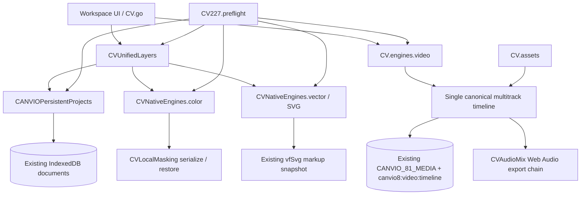

# CANVIO — AI Agent Guide (23.3 · reconciliation 2026-11-23 · main 7df9865)
> **CURRENT WORKING BASE (2026-11-23):** GitHub `main` — HEAD `7df9865c272dfd03dc3b4a6996951b89927066b8`, CANVIO `23.3.111-github-runtime-ci`, built additively on P67. P125.4 and P145.6–P145.10 are merged to main (PR #32/#33) and have hosted Node/Chromium evidence. Historical sections preserve architecture and acceptance notes; P47–P70 addenda document the integrated source chain and bounded test evidence. P70 remains blocked on fourteen real-world acceptance gates; do not treat automated CI as production certification. Use this guide before editing.
> Work surgically from the named owners/APIs below. Do not re-scan the entire HTML unless an unresolved question requires it; do not break active data synchronization or local project data. Exact inline-script/ID inventory and source/package hashes are generated by the hosted audit and `CANVIO_MANIFEST.json`. Reviewable module sources include `canvio-p63-p67.js`, `canvio-p68-p70.js`, `canvio-p127-duck.js`, and `assets/canvio-whisper-worker.js`.
> Preserve the canonical project, asset, media, timeline, history, Brand Kit, Project Vault and P8 owners. Keep tests/readiness claims bounded by their actual fixture and real-origin evidence.
>
> **P70 RELEASE-GATE BASELINE:** P70 application marker `23.3.84-p70`, base `23.3.81-p67`, PhaseSuite `70.0.0`. It adds a geometry-only self-contained OBJ viewer, read-only system resource/frame audit and a fail-closed CANVIO 1.0 release gate on top of P57–P67. Existing database, timeline, Project Vault, Asset Library, Layout Foundry and backup owners remain unchanged. P70 is integrated on GitHub `main`; the validated source tree was promoted by commit `8606375ed2671099b7b2f1713138109eec905088`, and GitHub Pages deployment completed successfully (run `#87`). Fourteen real-world acceptance gates remain open; this is not CANVIO 1.0 Stable and is not production-certified. See `CANVIO_MANIFEST.json` for current source/package SHA-256 values.

> **Historical release note:** the original 23.3.3 Prism Studio baseline and its internal `CANVIO_RELEASE.version` compatibility rule are retained in the historical guide sections. The current deliverable build is tracked by `CANVIO_BUILD.version = 23.3.84-p70`; historical values in older sections do not override this marker.
## 1. Nguyên tắc bắt buộc
- KHÔNG viết lại file từ đầu. Chỉ chỉnh sửa trong các hàm/mảng đã có.
- KHÔNG thêm dependency ngoài hoặc gọi API AI trả phí. Prompt generation hiện hữu vẫn là local-only (xem `choosePrompt()`). Ngoại lệ mạng có chủ ý: P30/P31 chỉ gửi request GET/HEAD khi người dùng bấm kiểm tra website công khai; không chạy nền, không gửi credentials, không upload/ghi website.
- KHÔNG xoá các "guard check" dạng `if(...||$('#id'))return` — chúng ngăn khởi tạo trùng khi `init()` chạy nhiều lần.
- Sau mỗi thay đổi, chạy `window.CV190Library.tests()` cho legacy Template Library và chạy regression API phù hợp với engine đã sửa (xem checklist mục 22/25); không dùng riêng CV190Library để kết luận toàn hệ thống đã PASS.

## 2. Bản đồ dữ liệu chính (tên mảng/hàm — không phải số dòng cố định vì file sẽ thay đổi)
| Thành phần | Tên trong code | Vai trò |
|---|---|---|
| Prompt packs (24 prompt) | `const PROMPTS=[...]` | Mỗi item có `cat` = `motion`/`site`/`ai`, dùng để build prompt trong Prompt Forge |
| Motion presets (6 preset) | `const MOTION_TEMPLATES=[...]` | Preset chữ động nạp vào Motion Lab |
| Hàm build thẻ preview | `motionCard()`, `promptCard()` | Render HTML cho từng thẻ trong lưới `#tplGrid` |
| Hàm chọn prompt | `choosePrompt(id)` | Ghép prompt → điền vào `#pfBrief/#pfTask/#pfRatio/#pfOutput` (Prompt Forge) |
| Hàm gửi sang công cụ khác | `sendPrompt(kind)` | Đẩy nội dung Prompt Forge sang Video Studio / ShotCraft / Image Studio |
| Hàm áp motion preset | `applyMotionTemplate(id)` | Ghi layer vào Motion Lab qua `engine.snapshotState()/restoreState()` |
| Khởi tạo toàn bộ | `init()` | Gọi theo thứ tự: `installTemplateIntro → installTemplateTabs → installPromptSuite` |
| Website showcase (5 mẫu ảnh thật) | `SITES{}` (script `#canvio191-reference-showcase`), `pageShell(id,d,spec)`, `extra(id,part)`, `ZOOM{}`, `window.CVShowcaseTemplates` | Mẫu `skyview-resort`, `horizon-residence`, `wander-atlas`, `moto-atelier`, `form-field-studio`. Thêm khối mới → sửa `extra()` + chèn `${extra(id)}` trước `.final-cta`. Click thẻ `data-use="web:<id>"` → `CV.go('autodesign')` → `A.run()` (không có luồng riêng). |
| Cờ trạng thái | `templateKind`, `promptKind`, `selectedPrompt` | State lọc hiện tại — chỉ nên có 1 nguồn sự thật, không tạo thêm biến trùng |

## 3. Luồng đồng bộ ĐANG hoạt động thật (giữ nguyên, chỉ mở rộng)
```
Poster/Motion template card
   → chọn (data-cv190-use-motion / data-cv190-use-prompt)
   → applyMotionTemplate() hoặc choosePrompt()
   → Prompt Forge (#pfBrief, #pfOutput...)
   → sendPrompt('motion'|'site'|'ai') → CV.go(page) → điền vào ô input của Video Studio/Image Studio/AI Studio
   → (tuỳ chọn) addAsset() → lưu vào Asset Library
```
Thêm tính năng mới PHẢI đi qua đúng luồng này, không tạo luồng song song.

## 4. Những gì KHÔNG nên cố làm (loại bỏ ngay nếu được yêu cầu)
- Đồng bộ hai chiều với công cụ ngoài (Canva, Figma, Google Slides...) — không có API, đừng giả lập.
- Tự động gọi model AI sinh ảnh/video thật — ngoài phạm vi file này (chỉ build prompt).
- Lưu trạng thái lên server — toàn bộ state là client-side (`localStorage`/biến JS), không có backend.

## 5. Quy ước khi thêm nội dung mẫu (Poster/Motion)
- Mỗi mẫu phải có: tên công ty/sản phẩm cụ thể, tên người + chức danh + tuổi, 1 số liệu hoặc quote thật, mô tả hình ảnh cụ thể (không orb/hình cầu trừu tượng).
- Giữ nguyên bộ token màu `--brand/--cyan/--mint/--amber/--rose/--violet` đã khai báo ở `:root` — không tự thêm bảng màu mới.
- ID mẫu mới theo đúng pattern đang dùng: `mt-<slug>` cho motion, `<prefix>-<slug>` cho prompt (`m-`, `s-`, `a-`).

## 6. Checklist trước khi báo "xong"
- [ ] `window.CV190Library.tests()` trả về toàn `true`/số > 0 cho các mục liên quan.
- [ ] Không có 2 hàm/biến làm cùng một việc (kiểm tra trùng lặp giữa `motionCard`/`promptCard`, giữa `templateKind`/`activeTemplateKind()`).
- [ ] Không có lời gọi `fetch(`, `XMLHttpRequest`, hay API key nào được thêm vào.
- [ ] Thẻ preview không còn `.cv190-orb` mặc định nếu đã yêu cầu thay bằng nội dung cụ thể.

## 7. Cách dùng file này khi giao việc cho AI
Khi nhờ AI sửa, chỉ cần nói: *"Theo CANVIO_AI_GUIDE.md, làm phần [X]"* — AI sẽ không cần đọc lại toàn bộ 13.800 dòng để hiểu bối cảnh, giúp tiết kiệm đáng kể usage mỗi phiên.

## 8. Duy trì file này (bắt buộc với AI khi sửa code)
> Stage 1 reliability addendum for base `CANVIO_23_3_12_QR_STUDIO.html` and output `CANVIO_23_3_13_STAGE1_RELIABILITY.html`: see section 38. It adds no page, store, timeline, external script or new network request.
> **Latest reliability follow-up:** `CANVIO_23_3_14_STAGE1_RELIABILITY.html` continues the 23.3.13 Stage 1 patch. See section 39 for the two follow-up fixes, current checks and remaining runtime acceptance.

File này KHÔNG tự cập nhật theo code. Nếu thay đổi của bạn làm sai lệch mục 2 (bản đồ dữ liệu) hoặc mục 3 (luồng đồng bộ) — ví dụ: đổi tên hàm/mảng, thêm mảng dữ liệu mới, thêm/đổi cách các module gọi nhau — bạn PHẢI cập nhật lại đúng mục đó trong file này ở cùng lượt sửa, trước khi báo "xong". Không cần viết lại toàn bộ guide, chỉ sửa đúng dòng/bảng bị ảnh hưởng. Mục 1, 4, 5, 6 thường không cần đổi trừ khi đổi hẳn kiến trúc hoặc phong cách thiết kế tổng thể.

---

# BỔ SUNG 22.6 — BẢN ĐỒ TOÀN HỆ THỐNG & KHOẢNG TRỐNG

> **Phạm vi cập nhật:** phần dưới đây bổ sung kiến trúc cho toàn bộ index `CANVIO_22_6_LOCAL_MASKING_STUDIO.html`. Các mục 1–8 ở trên là hướng dẫn cũ, tập trung vào module Template / Motion / Prompt Library CANVIO 19.0; chúng vẫn hữu ích khi sửa module `canvio190-template-motion-site-ai`, nhưng **không còn đủ để mô tả toàn bộ ứng dụng 22.6**.
>
> **Nguồn đã kiểm tra:** `CANVIO_22_6_LOCAL_MASKING_STUDIO.html` (đọc toàn bộ nội dung, 16.763 dòng / khoảng 3,3 MB) và `CANVIO_AI_GUIDE (1).md` (55 dòng). Phân tích tĩnh trên HTML, 76 thẻ script thực tế, 26 page section tĩnh, menu, tên API, adapter, registry, storage calls, tool parity matrix và các test hooks. Không tuyên bố runtime Chrome đã được nghiệm thu.

## 9. Danh tính bản nguồn và lưu ý phiên bản

| Mục | Kết quả đọc từ mã |
|---|---|
| File nguồn được kiểm tra | `CANVIO_22_6_LOCAL_MASKING_STUDIO.html` |
| Số dòng / dung lượng | 16.763 dòng / khoảng 3,3 MB |
| Page section tĩnh | 26 |
| Page tĩnh trên sidebar | 26 mục |
| Native engine pages | 8 trang được tạo động bởi `CVNativeSuite` |
| Script tags thực tế | 76 thẻ `<script>` được parser HTML nhận diện |
| Chuỗi `<script` khi đếm regex thô | 106 lần; số này có thể tính cả markup nằm trong chuỗi JS/template, không phải 106 thẻ DOM |
| `fetch(` | 33 vị trí trong source |
| `XMLHttpRequest` | 7 vị trí tham chiếu |
| ID tĩnh | 450 ID; không phát hiện ID trùng trong HTML tĩnh |
| Dependency script tĩnh có `src` | 0; tuy nhiên loader `canvio101-lib-loader` có thể lazy-load thư viện ngoài khi mở workspace phù hợp |
| Phiên bản module cuối | Có module 22.6 `CVLocalMasking` |
| `CANVIO_RELEASE.version` | Được module 22.6 cập nhật thành `22.6.0` khi chạy `start()` |
| `<title>` HTML | Vẫn ghi `CANVIO 22.5 — Luma HSL Mixer · Local-first Creative Suite` — **metadata chưa cập nhật theo 22.6** |

**Lưu ý:** Guide cũ mô tả file 13.800+ dòng và file 19.0; index hiện tại đã lên 16.763 dòng và chứa các lớp 20.x–22.6. Không nên dùng riêng Guide cũ để kết luận cấu trúc hiện hành.

## 10. Sơ đồ kiến trúc tổng thể

```mermaid
flowchart TB
  U["Người dùng · Sidebar · Ctrl+K · Điều hướng"]
  U --> SHELL["CANVIO App Shell / CV.go"]

  subgraph UI["A. WORKSPACES / UI LAYER"]
    COREUI["Core design & publishing<br/>Home · AI Studio · Poster · Website Builder<br/>Templates · Brand · Assets · Responsive · Motion"]
    MEDIAUI["Media & video<br/>Image Studio · Video Studio · Video Engine<br/>CapCut Engine · ShotCraft · ArtCraft · HR Visual"]
    PROUI["Production & operations<br/>Projects · Platform Hub · Portfolio<br/>Hallmark · Insight QA · Export · Collab · Settings"]
    NATIVE["8 Native Engines (dynamic pages)<br/>Pixel Atelier · Luma Develop · Vector Forge<br/>MotionCut · Motion Lab · Layout Foundry<br/>Clarity Lab · Prompt Forge"]
  end
  SHELL --> COREUI
  SHELL --> MEDIAUI
  SHELL --> PROUI
  SHELL --> NATIVE

  subgraph SHARED["B. SHARED CREATIVE CORE / CROSS-EDITOR"]
    CC["CVCreativeCore · CVStore<br/>Project context · shared creative state"]
    AS["CV.assets · Asset Library<br/>Import · metadata · reuse"]
    BRAND["Brand Kit · Design System<br/>Tokens · palettes · fonts · Style DNA"]
    LH["CVUnifiedLayers<br/>10 editor adapters · layers · undo/redo · snapshots"]
    CTX["Universal Context Workspace<br/>Quick Tools · Context Menu · sticky controls"]
    VAULT["CANVIOPersistentProjects<br/>IndexedDB Project Vault + localStorage fallback"]
  end
  COREUI --> CC
  MEDIAUI --> CC
  PROUI --> CC
  NATIVE --> CC
  COREUI <--> AS
  MEDIAUI <--> AS
  NATIVE <--> AS
  CC <--> BRAND
  COREUI <--> LH
  MEDIAUI <--> LH
  NATIVE <--> LH
  CTX --> COREUI
  CTX --> MEDIAUI
  CTX --> NATIVE
  LH <--> VAULT
  CC <--> VAULT

  subgraph SERVICES["C. ENGINES / AUTOMATION / QUALITY"]
    VIDEO["Video Engine<br/>Multitrack · trim · keyframe · filters<br/>SRT · audio · WebM / MP4 partial"]
    MOTION["Motion Lab / Shape Animation<br/>2D layers · 2–8 keyframes · easing"]
    PHOTO["Photo Tools + Luma Develop<br/>Curve · HSL · LUT · masks · retouch<br/>Batch Develop"]
    DESIGN["Design Tools / Vector Forge<br/>Pen · Bezier · SVG paths · Boolean · grid"]
    AUDIO["Audio Mix Automation<br/>Volume envelope · voice-over ducking<br/>WebM export automation"]
    QA["CVToolParity · Hallmark · Insight<br/>System QA · Ops Intelligence · usage guard"]
  end
  MEDIAUI --> VIDEO
  MEDIAUI --> AUDIO
  NATIVE --> PHOTO
  NATIVE --> DESIGN
  NATIVE --> MOTION
  UI --> QA

  subgraph EXT["D. EXTERNAL / OPTIONAL PROVIDERS"]
    GEM["Gemini API adapter"]
    OAI["OpenAI-compatible / Anthropic / custom / local registry"]
    THIRD["Firefly · Runway · Kling · Veo · ElevenLabs · stock services"]
  end
  COREUI -. "key + network + user action" .-> GEM
  PROUI -. "configured provider" .-> OAI
  MEDIAUI -. "prompt / official-service handoff" .-> THIRD

  OUT["Export & handoff<br/>PNG · JPG · WebP · SVG · HTML/CSS<br/>PDF/print · JSON/ZIP · SRT · EDL · WebM<br/>MP4 / 4K: partial, browser-dependent"]
  COREUI --> OUT
  MEDIAUI --> OUT
  PROUI --> OUT
  NATIVE --> OUT
```




### Đọc sơ đồ đúng cách

- Các workspace là bề mặt làm việc. Không phải workspace nào cũng là một engine độc lập.
- `CVNativeEngines` chứa 8 editor native. Các trang này được tạo động, không xuất hiện thành section tĩnh ban đầu.
- `CVUnifiedLayers` và `CANVIOPersistentProjects` là lớp dùng chung cho một tập editor được adapter hỗ trợ; **không mặc định mọi page đều có cùng mức snapshot/undo/persistence**.
- `CapCut Creative Engine` chủ yếu là lớp điều phối/handoff; chỉnh sửa đa track thực tế chạy trên Video Engine hiện hữu.
- Provider cloud là tùy chọn. Không được ghi một prompt handoff thành tính năng AI generation native.

## 11. Bản đồ workspace tĩnh (26 page sections)

| Page ID | Workspace | Chức năng đọc được từ index |
|---|---|---|
| `home` | Tổng quan | Prompt khởi tạo, 6 lối vào chính, dự án gần đây, trạng thái hệ thống |
| `studio` | AI Studio | Brief/prompt, quy trình, đề xuất, ảnh nền, phần tích hợp Gemini/API |
| `poster` | Poster Studio | Thiết kế poster, nhiều trang, layer, text/shape/image, căn chỉnh, zoom, undo/redo, export |
| `web` | Website Builder | Dựng nội dung, palette, preview, xuất HTML |
| `templates` | Thư viện mẫu | Template và component library, bộ lọc và prompt/motion packs |
| `brand` | Brand Kit | Palette, font, quy tắc, preview và kiểm tra tuân thủ thương hiệu |
| `assets` | Asset Library | Nhập, quản lý, tìm/lọc và tái sử dụng hình/logo/media cục bộ |
| `responsive` | Đa kích thước | Tạo biến thể theo nhiều tỷ lệ/kênh, xuất biến thể |
| `motion` | Chuyển động | CSS motion presets, timing, preview và mã CSS tái sử dụng |
| `imageStudio` | Image Generation Studio | Prompt queue, cấu hình, ảnh tham chiếu, theo dõi tác vụ/handoff |
| `videoStudio` | Video Studio | Brief/kịch bản, storyboard/shot list, media library, preview, timeline, export |
| `hallmark` | Design Intelligence | Heuristic design audit, creative direction, nguyên tắc và đề xuất cải thiện |
| `insight` | Đo lường & QA | Điểm thiết kế, 12 quy tắc/tiêu chí, attention map và gợi ý cải thiện |
| `projects` | Project Command Center | Brief, prompt composer, production board, workspace đang chọn, release gate |
| `export` | Export Center | Đóng gói, chia sẻ nhanh, kiểm tra trước khi phát hành |
| `collab` | Cộng tác | Ghi chú và activity log cục bộ; chưa phải cộng tác real-time đa người dùng |
| `settings` | Hệ thống | Module status, local data và extension settings |
| `platform` | Unified Platform Workbench | Workspace launcher, workflow, module registry, Data Workspace, Report Studio, Provider Registry, Backup/Recovery |
| `designEngine` | Designer Workspace (Konva) | Artboard/canvas, object/layer inspector, typography, transform, selection và design tools |
| `webEngine` | Website Engine (GrapesJS) | Component/block/style builder, preview và xuất HTML/CSS; lazy-load thư viện |
| `capcutEngine` | CapCut Creative Engine | Điều phối Video Engine, Video Studio/ShotCraft, Motion Lab, provider entry points và parity |
| `videoEngine` | Video Production Engine | Multitrack timeline, video/image/text/audio clip, trim, properties, preview và render |
| `portfolioStudio` | Portfolio Studio | Case-study builder, thông tin dự án, nội dung, gallery, preview/export HTML |
| `hrvisual` | HR Visual Studio | Tạo avatar/visual/banner HR bằng asset/SVG/local generation và nguồn ngoài tùy chọn |
| `artcraft` | ArtCraft Engine | Composition/scene workflow, model selection, craft prompt/preview, lưu composition |
| `shotcraft` | Video ShotCraft | Shot-by-shot planning, lens/angle/motion/duration, quick-add và summary |

## 12. Bản đồ 8 Native Engines (tạo động)

| Native engine | ID | Chức năng hiện hữu trong code | Khoảng trống quan trọng |
|---|---|---|---|
| Pixel Atelier | `pixelStudio` | Raster workspace; mở ảnh, vẽ/brush, text, shape, crop/transform/flip/rotate, filter, undo/redo, export và gửi Asset Library | Chưa có PSD round-trip/Smart Object, content-aware fill, neural filters; dung lượng/hiệu năng ảnh lớn phụ thuộc canvas |
| Luma Develop | `colorStudio` | Develop sliders, auto, before/after, histogram, preset, Curve/HSL 8 dải, LUT `.cube`, 22.6 masks và Batch Develop | Mask 22.6 chưa lưu vào Project Vault; batch chưa áp local masks; chưa có RAW/DNG decode và ICC workflow |
| Vector Forge | `vectorForge` | Shape/text/path, Pen, Bezier utilities/handle editing, SVG path import-to-nodes, Boolean operations, grid/snap, SVG/PNG export | Cần nghiệm thu node handles/path imported; chưa có Gradient Mesh tương đương Illustrator, symbol/library system và typography chuyên sâu |
| MotionCut | `motionCut` | Native motion/video editing workspace với clips/canvas/actions/export; có adapter riêng trong Unified Layers | Có timeline/editor state riêng cạnh Video Engine; cần quyết định rõ vai trò hoặc hợp nhất workflow, không tạo timeline thứ ba |
| Motion Lab | `motionLab` | 2D motion graphic, presets, easing, multi-layer shape animation, 2–8 keyframes; xuất clip sang Video Engine track 4 | Chưa có expression engine, particle system, 3D compositing/camera, tracking/roto và full graph editor |
| Layout Foundry | `layoutFoundry` | Multi-page document layout, pages, margins/columns, text/image/table, preview, print/PDF và export HTML/asset | Preflight 22.3 là kiểm tra cấu trúc/nội dung, không phải preflight nhà in đầy đủ; thiếu master pages, bleed/CMYK/ICC và package fonts/links |
| Clarity Lab | `clarityLab` | Local image enhance: upscale 2×/4× kiểu canvas, sharpen, denoise cơ bản, color-key background removal, WebP/JPEG, batch/ZIP helper | Không phải neural super-resolution/AI segmentation; cần mô hình chuyên dụng để đạt tương đương Topaz/Remove Tool |
| Prompt Forge | `promptForge` | Chuyển brief thành prompt có cấu trúc, chọn target/task/ratio/output, copy/export, handoff sang workspace khác | Bản thân Prompt Forge không sinh ảnh/video; chất lượng model phụ thuộc provider ngoài hoặc dịch vụ chính thức |

## 13. Các lớp dùng chung và dữ liệu

### 13.1 Creative Core / Asset / Brand

- `CVCreativeCore` / `CVStore`: context và shared creative state để các workspace biết project/brand/asset liên quan.
- `CV.assets`: Asset Library dùng chung; các module native có `addAsset`/handoff và đọc lại tài nguyên.
- Brand Kit / Creative System Library / Design System: màu, font, palette, token, style DNA, apply style.
- `CVGlobalDesignToolkit`: font catalog/loading, color/palette, shape SVG, shared controls và background helper.

### 13.2 Unified Layers & History

`CVUnifiedLayers` có 10 editor adapter được khai báo rõ:

`poster`, `designEngine`, `pixelStudio`, `colorStudio`, `vectorForge`, `motionCut`, `motionLab`, `layoutFoundry`, `clarityLab`, `videoStudio`.

API chính: `open`, `refresh`, `undo`, `redo`, `canUndoFor`, `canRedoFor`, `capture`, `exportSnapshot`, `restoreState`, `snapshotState`, `adapters`, `tests`. History trong module này dùng snapshot/in-memory queue với giới hạn 24 trạng thái/editor. Một số editor còn có history riêng.

**Cần lưu ý:** `videoEngine`, `web`, `webEngine`, `portfolioStudio`, `shotcraft`, `artcraft` không nằm trong danh sách 10 adapter của `CVUnifiedLayers`; có context editing/asset handoff không đồng nghĩa đã có cùng adapter lịch sử và snapshot.

### 13.3 Project Vault

- API: `CANVIOPersistentProjects` — `save`, `saveEditor`, `restore`, `restoreRecord`, `list`, `backup`, `render`, `tests`.
- IndexedDB: database `CANVIO_PROJECT_VAULT_18_7`, object store `documents`.
- Fallback: `localStorage` key `canvio18.7:fallbackDocs` (có giới hạn payload trong module).
- Autosave hooks bao quanh các mutator của editor thuộc adapter.
- Backup/restore dạng JSON có format `CANVIO_PERSISTENT_PROJECTS`.
- Project Command Center (`page-projects`) và Project Vault (`page-projectVault`, được module tạo động) là **hai vai trò khác nhau**: quản trị brief/tiến độ so với lưu/mở snapshot editor.

### 13.4 Các IndexedDB database được gọi trong source

- `CANVIO_PROJECT_VAULT_18_7` — persistent project documents.
- `CANVIO_81_MEDIA` — media storage.
- `canvio11cv` — dữ liệu ứng dụng đời cũ.
- `canvio13` — page/state storage đời cũ.
- `canvio16-music` — music-related state/assets.
- `canvio-global-fonts` — font storage.
- `canvio18_9_context` — context editing data.

Nhiều localStorage key theo thế hệ (`canvio5`, `canvio8`, `canvio10`, `canvio11`, `canvio13`, `canvio15`–`canvio22`) vẫn còn để tương thích. Đây là kiến trúc tiến hóa nhiều lớp, không phải một database duy nhất. **Không tự ý migrate/xóa các key cũ.** Khi thêm persistence mới, phải xác định owner và schema trước.

### 13.5 Context editing / Undo / navigation

`CANVIOContextWorkspace` có context menu chuột phải và quick tools chuột trái, zoom-at-pointer, duplicate, group, rename, visibility/lock, copy/paste style, page operations, alt-text/comments và sticky contextual controls. Danh sách editor của lớp context rộng hơn danh sách unified layer adapters; hai danh sách không được coi là một.

## 14. Video, audio, motion và publishing hiện tại

| Module | Tình trạng hiện hữu trong code | Giới hạn phải ghi rõ |
|---|---|---|
| Video Engine | Multitrack timeline, trim/split, clip properties, image/video/text/audio tracks, per-clip volume, filters, keyframes, chroma key, transition/fade, speed control, AutoCut, WebM render, SRT import/export và EDL | MP4/4K phụ thuộc browser codec/GPU, không được cam kết như native encoder; multicam/ML tracking/stabilization không có |
| CapCut integration | `CV.capcut` adapter/status + CapCut Engine điều phối tới Video Engine và các studio | Không phải bản sao CapCut desktop/cloud; CapCut Pro premium cloud tools vẫn là handoff/partial/missing |
| Video Studio | Kịch bản, shot list, media queue, preview, timeline/storyboard/export | Handoff/queue không chứng minh đã sinh video AI native |
| Video Scopes | RGB/Luma histogram, waveform, clipping stats; PiP overlay có thể kéo và resize trên preview; chỉ chạy khi bật | Phân tích canvas preview, không phải toàn bộ color-managed scopes/reference monitoring |
| Motion Lab / Shape Animation | Nhiều shape layer, 2–8 keyframes/layer, easing, CSS/WAAPI, preview, undo/redo, xuất clip sang track 4 Video Engine | Không thay thế After Effects đầy đủ; không có expressions/particles/tracking/roto/full 3D |
| Subtitle Designer | Style caption/text clips trên timeline hiện hữu; hỗ trợ SRT workflow | Auto speech-to-text, diarization, translation/AI TTS là provider handoff, không phải native recognition |
| Audio Mix 22.4 | Volume envelope per clip; voiceover-driven ducking; gain automation dùng trong WebM export | Chưa xác nhận realtime preview, loudness metering, EQ, compressor/limiter, noise removal và full audio bus routing |
| Layout Foundry | Multi-page layout, page controls, text/image/table, print via browser, export | Không tương đương production workflow InDesign/Prepress |
| Website Engine | GrapesJS lazy-loaded builder, block/component/style, preview, HTML/CSS; CMS/page/SEO modules đời trước | Hosting, production CMS, auth/database và collaborative deployment không có backend native |
| Portfolio Studio | Case study builder, gallery, preview và standalone HTML export | Không có hosted portfolio service hoặc team publishing server |

## 15. Tool Parity Matrix — số liệu và cách hiểu

Trong `CVToolParity`, ma trận hiện có **113 mục chức năng** được phân loại:

| Mã | Ý nghĩa theo source | Số mục |
|---|---|---:|
| `N` | Có sẵn trong CANVIO / mở công cụ | 59 |
| `P` | Một phần, có giới hạn | 11 |
| `H` | Bàn giao AI / mở dịch vụ chính thức / phụ thuộc provider | 32 |
| `T` | Chưa có nhưng có thể code | 0 |
| `X` | Không khả thi trung thực nếu thiếu backend/ML/phần mềm đóng/bản quyền | 11 |
| **Tổng** |  | **113** |

Đây là **nhãn parity do source định nghĩa**, không phải 113 bài test đã pass. Matrix là nguồn tham khảo tốt để thấy khoảng cách, nhưng đã có chỗ chưa theo kịp code 22.3–22.6:

- Photoshop brush/mask và Healing: Photo Tools 21.9 đã có brush mask/undo/redo và clone/heal; 22.6 có local masks riêng trong Luma. Ghi chú matrix còn cũ ở một số dòng.
- Lightroom batch: 22.6 có Batch Develop local JPEG/PNG/WebP tối đa 40 ảnh; matrix cũ chỉ mô tả batch export một phần.
- InDesign preflight: 22.3 có Layout Foundry preflight cơ bản, nhưng matrix `X` mô tả preflight in chuyên dụng. Cần tách `content/layout QA` khỏi `prepress preflight`.
- Illustrator Pen/Bezier: module Design Tools có Bezier utilities/handle functions và path import-to-nodes; ghi chú parity cũ nói chưa có handles/path editing. Cần xác minh UI runtime rồi cập nhật status, không giữ mô tả lỗi thời.
- Video/CapCut: matrix có một số chức năng AI hoặc tính năng Pro lặp dòng; cần chuẩn hóa ID tính năng và tránh đếm trùng.

## 16. Khoảng trống còn thiếu — ưu tiên thực hiện

### P0 — Độ tin cậy, release hygiene và nghiệm thu

1. **Cập nhật metadata 22.6:** sửa `<title>` từ 22.5 lên 22.6; đồng bộ release metadata/changelog và version hiển thị. `CANVIO_RELEASE` có set 22.6, nhưng title chưa đổi.
2. **Nâng cấp AI Guide:** map 19.0 ở mục 2–3 không còn đại diện toàn app; bổ sung module map 22.6, 8 native engines, adapter list, data owners và parity status (bản bổ sung này là điểm bắt đầu).
3. **Runtime acceptance trên Chrome:** mở mọi static/dynamic page; xác minh lazy-load Konva/GrapesJS, event listener/guard, console errors, canvas pointer, media import, save/restore và export file.
4. **Chạy regression thật:** `CV190Library.tests()`, `CVNativeSuite.tests()`, `CVUnifiedLayers.tests()`, `CANVIOPersistentProjects.tests()`, `CANVIOContextWorkspace.tests()`, `CVToolParity.tests()`, `CVVideoScopes.tests()`, `CVDesignTools.tests()`, `CVPhotoTools.tests()`, `CVShapeAnim.tests()`, `CVProNativeTools.tests()`, `CVLumaHSL.tests()`, `CVLocalMasking.tests()`, `CANVIOSystemQA.run()` khi module/page liên quan đã nạp.
5. **Đồng bộ Tool Parity Matrix:** status N/P/H/T/X phải phản ánh 22.6 và phân biệt tính năng native, partial, provider handoff và không khả thi.

### P1 — Project state, masks và lịch sử

1. **Lưu Masking Studio 22.6:** `CVLocalMasking` giữ `state.masks` trong bộ nhớ; `engine.load` gọi `resetMasksForImage()`. `getMasks()` chỉ trả metadata; chưa có serialize/restore gắn vào Luma snapshot hoặc Project Vault. Đây là thiếu hụt rõ ràng.
2. **Undo/redo cho mask 22.6:** chưa có mask history riêng tương đương `CVPhotoTools.maskUndo/maskRedo`; cần nối vào history hiện hành, không tạo history store thứ hai.
3. **Mask editor ergonomics:** handles để di chuyển/xoay/thay kích thước Linear/Radial; chỉnh feather/transition range; brush hardness/flow/pressure; subtract/intersect mask; mask name/duplicate.
4. **Tích hợp Batch Develop với mask:** hiện batch chỉ lấy global Develop values + HSL; mask gắn ảnh đang mở không áp cho batch. Cần preset mask có anchor/geometry hoặc thông báo rõ không hỗ trợ.
5. **Snapshot parity:** xác minh mọi chỉnh sửa 22.3–22.6 (Bezier paths, shape/motion keyframes, caption styling, audio envelopes, HSL, local masks, batch settings) có được snapshot, autosave, restore và undo đúng không.
6. **Video editor mapping:** `CVUnifiedLayers`/Project Vault liệt kê `videoStudio`, nhưng UI còn `videoEngine` và `motionCut`; cần xác định một nguồn project/timeline chuẩn và test alias/restore. Không thêm timeline thứ hai.
7. **Unified media identity:** thống nhất cách project tham chiếu asset ID, file URL/Blob và metadata; kiểm tra khi restore project sau reload hoặc xóa/reimport asset.

### P2 — Nâng parity sáng tạo native

**Photo / Photoshop / Lightroom**
- RAW/DNG decoder và profile-aware pipeline (ICC/color management).
- Non-destructive adjustment stack lưu theo project; layer mask có thể tái chỉnh sửa; smart object tương đương; PSD import/export round-trip nếu có parser/encoder hợp lệ.
- Healing/content-aware fill, generative fill, subject/object/background segmentation chất lượng cao cần thuật toán/model/compute phù hợp.
- Batch Develop cần crop/straighten, metadata, filename rules, preset/mask mapping, ZIP export và báo lỗi từng file.
- Đồng nhất pipeline HSL/Curve/LUT giữa Photo Tools, Luma Develop và Batch; hiện có nhiều đường xử lý riêng cần pixel parity tests.

**Vector / Illustrator**
- Gradient Mesh thật (nhiều node/màu nội suy), mesh handles.
- Path editing hoàn chỉnh cho SVG nhập vào: node type, tangent handles, compound path, stroke/fill rules, boolean trên nhiều loại đối tượng.
- Symbol/component library, text-on-path, advanced typography, variable fonts, export profile và SVG compatibility suite.

**Video / Premiere / CapCut**
- Browser-safe MP4/H.264/AAC encoder hoặc backend encoder có giấy phép; đảm bảo không tuyên bố MP4/4K native khi chỉ phụ thuộc MediaRecorder/browser.
- Proxy media, cache, waveform generation, frame-accurate seek, media relink và performance cho project dài.
- Multicam sync, audio/video sync, stabilization, motion/object tracking, roto/subject segmentation.
- Beat detection tự động thực sự (không chỉ BPM nhập tay/prompt), speed curves nhiều điểm, keyframe curves và transition/effect stack sâu hơn.
- Audio realtime preview có envelope; EQ, compressor, limiter, LUFS meter, noise reduction, bus/routing, ducking sidechain nâng cao.
- Speech-to-text, diarization, auto captions và translation chỉ đánh dấu native khi có engine local/provider thật; không chỉ nút handoff.

**Motion / After Effects**
- Graph Editor với tangent handles, spatial path, graph easing; expressions có sandbox; particle system; 3D camera/lights/compositing; motion tracking/roto.

**Layout / InDesign**
- Master Pages/parent pages, paragraph/character/object styles, baseline grid, linked text frames, automatic page numbering.
- Prepress: bleed, slug, crop marks, embedded fonts, image DPI/link report, spot colors, CMYK/ICC và package toàn bộ assets/fonts.
- PDF export production-grade được xác minh bằng PDF validator/preflight, không chỉ print dialog.

### P3 — Hệ thống và dịch vụ

- Collaboration real-time: authentication, roles thật, server persistence, conflict resolution, presence và multi-device sync. Hiện `Collab` chủ yếu là ghi chú/activity local; guide 19.0 cũng xác nhận không có backend.
- Asset/stock library có license, rights metadata và audio/music catalog. Không dùng asset có bản quyền không rõ nguồn.
- Provider adapters có schema/API/auth/quota/error handling thống nhất; chỉ gọi theo thao tác người dùng, có usage guard và không polling nền.
- Offline/PWA đầy đủ, font/media dependency fallback và kiểm tra CSP/CDN. Hiện lazy-loader có thể gọi thư viện ngoài.
- Accessibility QA sâu (keyboard, screen reader, contrast theo WCAG, focus order) và visual regression automation.

## 17. Rủi ro kiến trúc phải tránh khi giao AI khác

- Không tạo thêm Project Store, Asset Store, Layer Store, Timeline Store hoặc History Store.
- Không coi `page-capcutEngine` là timeline video thực; tuyến chỉnh sửa chính là Video Engine hiện hữu.
- Không coi `Prompt Forge` / provider handoff là AI generation nội bộ.
- Không coi 22.3 Layout Preflight là prepress/print preflight.
- Không coi WebM export là MP4/H.264 encoder; MP4/4K cần kiểm thử codec thực tế.
- Không đánh đồng `CVUnifiedLayers` 10 adapters với `CANVIOContextWorkspace` editor list rộng hơn.
- Không giả định local masks 22.6 được lưu qua reload; hiện chưa có serialize/restore.
- Không xóa localStorage/IndexedDB cũ hoặc migrate schema nếu chưa có backup và regression.
- Không thêm CDN/API/polling/background requests nếu chưa có yêu cầu, giới hạn usage và tests.
- Giữ init guard ở các module; không gọi `init()` lặp khiến listener/toolbar/card bị nhân đôi.

## 18. Checklist cho lần sửa tiếp theo

- [ ] Xác định module owner và API có sẵn trước khi viết code.
- [ ] Dùng một nguồn state hiện hữu; không tạo store thứ hai.
- [ ] Cập nhật map/guide nếu đổi page ID, API, adapter, schema, flow hoặc storage owner.
- [ ] Bổ sung test logic cho sanitize/serialize/restore/undo và giới hạn dữ liệu.
- [ ] Chạy test API sau khi module đã mount; ghi rõ `PASS / FAIL / MISSING`.
- [ ] Runtime test trên Chrome thật: mouse, keyboard, canvas, import, save/reload, restore, export.
- [ ] Mở output export bằng ứng dụng/validator phù hợp; không chỉ xác nhận Blob tồn tại.
- [ ] Ghi rõ hạn chế browser/provider/codec/license; không dùng từ “đã thay thế hoàn toàn” khi chưa chứng minh.
- [ ] Kiểm tra static page IDs, dynamic page IDs, duplicate IDs, event guard, script tag count và network call count.

## 19. Kết luận audit 22.6

CANVIO hiện là một **local-first Creative Production Suite nhiều workspace**, không còn chỉ là template/prompt library. Nền tảng đã có nhóm thiết kế, raster/photo, vector, layout, website, motion, video, audio, AI prompt/provider handoff, assets, brand, project, QA và publishing. Lớp shared core, asset library, unified layer adapters và Project Vault tạo nền cho việc liên kết các workspace.

Khoảng trống lớn nhất không phải là thiếu thêm menu. Đó là **độ phủ snapshot/restore cho mọi editor, lưu mask 22.6, thống nhất timeline/project/media, kiểm chứng codec/export và khoảng cách tới các tính năng dựa trên ML/backend/định dạng proprietary**. Nên ưu tiên các mục P0/P1 trước khi thêm nhiều UI mới.


---

# 20. BẢN ĐỒ VÀ DATA OWNERS 22.7

> **Release:** `CANVIO 22.7.0` · **Codename:** Project Intelligence & Creative Power. Bản này additive trên 22.6, không viết lại ứng dụng.

## 20.1 Release metadata
- HTML `<title>`: `CANVIO 22.7 — Project Intelligence & Creative Power · Local-first Creative Suite`.
- Runtime metadata được chuẩn hóa bởi module cuối `CANVIO 22.7 · PROJECT INTELLIGENCE & CREATIVE POWER`: `CANVIO_RELEASE.version = 22.7.0`.
- Namespace release mới: `window.CV227` (`version`, `tests`, `audit`, `preflight`, `mask`, `timeline`, `vectorMesh`, `audioMaster`).
- Module 22.7 được nối vào script block hiện hữu cuối HTML; không thêm thẻ `<script>` mới.

## 20.2 Sơ đồ dữ liệu chủ sở hữu


Sơ đồ vector tải riêng: `CANVIO_22_7_SYSTEM_MAP.svg`; bản xem nhanh: `CANVIO_22_7_SYSTEM_MAP_preview.png`.



## 20.3 Luma project snapshot schema
`CVUnifiedLayers` color adapter chuyển sang `snapshotProjectState()` / `restoreProjectState()`. Luma project snapshot chứa:

```js
{
  __canvioLumaProject: 1,
  source: "data:image/png;base64,...", // decoded image at Luma working dimensions
  values: { exposure: 0, contrast: 0, /* Develop + 8 HSL bands */ },
  masks: {
    version: 1,
    width: 0,
    height: 0,
    active: "mask-id",
    masks: [{ id, name, type, enabled, visible, invert, opacity,
      exposure, temperature, saturation, contrast,
      data: "data:image/png;base64,..." }]
  },
  updatedAt: "ISO-8601"
}
```

- Legacy flattened PNG snapshot vẫn được nhận diện qua `restoreState()` fallback để đọc record cũ.
- `CVLocalMasking.serialize()` giữ tối đa 12 masks; tổng base64 mask payload bị giới hạn ở 26 MB khi restore.
- `CVLocalMasking.addColorRange(hex,tolerance)` và `addLuminanceRange(low,high,feather)` tạo mask local dựa trên pixel ảnh đang mở; đây là heuristic pixel-range selection, không phải AI semantic selection.
- Mask thao tác qua Luma có thể đi vào `CVUnifiedLayers.capture('colorStudio', ...)`; save debounced qua `CANVIOPersistentProjects.saveEditor('colorStudio', ...)`.
- Mask vẫn là canvas raster masks, không phải vector mask.

## 20.4 Project Vault version snapshots
- Version history nằm trong **cùng record** của IndexedDB object store `CANVIO_PROJECT_VAULT_18_7.documents`; không tạo DB/object store mới.
- `versions` giữ tối đa 2 state trước trong mỗi editor record; state cũ chỉ được lưu nếu JSON serialized ≤700 KB và không chạy fallback localStorage.
- Các state lớn (ví dụ ảnh raster/mask nặng) được bỏ qua lịch sử bản cũ để tránh tăng quá mức dung lượng. Current snapshot vẫn theo cơ chế Project Vault hiện có.
- UI history bổ sung vào page Project Vault; restore version gọi `CVUnifiedLayers.restoreState` rồi lưu thành current state qua `saveEditor`.
- Đây là bounded snapshot history, không phải versioning vô hạn, branching hay collaboration server.

## 20.5 Unified Timeline & Media Bridge
- **Canonical multitrack timeline:** `CV.engines.video._state()`; dữ liệu được lưu tại `canvio8:video:timeline`, media blobs ở IndexedDB `CANVIO_81_MEDIA`.
- CapCut/Premiere-style controls trong 22.7 tiếp tục thao tác đúng timeline này; 22.7 không tạo timeline mới.
- `CV.engines.video.hasMedia(mediaId)` probe blob trong media DB hiện hữu.
- **Trước khi chạy media audit**, mở Video Engine ít nhất một lần để module khởi tạo IndexedDB `CANVIO_81_MEDIA`; nếu audit chạy trước khi DB sẵn sàng, trạng thái media có thể là unavailable/chưa xác định chứ không được kết luận blob đã mất.
- Clip có thể có metadata tham chiếu `assetRef: {id,name,mime,linkedAt}` trỏ đến Asset Library. Metadata này **không thay media source**.
- “Chèn asset thành clip mới” dùng `CV.engines.video.addAsset(assetId)` và có thể tạo clip mới trên timeline canonical.
- MotionCut vẫn là workspace/editor timeline riêng; 22.7 không tự động merge MotionCut state vào Video Engine vì chưa có migration/semantic mapping đã kiểm thử.
- Timeline audit kiểm tra duplicate clip IDs, mediaId thiếu, blob không còn trong IndexedDB và timeline save key. Đây là audit dữ liệu client-side, không thay thế relink UI cho từng trường hợp.

## 20.6 Audio Master Studio
- UI được gắn trong Video Engine, thao tác trên audio clip đang selected.
- Schema lưu trong chính clip: `audioFx = { enabled, lowDb, midDb, highDb, midHz, threshold, ratio, attack, release, limiterDb }`.
- `CVAudioMix.attach()` tạo chuỗi Web Audio `Gain → lowShelf → peaking → highShelf → DynamicsCompressor → limiter` chỉ khi `audioFx.enabled`.
- EQ / compressor / limiter hiện áp dụng trong WebM export path của `CVAudioMix`; chưa xác nhận preview realtime. Browser output/codec và audio device vẫn cần kiểm tra thực tế.

## 20.7 Vector Mesh Studio
- Tạo một group `.vf-object[data-type="gradient-mesh"]` trong SVG `#vfSvg`.
- 3×3 màu node điều khiển nội suy bilinear theo từng ô, được tessellate thành 200 tam giác SVG (triangulated gradient approximation).
- SVG markup được lưu bởi snapshot hiện hữu `CVNativeEngines.vector.snapshotState()` / restore.
- Đây là **triangulated SVG mesh approximation**, không phải native Illustrator Gradient Mesh object (có node/tangent mesh handles thật).

## 20.8 QA Center / API contract
- `CV227.preflight()` trả object `version`, `createdAt`, `checks[]`, `summary`.
- Trạng thái `PASS` ở preflight biểu thị API/logic presence, không phải runtime acceptance.
- Check `Chrome runtime acceptance` cố ý vẫn là manual/open cho đến khi kiểm thử trong Chrome thật: pointer/canvas, audio export playback, reload/restore, media recovery, exported artifact validation.
- `CV227.tests()` xác nhận release, mask snapshot APIs, range mask APIs, Project Vault, video owner/media probe, vector snapshot, Audio Mix và QA panel.

## 21. API và data ownership cần giữ khi sửa tiếp

| Data / feature | Single owner | Không được tạo thêm |
|---|---|---|
| Project records + bounded versions | `CANVIOPersistentProjects` / existing `documents` | Project DB / versions DB riêng |
| Editor undo/redo + snapshots | `CVUnifiedLayers` + editor-native history | History store mới |
| Luma Develop + HSL values | `CVNativeEngines.color` | Luma state store thứ hai |
| Luma masks | `CVLocalMasking` closure, serialize vào Luma snapshot | Mask DB riêng |
| Asset metadata | `CV.assets` | Asset Library thứ hai |
| Video multitrack clips | `CV.engines.video._state()` | CapCut/Premiere timeline copy |
| Video source blobs | `CANVIO_81_MEDIA` | Media DB mới |
| Audio FX | `clip.audioFx` trên video timeline | Audio project store riêng |
| Vector mesh artwork | `#vfSvg` + Vector Forge snapshot | Vector Mesh DB riêng |

## 22. Kiểm tra và acceptance 22.7

### Static/logic checks đã chạy khi build
- [x] JavaScript inline parse: 76/76 inline script blocks qua `node --check`, 0 lỗi cú pháp.
- [x] HTML DOM parser: 76 thẻ script thực, 450 ID tĩnh, 0 ID trùng; giữ nguyên so với 22.6.
- [x] Giữ nguyên 33 `fetch(`, 7 `XMLHttpRequest`, 0 static `<script src>` DOM elements.
- [x] Bảo toàn 76 thẻ script thực tế.
- [x] Bảo toàn số lần `fetch(` (33) và `XMLHttpRequest` (7) so với base 22.6.
- [x] Không thêm `script src`, CDN, module import, dependency hoặc endpoint mới.
- [x] Không thêm database/object store/timeline/history/asset store.
- [x] Node VM test: `CV227` namespace tạo được; RGB round-trip, audio-FX clamps và mesh triangle count pass.
- [x] Mock Web Audio graph: chain bật = Gain → 3× Biquad → Compressor → Limiter → MediaStreamDestination; bypass = Gain → MediaStreamDestination; stop restores Gain → AudioContext destination.

### Manual runtime acceptance còn mở
- [ ] Mở CANVIO bằng Chrome thật, kiểm tra console và từng dynamic workspace.
- [ ] Luma: open image → mask brush/range → save editor → reload → restore; kiểm tra pixel mask và Develop values.
- [ ] Luma: Undo/Redo một thay đổi mask và restore version snapshot.
- [ ] Project Vault: IndexedDB save/read, bounded versions và backup/restore trên project thật.
- [ ] Video: import media, reload, kiểm tra blob, Asset reference metadata, add asset clip mới.
- [ ] Audio: audio clip + Audio FX → WebM export → phát file bằng media player và nghe kiểm tra EQ/compression/limiting.
- [ ] Vector: create mesh → select/rename/duplicate/delete → snapshot/reload → xác minh SVG không mất.
- [ ] QA report: xác minh MISSING/WARN và không đánh dấu runtime PASS nếu chưa thực hiện.
- [ ] Exported PNG/JPEG/WebP/SVG/PDF/WebM mở được bằng ứng dụng/validator phù hợp.

## 23. Những giới hạn vẫn còn sau 22.7

- Version history chỉ giữ tối đa 2 snapshot nhỏ/editor và không lưu snapshot lớn hơn 700 KB; không phải branching/long-term version tree.
- Range Mask là pixel RGB/luminance heuristic; chưa có semantic subject/object segmentation, refine edge AI, pressure-aware brush, geometric handles cho mọi mask.
- Timeline bridge có audit và Asset Library reference; chưa thực hiện replace-in-place relink tự động cho blob video mất.
- MotionCut vẫn là editor riêng, chưa có migration được nghiệm thu sang timeline Video Engine.
- Audio FX áp dụng khi WebM export, chưa realtime preview; Web Audio dynamics processing không tương đương DAW/mastering plugin suite.
- Vector Mesh là 3×3 control-color triangulated SVG approximation, không có mesh tangent handles hoặc định dạng proprietary round-trip.
- Browser runtime, GPU behavior, codec availability, long-project performance và exported file validity vẫn cần manual Chrome acceptance.
- Không có AI cloud generation, server sync, paid provider entitlement hoặc premium asset licenses tự động.

## 24. Release handoff

Khi giao việc cho AI tiếp theo, dùng:

> Đọc `CANVIO_AI_GUIDE_22_8_UPDATED.md` trước. Dùng `CANVIO_22_9_INTERACTIVE_SPATIAL_WORKSPACE.html` làm base. Chỉ chỉnh additive trong module/API hiện có; không viết lại app, không thêm dependency/CDN/API/polling, không tạo project/asset/history/timeline/database thứ hai. Giữ data owners và snapshot contracts ở mục 20–21. Chạy các test và checklist mục 22; ghi rõ runtime items chưa thể thực hiện, không tuyên bố chúng PASS.


---

# 25. CANVIO 22.8 — SPATIAL 3D INTERFACE SYSTEM

> **Release:** `22.8.0` · **Codename:** `Spatial 3D Interface` · **Base:** `CANVIO_22_7_PROJECT_INTELLIGENCE_CREATIVE_POWER.html`. This release adds a CSS-only presentation layer over the 22.7 application. It does not change engine ownership, editor state, project schema, storage, provider adapters, or media timeline ownership.

## 25.1 Design direction
- Visual language: **Glass Titanium / Spatial Studio** — cool light surfaces, soft ambient aurora, transparent glass shell, machined/beveled controls, layered elevation and clear focus states.
- Depth comes from CSS perspective/3D transforms on non-canvas UI, layered gradients, inset highlights and multi-level shadows. It is a 3D-inspired interface, **not** a WebGL/3D scene renderer.
- Keep the editing surface readable and precise: do not rotate/tilt interactive canvases, SVG editing coordinates, timeline tracks or media preview frames.
- Accent palette remains derived from CANVIO brand tokens: indigo, cyan, mint, amber, rose and violet.

## 25.2 CSS implementation
- One stylesheet is appended at the end of the document body: `<style data-canvio228-spatial-ui="true">`.
- The stylesheet overrides shared tokens and visual classes without changing existing HTML IDs or adding new JS modules.
- Main selectors covered: `.app`, `.side`, `.logo`, `.nav`, `.main`, `.top`, `.page`, `.hero`, `.card`, `.stat`, `.quickCard`, `.pvCard`, `.assetCard`, `.tplCard`, `.btn`, `.tbtn`, `.field`, `.toolbar`, `.canvasWrap`, `.stage`, `.engine-workspace`, `.timeline-track`, `.timeline-clip`, `.cv11-*`, `.cv223-*`, `.cv227-*`, `.modal`, `.palette`, `.toast`.
- Responsive shell rules are defined for `max-width:1240px`, `max-width:960px`, and `max-width:600px`. Existing mobile drawer behavior (`body.navOpen .side`) is retained and restyled.
- `prefers-reduced-motion: reduce` disables nonessential transitions/animations. Keyboard focus receives a visible outline. Print media resets glass/shadows and hides app chrome.

## 25.3 Preserved architecture and data ownership
- No changes to `CV.go`, page IDs, editor APIs, Project Vault IndexedDB schema, localStorage keys, asset IDs, Unified Layers adapters, or Video Engine timeline owner.
- Stable historical API namespace `CV227` remains in place; its exposed release version is `22.8.0`. The internal `cv227-*` DOM IDs are deliberately not renamed, to avoid breaking existing selectors and tests.
- `CANVIO_RELEASE.version`, `CANVIOCreativeSuite.version`, `CVLocalMasking.version`, document title, Workbench kicker and visible version tags are aligned to 22.8.
- No new `<script>` tag, `fetch(` call, `XMLHttpRequest`, static script source, CDN, dependency, provider request, database, object store, history store, asset store or timeline store.

## 25.4 Performance and accessibility notes
- No WebGL, canvas shader, JavaScript animation loop, pointer-follow animation, or GPU-heavy post-processing is introduced.
- Glass blur is limited to major shell/dialog surfaces; editing canvas content remains unfiltered.
- 3D hover movement is limited to cards/navigation/buttons and does not apply to editable stage elements.
- Users with reduced-motion preferences receive near-zero transitions and no page-entry animation.
- Contrast and screen-reader behavior still require manual accessibility review; this CSS pass is not a WCAG certification.

## 25.5 22.8 static validation
- [x] HTML parser: 76 script elements, unchanged from 22.7.
- [x] Node syntax: all 76 script blocks pass `node --check`; 0 syntax errors.
- [x] CSS parser: 140 top-level rules; 0 top-level parse errors.
- [x] Static IDs: 450, unchanged; no duplicate static IDs detected.
- [x] `fetch(`: 33, unchanged.
- [x] `XMLHttpRequest`: 7, unchanged.
- [x] Static script-src attributes: 0, unchanged.
- [x] No extra provider/API/network request code or new storage owner.
- [ ] Chrome runtime / visual acceptance: pending. Headless Chromium did not complete a screenshot/DOM render within the available run; do not mark visual runtime as PASS based on static tests.

## 25.6 Manual acceptance checklist
- [ ] Desktop 1440px+: sidebar and main frame align, topbar remains sticky, no horizontal overflow.
- [ ] Tablet 960–1240px: navigation/content remain usable, editor panels stack correctly.
- [ ] Mobile ≤600px: menu opens/closes, backdrop does not cover drawer, topbar actions remain reachable.
- [ ] Home, Workbench, Poster, Designer, Vector Forge, Luma, Video Engine, Motion, Layout, Asset Library, Project Vault, Export and Settings visually maintain the same design language.
- [ ] Canvas pointer coordinates, Konva selection/drag/resize, SVG node/mesh selection and timeline clip drag are unchanged.
- [ ] Modals, command palette, dropdowns and toast remain above the shell (z-index stacking).
- [ ] Keyboard focus, Tab order, Escape close behavior and `prefers-reduced-motion` work.
- [ ] Print/export workspace output is not contaminated by the spatial shell styling.

## 25.7 Handoff instruction
Use `CANVIO_22_8_SPATIAL_3D_INTERFACE.html` as the 22.8 historical base and its 22.8 visual-system contract. For current work, use `CANVIO_22_9_INTERACTIVE_SPATIAL_WORKSPACE.html` and section 26 as the current architecture contract. Preserve the CSS-only visual layer unless a deliberate design revision is required. Do not add a parallel theme engine, duplicate editor/page, new persistence store, CDN, library, polling, or API merely to create visual depth. Any future changes to page IDs, CSS tokens, state owners, storage or adapters must update this guide in the same release.


---

# 26. CANVIO 22.9 — INTERACTIVE SPATIAL WORKSPACE

> **Release:** `22.9.0` · **Codename:** `Interactive Spatial Workspace` · **Base:** `CANVIO_22_8_SPATIAL_3D_INTERFACE.html`. This is an additive UI interaction release over 22.8. Core engine and project data ownership remain unchanged.

## 26.1 New interaction layer
- `window.CV229` is the release API for the spatial UI layer: `mount()`, `tests()`, `audit()`, `state()`, `setTheme()`, `setDock()`, `open()`, `close()`.
- Workspace Navigator is `#cv229-inspector`; its topbar trigger is `#cv229-open`. It is mounted as a direct child of `.app` and does not reparent/clone any editor page.
- Route entries are derived from existing `.side button[data-page]` elements and invoke the existing `CV.go(id)`. There is no duplicate page registry.
- Preferences are stored only in localStorage key `canvio22.9:spatial-ui`: `sidebar`, `focus`, `compact`, `theme`, `dock`, `open`, floating `x/y` and recent page IDs. This key stores UI preference metadata only, never projects, assets, history, masks, timeline clips or media blobs.

## 26.2 Layout modes
- **Sidebar rail:** `.app.cv229-sidebar-collapsed` reduces desktop sidebar to icon-only navigation; on mobile the original off-canvas drawer remains expanded and operable.
- **Focus:** `body.cv229-focus` hides side/top chrome and expands the current page; Escape exits Focus.
- **Split:** `.app.cv229-split.dock-right|dock-left` places the Navigator beside the active editor on wide desktop; on narrower screens it becomes an overlay to preserve editor width. It does not instantiate another editor.
- **Dock:** `floating`, `right`, `left`, `bottom`. Floating panel supports pointer drag using `#cv229-drag-handle`.
- **Compact density:** `body.cv229-compact` reduces common spacing.

## 26.3 Theme manager
- `glass` = Glass Titanium (22.8 baseline), `midnight` = dark studio palette, `aurora` = light aurora palette.
- Themes apply at body-level via `.cv229-theme-*`; the preference is local to this browser. Theme changes do not rewrite project data or editor colors.

## 26.4 Canvas navigation
- Poster canvas receives `#cv229-canvas-hud` inside the existing `#canvasWrap`. Zoom buttons delegate to existing `CV.poster.zoom(delta)` and `CV.poster.zoomFit()`.
- Pan mode uses the current scrollable canvas wrapper (`scrollLeft/scrollTop`) and captures pointer gestures only while Pan mode is enabled. With Pan disabled, native object selection/drag remains unchanged.
- This HUD is not a universal zoom API for Konva, GrapesJS, Video Engine or SVG editors; each engine retains its own navigation controls.

## 26.5 Keyboard controls
- Ctrl/Cmd + Shift + I: open/close Workspace Navigator.
- Ctrl/Cmd + Shift + F: toggle Focus mode.
- Ctrl/Cmd + Shift + B: collapse/expand desktop sidebar.
- Escape: close Navigator, otherwise exit Focus mode.

## 26.6 Ownership constraints
- Do not duplicate `.page` elements, editor DOM, page registry, Project Vault, Asset Library, Unified Layers/History, Video Engine timeline or media stores.
- Do not store artwork, editor state or media in `canvio22.9:spatial-ui`; that key is UI-only.
- Keep existing `CV.go` behavior; CV229 only wraps it to update recent-workspace UI state and then delegates to the original function.
- Keep historical namespaces such as `CV227` for compatibility. `CV229` is the current spatial-interaction namespace.
- No new CDN, dependency, server API, AI request, polling, `fetch`, XHR, database, object store, timeline store or script element is introduced. JS is appended inside the existing final script; CSS is appended inside the existing 22.8 stylesheet.

## 26.7 Validation and acceptance
- `CV229.tests()` checks release metadata, the Navigator, topbar trigger, route availability, theme/dock options, Poster canvas presence, script element count and UI-only preference key.
- `CV229.audit()` reports current page, UI state, workspace route count, tests and preference key.
- Historical 22.9 build records remain in the archive. For current 23.0 acceptance, use `CANVIO_23_0_CHANGELOG_AND_ACCEPTANCE.md` and `CANVIO_23_0_BUILD_REPORT.json`.
- Chrome runtime acceptance remains manual: open/dock/drag, keyboard, route navigation, theme contrast, responsive behavior, canvas pan/zoom and regressions across editors.

## 26.8 Handoff instruction
Use `CANVIO_23_0_FULL_SPATIAL_CREATIVE_ENVIRONMENT.html` as the current base and this guide as the architecture contract. The next AI should first inspect `CV229.tests()` and `CV229.audit()`, then manually verify the 23.0 checklist before adding more spatial behavior. Do not add a parallel layout, theme, workspace/page registry, project/history/asset/timeline store or any external dependency merely to enhance spatial behavior.


---

# BỔ SUNG 23.0 — FULL SPATIAL CREATIVE ENVIRONMENT

> **Current release:** `CANVIO 23.0.0` · **Base:** `CANVIO_22_9_1_SPATIAL_LAUNCHER_FIX.html` · **Output:** `CANVIO_23_0_FULL_SPATIAL_CREATIVE_ENVIRONMENT.html`.
> 23.0 mở rộng module CV229 trong cùng script hiện hữu; không thêm `<script>` tag, không thay Project/Asset/Timeline/History ownership.

## 26. Release metadata alignment

- `CANVIO_RELEASE.version`, `CV227.version`, `CVLocalMasking.version`, `CV229.version` và `CANVIOCreativeSuite.version` được chuẩn hóa về `23.0.0` trong lượt khởi tạo 23.0.
- Các test hook kiểm tra release phải trỏ về `23.0.0`; `canvio22.9:spatial-ui` vẫn được giữ nguyên để tương thích dữ liệu preferences cũ.

## 27. Spatial Preferences và layout presets

- Module owner: `window.CV229`.
- Storage hiện hữu giữ nguyên: `canvio22.9:spatial-ui` (chỉ UI preferences).
- Thêm các trường UI preference: `layoutPreset`, `panelWidth`, `previewDevice`, `previewRotate`.
- Không dùng storage key này để lưu project hoặc nội dung sáng tạo.
- API mới: `CV229.setSidebar(on)`, `setFocus(on)`, `setCompact(on)`, `setOpen(on)`, `setPanelWidth(px)`, `setPreviewDevice(name)`, `applyLayoutPreset(name)`, `refreshMockup()`.
- Presets: `designer` → `CV.go('poster')`; `video` → `CV.go('videoEngine')`; `review` → `CV.go('assets')`; `focus` giữ trang hiện tại.
- Mỗi preset điều chỉnh dock/sidebar/focus/compact/open thông qua hàm hiện hữu của CV229. Không tạo page registry mới.

## 28. Live 3D Mockup Preview

- UI: `#cv230-preview-stage`, `#cv230-device-shell`, `#cv230-preview-screen`, `#cv230-rotate`.
- Nguồn nội dung: clone read-only từ `#stage` (Poster Studio) khi có artboard.
- Clone loại bỏ ID và trạng thái chọn để tránh duplicate DOM IDs và không nhận tương tác editor.
- `MutationObserver` theo dõi thay đổi ở stage; `CV229.refreshMockup()` có thể gọi thủ công.
- Device frames: `desktop`, `tablet`, `phone`, `print`; góc xoay 3D dùng CSS transforms.
- Đây là mockup preview CSS 3D, không phải WebGL scene, không xuất file mockup riêng và không đại diện cho preview của mọi editor.

## 29. Panel resizing

- `.cv230-resize-handle` cho phép thay đổi độ rộng panel từ 310–560 px.
- Giá trị lưu vào `panelWidth` thuộc UI preferences hiện có.
- Không thay đổi kích thước hoặc tọa độ các canvas/artboard.

## 30. Release verification — 23.0

- 76 inline script blocks: phải kiểm tra lại bằng `node --check`.
- Không thêm `<script>` tag; giữ nguyên `fetch(` và XHR counts từ 22.9.1.
- Thêm layout preset và mockup IDs mới, không trùng với ID hiện có.
- Runtime acceptance cần kiểm tra: Design Room → Poster; Video Room → Video Engine; Review Room → Assets; Focus Room không điều hướng; resizing; device preview; thay đổi artboard cập nhật mockup; đóng/mở lại duy trì UI preferences.
- Clone preview là read-only; không ghi trở lại editor hoặc Project Vault.

## 31. Không tuyên bố vượt quá khả năng

- Không coi CSS 3D mockup là WebGL/3D rendering engine.
- Không coi mockup clone từ Poster Stage là preview 3D cho mọi editor.
- Không tạo docking nhiều panel độc lập; 23.0 nâng cấp panel Navigator hiện hữu và thêm preset layout.
- Không tuyên bố runtime PASS nếu chưa chạy trên Chrome thật.


---

# BỔ SUNG 23.1 — PRO DESIGN SYSTEM REFORGE

> **Current release:** `CANVIO 23.1.0` · **Codename:** Pro Design System Reforge. Base: `CANVIO_23_1_PRO_DESIGN_SYSTEM.html`. This release is a presentation-layer redesign over 23.0; it does not change project, asset, layer, history, media, timeline or provider ownership.

## 26. Design system ownership and tokens

- Design system lives in the final stylesheet marked `data-canvio231-pro-design-system="true"`.
- The stylesheet is CSS-only and is appended after the 23.0 Spatial styles so its design tokens and component hierarchy take precedence.
- Core tokens: `--bg`, `--bg-2`, `--surface`, `--surface-2`, `--surface-3`, `--line`, `--line-2`, `--line-3`, `--ink`, `--ink-2`, `--ink-3`, `--brand`, `--brand-ink`, semantic `--cyan/--mint/--amber/--rose/--violet`, radii, shadows and `--cv231-font`.
- Typography uses a local system stack (`Inter` when installed, then Segoe UI Variable / ui-sans-serif / system fonts). Do not add a remote font CDN.
- Component families covered: app shell, sidebar/nav, topbar, page headers, cards, quick cards, KPI/stat tiles, hero panels, workspace cards, buttons, toolbars, segmented controls, tabs, chips, forms, tables, metrics, lists, badges, progress bars, empty states, media cards, canvas frames, engine workspaces, timeline clips, Spatial Navigator, dialogs and command palette.
- Theme compatibility remains `cv229-theme-glass`, `cv229-theme-midnight`, `cv229-theme-aurora`; do not introduce a parallel theme state store. Existing `CV229.setTheme()` remains the owner.

## 27. Visual and interaction constraints

- Keep creative coordinate surfaces (Konva canvas, SVG editor, video preview, stage and timeline) free of decorative transforms that can offset pointer coordinates.
- Use elevation for hierarchy, not to make every element float. Primary action = cobalt; secondary = neutral; success/warning/danger = semantic colors.
- Preserve visible focus, disabled states, keyboard navigation, reduced-motion behavior, forced-colors compatibility and responsive touch targets.
- Theme overrides must maintain readable contrast in light, midnight and aurora variants. Do not apply dark surfaces to video timeline preview/media pixels.
- All future component styling should consume the 23.1 tokens; avoid new hard-coded palette values unless a chart/data visualization needs a semantic series color.

## 28. Release 23.1 verification

- [x] HTML title and `CANVIO_RELEASE` / `CV229` / `CV227` version metadata updated to 23.1.0 in the final release owner.
- [x] One CSS-only design-system block added; no script tag added.
- [x] No added dependency, network request, API key, database, project store or history store.
- [x] Existing theme identifiers and CV229 API retained.
- [ ] Chrome runtime review for all 26 static pages and 8 dynamic Native Suite pages.
- [ ] Verify button labels/states, contrast, field focus, table readability, toolbars, canvas pointer coordinates and all three themes at desktop/tablet/mobile breakpoints.
- [ ] Verify browser zoom 80/100/125/150%, keyboard-only navigation and `prefers-reduced-motion`.

## 29. Suggested visual QA matrix

| Surface | Light / glass | Midnight | Aurora | Responsive | Manual status |
|---|---|---|---|---|---|
| App shell / sidebar / topbar | Static CSS checked | Static CSS checked | Static CSS checked | CSS media queries | OPEN |
| Cards / data tables / status | Static CSS checked | Static CSS checked | Static CSS checked | CSS media queries | OPEN |
| Buttons / tabs / forms | Static CSS checked | Static CSS checked | Static CSS checked | Touch sizing rules | OPEN |
| Canvas / Konva / timeline | Coordinate transforms avoided | Surface overrides only | Inherits light surfaces | Existing breakpoints | OPEN |
| Spatial Navigator / mockup | Existing API retained | Added semantic colors | Warm accents | Existing breakpoints | OPEN |
| Dialogs / command palette | Static CSS checked | Surface overrides | Inherits light surfaces | Existing breakpoints | OPEN |


---

# BỔ SUNG 23.2 — CYBER NEON THEME

> Base: `CANVIO_23_1_PRO_DESIGN_SYSTEM.html` → Output: `CANVIO_23_2_CYBER_NEON.html`. Chỉ đổi lớp trình bày; không đổi engine/data.

- Theme thứ 4 `cyber` do `CV229.setTheme()` / `applyTheme()` sở hữu (vẫn là nguồn duy nhất, không tạo state mới). Mặc định (fallback) là `cyber`; người dùng đã lưu theme cũ trong `canvio22.9:spatial-ui` vẫn giữ theme đó.
- Khi `cyber` bật, body có **cả** `cv229-theme-cyber` và `cv229-theme-midnight` → kế thừa toàn bộ fix tương phản của midnight, cyber chỉ ghi đè token + accent.
- CSS nằm trong `<style data-canvio232-cyber-neon="true">` đặt cuối `<body>`. Token mới chỉ nằm trong scope `body.cv229-theme-cyber` (`--neon-a` cyan #00e5ff, `--neon-b` tím indigo #7a5cff); token chuẩn `--brand/--cyan/--mint/--amber/--rose/--violet` được override, không thêm bảng màu ngoài scope này.
- Nút chọn theme: `data-cv229-theme="cyber"` cạnh Glass/Midnight/Aurora trong Spatial Navigator.
- Không đụng canvas/Konva/timeline/video (không transform, glow chỉ bằng border/box-shadow). Có `prefers-reduced-motion` và `forced-colors`.
- Release metadata vẫn `23.1.0` (cố ý, để `CV229.tests()` release check không vỡ). Việc bump 23.2.0 cần sửa đồng bộ 18 chỗ + tests.

## 23.2b — Neon Graffiti (theme thứ 5)
`graffiti` do `applyTheme()` sở hữu, cũng chạy chồng lên midnight. CSS: `<style data-canvio232-neon-graffiti="true">`. Palette: nền bê tông #0a0a0c, hồng #ff2e93, chanh #b6ff00, vàng #ffe600, cam #ff6a00, cyan #00e5ff. Nút chọn `data-cv229-theme="graffiti"`. Mặc định vẫn là `cyber`.

## 23.2c — Fix: menu sidebar không bấm được trên màn ≤960px
Nguyên nhân (có từ 23.0): `.app{perspective:1800px}` tạo stacking context, nên `.side` (z-index 60) nằm trong context đó và bị overlay `body.navOpen::after` (z-index 35, nằm ngoài) đè; click rơi vào BODY. Fix: `<style data-canvio232-nav-fix="true">` ở `max-width:960px`: `.app{perspective:none}`, `.side{z-index:9000}`, overlay `navOpen::after{z-index:8990}` (vì sau khi bỏ stacking context, phần tử trang như `#cv-sz`, `#cvg-globalbar` còn đè lên sidebar). Không thêm stacking context (`perspective/transform/filter/isolation`) lên `.app` ở breakpoint mobile.

## 23.2d — Fix: nút Spatial không bấm được + bỏ nút trùng
- Có 2 nút mở Spatial: `.cv229-side-launch` (sidebar) và `.cv229-floating-launch` (nổi góc dưới). Nút nổi bị đẩy ra ngoài màn hình ở desktop → **đã ẩn** (`<style data-canvio232-spatial-launch-fix>`, `display:none`). Giữ `.cv229-side-launch` + `#cv229-open` (nút ẩn, API của CV229).
- Lỗi thật (từ 23.0): trong `bindTop()`, handler `document click` đóng panel floating nếu click không nằm trong `#cv229-inspector`/`.cv229-open-btn`/`#cv229-open`. Nút launcher gọi `#cv229-open.click()` (mở), rồi cùng click đó nổi bọt lên document → đóng ngay. Fix: thêm `.cv229-side-launch` và `.cv229-floating-launch` vào danh sách loại trừ.
- `CV229.tests().themeOptions` đổi kỳ vọng 3 → 5 theme (glass, midnight, aurora, cyber, graffiti).

## 23.2e — Fix: panel Spatial không thu lại được trên mobile
Trên ≤960px, mở Spatial từ drawer làm overlay `navOpen::after` (z 8990) đè lên panel (z 95) → nút × và vùng ngoài rơi vào BODY. Fix: nút `.cv229-side-launch` gỡ `navOpen` trước khi mở; trong khối `data-canvio232-nav-fix` (≤960px) `.cv229-inspector{z-index:9100}`. Desktop không đổi. Cách thu panel: nút ×, Esc, bấm ra ngoài, bấm lại nút Spatial.

## 23.2f — Neon Light (nền trắng) làm mặc định
- Theme thứ 6 `neonlight` do `applyTheme()` sở hữu; KHÔNG kèm class midnight (nền sáng). CSS: `<style data-canvio232-neon-light="true">`. Nền #f6f8fc / thẻ trắng, brand cyan #0780a8, accent indigo #6d4aff, glow cyan khi hover/focus. Nút chọn `data-cv229-theme="neonlight"` ("Neon Light (trắng)").
- Mặc định đổi thành `neonlight`. Migration: `read()` thấy preference chưa có `themeV===2` thì ép `theme='neonlight'` một lần (người dùng đã lưu theme tối vẫn được chuyển sang trắng; sau đó chọn lại theme khác sẽ được giữ).
- `CV229.tests().themeOptions` kỳ vọng 6 theme.

## 23.2g — Neon Graffiti v2 (theo ảnh Gravastar) — mặc định
- Thay khối `data-canvio232-neon-graffiti`: nền sáng #f3f3f5, thẻ trắng, đen #0b0b10, vàng #f2c318 (`--g-yellow`), hồng #ff3d9a (`--g-pink`), cyan #31c9f0 (`--g-cyan`), tím #7b3fe4 (`--g-purple`). Nút chính **hồng neon #ff3d9a** chữ đen viền đen + đổ bóng cứng kiểu sticker (hover hồng sáng + bóng cyan); vàng chỉ dùng cho menu đang chọn, tiêu đề bảng, logo; mục menu đang chọn nền đen chữ vàng; bảng header đen chữ vàng.
- `graffiti` KHÔNG còn kèm class midnight (chỉ `cyber` kèm). Mặc định `graffiti`; migration `themeV===3`.
- Nút chính ngoài `.btn-primary` được phủ riêng theo id: `#mkBtn,#ws-export,#ws-jgo,#ws-obc [data-a=open]`.

## 23.2h — Đồng bộ Neon Graffiti toàn hệ thống
- Quét 48 page bằng Chrome (computed style, lọc hue xanh 185–275°). Khối `data-canvio232-graffiti-sync` phủ nốt chrome: icon menu `.side button>i[data-v49]` (xoay hồng/cyan/vàng/tím/mint theo `nth-child(5n+k)`, viền đen), launcher Spatial, badge/verTag/eyebrow, `#navTip`, `.head h1` (bỏ gradient chữ), `button.pri`, `.we-tab`, `.ws-t i`, `.fam`.
- Cố ý KHÔNG đụng nội dung thiết kế của người dùng (`.ly`, layer, canvas) và màu cyan/tím thuộc bảng graffiti.
- Quy tắc: thêm UI mới thì dùng `--g-pink/--g-yellow/--g-cyan/--g-purple`, không hard-code xanh #2563eb/#4f46e5.

## 23.2i — Bố cục Tổng quan: hero lên đầu + đồng bộ màu
- `<style data-canvio232-home-layout>`: `#page-home.active` thành flex column; thứ tự `#cvHero`(1) → `#ws-jobs`(2) → `#ws-cards`(3) → `#l43-recent`(4) → `#ws-obc`(5) → `#l43-more`(6); khối legacy (`.cvQuick`, `.hero`, `.grid.g4`, `.split2`) vẫn gập sau nút "Xem thêm" (body.l43-all). Chỉ CSS (`order`), KHÔNG đổi DOM, KHÔNG thêm `<script>` (test `noNewScriptTag` sẽ fail nếu thêm).
- `#cvHero` hiện luôn (ghi đè `display:none` của rule v16 bằng `!important`), phối đen + splatter hồng/cyan/vàng; `.cvScene` dùng `filter:hue-rotate(112deg)` để đổi xanh→hồng; ẩn scene ở ≤900px.
- Bottom nav `#l42-bnav`: nền trắng, viền đen, mục đang chọn nền đen chữ vàng.
- `<style data-canvio232-home-sync>`: icon `.ws-icon`, `.cvQuick b`, thẻ `.ws-card` xoay 6 màu graffiti.

## 23.2j — Menu mobile tự đóng + đồng bộ icon
- `<aside class="side" id="side">` có inline `onclick`: click vào `button[data-ws],button[data-page],.nav button` thì `setTimeout(...,0)` gỡ `navOpen` (đóng drawer). Dùng inline attribute, KHÔNG thêm thẻ `<script>` (test `noNewScriptTag`). Nguyên nhân gốc: một số trang (vd `systemHub`, và trang "gần nhất" của không gian Website) có handler `CV.go` riêng không gỡ `navOpen`.
- `<style data-canvio232-icon-sync>`: `.logo::after` (badge 3D) đen/vàng; `.quickCard .qi` xoay 6 màu graffiti; `.cardTop em`; `.nav button.active>i` hồng.
- Không đổi: `.ch-app-icon` (icon logo hãng Lightroom/Photoshop/Premiere trong Creative Hub) và nội dung thiết kế của người dùng.

## 23.2k — P0: Gộp menu (Information Architecture)
- `WS` (module workspace, ~dòng 9633) giờ phủ **mọi module dùng được**: Thiết kế 9 tab (+Layout Foundry, Vector Forge, Hệ thiết kế), Website 6, **Ảnh/video 11 tab** (nhóm ẢNH: Pixel Atelier, Luma Develop, Clarity Lab, Sinh ảnh AI, ArtCraft; nhóm VIDEO: MotionCut, Motion Lab·CapCut, Video Studio, Video Engine, ShotCraft, Chuyển động), Dự án 5, AI 8 (+Prompt Forge, Creative Hub, Hướng dẫn). Tuple thứ 3 `[id,title,'Nhãn nhóm']` → `drawTabs` vẽ `.ws-sep`.
- Khỏi menu (vẫn mở được bằng `CV.go`): `systemHub`, `creativeCore`, `creativeSuite`, `canvio22` (hub-của-hub), `projectVault`, `unifiedLayers`, `capcutEngine` (đã là alias của Motion Lab).
- `.navgroup.l48g` (danh sách thứ hai trùng `#ws-nav`) bị ẩn bằng `<style data-canvio232-p0-menu>`.
- **MutationObserver** cuối module workspace: module native (Pixel Atelier, MotionCut...) tự mở trang không qua wrapper `CV.go` → trước đây không hiện thanh tab/breadcrumb/active menu; giờ `sync()` chạy theo `.page.active`.
- Kiểm thử: click 38 tab, mỗi tab mở đúng `#page-<id>` (chờ ≥900ms vì Web Engine/GrapesJS nạp chậm); `CV229.tests()` toàn true (sau ~6s, `release` cập nhật bất đồng bộ).
- CHƯA gộp chức năng bên trong: Image Studio vs Pixel Atelier, Video Studio vs Video Engine vs MotionCut chỉ được sắp nhóm, chưa hợp nhất code — thuộc P1/P2 sau audit.


---

# 32. CANVIO 23.3 — PRISM STUDIO / UNIFIED WORKBENCH

> **Current release:** `23.3.0` · **Base:** `CANVIO_23_3_PRISM_STUDIO.html` · **Parent:** `CANVIO_23_2_CYBER_NEON.html` (uploaded working source). This release has one additive CSS design layer and one surgical update to the existing Workspace (`CVWS`) module. No editor engine or project data schema was rewritten.

## 32.1 Active ownership contracts — preserve

| Domain | Current owner | Contract |
|---|---|---|
| Navigation / workspace routes | `CVWS` + existing `CV.go(id)` | `WS` is still the single workspace route map; no parallel route/page registry. |
| Spatial preferences / themes / dock | `CV229` | Existing `canvio22.9:spatial-ui` remains UI-preference-only. Six existing theme choices stay available. |
| Project records / bounded versions | `CANVIOPersistentProjects` | Existing IndexedDB database/object store and localStorage fallback remain unchanged. |
| Editor history / snapshots | `CVUnifiedLayers` + native editor history | No new history store. Adapters are not universal across every editor. |
| Asset metadata | `CV.assets` | Continue using shared Asset Library handoff; no duplicate asset owner. |
| Video multitrack timeline | `CV.engines.video._state()` | Canonical timeline for edit/export actions; no new CapCut/Premiere timeline store. |
| Video source blobs | `CANVIO_81_MEDIA` | Existing media DB remains the blob owner. |
| Motion Lab output | Existing Motion Lab export bridge | Motion Lab clip output is handed to the existing Video Engine track 4. |
| MotionCut | Native `motionCut` editor state | Separate timeline/editor state. No automatic migration to Video Engine is implemented or claimed. |
| Luma source / Develop / masks | `CVNativeEngines.color` + `CVLocalMasking` | Preserve existing Luma project snapshot and mask serialize/restore contract. |

## 32.2 Workspace navigation — compact primary actions

- Existing `CVWS` object, `WS` route map, page IDs and `CV.go()` remain the route owners.
- Main sidebar retains the five high-level spaces: Design, Website & Profile, Images & Video, Projects & Export, AI & System. The duplicated legacy `.navgroup.l48g` remains hidden; its DOM/API/data are not deleted.
- `WS_PRIMARY` in the existing Workspace script defines no more than four primary routes per space. Remaining routes render in the functional **“＋ Công cụ khác”** popover. This reduces visible button density without deleting secondary tools.
- The overflow menu supports mouse selection, closes after route selection, closes on outside click, and closes with Escape. Keyboard left/right continues to move between primary tabs.
- Selecting a secondary route keeps that route visibly represented while active. Other tools remain available in the overflow menu.
- Media route labels now distinguish their roles: `ẢNH`, `VIDEO`, and `LEGACY`. Primary image routes: Pixel Atelier, Luma Develop. Primary video/motion routes: Dựng video (Video Engine) and Motion Lab. Other tools remain accessible through Công cụ khác.
- Media item labels clarify capability rather than implying cloud generation: `AI ảnh · Prompt`, `Kịch bản video`, `Motion presets`. `MotionCut · Timeline riêng` is explicitly placed in the `LEGACY` group.
- The earlier website merge behavior remains: `studio` and `web` route entries are filtered from the main tab map and hand off to Auto Design; their legacy page IDs remain available for compatibility.

## 32.3 Video / image consolidation decisions

| Tool | 23.3 presentation | Actual role / integration truth |
|---|---|---|
| Pixel Atelier | Primary | Raster image editor; it is not a full Photoshop PSD/Smart Object replacement. |
| Luma Develop | Primary | Photo develop / curves / HSL / LUT / local masks; RAW/DNG and pro ICC workflow remain gaps. |
| Clarity Lab | Overflow | Local canvas upscale/sharpen/denoise/color-key approximation; not neural Topaz-quality super-resolution or AI semantic masking. |
| Image Studio | Overflow | Prompt queue / provider handoff; does not mean native image generation is running locally. |
| ArtCraft | Overflow | Composition / scene workflow; preserve its own state owner. |
| Video Engine | Primary canonical editor | Main multitrack editing owner; WebM export is present, MP4/H.264 remains browser/codec-dependent. |
| Motion Lab | Primary motion tool | 2D keyframe animation; its export can be inserted into Video Engine track 4. Not full After Effects / 3D VFX. |
| Video Studio | Overflow / planning | Script, storyboard, shot list, media queue and preview workflow. Do not treat its planning UI as a second canonical timeline owner. |
| ShotCraft | Overflow / planning | Shot-by-shot planning; it is not an AI video renderer. |
| Motion presets | Overflow | CSS motion preset workflow; distinct from full video timeline editing. |
| MotionCut | Overflow / LEGACY | Separate editor/timeline. No migration has been proven; do not auto-merge or delete its local state. Keep out of the primary path until a deliberate migration is designed and validated. |

**Do not claim** that MotionCut has been merged into Video Engine. The 23.3 update reduces navigation clutter and clarifies the canonical Video Engine path, while retaining MotionCut under LEGACY so existing user work is not silently discarded. A true project migration requires schema inspection, mapping, backup, parity tests and user-safe rollback.

## 32.4 Prism Studio design-system layer

- New CSS marker: `<style data-canvio233-prism-studio="true">` appended at the end of the real document body.
- Visual direction: premium Prism / 3D creative deck — dark high-contrast topbar, glassy light sidebar and surfaces, refined typography, softly raised cards, pink-to-violet-to-cyan accent gradient, and a cinematic dark hero surface.
- Font stack is local/system-only: Segoe UI Variable / Aptos / Inter / system UI fallback. No remote font request or font dependency is introduced. Actual glyph appearance depends on the user's installed OS fonts.
- The 3D treatment is limited to non-canvas cards and interface surfaces. No transforms are applied to Konva, SVG nodes, Poster stage coordinates, Video Engine timeline or media preview pixels.
- `prefers-reduced-motion` disables the new nonessential hover transitions. Existing theme manager remains owned by `CV229`; the CSS does not create a parallel theme state or preferences key.
- The new UI layer is most visibly tuned for the default `graffiti` palette. Existing midnight/aurora/neonlight/cyber theme state is preserved; manual contrast review across every theme is still required.

## 32.5 Release metadata and static validation

- All 18 exact `23.1.0` release references in the active HTML were synchronized to `23.3.0`, including release checks and the exposed `CV229` / `CV227` / `CVLocalMasking` / `CANVIOCreativeSuite` version fields.
- Document title and visible release kicker are `CANVIO 23.3 — Prism Studio`.
- HTML parser: 76 script elements before and after; 0 external `script src` elements.
- JavaScript: 76/76 inline script blocks pass `node --check`; 0 syntax errors.
- Static IDs: 464 before and after; 464 unique; 0 duplicates.
- Network-source counts are unchanged from the supplied base: 33 `fetch(` occurrences and 7 `XMLHttpRequest` references. No new API, API key, dependency, CDN or provider call was added.
- New Prism stylesheet: 65 top-level CSS rules parsed; 0 parse errors.
- No new database, object store, project store, asset store, history store or timeline store was introduced.
- The 23.3 additions do not add a `<script>` tag; the existing `CV229.tests().noNewScriptTag` expectation remains 76.

## 32.6 Manual runtime acceptance — OPEN

- [ ] Open `CANVIO_23_3_PRISM_STUDIO.html` in Chrome (not an in-app file preview) and confirm `CV229.tests()` and `CV227.tests()` return the expected release state.
- [ ] Verify workspace overflow open/close, outside click, Escape and route switching at desktop, tablet and Android/mobile widths.
- [ ] Verify the secondary-route current-state behavior when opening Clarity Lab, Image Studio, Video Studio, ShotCraft and MotionCut.
- [ ] Verify the dark topbar's crumb, search, save-state and avatar contrast.
- [ ] Check hero, 3D workspace cards, buttons and typography at desktop/tablet/mobile and browser zoom 80/100/125/150%.
- [ ] Check all six themes, keyboard focus, forced-colors and reduced-motion behavior.
- [ ] Verify existing Poster / Konva / SVG / Luma / Video timeline pointer coordinates and exports are unchanged.
- [ ] Verify Project Vault save/reload, Luma mask snapshot, Asset Library references and canonical Video Engine timeline with real data.
- [ ] Check output files in target apps; a successful Blob download alone is not sufficient.

**Runtime status:** not certified in this patch. Headless Chromium did not finish loading/rendering the 3.5 MB file within the available execution window, so no screenshot/DOM interaction test is claimed as PASS. The static checks above are not a substitute for manual Chrome acceptance.

## 32.7 Next implementation priorities

1. **P1 Media consolidation:** connect import/source, asset handoff, image editing, Luma Develop and Clarity operations around existing `CV.assets` and current engine APIs. Do not create another media or project store. Identify state boundaries before merging any UI.
2. **P2 Video consolidation:** make Video Engine the one canonical multitrack edit/export flow; use Video Studio and ShotCraft as planning inputs and Motion Lab as motion-clip producer. MotionCut remains a separate legacy route until a reversible migration is proven.
3. **P3 publishing:** strengthen layout master pages, responsive web export, print QA and real codec validation within browser constraints.
4. **P4 local AI:** only after model and browser capability checks, explicit user-initiated downloads, cache management, storage estimates and machine-weak mode. Never label prompt/provider handoff as native AI generation.

## 32.8 Handoff contract

For the next AI, use `CANVIO_23_3_PRISM_STUDIO.html` as the working base and this guide as the current architecture map. Search the named modules and owners only; do not read all 18k lines by default. Do not remove project data, do not auto-migrate MotionCut, do not introduce a duplicate timeline/store, and do not add API keys/CDNs/dependencies without explicit owner approval. Run static and runtime checks separately and document every remaining limitation.


---

# 33. CANVIO 23.3.1 — LOCAL IMAGE LAB (API-KEY-FREE)

> Additive native capability patch on `CANVIO_23_3_PRISM_STUDIO.html`. The release owner remains 23.3.0 for compatibility with existing release tests; the patch label is 23.3.1. No external AI provider, API key, CDN, dependency, network request, database or project schema is added.

## 33.1 New capability
- Asset Library gains `#cvLocalImageLab`, a local batch image processor for JPEG / PNG / WebP.
- Controls: maximum edge (original / 1080 / 1280 / 1920 / 2560 / 3840), output format (WebP / JPEG / PNG), quality (55–100%), select up to 20 images, process, save outputs into the existing Asset Library, and download processed files individually.
- Processing uses browser `Image`, `CanvasRenderingContext2D`, `canvas.toBlob`, and object URLs. Source files are not uploaded and are not overwritten.
- Saved outputs go through the existing `CV.assets.addBlob()` owner. No new asset store is created.
- `window.CVLocalImageLab` exposes `mount`, `process`, `save`, and a small read-only `getState` diagnostic.

## 33.2 Limits and safety
- This is deterministic image resizing / format conversion / lossy compression, not generative AI, neural upscaling, semantic background removal or RAW development.
- PNG output is lossless; JPEG has a white background for transparent inputs; WebP/JPEG quality is browser encoder-dependent.
- Browser memory, Canvas maximum dimensions, localStorage quota and the existing Asset Library 40-item cap apply. Batch is limited to 20 images to reduce memory pressure.
- The existing Asset Library data owner and 5 MB upload UI limit are unchanged. If a large batch or storage quota fails, retry with fewer/smaller images.

## 33.3 Integration / ownership
- UI lives inside `#page-assets`; it is not a new workspace or page.
- Outputs are inserted using `CV.assets.addBlob`; existing Poster / Designer / Video consumers can reuse them through the Asset Library.
- No changes to `CANVIOPersistentProjects`, `CVUnifiedLayers`, `CV.engines.video._state()`, `CANVIO_81_MEDIA`, Luma snapshots or MotionCut state.

## 33.4 Validation
- HTMLParser found 76 inline script elements; all 76 pass `node --check`.
- No script element was added. Existing source-level `fetch(` count remains 33 and `XMLHttpRequest` references remain 7; this feature adds neither.
- Existing HTML source contains 3 external script-src references; this patch adds none.
- Runtime acceptance is still required in Chrome/Android: choose images, process each output format, save to Assets, reopen saved asset in Poster/Designer/Video, test mobile layout and test quota behavior. Do not mark runtime PASS based on static validation.


---

# 34. CANVIO 23.3.2 — UNIFIED LOCAL PHOTO WORKFLOW (NO API KEY)

> Additive workflow integration on the 23.3.1 Local Image Lab base. The patch does not create a new editor, page, asset store, project store, history store, or API provider.

## 34.1 New capability
- Adds `Photo Workflow · Quy trình ảnh thống nhất` inside the existing `#page-assets` Asset Library page.
- `window.CVPhotoWorkflow` exposes `mount`, `refresh`, `open`, `save`, `tests`, and `getActiveEditor`.
- User can import one image through the existing `CV.assets.addBlob(file)` owner or select an existing image from `CV.assets.list()`.
- The selected Asset Library image can be opened in the existing native engines:
  - `CVNativeEngines.color.load(dataURL)` — Luma Develop.
  - `CVNativeEngines.pixel.load(dataURL)` — Pixel Atelier.
  - `CVNativeEngines.clarity.load(dataURL)` — Clarity Lab.
- Save-current-result reads each engine's existing `snapshotState()` and stores a new raster file via `CV.assets.addBlob(file)`. The source asset is never overwritten.
- The active engine is tracked only in the workflow UI; no editor state is duplicated. `CV.go(id)` remains the route owner.

## 34.2 Data ownership and fidelity
- Asset metadata and bytes remain owned by `CV.assets`; no new IndexedDB/localStorage key is introduced.
- The saved result is a flattened raster checkpoint, not a layered project interchange format. It does not embed Pixel layers, Luma Develop values/masks, or Clarity operation history.
- Preserve editor-native Project Vault / Unified Layers snapshot contracts for editable state. Do not claim that a flattened Asset Library image is a reversible project backup.
- The panel explicitly warns that flattening is separate from editor project/version saving.

## 34.3 API-key and network policy
- No API key, AI provider, CDN, dependency, network request, or model download is introduced.
- This is a native local workflow integration, not generative AI or neural image processing.
- No remote font or cloud storage requirement is added.

## 34.4 Validation
- The patch is inserted into an existing inline script block; it does not add a `<script>` element.
- All 76 parsed inline script blocks pass `node --check` after the patch.
- Source-level `fetch(` count remains 33 and `XMLHttpRequest` references remain 7.
- HTMLParser finds 0 external `<script src>` elements; this patch adds none.
- Runtime Chrome/Android acceptance remains OPEN: import a new image, select an existing asset, open each of the three engines, edit, save a flattened checkpoint, confirm the original asset remains, and verify the saved checkpoint can be reopened by all three engines.

## 34.5 Known constraints
- Asset Library retains its existing 40-item cap and current storage quota behavior.
- Pixel Atelier, Luma Develop and Clarity Lab retain their existing canvas dimension / browser memory limits.
- `snapshotState()` exports a flattened raster image. Luma's separate `snapshotProjectState()` remains the richer editable-state snapshot and is not replaced by this workflow.
- Do not automatically migrate MotionCut or create a parallel timeline. This patch is photo-only.


---

# 35. CANVIO 23.3.3 — VIDEO EXPORT READINESS (P2.1)

> Additive preflight UI for the existing canonical Video Engine. This is not a new timeline or renderer.

## 35.1 New capability
- Adds `Video Export Readiness` to the existing `#page-videoEngine` beside the current Unified Media & Timeline Bridge.
- `window.CVVideoPreflight` exposes `mount`, `run`, and `tests`.
- `run()` reads only `CV.engines.video._state()` and checks clip presence, duplicate clip IDs, media references through `CV.engines.video.hasMedia`, MediaRecorder availability, WebM codec support, and `HTMLCanvasElement.prototype.captureStream`.
- `Thử xuất WebM` invokes the existing `CV.engines.video.exportWebM()` only after hard preflight checks pass. Codec support is a warning because actual encoder behavior varies by browser.
- The existing Video Engine remains the only multitrack timeline owner. Video Studio and ShotCraft remain planning tools; Motion Lab remains the motion-clip producer; MotionCut remains a separate legacy editor.

## 35.2 Ownership / constraints
- No new timeline, media blob store, project store, asset store, API key, provider, CDN, dependency, network request or model download.
- Media references are checked with the existing `hasMedia` API; the preflight does not read or rewrite media blobs.
- Export still uses the existing WebM renderer and browser capabilities. A preflight PASS is not proof that the resulting file is compatible with every player.

## 35.3 Validation
- Parsed inline script elements remain 76; all 76 pass `node --check`.
- Source-level `fetch(` remains 33; `XMLHttpRequest` remains 7.
- Runtime Chrome/Android testing is OPEN. Verify real media import, IDB persistence, codec check, export playback and target-device compatibility before marking production acceptance.

## 35.4 P2 remaining
- Proxy generation / relink and large-media memory management.
- Full export verification across target browsers and Android devices.
- Audio loudness normalization is not claimed; current Audio Master Studio EQ/compressor/limiter and volume automation remain as implemented.
- Do not duplicate subtitle tools; current SRT import/export and Subtitle Designer remain the owners.


---

# 36. CANVIO 23.3.4 → 23.3.11-r1 — BẢN ĐỒ NHANH (bổ sung vì guide trước dừng ở 23.3.3)

> Nguồn: chú thích đầu module trong `CANVIO_23_3_11_R1_RUNTIME_HARDENED.html` (đọc tiêu đề + namespace, KHÔNG đọc sâu từng hàm). Muốn sửa module nào thì đọc đúng khối module đó.

| Patch | Namespace / owner | Nội dung (theo chú thích mã nguồn) |
|---|---|---|
| 23.3.5 | khối addon quanh dòng ~17067 (chưa xác minh namespace) | Media Health, relink hàng loạt an toàn, RAM guard. Chỉ dùng timeline hiện có + `CANVIO_81_MEDIA`. |
| 23.3.6 | quanh dòng ~17080 | Subtitle workbench: nhập/sửa/offset/xuất SRT. |
| 23.3.7 | quanh dòng ~17096 | Audio Automation Studio trên audio clip của Video Engine. |
| 23.3.8 | `CVKeyframeStudio` | Keyframe cho clip hình ảnh trong Video Engine. |
| 23.3.9 | `CVRenderQueue`, key `canvio.renderQueue.23.3.9` | Render queue WebM tuần tự (foreground), tối đa 8 job. |
| 23.3.10 | `CVStudioSuite2310` | Audio Studio (waveform/trim/gain/fade), tiện ích Vector Forge, Export Guard, kiểm tra sẵn sàng Local AI. |
| 23.3.11-r1 | `CVStudioSuite2311` | P2.8 waveform đa kênh + căn transient; P3 typography/trang nhiều trang/master page cho Vector Forge; P4 Local AI chỉ qua loopback/mạng nội bộ (Ollama, OpenAI-compatible), đã vá validator host giả mạo (`10.attacker.com`). |

**Đã có sẵn, ĐỪNG làm lại** (kiểm tra ở 23.3.12): Beat detect + Beat sync (`vBeatDetect`, `vBeatSync` trong Video Engine; `CV.engines.video.beatSyncPrompt`), thư viện hình/biểu tượng (`CVGlobalDesignToolkit`, tab "Hình & biểu tượng"), Creative Hub model router (`CVCreativeHub.models` + `NEW_MODELS` trong `CVToolParity`: Gemini/Veo, GPT Image, FLUX, Firefly, Runway, Kling, Luma, Seedance, Hailuo, Moonvalley, ElevenLabs, Higgsfield, Topaz, Recraft, Hunyuan).

---

# 37. CANVIO 23.3.12 — QR STUDIO (LOCAL, NO API)

> Base: `CANVIO_23_3_11_R1_RUNTIME_HARDENED.html` → output `CANVIO_23_3_12_QR_STUDIO.html`. Additive IIFE chèn cuối script block hiện có; **không thêm thẻ `<script>`**.

## 37.1 Năng lực mới
- Mục `#cvQrStudio` nằm trong `#page-assets` (không phải page/route mới). Mount trễ 2,3 s sau load và khi `CV.go('assets')` (guard `$('#cvQrStudio')`).
- `window.CVQRStudio`: `mount`, `encode(text,{ecl,minVersion,mask})`, `payload(kind,fields)`, `toSVG`, `toCanvas`, `check`, `tests`.
- Encoder tự viết: byte mode UTF-8, version 1–40, ECC L/M/Q/H, tự chọn mask theo penalty. Không dependency, không CDN.
- Loại nội dung: URL (chỉ http/https, tự thêm `https://`), văn bản, Wi-Fi (escape `\ ; , : "`), email (mailto), điện thoại (tel), vCard 3.0.
- Xuất: SVG vector (một `<path>` gộp theo hàng), PNG (canvas, tối đa 4096 px). Lưu bằng `CV.assets.addBlob()` hoặc tải trực tiếp.
- Cảnh báo: tương phản < 4:1, mã đảo màu, vùng trống < 4 ô.

## 37.2 Ownership / ràng buộc
- Asset owner vẫn là `CV.assets`; không store mới. **Không ghi localStorage/IndexedDB**: nội dung nhập (kể cả mật khẩu Wi-Fi) chỉ nằm trong DOM.
- Không `fetch`, không XHR. `CANVIO_BUILD` đặt lại `23.3.12` (đóng băng như các patch trước). `CANVIO_RELEASE.version` giữ `23.3.0` vì test release cũ.
- Mã QR không phải secret: mật khẩu Wi-Fi nằm trong mã ở dạng đọc được (UI có ghi chú).

## 37.3 Kiểm chứng đã chạy
| Kiểm tra | Kết quả |
|---|---|
| Parser HTML: số script / external src / ID trùng | 79 / 0 / 0, không đổi so với gốc |
| `node --check` mọi inline script | 79/79 PASS |
| `fetch(` / XHR | 34 / 7, không đổi (module mới thêm 0) |
| Encode 160 tổ hợp version 1–40 × ECC + 24 payload thực → giải mã bằng OpenCV | 183/184 |
| Mã duy nhất OpenCV không đọc (v21-L, mask chọn tự động) | Kiểm tra độc lập (format, version info, syndrome Reed-Solomon = 0, parse nội dung) **PASS cả 8 mask**; mask 3 và 7 OpenCV cũng đọc được ⇒ hạn chế bộ giải mã OpenCV, không phải dữ liệu sai. v21 chỉ xuất hiện khi nội dung ≳ 900 byte. |
| Chromium thật: mount, nhập URL, lưu SVG+PNG vào Assets, PNG đã lưu và PNG tải về giải mã đúng, URL `javascript:` bị từ chối, cảnh báo tương phản, mobile 390 px | PASS, 0 page error |
| Hồi quy: file gốc vs bản vá | Giống hệt nhau (xem 37.4) |

## 37.4 Lỗi CÓ SẴN từ trước (không do 23.3.12, chưa sửa)
- `CV229.tests().noNewScriptTag === false`: test kỳ vọng 76 script, thực tế 79 (các patch 23.3.5+ đã thêm). Cần cập nhật kỳ vọng, không phải xoá script.
- `CVStudioSuite2311.tests().audioWaveformMultiChannel === false` khi chưa phân tích audio nào (bình thường); nên đổi test thành "N/A khi chưa có waveform".

## 37.5 Chưa kiểm chứng (OPEN)
- Quét bằng điện thoại thật (iOS Camera, Google Lens, Zalo); in ấn thật.
- Kích hoạt tải xuống trên Android/Safari; kích thước PNG lớn ở thiết bị yếu.
- Các mục manual acceptance ở 32.6 và 35.3 vẫn OPEN.


---

# 38. CANVIO 23.3.13-r1 — STAGE 1 RELIABILITY / SNAPSHOT PARITY

> **Base:** `CANVIO_23_3_12_QR_STUDIO.html`  
> **Output:** `CANVIO_23_3_13_STAGE1_RELIABILITY.html`  
> **Scope:** reliability only; no menu/workspace/feature expansion and no automatic user-data migration.

## 38.1 Ownership and additive patch map

- `CVUnifiedLayers` remains the only shared editor history/snapshot owner. `undo`, `redo`, `restorePrevious`, `jump`, `snapshotState` and `restoreState` now await asynchronous adapter restores so Luma's image-backed mask restore is complete before history navigation resolves.
- `videoEngine` is an alias to the existing `videoStudio` adapter/project record. The canonical timeline remains `CV.engines.video._state()`; `commit()` is wrapped by the existing autosave hook. No timeline is created.
- The existing Vector Forge adapter wraps its existing engine snapshot with the existing `CVStudioSuite2311.snapshotWorkspaceState()` payload, which includes current pages and master pages. Restore validates limits and reverts the prior in-memory view on an error.
- Luma masks remain in `CVLocalMasking` and the existing Luma project snapshot. Mask history uses `CVUnifiedLayers.capture('colorStudio', ...)` and relies on that owner's own snapshot-size guard; no new mask/history store exists.
- `CV229.tests().noNewScriptTag` expectation is updated from 76 to the supplied base of 79 scripts; no script is deleted.
- `CVStudioSuite2311.tests().audioWaveformMultiChannel` returns `N/A` until a waveform analysis exists, then evaluates the channel count.
- Build marker: `23.3.13-r1`, base `23.3.12`. `CANVIO_RELEASE.version` remains `23.3.0` for legacy assertion compatibility.

## 38.2 Static baseline / output

| Metric | Base 23.3.12 | Output 23.3.13-r1 | Result |
|---|---:|---:|---|
| HTML script tags | 79 | 79 | PASS — unchanged |
| Inline scripts with `node --check` | 79/79 | 79/79 | PASS |
| External script `src` | 0 | 0 | PASS — unchanged |
| Static ID count | 479 | 479 | PASS — unchanged |
| Duplicate static IDs | 0 | 0 | PASS |
| `fetch(` occurrences | 34 | 34 | PASS — unchanged |
| `XMLHttpRequest` references | 7 | 7 | PASS — unchanged |
| New DB / object store / asset store / history store / timeline store | 0 | 0 | PASS — none introduced |

## 38.3 Repeatable verification

`CANVIO_23_3_13_STAGE1_QA.py` is the rerunnable Chromium harness. JSON evidence is in `CANVIO_23_3_13_STAGE1_QA_RESULTS/report.json`.

The isolated Chromium DOM/script harness reports:
- 79 inline scripts evaluated; 47/47 sidebar routes opened the matching page.
- `CV229.tests().noNewScriptTag === true`.
- waveform-not-analyzed state is `N/A`.
- Luma snapshot round-trip retains mask metadata and pixel bytes; mask Undo/Redo and HSL Undo/Redo passed in synthetic QA fixture.
- Vector Forge Bezier snapshot, Undo/Redo and page/master workspace payload passed using a synthetic QA master page; test restored the original fixture afterward.
- Video Engine alias resolves to existing `videoStudio` adapter; keyframe/caption/envelope snapshot and history checks passed in the harness.
- Existing Project Vault API returned success in the runtime harness; the separate fresh-realm reload simulation used a shimmed localStorage map. **Native IndexedDB close/reopen on a real file origin is not certified by that reload simulation.**
- Export artifacts were independently parsed: PNG by Pillow, SVG by lxml, WebM by `ffprobe` (VP9, 960×540).

### Runtime checks that remain OPEN

- Lazy-load Konva and GrapesJS was **NOT TESTED** because external requests were intentionally blocked in the isolated harness. A browser run with normal network access and CDN reachability is required.
- True browser tab reload with native IndexedDB data, actual source image/mask pixel fidelity, project backup/restore against a user's own records, and full UI-level import/export in the installed Chrome profile still require manual acceptance.
- The harness's WebM export was checked as a real VP9/WebM stream. It does not certify MP4/H.264/AAC, 4K or cross-browser compatibility.

## 38.4 Known existing quality signals / defects to triage separately

`CANVIOSystemQA` on 23.3.13-r1 reported 13 PASS, 3 FAIL and 2 WARN (18 checks total). This is the pre-follow-up historical state; see section 39 for the 23.3.14-r1 retest. Details in the 23.3.13 QA JSON:
- Duplicate dynamic DOM ID `cs-ai`.
- Data Layer metadata initialization failure.
- Data Layer schema remains at schema 1 (non-destructive status; no migration attempted).
- Warnings: legacy system diagnostics 21/22 and one external stylesheet declared.
- Additional test API false values under the isolated harness include context quick-tools/menu checks and Konva availability; these are not treated as a successful browser UI acceptance.
- Runtime console/page errors are recorded in the JSON (`[CANVIO] promise undefined` / generic `undefined`). The previous same-harness comparison noted these also on the base; a raw baseline JSON was not preserved in this delivery, so repeat A/B capture should be performed before treating the “no new runtime errors” statement as release certification.

## 38.5 MotionCut → Video Engine: design only; do not migrate automatically

### Current source schemas (observed in 23.3.12)

MotionCut's native editor snapshot is an array of clip objects. Each clip currently contains fields close to:

```js
{
  id, file, url, type: "image" | "video", name,
  duration, trimStart, trimEnd
}
```

Its global UI settings are outside that clip array: ratio (`16:9` / `9:16` / `1:1`), transition selector (`fade` / `cut`), title, subtitle, default image duration, font and text color. It currently has no native audio clip or multi-track audio mixing. `file` is a Blob/File and `url` is a transient object URL; neither URL is a portable media identity.

The canonical Video Engine snapshot is a project object with `clips`, `selected`, `duration`, `time`; each clip is normalized around:

```js
{
  id, mediaId, name,
  type: "video" | "image" | "audio" | "text",
  start, duration, track,
  trimIn, trimOut, volume,
  motion, fx, speed, /* video-only speed ramp fields */
  text /* text clip content */
}
```

Media bytes are owned by `CANVIO_81_MEDIA`; persistent references are `mediaId` values, not object URLs. Track defaults observed in the engine: video/image → track 1, audio → track 2, text → track 3. The video engine also supports video/image track 4 for motion insertion. Exact project-level fields and optional effects must be revalidated against the current owner at implementation time.

### Proposed mapping (planning contract, not executed)

| MotionCut source | Video Engine target | Rule / caveat |
|---|---|---|
| `clip.id` | `clip.id` | Preserve when unique; otherwise generate a new ID and store an explicit old→new map in the migration manifest. |
| `clip.file` (Blob/File) | record in `CANVIO_81_MEDIA` + `clip.mediaId` | Import using the Video Engine's existing public import path. Never persist `blob:` URL as a stable ID. Verify checksum and byte length. |
| `clip.type` | `clip.type` | `image` and `video` map directly. Reject unknown types in dry-run. |
| clip order + `duration` | `start` + `duration` | Compute cumulative sequential start times in source order; check frame-rate rounding and overlaps before user approval. |
| `trimStart` / `trimEnd` | `trimIn` / `trimOut` | Map only after confirming units and whether `trimEnd` means absolute source time or duration. Current code uses `trimStart` for initial seek; `trimEnd` semantics need explicit test. |
| `name` | `name` | Preserve as label; do not use it as media identity. |
| `ratio` | Video Engine project canvas/aspect setting | Map only to a verified existing field; otherwise keep as migration metadata and prompt the user to choose. |
| global `title` / `subtitle` | generated `text` clips on track 3 | Add explicit start/duration and style; user preview required because current MotionCut text is global overlay, not necessarily timed clips. |
| `transition` | existing transition field only if parity is proven | Current MotionCut transition UI is not demonstrably applied per clip; do not invent transition data. Preserve as source metadata if unsupported. |
| no MotionCut audio | none | Do not create an audio clip. User can add audio in Video Engine after migration. |

### Required backup and two-phase migration

1. **Read-only discovery:** enumerate the selected MotionCut snapshot, media Blob metadata and stable IDs; calculate clip count, byte sizes, durations, missing blobs and duplicate IDs. No writes.
2. **Backup:** ask the user to export a complete `CANVIO_PERSISTENT_PROJECTS` backup plus a MotionCut media manifest and media blobs/checksums. Save backup to a user-selected location; verify re-open before migration. Do not clear MotionCut state.
3. **Dry-run map:** generate a JSON migration manifest (source project ID, source snapshot hash, old→new clip IDs, media hashes, computed starts, track decisions, unsupported transitions, text-overlay decisions). Show a preview with warnings and totals.
4. **User confirmation:** explicit consent for the specific source project and target project. No automatic/background migration.
5. **Stage target:** import media through the existing `CV.engines.video` / `CANVIO_81_MEDIA` contract, then build a candidate Video Engine snapshot. Keep MotionCut untouched.
6. **Parity gate:** compare clip count/order/type, media hash, durations, trim points, aspect ratio, title/subtitle appearance, render frame samples and total duration. Verify export in `ffprobe` and independent player. Mark known differences (MotionCut has no audio; its transition control may be non-operative).
7. **Commit:** save through the existing `CANVIOPersistentProjects` Video Engine alias and verify restore after browser reload. Only then mark the destination project migrated; still retain the source backup and MotionCut source state.

### Rollback

- On any error before commit: delete only newly imported media records proven to be created by this migration manifest; never remove pre-existing records; discard candidate snapshot; leave MotionCut untouched.
- On error after commit: restore the pre-migration Video Engine snapshot and media manifest from the verified backup; verify that project; preserve the migrated candidate as a separate recoverable version if safe.
- Never auto-delete MotionCut local state, old keys, source Blobs or prior Project Vault versions. No migration code is part of 23.3.13-r1.

### Required parity suite before implementation

- Synthetic fixtures: image-only, video-only, mixed order, duplicate clip IDs, absent Blob, broken object URL, large media, portrait/square/landscape, zero/invalid duration, trim edge cases, title only, subtitle only, title+subtitle, and unsupported transition state.
- Assert every source clip maps once; every target non-text clip references an existing media record; checksums match; target starts are monotonic; duration is not truncated; IDs are unique; no extra audio appears.
- Render representative frames at clip head/mid/tail and compare geometry, crop, ratio and overlay. Use a documented tolerance for browser rendering differences; don't demand binary equality of WebM encoders.
- Save → close/reopen browser → restore → render again. Validate with `ffprobe` and a second independent playback tool.
- Fault injection: quota exceeded, IndexedDB abort, media import fail, saveEditor fail, tab close during staging, and failed rollback. Confirm source remains recoverable.

## 38.6 Release boundary

This 23.3.13 patch improved snapshot/history routing and test correctness. It does **not** claim full Canva Pro / CapCut Pro parity, native AI generation, MP4/H.264, real-time collaboration or MotionCut migration. No user data is migrated or deleted.


---

# 39. CANVIO 23.3.14-r1 — DATA LAYER FALLBACK & CREATIVE SUITE ID COLLISION

> **Base:** `CANVIO_23_3_13_STAGE1_RELIABILITY.html`  
> **Output:** `CANVIO_23_3_14_STAGE1_RELIABILITY.html`  
> **Scope:** reliability-only follow-up. No new menu, workspace, feature surface, data store, database, object store, timeline, history store, API key, CDN or network request.

## 39.1 Root causes found from the previous System QA failures

1. **Creative Suite ID collision:** the Creative Suite AI provider card grid used `id="cs-ai"`, which is already owned by the CV Studio status label. `document.getElementById('cs-ai')` could therefore resolve to the wrong element depending on DOM order.
2. **Data Layer fallback not operational when the existing KV adapter failed:** `CANVIODataLayer` saw `CVLot25.kv` as present and continued selecting it even when its asynchronous IndexedDB operations were blocked or rejected (for example, an opaque `about:blank` origin). This prevented the documented localStorage fallback from being used for initial metadata/schema writes.

## 39.2 Additive fixes

- Renamed only the Creative Suite AI provider grid to `cs-ai-catalog`; updated its existing renderer to target that ID. The CV Studio status label retains `cs-ai`.
- Hardened `CANVIODataLayer`'s existing read/write adapter selection: use the current KV owner where it succeeds; when it returns an unavailable result or fails, switch to the existing namespaced localStorage fallback. A successful localStorage fallback is reported as such through `health()`.
- HTML title is `CANVIO 23.3.14 — Creative Production Suite`. The final existing script block re-asserts `document.title` at `DOMContentLoaded` because a legacy release initializer overwrites it. This last listener addition passed `node --check`; runtime re-test is still OPEN.
- No schema upgrade: Data Layer remains schema `1`. No old keys are removed, migrated or overwritten in bulk. Existing `CVLot25.kv`, `CANVIODataLayer` and `localStorage` namespace remain the owners.
- Build marker: `23.3.14-r1`, base `23.3.13-r1`. `CANVIO_RELEASE.version` compatibility value remains unchanged.

## 39.3 Static validation

| Check | 23.3.12 base | 23.3.14-r1 | Result |
|---|---:|---:|---|
| Inline script elements | 79 | 79 | unchanged |
| External script `src` | 0 | 0 | unchanged |
| Static IDs | 479 | 479 | unchanged |
| Duplicate static IDs | 0 | 0 | PASS |
| `fetch(` occurrences | 34 | 34 | unchanged |
| `XMLHttpRequest` references | 7 | 7 | unchanged |
| `node --check` | 79/79 | 79/79 | PASS |

## 39.4 Chromium isolated-harness results

The rerunnable Stage 1 harness ran the 23.3.14 HTML through Chromium by loading its DOM and injecting its inline scripts in order. It records **10 PASS / 0 FAIL / 1 NOT TESTED** in the focused Stage 1 check group. The in-app `CANVIOSystemQA` result is **17 PASS / 0 FAIL / 1 WARN** (18 checks total):

- DOM duplicate-ID integrity: PASS; no duplicate IDs found.
- Data Layer write/read/delete test: PASS; schema 1 confirmed, no destructive migration.
- Legacy system diagnostics: 22/22 PASS.
- Navigation: 47/47 routes selected the matching active page.
- Existing `CV229.tests().noNewScriptTag`: PASS; waveform-not-analyzed now returns `N/A`.
- Luma mask snapshot/restore metadata and pixel payload equality, history Undo/Redo, HSL history and Project Vault API snapshot: PASS using synthetic local fixtures.
- Vector Bezier/page/master-page snapshot, restore and Undo/Redo: PASS using synthetic fixtures; original fixture restored after test.
- Video Engine keyframe/caption/audio-envelope snapshot and route alias to the existing `videoStudio` adapter: PASS using synthetic clips.
- Media import and WebM export: PASS. The produced file was inspected by `ffprobe` as WebM/VP9 at 960×540. SVG was parsed by lxml and PNG decoded by Pillow.
- One remaining SystemQA warning: one external stylesheet declaration. This is pre-existing and no external script was added.

The 10/0/1 focused harness summary and the 17/0/1 SystemQA summary are different test groups and must not be added together.

## 39.5 Runtime acceptance still OPEN

- **Native IndexedDB persistence across a real browser reload:** NOT TESTED. The harness uses a shimmed localStorage map transferred between fresh page realms; this is not equivalent to closing/reloading a browser tab with native IndexedDB.
- **Konva / GrapesJS lazy-load:** NOT TESTED because external dependency requests are blocked by this execution environment.
- **True `file://` / `http://localhost` run:** NOT TESTED. Chromium navigation to both was rejected by the host sandbox (`ERR_BLOCKED_BY_ADMINISTRATOR`). The full in-app file, browser-profile storage and CDN acceptance must be completed on the user's Chrome environment.
- The harness records an existing generic console/page error (`[CANVIO] promise undefined` / `undefined`). It was also observed in the prior 23.3.13 run and was not proven to originate from this patch. Keep it as an open investigation; do not mark console clean.
- The one stylesheet warning remains. No claim of zero runtime warnings/errors is made.

## 39.6 Handoff prompt for remaining acceptance

> Open `CANVIO_23_3_14_STAGE1_RELIABILITY.html` directly in desktop Chrome on a normal origin/profile. Do not use `about:blank` or the isolated script harness. Confirm `CANVIODataLayer.health().storageMode`, write/read a non-sensitive test record, reload the tab, and verify the record survives using the existing Data Layer owner. Then open Designer and Website Engine and confirm Konva/GrapesJS lazy-load from their existing configured sources, with console/network evidence. Re-run `CANVIOSystemQA.run()` and all Stage 1 fixtures. Export WebM, PNG and SVG and open them independently. Investigate `[CANVIO] promise undefined` with a stack/call-site trace on both 23.3.13 and 23.3.14. Do not change user data, schemas, stores or dependencies while investigating.

## 39.7 Release boundary

23.3.14-r1 only fixes the `cs-ai` ID collision and makes the existing Data Layer fallback operational when the current KV adapter is unavailable. It does not add creative capabilities or certify native IndexedDB reload, lazy-loaded external libraries, MP4/H.264, 4K or full Canva Pro / CapCut Pro parity. No user project, asset, media or MotionCut data is migrated or deleted.


---

# 40. CANVIO 23.3.15-r1 — BUILD TITLE GUARD & RUNTIME RECHECK

> **Base:** `CANVIO_23_3_14_STAGE1_RELIABILITY.html`  
> **Output:** `CANVIO_23_3_15_STAGE1_RUNTIME_HARDENED.html`  
> **Scope:** reliability-only follow-up. No new feature, menu, workspace, storage owner, database, schema, API, CDN or network dependency.

## 40.1 Root cause and additive correction

- The 23.3.14 title guard ran at `DOMContentLoaded`, but a delayed legacy release initializer (`CV227.mountAll()` path) could change `document.title` later (observed around 3.1 s after initial startup).
- The existing final inline script now declares build `23.3.15-r1` and keeps the intended HTML title `CANVIO 23.3.15 — Creative Production Suite` stable using a guarded `MutationObserver` on the existing document head. The observer changes the title only when another initializer overwrites it. A bounded 3.6 s re-assertion is retained as a fallback.
- `CANVIO_RELEASE.version` is intentionally not rewritten; legacy compatibility assertions remain owned by the existing release system.
- This change adds no `<script>` element, network request, storage key, project schema, event listener on application controls, or new store.

## 40.2 Static validation

| Check | 23.3.15-r1 | Result |
|---|---:|---|
| Inline script elements | 79 | unchanged |
| `node --check` | 79/79 | PASS |
| External `<script src>` | 0 | unchanged |
| Static IDs | 479 | unchanged |
| Duplicate static IDs | 0 | PASS |
| `fetch(` occurrences | 34 | unchanged |
| `XMLHttpRequest` references | 7 | unchanged |
| HTML title / build marker | 23.3.15 / 23.3.15-r1 | PASS |
| Title observer marker | present | PASS |

## 40.3 Focused Chromium harness (opaque-origin DOM with controlled storage shim)

| Check | Result | Evidence / limitation |
|---|---|---|
| Startup title and build marker | PASS | `CANVIO 23.3.15 — Creative Production Suite`, `23.3.15-r1` after delayed startup |
| Script and dynamic ID count | PASS | 79 scripts; 0 duplicate IDs |
| `CVHealth.errors` / page errors | PASS in this harness | both empty in the completed focused run |
| Data Layer ready + schema | PASS | existing Data Layer owner; schema 1 |
| Data Layer set/get/remove | PASS | localStorage fallback after the existing KV adapter rejected the write; test key removed |
| Creative Suite / CV Studio ID ownership | PASS | status `#cs-ai` belongs to CV Studio; grid `#cs-ai-catalog` exists |
| `CANVIOSystemQA.run()` | PASS WITH WARN | 17 PASS / 0 FAIL / 1 WARN (18 total); warning is one existing external stylesheet declaration |
| Konva lazy-load | NOT VERIFIED | dependency request failed in the sandbox; no conclusion about normal user network |
| GrapesJS lazy-load | NOT VERIFIED | dependency request failed in the sandbox; no conclusion about normal user network |
| Native IndexedDB across a real tab reload | NOT TESTED | this harness uses an opaque-origin/localStorage shim; it is not evidence of native IndexedDB persistence |

The focused run logged failed external resource loads because the sandbox blocks outbound dependency requests. Those resource errors are environmental and must not be represented as successful Konva/GrapesJS loading. The real-origin runner in the delivery package is provided to complete those checks on a normal desktop Chrome profile.

## 40.4 Runtime issue investigation

- `[CANVIO] promise undefined` was not reproduced in the completed 23.3.15 focused harness (`pageErrors=[]`, `CVHealth.errors=[]`). This does **not** clear the issue on a normal origin/profile; the full application and native browser storage must still be checked there.
- No new runtime error was observed in the completed focused harness. Eight console messages were failed resource-load notices from the network-blocked sandbox.

## 40.5 Required real-origin acceptance — OPEN

Run `CANVIO_23_3_15_REAL_CHROME_ACCEPTANCE.py` from a desktop environment with Python, Playwright and Chrome/Chromium installed. It starts a temporary localhost HTTP server, tests the existing Data Layer write/read across tab reload, opens the existing Designer and Website Engine routes, records Konva/GrapesJS load outcomes and console/network errors, runs System QA, and removes only its unique QA record.

Required result before runtime acceptance can be marked complete:
- `origin_navigation` PASS on localhost;
- native IndexedDB or documented fallback write/read/reload PASS;
- Konva and GrapesJS dependencies load from their already configured sources (or a concrete source/version/network failure is documented);
- `CANVIOSystemQA.run()` has no unexplained FAIL;
- no unhandled `promise undefined` on the real origin;
- export files are independently validated as specified in sections 18 and 32.6.

## 40.6 Release boundary

23.3.15-r1 corrects the delayed build-title overwrite and retains the 23.3.14 Data Layer fallback and ID-collision fixes. It is **not** full runtime acceptance and is **not** production certification. Native IndexedDB reload and external lazy-loaded dependencies remain open. No user project, asset, media, legacy storage key or MotionCut state is migrated or deleted.

---

# 41. CANVIO 23.3.28-r1 — P5–P11 FEATURE CONTINUATION / P6 MANIFEST FIX

> **Current working base:** `CANVIO_23_3_28_P6_MANIFEST_FIX.html`  
> **Parent:** `CANVIO_23_3_27_P6_ASSET_INTELLIGENCE_PLUS.html`  
> **Release boundary:** additive P5–P11 capabilities on existing owners; this patch fixes a P6 manifest-export runtime bug. It does not certify full real-origin runtime acceptance.

## 41.1 Shared owner map — preserve

| Feature | Existing owner / API | Contract |
|---|---|---|
| P5 Creative Workflow | `CV11` Workflow Intelligence; Data Layer key `canvio11:platform`; `CV.go(id)` | Creates a reviewable draft plan, requires explicit approval, and hands off one step at a time. It does not execute arbitrary editor mutations or native AI generation. |
| P6 Smart Asset Intelligence | `CV.assets`; metadata key `canvio20:asset-intelligence:v1`; `CV11.backupIntegrity.seal()` | Asset bytes remain in `CV.assets`. Search/filter, license declarations, usage trace and local dominant-color metadata are additive. Exported manifest contains metadata and IDs only; never media bytes. |
| P7 Review Studio | `CV.collab` existing notes; `CANVIOPersistentProjects` snapshots | Review state and anchors enrich existing local notes. Snapshot compare reads Project Vault snapshots. No realtime server collaboration or second comments database. |
| P8 Professional Quality Gate | `CANVIOSystemQA`, `CVVideoPreflight`, `CV.assets`, snapshot APIs | Aggregates existing checks into a report; it is not a separate QA engine. Missing/unavailable runtime APIs must be WARN/N/A, not falsely PASS. |
| P9 Multi-Platform Safe Area | `CVResponsiveSafeArea`; `CV.poster`; `Responsive.getSizes()` | Read-only checks against existing responsive variants and Poster state. Safe-zone margins are general guides, not official platform UI specifications. |
| P10 Safe Extensions Registry | `CANVIOIntegrationHub` + existing Data Layer | Validates permission allowlist and stores manifest metadata only. No plugin code is fetched, evaluated or run. |
| P11 Backup Integrity | `CV11.backupIntegrity.seal/verify/tests`; Project Vault existing backup/restore | Offline SHA-256 envelope; verify before overwrite. Legacy schema-1 backups remain detectable as `legacy`; do not force-migrate them. |

## 41.2 P6 manifest export correction in 23.3.28

`exportAssetManifest()` must declare `payload` with `let` because the existing checksum sealer may return a new object that is assigned back to `payload`. The earlier `const payload` caused `Assignment to constant variable` and prevented P6 manifest download. The 23.3.28 patch changes only that declaration and build/title metadata. Manifest schema, metadata owner, asset owner and checksum API are unchanged.

## 41.3 Static baseline

- HTML script elements: 79; `node --check`: 79/79 PASS.
- External script `src`: 0.
- Static IDs: 486; duplicate IDs: 0.
- Source `fetch(` count: 34; XHR references: 7. This patch adds none.
- Build/title: `23.3.28-r1` / `CANVIO 23.3.28 — Creative Production Suite`.

## 41.4 P6 isolated runtime evidence

An isolated Chromium fixture using synthetic PNG/SVG assets reports 9 PASS / 0 FAIL: API tests, kind filter, local color extraction (`#ff0000`), metadata write to `canvio20:asset-intelligence:v1`, project usage trace, Blob download, metadata-only manifest, and handoff to the existing backup sealer. The test uses a mock sealer at the integration boundary; see `CANVIO_23_3_28_STAGE_REPORT.md` before interpreting the checksum assertion. P11's real SHA-256 seal/tamper tests were run separately in the prior focused suite.

## 41.5 Real-origin acceptance — OPEN

The current sandbox blocks Chromium navigation to `file://` and `http://localhost` and blocks external dependency requests. Therefore native IndexedDB persistence across a true reload, Konva/GrapesJS lazy-load, full app route click-through and the previously observed `[CANVIO] promise undefined` on a real browser profile remain open. Run on the user's desktop Chrome from a normal local server/localhost origin. Do not label these items PASS from an opaque-origin harness.

## 41.6 No-migration boundary

No new project, asset, layer, timeline or history store is introduced. No legacy localStorage/IndexedDB keys or user projects are deleted, migrated, compacted or rewritten by this patch. MotionCut remains separate. Provider handoff is not native AI generation. Plugin manifests are metadata-only.


---

# 42. CANVIO 23.3.29 — P12 SUBTITLE QUALITY INTELLIGENCE

> **Base:** `CANVIO_23_3_28_P6_MANIFEST_FIX.html` (P5–P11)  
> **Current inherited base:** `CANVIO_23_3_33_P16_SAFE_MEDIA_RELINK.html`  
> **Owner:** Existing Subtitle Desk / Subtitle Designer in Video Studio. P12 adds the read-only helper `window.CVSubtitleQC` and controls inside the existing Subtitle Desk; no second subtitle editor or cue store.

## 42.1 Capabilities
- Validate SRT timestamps, cue duration, malformed or empty cues, duplicated/non-sequential cue indexes and overlapping time ranges.
- Warn on reading speed over 20 characters/second, a line over 42 characters, more than two lines, unusually short/long cues, and cues past the current Video Engine duration when available.
- Input guards: 5 MB maximum and 10,000 cues maximum.
- Export a local JSON QC report. P8 reads the existing `CVSubtitleQC.tests()` readiness/self-test result.

## 42.2 Data / safety boundary
- Reads subtitle text from the existing Subtitle Desk input. It does not persist subtitle contents, create a subtitle database, call speech-to-text or translate text.
- Does not change cue timing, captions, project snapshots or the canonical Video Engine timeline.
- Reading-speed and line-length limits are practical heuristic defaults; they are not a language-specific accessibility certification.

## 42.3 Chromium fixture evidence
- P12 runtime suite: **13 PASS / 0 FAIL** on synthetic SRT cues in Chromium.
- Covered clean SRT, invalid duration, overlap, reading speed, video overflow, size limit, panel/button wiring and JSON export.
- No console or page errors in the isolated fixture. This is not a whole-application real-origin test.

---

# 43. CANVIO 23.3.30 — P13 AUDIO QUALITY INTELLIGENCE

> **Owner:** `CVStudioSuite2310.getSelectedAudio()` / `getMediaBlob()` and `CANVIO_81_MEDIA`; the timeline owner remains `CV.engines.video._state()`.

## 43.1 Capabilities
- Analyze the currently selected audio clip locally with Web Audio decode.
- Report sample peak / dBFS, average sample RMS / dBFS, number and ratio of clipped samples (`|sample| >= 0.999`), and long low-level silence windows (under -60 dBFS for at least 1.5 seconds).
- Reference sample peak warning target: -1 dBFS. Very low RMS may be flagged for review; it is not loudness normalization.
- Resource limits: low-memory mode (reported `navigator.deviceMemory` <=4 GB) uses 15 MB / 90 seconds; standard mode uses 30 MB / 180 seconds.
- Export a local Audio QC JSON report. P8 checks analyzer readiness; actual clip analysis remains an explicit user action in Export Center.

## 43.2 Explicit limits
- This is a sample-domain heuristic. It does **not** calculate EBU R128 / LUFS, true peak, phase correlation, broadcast compliance, noise floor certification, or subjective audio quality.
- It does not normalize, compress, limit, trim or rewrite the selected source clip.
- Reads media via the existing Audio Studio media accessor; no second media DB or audio cache is created.

## 43.3 Chromium fixture evidence
- P13 runtime suite: **11 PASS / 0 FAIL**. A synthetic PCM16 WAV was decoded by browser Web Audio; the fixture intentionally contains clipping and a 1.8-second silence segment.
- The resulting audio report correctly says `FAIL` for the test audio's clipping and warns for peak/silence. That is the expected QC finding; the test suite itself passed.
- `CVStudioSuite2310` media access was mocked to the synthetic in-memory Blob in the isolated fixture. Native CANVIO_81_MEDIA was not changed.

---

# 44. CANVIO 23.3.31 — P14 VIDEO TIMELINE INTEGRITY & CONTINUITY QC

> **Owner:** `CV.engines.video._state()` for the canonical timeline; `CV.engines.video.hasMedia(mediaId)` for media lookup in `CANVIO_81_MEDIA`.

## 44.1 Checks
- Duplicate/missing clip IDs, invalid clip type/start/duration/track, trim bounds and clip volume range.
- Missing media references and media lookup timeout (warn, not false fail).
- Clip end beyond the current timeline duration.
- Visual continuity gaps greater than 1.5 seconds on primary visual track 1 are warnings only.
- Overlaps on primary visual track 1 are reported as transition information (`INFO`), not failed: the Video Engine deliberately uses overlaps for transitions. Track 4 overlay/PiP is excluded from the primary continuity-gap calculation.
- Motion keyframe time order/range is checked when keyframes exist. Maximum analysis scope is 500 clips; media probes have a 2.5-second timeout.
- Local JSON report. P8 executes P14 when the current canonical timeline contains clips.

## 44.2 Safety / limits
- Read-only. Does not move, trim, delete, relink, render or rewrite clip state.
- A long gap is not proof of black frames; it is a prompt for editorial review. It does not inspect rendered pixels, frame cadence, A/V sync, codec decode, color or creative intent.
- It does not create a new timeline or media owner.

## 44.3 Chromium fixture evidence
- P14 runtime suite: **15 PASS / 0 FAIL**. Tested a synthetic timeline, valid `hasMedia` responses, 2-second visual gap warning, transition overlap as INFO, missing media, duplicate IDs, invalid fields, overflow, source immutability and JSON export.
- The test used an isolated mock for `hasMedia()`; this is not native IndexedDB persistence verification.

---

# 45. CANVIO 23.3.32 — P15 EXPORT ARTIFACT INTEGRITY

> **Location:** existing Export Center (`#page-export`).  
> **Owner:** user-selected local `File` only; no project or asset store is involved.

## 45.1 Supported local checks
- PNG: signature, IHDR dimensions, IDAT/IEND presence, chunk bounds and CRC32.
- JPEG: SOI/EOI, marker segment bounds, SOF dimensions and SOS presence.
- WebP: RIFF/WEBP signature, chunk lengths and VP8 / VP8L / VP8X image chunk.
- SVG: XML parse, root element, script/foreignObject warning and external URL reference warning.
- PDF: header, EOF marker, page-object markers and `startxref` marker.
- WebM: EBML header and Segment marker.
- MP4: `ftyp`, `moov` and `mdat` box presence.
- JSON syntax and SRT syntax via P12.
- Maximum input size: 64 MB. Result can be exported as a local QC JSON report.

## 45.2 Explicit limits
- PDF checks are structural and are not qpdf/PDFium/prepress validation. WebM/MP4 checks do not establish VP9/H.264/AAC codec correctness or successful playback. JPEG/WebP checks do not fully decode every pixel in this validator. The file still needs to be opened with independent tools (e.g. ffprobe, image reader, PDF parser) before delivery.
- No file is uploaded, persisted or imported into `CV.assets`. P15 only reads the file selected by the user.
- P8 checks P15 validator readiness; the user still chooses each final export artifact to inspect.

## 45.3 Chromium fixture evidence
- P15 runtime suite: **16 PASS / 0 FAIL**. Valid generated PNG/JPEG/SVG/PDF/WebM/MP4/JSON/SRT fixtures were recognized; a PNG with altered IDAT data failed CRC validation; file input, UI run and report export worked.
- PDF/WebM/MP4 inputs were deliberately small structural fixtures, not real production exports. No codec/parser compliance is claimed from those fixtures.

---

# 46. CANVIO 23.3.33 — P16 SAFE MEDIA RELINK

> **Owner:** canonical Video Engine helper `CV.engines.video.relinkMedia(mediaId, file)`; blob owner remains `CANVIO_81_MEDIA` database `media` object store. UI: Safe Media Relink Assistant within existing Video Engine page.

## 46.1 Recovery contract
- P16 scans using P14 and lists only clip references reported as missing.
- User selects the target `mediaId`, chooses a local image/video/audio file and explicitly confirms the repair.
- File type must match the referenced clip type; size maximum is 150 MB (same ceiling as the existing Video Engine importer). The UI probes image dimensions or media duration before writing; media probe timeout is 8 seconds.
- The helper performs a read-before-write inside the existing `CANVIO_81_MEDIA` read/write transaction. If any record already exists at that ID, the transaction is aborted. It never overwrites an existing media record.
- When the record is truly absent, the selected Blob is stored under the **same old mediaId**. All clips sharing that mediaId reuse the new object URL; clip ID, mediaId, timeline start, duration, track and project schema remain unchanged.
- P14 re-scans after restore. No new DB, store, localStorage key, media ID or timeline is created.

## 46.2 Safety / limits
- User confirmation is mandatory. No relink runs during startup, scan or P8. Wrong media type, missing target, oversized file, inaccessible IndexedDB, or existing media record blocks the operation.
- There is no background media search and no heuristic auto-match by filename. User chooses the replacement file and target mediaId.
- If write succeeds but read-back verification fails, the UI reports failure and does not claim the media is restored. Check database state before trying again.

## 46.3 Chromium fixture evidence
- P16 runtime suite: **13 PASS / 0 FAIL**. It exercised the actual `vRelinkMedia` helper against a transaction-compatible in-memory IndexedDB fixture, checked same-ID write/readback, P14 rescanning, unchanged clip/timeline fields, wrong-type rejection and guard against replacing an existing record.
- The test is not proof of a native IndexedDB transaction/reload on the user's Chrome profile. That acceptance remains OPEN under section 47.

---

# 47. CANVIO 23.3.33 — CURRENT VALIDATION SUMMARY & OPEN ACCEPTANCE

## 47.1 Static source checks

| Check | Result |
|---|---:|
| Inline script elements | 79 |
| External script `src` | 0 |
| `node --check` | 79/79 PASS |
| Static DOM IDs | 409 |
| Duplicate static DOM IDs | 0 |
| Source `fetch(` count | 34 (unchanged from 23.3.12 base) |
| `XMLHttpRequest` references | 7 (unchanged from 23.3.12 base) |
| New script / API key / CDN / network call in P12–P16 | 0 |

## 47.2 Focused Chromium fixture suites

| Stage | Result | Test scope |
|---|---:|---|
| P12 Subtitle QC | 13/13 PASS | SRT validation, cue diagnostics, UI and JSON report |
| P13 Audio QC | 11/11 PASS | Browser Web Audio decode, clipping, peak/RMS, silence, report export |
| P14 Timeline QC | 15/15 PASS | Canonical timeline fixture, media probe boundary, gap/overlap/missing/overflow and export |
| P15 Artifact QC | 16/16 PASS | Synthetic PNG/JPEG/SVG/PDF/WebM/MP4/JSON/SRT and corrupt PNG rejection |
| P16 Safe Relink | 13/13 PASS | Actual Video Engine relink helper against transaction-compatible in-memory DB fixture |
| **Total focused assertions** | **68/68 PASS** | Isolated fixtures; not full-app production acceptance |

No console error or page error occurred in these focused fixtures. The P13 generated audio fixture intentionally reports clipping as a QC FAIL; the P13 test suite itself passes.

## 47.3 Full-origin acceptance remains OPEN

The execution environment used for this patch does not allow Chromium navigation to the app's `file://` or `http://localhost` origin (`ERR_BLOCKED_BY_ADMINISTRATOR`) and blocks outbound lazy dependency requests. This is an environment restriction, not evidence that those resources work in the user's environment. The following still require desktop Chrome on a normal local origin/profile:
- Native `CANVIO_81_MEDIA` and Project Vault IndexedDB persistence across actual tab close/reload, including P16 media relink persistence.
- Konva and GrapesJS lazy-load from their existing configured sources.
- Full static and dynamic route click-through, editor pointer behavior, project save/restore using real user data (after backup), and exports from real projects.
- Investigate `[CANVIO] promise undefined` in the actual browser profile; absence in isolated fixtures does not close the older finding.
- Open actual PNG/SVG/PDF/WebM/MP4 exports with independent target-app parsers/players; P15 is a structural precheck only.

## 47.4 Do not claim
- No claim of complete Canva Pro / CapCut Pro replacement or production certification.
- P13 is not LUFS / true-peak / broadcast metering.
- P15 PDF/MP4/WebM checks are not full parsers or codec certification.
- P16 test fixture is not a native browser IndexedDB acceptance test.
- P5–P16 do not add backend collaboration, cloud AI generation, or automatic arbitrary editor mutation.
- MotionCut remains a separate legacy editor; no user project migration has been performed.

## 47.5 Handoff / next acceptance actions

> Use `CANVIO_23_3_35_P18_BRAND_INTEGRITY.html` as the current working base. First run the real-origin Stage 1 acceptance runner from a desktop Chrome profile with localhost enabled. Verify native IndexedDB persistence over a real reload and Konva/GrapesJS lazy-load. Then test P16 with a disposable project and an intentionally missing media reference: confirm scan → user file selection → explicit confirmation → same mediaId read-back after browser reload. Run P8 including P17/P18 on a test project and open actual export files in target tools. Back up all user data before any destructive test. Do not create a second media/project/timeline/history/font/brand store.

## 47.6 Focused regression verification on the P17 R2 base

The P12–P17 focused suites were re-run against the exact P17 R2 HTML artifact before P18 was added. Each JSON includes the same input filename and SHA-256 below; the suites extract the named real module(s) from that artifact and execute them in isolated Chromium fixtures.

`63eb815cb02c712daf1d41b41265992596b30e2bc57b61dd947729e1dab8785f`

| Suite | Assertions | Result | Fixture boundary |
|---|---:|---|---|
| P12 Subtitle QC | 13 | PASS | Existing Subtitle Desk function + mock 8 s timeline; synthetic SRT |
| P13 Audio QC | 11 | PASS | Web Audio decoded synthetic PCM16 WAV; existing media accessor boundary mocked |
| P14 Timeline QC | 15 | PASS | Canonical `CV.engines.video._state()` fixture + `hasMedia()` fixture |
| P15 Artifact QC | 16 | PASS | Synthetic artifact fixtures; structural validation only |
| P16 Safe Relink | 13 | PASS | Actual relink helper/UI against transaction-compatible in-memory IndexedDB fixture |
| P17 Typography QC | 21 | PASS | Existing font DB functions through deterministic IndexedDB adapter mock; synthetic Poster/Vector documents |
| **Total** | **89** | **PASS** | Focused isolated Chromium fixtures; not full-origin acceptance |

All six JSON result files in the P17 R2 rerun set carry the exact same input SHA-256. The P13 test fixture intentionally contains clipping and a long silence; the QC finding is expected and does not indicate a failed test assertion.

P8 includes P12–P17 readiness where implemented, but its project-level checks remain bounded by what can be read from the active local project and the browser origin.


# 48. CANVIO 23.3.34 — P17 PROFESSIONAL TYPOGRAPHY & FONT INTEGRITY

> **Base:** `CANVIO_23_3_33_P16_SAFE_MEDIA_RELINK.html`  
> **Output:** `CANVIO_23_3_34_P17_TYPOGRAPHY_QC_R2.html`  
> **Owner:** `CVGlobalDesignToolkit` + its existing IndexedDB `canvio-global-fonts` / object store `fonts`; text owners are `CV.poster` and `CVNativeEngines.vector` / `#vfSvg`; aggregate gate remains `CVProfessionalQC` (P8).

## 48.1 Added APIs / behavior
- `CVGlobalDesignToolkit.listImportedFonts()` reads metadata only from the existing `canvio-global-fonts.fonts` object store. It deliberately omits binary font data from the returned inventory.
- `CVGlobalDesignToolkit.updateFontMetadata(family, metadata)` updates optional license fields on the existing font record, preserving the family key and font bytes. No database version, object store, or separate font metadata store is introduced.
- `CVTypographyQC.scan/run/exportReport/tests` audits text layers in the currently open Poster document and SVG text nodes in the currently open Vector Forge SVG.
- Checks include missing family declaration, possible fallback (heuristic warning only), Poster artboard bounds, observed DOM text clipping, tight line-height, Vector text outside viewBox, imported font load status, license status and font-embedding permission status. Poster font aliases (`sans`, `serif`, `mono`, `condensed`, `rounded`) are resolved through the existing global `FONTS` stack to their primary CSS family; custom `fontFamily` overrides take precedence.
- Text enumeration is bounded before inspection: at most 2,500 text nodes total per run (Poster first, then Vector Forge); the report discloses detected and scanned counts and returns a limit warning when exceeded.
- License states are user-attested metadata only: `unknown`, `verified-ofl-apache`, `verified-commercial`, `public-domain-verified`, `restricted`; embedding permission: `unknown`, `allowed`, `restricted`, `forbidden`. The editor is for imported font records only; it does not label imported files as system fonts.
- Imported font files are now limited to TTF/OTF/WOFF/WOFF2 and 25 MB before FileReader/base64 processing. This does not prove that a file is a valid font; browser load and actual target-app compatibility still need testing.
- P8 invokes P17 read-only audit when its Quality Gate is run. The P17 panel is mounted within the existing Export Center.

## 48.2 Fidelity / safety limits
- No font license is inferred from the family name or source. An imported font defaults to `unknown` until a user checks the actual license/EULA and records it. The app does not provide legal advice or a global font licensing catalogue.
- `document.fonts` cannot reliably enumerate every installed operating-system font. A font not proven loaded is WARN / unverified, not a definitive missing-font FAIL.
- Layout scope is limited to Poster DOM text layers and live Vector Forge SVG text nodes. It does not inspect every Konva canvas, rasterized text, video subtitle renderer, Website Engine or every editor adapter.
- It does not embed fonts into PDF/HTML/SVG exports, convert text to outlines, or change project text/layout. Exported files must be opened in independent target applications.
- No font bytes are copied, moved, migrated, deleted, or overwritten by P17 metadata editing. The existing font import flow remains the font binary owner.

## 48.3 Static / runtime validation
- P17 was re-verified by extracting the actual P17 module and font-owner functions from the final P18 artifact `CANVIO_23_3_35_P18_BRAND_INTEGRITY.html` (SHA-256 `7eb0c48c009f816c8182810c8d3f8efd9278b902321f59a1a1aa5cbfb22ec9f3`): 21/21 Chromium assertions PASS.
- P17 fixture verifies Poster font alias resolution, missing family warning, poster clipping / artboard bounds / line-height heuristic, Vector viewBox overflow, imported-font license/embedding warnings, text-node scan cap, report JSON generation, and metadata edit preserving original font bytes.
- The fixture uses a deterministic IndexedDB adapter mock and synthetic design records; it validates owner API logic but does not prove native `canvio-global-fonts` persistence across a real browser reload.
- Real-origin IndexedDB persistence remains tied to the open Chrome acceptance in section 47. P17 focused fixture tests do not replace native DB reload verification.

## 48.4 Ownership boundary
- No second Font Store / Project Store / Asset Store / Layer Store / Timeline Store / History Store.
- No new script tag, CDN, API key, remote font fetch, or background license request is added by P17.
- Existing Google Fonts picker behavior remains an explicit existing action; P17 audit itself does not load remote fonts or initiate network requests.


# 49. CANVIO 23.3.35 — P18 BRAND SYSTEM INTEGRITY QC

> **Base:** `CANVIO_23_3_34_P17_TYPOGRAPHY_QC_R2.html`  
> **Output:** `CANVIO_23_3_35_P18_BRAND_INTEGRITY.html`  
> **Owner:** existing `Brand.read()` / `Brand.save()` + `CV.poster.doc` + live `#vfSvg`; aggregate release gate remains `CVProfessionalQC` (P8).

## 49.1 Behavior
- `CVBrandIntegrityQC.run()` reads the six current Brand Kit HEX tokens, heading/body font choices, the open Poster document and live Vector Forge SVG.
- Checks contrast between main text/background (4.5:1 reference), muted text/background (4.5:1 reference), primary/background (3:1 reference), and white/primary button (4.5:1 reference). These are design heuristics; not a complete WCAG audit.
- Reports explicit HEX colors outside the Brand Kit palette and declared text font families outside heading/body selections for Poster and SVG.
- Off-brand color/font usage is WARN, not FAIL, because intentional creative exceptions are possible. Invalid Brand Kit HEX tokens and insufficient main text contrast can FAIL.
- Adds a read-only Brand Integrity panel inside the existing Brand page. Export is JSON and user-triggered. P8 appends a `brand-integrity` result to its existing report when Quality Gate runs.
- Test helper: `CVBrandIntegrityQC.analyzeData(brand, poster, svgRoot)`; synthetic fixture checks cover tokens, contrast, Poster/Vector warnings and read-only behavior.

## 49.2 Ownership / limits
- Does not create a second Brand Kit, design token registry, font store or project state.
- Does not change palette, font, Poster layer, SVG node, Brand Kit settings or project data.
- Scans only explicit HEX values in selected layer properties and explicit SVG `fill` / `stroke`; gradients, inherited CSS, raster text, Konva canvas, Website Engine and other editors are out of scope.
- Font comparison is a declared-family heuristic, not proof that the font is installed, embedded or licensed. P17 remains the owner of imported font licensing metadata.

## 49.3 Validation
- Final artifact SHA-256: `7eb0c48c009f816c8182810c8d3f8efd9278b902321f59a1a1aa5cbfb22ec9f3`.
- Static: 79 script elements; 79/79 `node --check`; 486 static IDs / 486 unique; 0 duplicate IDs; 0 external script `src`; `fetch(` = 34 and XHR = 7, unchanged from 23.3.33.
- The final P18 artifact was the input source for each focused suite. Modules were extracted from that exact HTML hash and executed in Chromium with isolated synthetic fixtures / mocked storage boundaries, not against user projects.

| Focused suite | Assertions | Result |
|---|---:|---|
| P12 Subtitle QC | 13 | PASS |
| P13 Audio QC | 11 | PASS |
| P14 Timeline QC | 15 | PASS |
| P15 Artifact QC | 16 | PASS |
| P16 Safe Media Relink | 13 | PASS |
| P17 Typography QC | 21 | PASS |
| P18 Brand Integrity QC | 14 | PASS |
| **Total** | **103** | **PASS** |

- P18 runtime fixture verifies six Brand Kit token validation, contrast calculations, Poster off-palette color / font warnings, Vector SVG off-palette color / font warnings, invalid token failure, read-only source preservation, JSON export and P8 wrapper integration. The P8 integration fixture uses the expected `CVProfessionalQC.run()` interface stub; full P8 on an active production project still requires real-origin acceptance.
- Full-origin acceptance still requires the real Chrome profile checks described in section 47.3. P5–P11 were inherited from prior builds and have not been fully end-to-end rerun on this P18 artifact; do not treat the 103 focused assertions as full-application acceptance.

## 49.4 Release metadata / handoff
- Release build label: `23.3.35-r1`; base: `23.3.34-r2`.
- Additive P18 IIFE is appended within the final existing inline script block. The 79-script baseline is preserved.


# 50. CANVIO 23.3.36 — P19 ACCESSIBILITY & KEYBOARD NAVIGATION QC

> **Base:** `CANVIO_23_3_35_P18_BRAND_INTEGRITY.html`  
> **Output:** `CANVIO_23_3_36_P19_ACCESSIBILITY_QC.html`  
> **Owner:** existing DOM/workspace shell; aggregate result appended to `CVProfessionalQC` (P8). No new persistent owner.

## 50.1 Behavior
- `CVAccessibilityQC.run()` scans the active workspace DOM (fallback: Export Center / body), up to 3,000 nodes.
- Checks accessible names for interactive controls, form labels, image alt, non-semantic onclick targets, keyboard focusability, positive tabindex, `aria-hidden` interactive nodes, new-tab link `rel=noopener`, and heading-level skips.
- Adds a read-only panel in the existing Export Center. Export is explicit JSON; no markup or project mutation is performed.
- P8 appends one accessibility result when Quality Gate is run.
- `CVAccessibilityQC.auditRoot(root)` supports deterministic isolated fixture tests.

## 50.2 Limits
- Heuristic DOM checks only; not a full WCAG 2.2 conformance audit or legal certification.
- Does not test screen readers, real keyboard sequences, focus ring visibility in all themes, color contrast for every dynamic state, browser zoom, forced-colors or actual assistive technology.
- Does not automatically add ARIA, rename controls or rewrite markup.
- Scans only the current workspace DOM at run time; hidden routes and lazy-created dialogs require the user to open each relevant workspace before checking.

## 50.3 Validation (final P19 artifact)
- **Final SHA-256:** `1c9b611d236df02e942e43279ba54b7f6e77620a541a37dcda960e9e6a013515`.
- Static: 79 script elements; 79/79 `node --check` PASS; 486 static IDs / 486 unique; 0 duplicate IDs; 0 external script `src`; `fetch(` = 34 (base 34); XHR = 7 (base 7). No additional script tag, network call or dependency.
- P19 runtime fixture: 16/16 Chromium assertions PASS, 0 FAIL; no console/page errors. It verifies accessible fixture acceptance, missing accessible name, form label, image alt, non-semantic click targets, keyboard focusability, positive tabindex, heading skips, `_blank` rel, read-only source preservation, JSON export and P8 wrapper integration.
- A first P19 fixture pass exposed two QA implementation defects (detached-root label lookup and positive-tabindex elements excluded from the scan). Both were corrected in the final artifact; the final suite above was rerun after correction.
- The P12–P18 focused suites were re-extracted and rerun from this exact P19 HTML. All suites have the same SHA-256 as this artifact:

| Focused suite | Assertions | Result |
|---|---:|---|
| P12 | 13 | 13 PASS / 0 FAIL |\n| P13 | 11 | 11 PASS / 0 FAIL |\n| P14 | 15 | 15 PASS / 0 FAIL |\n| P15 | 16 | 16 PASS / 0 FAIL |\n| P16 | 13 | 13 PASS / 0 FAIL |\n| P17 | 21 | 21 PASS / 0 FAIL |\n| P18 | 14 | 14 PASS / 0 FAIL |\n| P19 | 16 | 16 PASS / 0 FAIL |\n| **Total P12–P19** | **119** | **119 PASS / 0 FAIL** |

- These are isolated Chromium fixture tests with synthetic DOM/media/timeline/font/brand data and mocked owner boundaries. They do not operate on user projects or certify a full browser session.
- Full manual keyboard, actual screen-reader and assistive-technology acceptance remains OPEN; fixture assertions do not certify WCAG conformance.

## 50.4 Ownership
- No new database, localStorage key, store, script tag, CDN, API or network request.
- Uses existing Export Center and P8 report; no standalone accessibility history is stored.


# 51. CANVIO 23.3.37 — P20 PROJECT RECOVERY DRILL / SAFE RESTORE PREFLIGHT

> **Base:** `CANVIO_23_3_36_P19_ACCESSIBILITY_QC.html`  
> **Output:** `CANVIO_23_3_37_P20_SAFE_RESTORE_PREFLIGHT.html`  
> **Owner:** `CANVIOPersistentProjects.list()` + `CV11.backupIntegrity.verify()` + `CVUnifiedLayers.editorIds()`. No restore API is invoked.

## 51.1 Behavior
- `CVProjectRecoveryDrill.inspectFile(file)` reads a user-selected Project Vault JSON backup (maximum 64 MB) and parses it in memory.
- `inspectPayload(payload, existingRows)` checks `CANVIO_PERSISTENT_PROJECTS` schema version 1, a maximum of 3,000 records, record key validity/duplicates, editor support against `CVUnifiedLayers.editorIds()`, presence of state, savedAt format, and conflicts with existing Vault keys.
- SHA-256 is verified through the existing `CV11.backupIntegrity.verify()` owner. Legacy backups without integrity metadata are reported WARN, not rejected solely for being legacy. A checksum mismatch is FAIL.
- The UI is mounted inside the existing dynamic Project Vault page. It displays PASS / WARN / FAIL and can export a report that contains metadata/check results, not project state content.
- P8 appends the most recent preflight state; without a selected backup it reports N/A.

## 51.2 Safety / ownership
- The P20 inspection API is strictly read-only: it does not call `CANVIOPersistentProjects.restoreRecord`, `save`, `saveEditor`, `put`, or open a write transaction. The Project Vault owner’s existing `importBackup()` is gated by P20: checksum/schema/editor/duplicate failures are blocked before confirmation/write; legacy or existing-key conflicts require an extra user confirmation; a valid file continues through the existing import loop only after the original user confirmation. P20 itself has no Restore button.
- No new database, object store, localStorage key, Project Store, or history store.
- No payload unpacking, schema migration, overwrite, delete, background scan, network request, API key, CDN or dependency.
- Existing key conflict is WARN because a separate existing import flow updates same keys after user confirmation; P20 itself does not import.
- Unsupported editor or duplicate/invalid records are FAIL because current Project Vault import would skip or ambiguously update them.

## 51.3 Limits
- PASS is a structural/checksum preflight only; it does not prove every editor snapshot will render exactly, media blobs are present in a separate database, storage quota is sufficient, or native IndexedDB persistence survives reload.
- Legacy backup has no SHA-256 proof and is WARN.
- File input is bounded to 64 MB and 3,000 records to limit memory use.

## 51.4 Validation (final artifact)
- **Final SHA-256:** `dd1deca871414f424cad94d6478762a62221875c731287c1e43ea027c4fb6e86`.
- Static: 79 script elements; 79/79 `node --check` PASS; 486 static IDs / 486 unique; 0 duplicates; 0 external script `src`; `fetch(` = 34 (base 34); XHR = 7 (base 7).
- P20 Chromium fixture: 15/15 PASS, 0 FAIL, 0 console/page errors. It runs the exact P20 module, existing P11 pure-JS SHA-256 functions and extracted Project Vault `importBackup()` owner in an isolated Chromium fixture.
- Checks cover valid signed backup, legacy warning, tampered checksum rejection, duplicate key/editor/schema/record limit, current key conflict, file-picker status and report button, P8 result, import guard blocking tampered file before confirm/write, cancellation of legacy warning without write, and valid backup continuing through the existing import owner only after explicit confirmation.
- The synthetic valid-import test uses an in-memory `put` stub; no real user database is touched.
- P12–P19 suites were also re-extracted and rerun from this exact P20 HTML. Every focused JSON has the same SHA-256:

| Focused suite | Assertions | Result |
|---|---:|---|
| P12 | 13 | 13 PASS / 0 FAIL |\n| P13 | 11 | 11 PASS / 0 FAIL |\n| P14 | 15 | 15 PASS / 0 FAIL |\n| P15 | 16 | 16 PASS / 0 FAIL |\n| P16 | 13 | 13 PASS / 0 FAIL |\n| P17 | 21 | 21 PASS / 0 FAIL |\n| P18 | 14 | 14 PASS / 0 FAIL |\n| P19 | 16 | 16 PASS / 0 FAIL |\n| P20 | 15 | 15 PASS / 0 FAIL |\n| **Total P12–P20** | **134** | **134 PASS / 0 FAIL** |

- Focused Chromium fixtures are synthetic and do not constitute full-app acceptance on a user’s browser profile.
- Real Chrome origin acceptance, native IndexedDB reload, actual project/media restore, Konva/GrapesJS lazy-load, and manual backup/restore on a copied user profile remain OPEN.


# 52. CANVIO 23.3.38 — P21 LAYOUT PRINT INTEGRITY

> **Base:** `CANVIO_23_3_37_P20_SAFE_RESTORE_PREFLIGHT.html`  
> **Output:** `CANVIO_23_3_38_P21_LAYOUT_PRINT_INTEGRITY.html`  
> **Owner:** existing `CVNativeEngines.layoutFoundry.snapshotState()` + existing `cv223-preflight` panel + `CVProfessionalQC.run()`.

## 52.1 Behavior
- Adds `window.CVLayoutPrintQC` with `mount`, `run`, `inspect`, `tests`, `last`, and `download`.
- Extends the existing Layout Foundry Print Preflight card (`#cv223-preflight`); does not add a workspace, navigation item or separate document owner.
- Read-only checks: known paper dimensions (A4, Letter, square, presentation), margin value (5–40 mm), columns (1–3), external image/link dependencies, unsafe `javascript:` / `data:text/html` source schemes, missing image alt, fixed-size overflow clipping risk, negative offsets, long `nowrap` text, long tables, hidden pages, and font-family availability hints.
- Dangerous image/link schemes are detected from source text then sanitized to inert placeholders before temporary DOM parsing. Both double-quoted and single-quoted attributes are covered.
- P8 Quality Gate appends a `layout-print-integrity` result from the existing Layout Foundry snapshot.

## 52.2 Limits and safety
- P21 only reads `CVNativeEngines.layoutFoundry.snapshotState()`; it does not mutate the DOM source, call `restoreState`, change the project snapshot, write localStorage/IndexedDB or touch Asset Library.
- It does not download remote assets. External dependencies are warnings only.
- It explicitly does **not** claim real DPI verification unless pixel dimensions and physical print scaling are known. PDF font embedding, CMYK/ICC, bleed/slug, crop marks, PDF/X, PDF rendering fidelity and physical print are not verified; use independent PDF/prepress tools.
- A clipping/negative-offset/nowrap detection is a heuristic requiring visual confirmation, not proof that every print layout is clipped.
- Snapshot scan is bounded to 250 pages and 12 MB of HTML to limit browser memory.

## 52.3 Validation (final P21 artifact)
- **Final SHA-256:** `c17dd52c96e614abda26ad06085095cf7c9a971cfbbf0980b82f25eebf59c1d0`.
- Static: 79 script elements; 79/79 `node --check` PASS; 486 IDs / 486 unique; 0 duplicate IDs; 0 external script `src`; `fetch(` = 34 (base 34); XHR = 7 (base 7). No new script tag, network request, dependency or store.
- P21 Chromium fixture: 18/18 assertions PASS, 0 console errors, 0 page errors. Cases include clean document, unsafe image/link URL schemes using both quote styles, clipping/negative offset/nowrap detection, invalid margin, unknown page size, UI run/report export readiness, P8 integration, snapshot immutability and zero restore/write calls.
- P12–P20 suites were re-extracted and rerun from this exact P21 HTML. All QA JSON results share the same SHA-256:

| Suite | Assertions | Result |
|---|---:|---|
| P12 | 13 | 13 PASS / 0 FAIL |
| P13 | 11 | 11 PASS / 0 FAIL |
| P14 | 15 | 15 PASS / 0 FAIL |
| P15 | 16 | 16 PASS / 0 FAIL |
| P16 | 13 | 13 PASS / 0 FAIL |
| P17 | 21 | 21 PASS / 0 FAIL |
| P18 | 14 | 14 PASS / 0 FAIL |
| P19 | 16 | 16 PASS / 0 FAIL |
| P20 | 15 | 15 PASS / 0 FAIL |
| P21 | 18 | 18 PASS / 0 FAIL |
| **Total P12–P21** | **152** | **152 PASS / 0 FAIL** |

- These are focused isolated Chromium fixture tests using synthetic Layout Foundry snapshots, SRT/audio/timeline/export/asset/font/brand/accessibility/backup fixtures. They are not a full end-to-end user session and do not touch user data.
- Native browser-origin acceptance (real IndexedDB across reload, full normal-network lazy-load, independent PDF/prepress acceptance and manual route checks) remains OPEN.


# 53. CANVIO 23.3.39 — P22 WEBSITE PUBLISH INTEGRITY

> **Base:** `CANVIO_23_3_38_P21_LAYOUT_PRINT_INTEGRITY.html`  
> **Output:** `CANVIO_23_3_39_P22_WEBSITE_PUBLISH_INTEGRITY.html`  
> **Owner:** existing `CV.engines.web` / GrapesJS `editor` + existing `#page-webEngine` + `CVProfessionalQC.run()` (P8).

## 53.1 Behavior
- Adds `CV.engines.web.snapshotWebsite()` and `isReady()` read-only accessors over the private GrapesJS editor instance. This is the same Website Engine owner; no second editor, project or content store is created.
- Adds `window.CVWebsitePublishQC` with `inspectSnapshot`, `run`, `buildDocument`, `meta`, `download`, `mount`, `tests`, and `last`. The panel is mounted inside the existing `#page-webEngine`, not a new workspace or navigation entry.
- Read-only HTML checks: unsafe `javascript:` / `vbscript:` / `data:text/html` URLs; inline `on*` handlers; embedded script presence; missing image alt; missing button accessible names; unlabeled form controls; heading hierarchy; `_blank` rel protection; generic/missing title and meta description.
- CSS checks: unsafe `url()` schemes, remote `@import` / `url()` dependencies, responsive `@media` coverage, image max-width rule and large fixed/min-width declarations. External resources and scripts are reported as warnings; P22 does not fetch them.
- The existing `CV.engines.web.exportHTML()` path now invokes P22 checks, asks for explicit confirmation if FAIL-level issues are found, and exports the existing editor HTML/CSS wrapped with user-entered title, `meta description`, viewport and Vietnamese document language. It does not rewrite or autosave editor content.
- P8 appends `website-publish-integrity` using the current Website Engine snapshot; if GrapesJS is not initialized, the result is N/A instead of forcing initialization.

## 53.2 Safety / ownership
- P22 reads `editor.getHtml()` / `editor.getCss()` only. The temporary audit parse removes script/form/iframe/object/embed blocks and strips event handlers and resource URL attributes before creating a detached DOM. Dangerous URL values are scanned from source before parse; HTML/CSS is not injected into the live page.
- No new `<script>` tag, CDN, API, `fetch`, XHR, project store, localStorage key, database, asset store, font store or server integration. Page metadata values exist only in the panel until the user invokes export.
- The existing `canvio8:grapes:project` localStorage owner remains unchanged. `save()` / `load()` semantics are not migrated.
- Export remains a user action. FAIL-level items require explicit confirmation; WARN/INFO items are disclosed but are not silently altered. External resources are never downloaded or packed.
- HTML/CSS scan bounds: 6 MB HTML, 3 MB CSS and 3,000 DOM nodes. Oversized drafts fail closed with a bounded diagnostic.

## 53.3 Limits
- This is a client-side heuristic preflight, not a penetration test, CSP/server-header audit, dependency/SBOM review, SEO ranking guarantee or proof of responsive behavior across all browsers/devices.
- Inline `<script>` presence is WARN and event-handler / dangerous URL attributes are FAIL; project owners must still verify third-party scripts and user-authored code before publishing.
- Responsive checks only inspect the presence of some CSS patterns; they do not render breakpoints or compare pixels. Use manual desktop/tablet/mobile preview.
- Form semantics and accessible names are heuristic checks, not a WCAG conformance certificate or screen-reader acceptance.

## 53.4 Validation (final P22 artifact)
- **Final SHA-256:** `b94c3bac823c43f6a69c95fb82026fbde4e614af139cdf0b3681ec2bad84abb6`.
- Static: 79 inline script elements; 79/79 `node --check` PASS; 486 IDs / 486 unique; 0 duplicate IDs; 0 external script `src`; `fetch(` = 34 (P21 base 34); XHR = 7 (P21 base 7). No new script tag, network request, dependency or store.
- P22 Chromium isolated fixture: 23/23 PASS, 0 console errors, 0 page errors. It tests clean and unsafe drafts, HTML and CSS URL schemes, inline handlers/scripts, alt/button/form/heading checks, external dependencies, responsive hints, metadata injection, safe CSS style termination, read-only source behavior, P8 integration, JSON report export and the existing `webExport()` path's metadata wrapper.
- All P12–P22 focused suite JSON files were rerun from the exact same HTML artifact and share the final SHA-256:

| Suite | Assertions | Result |
|---|---:|---|
| P12 | 13 | 13 PASS / 0 FAIL |
| P13 | 11 | 11 PASS / 0 FAIL |
| P14 | 15 | 15 PASS / 0 FAIL |
| P15 | 16 | 16 PASS / 0 FAIL |
| P16 | 13 | 13 PASS / 0 FAIL |
| P17 | 21 | 21 PASS / 0 FAIL |
| P18 | 14 | 14 PASS / 0 FAIL |
| P19 | 16 | 16 PASS / 0 FAIL |
| P20 | 15 | 15 PASS / 0 FAIL |
| P21_RUNTIME | 18 | 18 PASS / 0 FAIL |
| P22 | 23 | 23 PASS / 0 FAIL |
| **Total P12–P22** | **175** | **175 PASS / 0 FAIL** |

- Chromium fixtures use synthetic HTML/CSS and mocked existing-owner snapshots; they do not load the real GrapesJS CDN or touch user projects.
- Real Chrome origin acceptance remains OPEN: actual GrapesJS CDN initialization, save/reload against the user's `canvio8:grapes:project`, published-site browser testing, server headers/CSP, actual external dependency availability and manual responsive/screen-reader review. Earlier sandbox attempts to navigate `file://` and localhost were blocked by `ERR_BLOCKED_BY_ADMINISTRATOR`; that environment limitation is not counted as a CANVIO pass or fail.
- P5–P11 were carried forward from 23.3.29 and were not fully end-to-end rerun on P22; focused reruns P12–P22 are the exact evidence in this report.


# 54. CANVIO 23.3.40 — P23 RENDERED RESPONSIVE PREVIEW QC

> **Base:** `CANVIO_23_3_39_P22_WEBSITE_PUBLISH_INTEGRITY.html`  
> **Output:** `CANVIO_23_3_40_P23_RESPONSIVE_PREVIEW_QC.html`  
> **Owner:** existing `CV.engines.web.snapshotWebsite()` / GrapesJS editor, existing P22 `#cv22-website-publish-qc` panel and `CVProfessionalQC.run()` (P8).

## 54.1 Behavior
- Adds `window.CVWebsiteResponsiveQC` with `run`, `inspectSnapshot`, `tests`, `last`, `download`, and `mount`.
- The module reads HTML/CSS through the existing Website Engine snapshot owner; no second editor/project/content store.
- Builds isolated preview frames at 1280 px (Desktop), 768 px (Tablet), and 375 px (Mobile); measures viewport/document horizontal overflow and excessive node bounds.
- Uses a sandboxed iframe and restrictive CSP. Scripts, inline event handlers, forms, iframe/object/embed, CSS `@import`, CSS remote URLs and unsafe CSS resource URLs are removed or neutralized before preview. No network requests are made.
- Reports sanitization counts, viewport measurements, warnings/failures and supports JSON export (`CANVIO_WEBSITE_RESPONSIVE_PREVIEW_QC`).
- P8 adds `website-responsive-preview`; it is N/A when the Website Engine is not initialized and does not force GrapesJS loading.

## 54.2 Safety / ownership
- Read-only: does not switch GrapesJS device manager, mutate draft HTML/CSS, save, restore, write localStorage/IndexedDB or modify project/asset data.
- Preview frame is removed after completion/close; no background rendering or polling.
- Bounds are applied to snapshot size and scanned DOM nodes to prevent large-page memory pressure.
- Dangerous URL patterns are sanitized before inserting preview content; the active app DOM is never used as the preview surface.

## 54.3 Limits
- Viewports 1280/768/375 px are CANVIO QA profiles, not exhaustive device coverage, platform safe-zones, browser zoom coverage or pixel-perfect visual regression.
- Since scripts, forms, iframes and external resources are intentionally disabled, dependent layouts are not measured; the report warns and counts removed content.
- Overflow detection is a layout heuristic and cannot confirm visual design quality, usability, WCAG or every CSS state.
- The Chromium fixture uses synthetic HTML/CSS and a mocked read-only Website Engine snapshot. Native GrapesJS CDN and user project save/reload on a real browser origin remain OPEN.

## 54.4 Validation (final P23 artifact)
- **Final SHA-256:** `b2af878b0814bf74657fd2d9b3d1f0465fea1b611f73a1ea2fa53d79fcbe3cf3`.
- Static: 79 inline scripts; 79/79 `node --check` PASS; 486 IDs / 486 unique; 0 duplicates; 0 external script `src`; `fetch(` = 34 (baseline 34); XHR = 7 (baseline 7). No new script tag, CDN, network request, dependency, store or timeline.
- P23 isolated Chromium fixture: 13/13 PASS, 0 console errors, 0 page errors and 0 network requests. Clean fixture has no overflow at 1280/768/375; fixed-width 1100 px fixture overflows at 768/375 and is flagged. Script and external CSS resources are neutralized; draft source is unchanged; no iframe remains; P8 and JSON export work.
- P12–P23 focused regression JSON files were re-extracted and rerun from this exact artifact. All result files share the same SHA-256:

| Suite | Assertions | Result |
|---|---:|---|
| P12 | 13 | 13 PASS / 0 FAIL |
| P13 | 11 | 11 PASS / 0 FAIL |
| P14 | 15 | 15 PASS / 0 FAIL |
| P15 | 16 | 16 PASS / 0 FAIL |
| P16 | 13 | 13 PASS / 0 FAIL |
| P17 | 21 | 21 PASS / 0 FAIL |
| P18 | 14 | 14 PASS / 0 FAIL |
| P19 | 16 | 16 PASS / 0 FAIL |
| P20 | 15 | 15 PASS / 0 FAIL |
| P21 | 18 | 18 PASS / 0 FAIL |
| P22 | 23 | 23 PASS / 0 FAIL |
| P23 | 13 | 13 PASS / 0 FAIL |
| **Total P12–P23** | **188** | **188 PASS / 0 FAIL** |

- Tests use focused Chromium fixtures and synthetic content; they do not touch user projects. P5–P11 are carried forward and are not claimed as full end-to-end reruns on this artifact.
- Native browser-origin acceptance (real GrapesJS load, IndexedDB save/reload, user-project preview and manual responsive checks) remains OPEN. Earlier sandbox navigation to `file://` and localhost was blocked by `ERR_BLOCKED_BY_ADMINISTRATOR`; this is an environment limitation, not a product pass.


# 55. CANVIO 23.3.41 — P24 WEBSITE LINK & ASSET INTEGRITY

> **Base:** `CANVIO_23_3_40_P23_RESPONSIVE_PREVIEW_QC.html`  
> **Output:** `CANVIO_23_3_41_P24_WEBSITE_LINK_ASSET_INTEGRITY.html`  
> **Owners:** existing `CV.engines.web.snapshotWebsite()` / GrapesJS snapshot, `CV.assets.list()` and `CVProfessionalQC.run()` (P8).

## 55.1 Behavior
- Adds `window.CVWebsiteLinkAssetQC` with `inspectSnapshot`, `run`, `last`, `download`, `mount`, `tests`.
- Reads HTML/CSS from the existing Website Engine snapshot and asset metadata from `CV.assets.list()`; no new content or asset owner.
- Checks internal `#fragment` targets, placeholder anchors, duplicate HTML IDs, unsafe URL schemes and missing image sources.
- Classifies image resources (`data:image`, `blob:`, remote HTTP(S), relative path) and matches embedded data URLs against existing `CV.assets` fields `data`/`src`/`url` where available.
- Warns about embedded images not matched to Asset Library, ephemeral Blob URLs, remote/relative dependencies and CSS `@import`; it does not fetch resources.
- Adds JSON report `CANVIO_WEBSITE_LINK_ASSET_QC` and P8 check `website-link-asset-integrity` inside the existing Website Engine panel.

## 55.2 Safety / ownership
- Read-only. It does not call `CV.assets.addBlob`, alter image references, rewrite anchors, edit Website Engine content, or save to localStorage/IndexedDB.
- Before parsing, the audit copy removes active content and converts URL-bearing attributes (`href`, `src`, `srcset`, `poster`, form action) into inert `data-cv24-*` attributes. Inline event handlers and active style resource URLs are neutralized. The live app DOM and draft content are not used as an injection target.
- Asset list is bounded to 5,000 entries, DOM scan to 3,000 nodes, HTML to 6 MB and CSS to 3 MB.
- No fetch/XHR, CDN, dependency, model, new store or database.

## 55.3 Limits
- Exact data URL matching only; Blob-backed or transformed images may not be matchable from metadata alone.
- Unmatched embedded data URL is WARN, not FAIL, because the website may intentionally embed an independent image.
- Relative paths and external resources are not fetched or tested for actual availability, HTTP status, license, CORS or deploy-root correctness.
- Duplicate-ID/anchor audit covers the supplied HTML snapshot only, not dynamically injected runtime DOM.
- Chromium runtime fixture uses synthetic HTML/CSS and a mocked `CV.assets.list()` + Website Engine snapshot. Native GrapesJS and user Project/Asset Library origin persistence remain OPEN.

## 55.4 Validation (final P24 artifact)
- **Final SHA-256:** `08b5bdb8ac6a95562054b08f2ac5ab5a01b60336ab00498bf83ffb2db9616051`.
- Static: 79 inline scripts; 79/79 `node --check` PASS; 486 IDs / 486 unique; 0 duplicate IDs; 0 external script `src`; `fetch(` = 34 (baseline 34); XHR = 7 (baseline 7). No new script tag, CDN, dependency, request, store or database.
- P24 Chromium isolated fixture: 19/19 PASS, 0 console errors, 0 page errors, 0 network requests. It covers clean/broken anchors, duplicate IDs, unsafe scheme in `href`, asset metadata match/miss, Blob URL, remote image/CSS, CSS import, placeholder anchor, UI, JSON export, P8 integration and read-only source behavior.
- P12–P23 suites were rerun from this exact artifact and P24 itself was rerun separately. All JSON files share this SHA-256:

| Suite | Assertions | Result |
|---|---:|---|
| P12 | 13 | 13 PASS / 0 FAIL |
| P13 | 11 | 11 PASS / 0 FAIL |
| P14 | 15 | 15 PASS / 0 FAIL |
| P15 | 16 | 16 PASS / 0 FAIL |
| P16 | 13 | 13 PASS / 0 FAIL |
| P17 | 21 | 21 PASS / 0 FAIL |
| P18 | 14 | 14 PASS / 0 FAIL |
| P19 | 16 | 16 PASS / 0 FAIL |
| P20 | 15 | 15 PASS / 0 FAIL |
| P21 | 18 | 18 PASS / 0 FAIL |
| P22 | 23 | 23 PASS / 0 FAIL |
| P23 | 13 | 13 PASS / 0 FAIL |
| P24 | 19 | 19 PASS / 0 FAIL |
| **Total P12–P24** | **207** | **207 PASS / 0 FAIL** |

- These are focused synthetic Chromium fixture tests. P5–P11 are carried forward and are not claimed as full end-to-end reruns on P24. Whole-app runtime with native GrapesJS, actual Asset Library, real user project and IndexedDB origin reload remains OPEN.


# 56. CANVIO 23.3.42 — P25 SOCIAL SHARE PREVIEW & METADATA

> **Base:** `CANVIO_23_3_41_P24_WEBSITE_LINK_ASSET_INTEGRITY.html`  
> **Output:** `CANVIO_23_3_42_P25_SOCIAL_SHARE_PREVIEW.html`  
> **Owners:** existing `CVWebsitePublishQC.buildDocument()` / `CV.engines.web.exportHTML()` + existing Website Engine panel + `CVProfessionalQC.run()` (P8).

## 56.1 Behavior
- Adds `window.CVWebsiteSocialPreview` with `read`, `validate`, `buildTags`, `inject`, `run`, `last`, `download`, `mount`, and `tests`.
- Adds a mock share card preview for title, description and a placeholder area for the public share image. It deliberately does not load the supplied image URL.
- Validates canonical URL and OG image URL as HTTPS, rejects URL credentials, localhost/`.local`, common private/link-local/loopback IPv4 ranges, and invalid locale format.
- Builds Open Graph (`og:type/title/description/url/image/locale`), Twitter Card metadata and canonical link tags. Invalid locale is omitted; invalid URL fields fail closed.
- Wraps the existing `CVWebsitePublishQC.buildDocument()` so social tags are inserted into the existing HTML export document. Wraps the existing `CV.engines.web.exportHTML()` to require explicit confirmation when P25 reports FAIL-level metadata.
- Adds P8 check `website-social-metadata`; no second website editor, publisher, backend or metadata store.

## 56.2 Safety / ownership
- Share preview is local UI only; it does not request the image URL, call social APIs, upload assets or persist new project data.
- Public image URLs are entered by the user. An image stored only as data URL/Blob in local `CV.assets` is not treated as publicly reachable by social crawlers.
- HTML injection escapes metadata values; URL values are emitted only after validation. On invalid metadata, the export path asks for explicit user confirmation and invalid URL tags are not emitted.
- Inputs remain in the UI until export and are not persisted in `canvio8:grapes:project`; canonical/image/locale values must be entered again after reload. Existing P22 title/description fields remain the default source for title/description.
- No fetch/XHR, CDN, external dependency, new script tag, project store, asset store or database.

## 56.3 Limits
- Preview is a representative mock card, not an exact render by Facebook, LinkedIn, X or other platform.
- HTTPS syntax validation does not verify DNS, real public reachability, HTTP status, redirects, CORS, content type, dimensions or actual image content. The preview recommends 1200×630 but does not download or measure it.
- No guarantee of SEO ranking, social crawler cache refresh, card approval or platform-specific crop behavior.
- Chromium fixtures use synthetic metadata and mocked existing Website Publish/export owners. Native GrapesJS, real user projects, actual hosting and real social crawler validation remain OPEN.

## 56.4 Validation (final P25 artifact)
- **Final SHA-256:** `29f188b10432f2d78739269871e400d10cef93a3441dc98aadfef7c3796d2435`.
- Static: 79 inline scripts; 79/79 `node --check` PASS; 486 IDs / 486 unique; 0 duplicates; 0 external script `src`; `fetch(` = 34 (base 34); XHR = 7 (base 7). No new script tag, CDN, dependency, fetch/XHR, store or database.
- P25 Chromium isolated fixture: 15/15 PASS, 0 console errors, 0 page errors, 0 network requests and 0 storage writes. It covers URL validation, invalid locale exclusion, metadata escaping, OG/Twitter/canonical generation, preview field binding, export confirmation, existing export owner call and P8 integration.
- P12–P24 suites were rerun from this exact P25 artifact, then P25 was run separately. Every JSON shares this SHA-256:

| Suite | Assertions | Result |
|---|---:|---|
| P12 | 13 | 13 PASS / 0 FAIL |
| P13 | 11 | 11 PASS / 0 FAIL |
| P14 | 15 | 15 PASS / 0 FAIL |
| P15 | 16 | 16 PASS / 0 FAIL |
| P16 | 13 | 13 PASS / 0 FAIL |
| P17 | 21 | 21 PASS / 0 FAIL |
| P18 | 14 | 14 PASS / 0 FAIL |
| P19 | 16 | 16 PASS / 0 FAIL |
| P20 | 15 | 15 PASS / 0 FAIL |
| P21 | 18 | 18 PASS / 0 FAIL |
| P22 | 23 | 23 PASS / 0 FAIL |
| P23 | 13 | 13 PASS / 0 FAIL |
| P24 | 19 | 19 PASS / 0 FAIL |
| P25 | 15 | 15 PASS / 0 FAIL |
| **Total P12–P25** | **222** | **222 PASS / 0 FAIL** |

- These are focused Chromium fixture tests. P5–P11 are carried forward and are not claimed as full end-to-end reruns on P25. Real GrapesJS CDN, actual browser-origin persistence, external hosting and social crawler acceptance remain OPEN.


# 57. CANVIO 23.3.43 — P26 WEBSITE PERFORMANCE BUDGET QC

> **Base:** `CANVIO_23_3_42_P25_SOCIAL_SHARE_PREVIEW.html`  
> **Output:** `CANVIO_23_3_43_P26_WEBSITE_PERFORMANCE_BUDGET.html`  
> **Owners:** `CV.engines.web.snapshotWebsite()` + `CV.assets.list()` + `CVProfessionalQC.run()` (P8).

## 57.1 Behavior
- Adds `window.CVWebsitePerformanceQC` with `inspectSnapshot`, `run`, `last`, `download`, `mount`, `tests`.
- Mounts inside the existing Website Publish / Social Share QC panel; no new page or route.
- Read-only budget metrics: HTML/CSS byte size, embedded `data:image` payload, DOM node count, image classification (Asset Library match / unmanaged embedded / remote / Blob / relative), CSS URL and `@import`, external scripts/stylesheets, inline scripts/bytes and `@font-face` count.
- Current heuristic thresholds: HTML WARN 1 MB / FAIL 5 MB; CSS WARN 512 KB / FAIL 2 MB; embedded images WARN 3 MB / FAIL 12 MB; DOM WARN 2,000 / FAIL 4,000. Scan caps: HTML 6 MB, CSS 3 MB, 5,000 DOM nodes and 5,000 Asset Library records.
- Adds P8 check `website-performance-budget`.

## 57.2 Safety / limits
- Reads `CV.engines.web.snapshotWebsite()` and `CV.assets.list()` only. Does not save, restore, upload or rewrite Website Engine content or asset metadata.
- No CDN, fetch/XHR, network probing, new script tag, project/asset/font store or database.
- Payload estimate is only uncompressed HTML + CSS + embedded `data:image` bytes. It excludes HTTP compression, runtime JavaScript, font cache, network latency, server execution and actual Core Web Vitals. External dependencies are counted but never requested or verified.

## 57.3 Validation
- Final P27 artifact's P26 regression fixture: **15/15 PASS** (P26 module re-extracted and rerun from the exact P27 HTML).
- Static checks on the final P27 artifact retain 79/79 inline scripts passing `node --check`, 486 unique static IDs, 0 external script `src`, `fetch(` = 34 and XHR = 7.
- See P27 validation below for the shared artifact SHA-256 and full P12–P27 regression table.


# 58. CANVIO 23.3.44 — P27 WEBSITE STRUCTURED DATA & CRAWL FILES

> **Base:** `CANVIO_23_3_43_P26_WEBSITE_PERFORMANCE_BUDGET.html`  
> **Output:** `CANVIO_23_3_44_P27_STRUCTURED_DATA_SITEMAP.html`  
> **Owners:** existing `CVWebsitePublishQC.buildDocument()` / `CV.engines.web.exportHTML()` + `CVWebsiteSocialPreview.read()` + `CVProfessionalQC.run()` (P8). No new website editor or publishing backend.

## 58.1 Behavior
- Adds `window.CVWebsiteStructuredDataQC` with `read`, `schemaResult` / `buildJsonLd`, `injectSchema`, `buildSitemap`, `buildRobots`, `inspect`, `run`, `last`, three download actions, `mount`, and `tests`.
- Adds controls to the existing Website Publish / Performance panel. Supported Schema.org types: `WebSite`, `WebPage`, `Organization`, `Article`, `Product`, `LocalBusiness`; Structured Data can be turned Off.
- Generates JSON-LD from user-entered fields. It supports Article author/date, Product brand/SKU/Offer, Organization `sameAs`, and LocalBusiness telephone/address fields. It injects one marked JSON-LD script into the existing Website Publish `buildDocument()` result when the selected schema validates; repeated injection replaces the prior P27 block rather than duplicating it.
- JSON-LD string serialization escapes `<`, U+2028 and U+2029 so untrusted field values cannot close the script element or become HTML.
- Generates a downloadable `sitemap.xml` from explicit path entries. URLs must be HTTPS and same-origin with the entered root URL, may not contain credentials/query/fragment, are deduplicated and limited to 500 per file.
- Generates a downloadable `robots.txt` with a default Allow rule, up to 50 explicit Disallow paths, and a same-origin `/sitemap.xml` declaration. Control characters, query/fragment and malformed paths are rejected; `Disallow: /` is surfaced as a warning because it blocks all crawlers.
- Wraps the existing `CV.engines.web.exportHTML()` flow. If a selected schema has validation errors, the existing export path is not called until the user explicitly confirms continuing without P27 JSON-LD. Valid schema data is inserted through the existing `CVWebsitePublishQC.buildDocument()` chain.
- Adds P8 check `website-structured-data`.

## 58.2 Safety / ownership
- User inputs and generated previews remain in the current UI; P27 creates no localStorage/IndexedDB keys, Project/Asset/Font stores or server state.
- Sitemap and robots are downloads only. CANVIO does not crawl a site, upload files, publish to hosting, call a social/search API, or make network requests.
- Public URL checks require HTTPS and reject credentials, localhost/private or reserved test hosts, IP literals, and local suffixes. This is a syntax/hostname denylist, not DNS resolution or proof of public reachability.
- P27 does not modify the editable GrapesJS HTML/CSS draft; only the existing exported HTML document receives the generated JSON-LD.

## 58.3 Limits
- Structured Data syntax is locally generated from a limited allowlist; no external Schema.org validator or Google Rich Results Test is run. It does not guarantee rich-result eligibility, crawler indexing, ranking or platform display.
- `sameAs`, image and canonical URLs are checked locally for HTTPS/host form only; DNS, redirects, HTTP status, content type, image dimensions and actual public reachability are not verified.
- Currency validation checks a three-letter code shape when a Product Offer price is supplied; it does not consult an ISO 4217 currency registry. Address fields are user-supplied and not geocoded.
- Sitemap contains only the paths the user enters (maximum 500); CANVIO does not discover pages. Large sites need multiple sitemap files or a sitemap index built/deployed separately.
- `robots.txt` and `sitemap.xml` must be uploaded by the user to the correct hosting root. Downloading these files does not publish or configure the server.

## 58.4 Validation — final P27 artifact
- **Final SHA-256:** `0ddaaa58e1fc8b74b5f16030a072dc48cb37622c2df1b932bbe14f895046cbb3`.
- Static: 79 script elements; 79/79 `node --check` PASS; 486 IDs / 486 unique; 0 duplicate IDs; 0 external script `src`; `fetch(` = 34 (P26 base 34); XHR = 7 (P26 base 7). No new script tag, CDN, dependency, network request, store, database or timeline.
- P27 Chromium isolated fixture: **18/18 PASS**, 29/29 module self-tests PASS, 0 console errors, 0 page errors, 0 network requests, 0 storage writes. It covers supported schema types/validation, reserved/private URL rejection including trailing-dot localhost, JSON-LD escaping/injection/duplicate replacement, same-origin sitemap validation/deduplication, robots generation/CRLF rejection/root-block warning, downloads, explicit export confirmation, P8 integration and read-only draft behavior.
- P12–P26 regression suites were extracted and rerun from this exact P27 HTML artifact. Every QA JSON reports this same SHA-256:

| Suite | Assertions | Result |
|---|---:|---|
| P12 | 13 | 13 PASS / 0 FAIL |
| P13 | 11 | 11 PASS / 0 FAIL |
| P14 | 15 | 15 PASS / 0 FAIL |
| P15 | 16 | 16 PASS / 0 FAIL |
| P16 | 13 | 13 PASS / 0 FAIL |
| P17 | 21 | 21 PASS / 0 FAIL |
| P18 | 14 | 14 PASS / 0 FAIL |
| P19 | 16 | 16 PASS / 0 FAIL |
| P20 | 15 | 15 PASS / 0 FAIL |
| P21 | 18 | 18 PASS / 0 FAIL |
| P22 | 23 | 23 PASS / 0 FAIL |
| P23 | 13 | 13 PASS / 0 FAIL |
| P24 | 19 | 19 PASS / 0 FAIL |
| P25 | 15 | 15 PASS / 0 FAIL |
| P26 | 15 | 15 PASS / 0 FAIL |
| P27 | 18 | 18 PASS / 0 FAIL |
| **Total P12–P27** | **255** | **255 PASS / 0 FAIL** |

- P12–P27 are focused Chromium tests using isolated DOM and synthetic fixtures/stubbed existing owner APIs; they do not constitute full application acceptance against a user's browser profile or real hosted website. P5–P11 are carried forward from the earlier 23.3.28 stage and were not fully end-to-end rerun on P27.
- Native Chrome-origin acceptance remains OPEN: real GrapesJS lazy-load, actual IndexedDB save/reload, real user project/asset restore, published-host crawl, server headers/CSP, platform crawler rendering and manual screen-reader/device testing. The sandbox previously blocked `file://` and localhost navigation with `ERR_BLOCKED_BY_ADMINISTRATOR`; this is an environment limitation, not a CANVIO pass or product failure.


# 59. CANVIO 23.3.45-r2 — P28 WEBSITE DEPLOYMENT READINESS

> **Base:** `CANVIO_23_3_44_P27_STRUCTURED_DATA_SITEMAP.html`  
> **Output:** `CANVIO_23_3_45_P28_DEPLOYMENT_READINESS_R2.html`  
> **Owners:** existing AutoDesign `CVPublish.pack` / `CVPublish.run`, `CVZip.build`, `CVAuto.spec`, P27 `CVWebsiteStructuredDataQC`, P11 `CV11.backupIntegrity`, and P8 `CVProfessionalQC.run` + `#cvP8Run`. P28 is a preflight/export extension only; it does not implement hosting upload or deployment backend.

## 59.1 Behavior
- Adds `window.CVWebsiteDeploymentQC`: `analyzePackage`, `prepare`, `preflight`, `exportRun`, `last`, `exportReport`, `tests`, `mount`.
- Extends the existing AutoDesign publish ZIP/HTML export. Existing `#pb-zip` and `#pb-one` buttons route through P28 preflight before the existing `CVZip.build` / Blob download path; it does not add another publisher or workspace.
- Adds a Deployment Readiness card inside existing `#pb-card`, with manual preflight and JSON report export.
- Checks: `index.html` exists; file count; safe relative paths (no absolute/drive/backslash/control/dot/dot-dot segments); duplicate paths; empty files; 80 MiB hard ZIP cap / 40 MiB warning; asset count; title/description/viewport/lang; JavaScript/VBScript/file/data:text/html URL schemes; temporary Blob URLs; missing packaged assets; root-relative path portability; external dependencies; embedded data images; `robots.txt` and P27 crawl-file configuration.
- ZIP includes `index.html`, existing package assets, robots/sitemap generated by P27 when configured, `CANVIO-DEPLOYMENT-MANIFEST.json`, `DEPLOYMENT-CHECKLIST.md`, and `HUONG-DAN-TRIEN-KHAI.txt`.
- Manifest lists byte sizes and SHA-256 for each package file when available. Hashing tries existing `CVShield.sha256`, Web Crypto, then an offline pure-JS byte SHA-256 fallback for files up to 24 MiB. Files above that fallback cap remain listed in `hashSummary.unhashedFiles` when no stronger digest API is available. Manifest itself is sealed with existing `CV11.backupIntegrity.seal`.
- P8 integration wraps `CVProfessionalQC.run()` and intercepts the existing `#cvP8Run` button in capture phase so a real UI click uses the wrapped Quality Gate path. The returned/report-rendered checks include `website-deployment-readiness`; `CVProfessionalQC.last()` returns the combined report.

## 59.2 Ownership / safety
- No new project, asset, media, history, timeline, font, or deployment store. Uses `CVAuto.spec`, `CVPublish`, `CVZip`, P27 crawl-file API, P11 integrity API and P8.
- No CDN, API key, new dependency, new `fetch`, XHR, network request, automatic upload, DNS lookup, deployment, storage write, user-data migration or overwrite is introduced by P28.
- External dependencies are warned, not fetched or certified. Export with warnings requires explicit confirmation. Hard failures block export.
- Deployment ZIP is static output for the user to upload manually. No claim of automatic Netlify/GitHub Pages/Cloudflare deployment.

## 59.3 Limits
- Heuristic inspection is limited to built HTML/package references and the stated path/size/count budgets. It does not execute or fully statically analyze every dynamic JavaScript path, nor prove that external URLs work.
- Cannot verify DNS, TLS, redirects, server HTTP status, security headers/CSP, cache headers, MIME configuration, backend forms, uptime, crawler access, or actual hosting path. The included checklist describes these manual post-upload checks.
- P27 sitemap/robots output is included only when configured. Otherwise P28 includes a default `robots.txt` and warns that crawl files were not configured.
- `data:image` remains embedded in `index.html` when that is how existing AutoDesign produces a one-file output; this is warned, not silently rewritten into a second asset pipeline.
- Sample QA generated a synthetic 5-file deployment ZIP. Its preflight had 12 PASS / 0 FAIL / 4 WARN: missing meta description, two external dependencies, embedded data image, and P27 sitemap not configured. User confirmation was explicitly simulated in the harness.
- Full-app browser harness used `about:blank` plus an in-memory `localStorage`/`sessionStorage` shim; Google Fonts requests were blocked and sandboxed `about:srcdoc` preview frames emitted blocked-script console messages. There were no uncaught `pageerror`s. This does not certify user-profile storage or native IndexedDB persistence.
- Full P8 run in the opaque-origin harness showed P28 as WARN (0 FAIL / 4 WARN / 12 PASS); the wider P8 report still had unrelated environment/state-dependent warnings and one Accessibility QC FAIL. Do not present the entire P8 run as green.
- P5–P11 are carried forward and not fully rerun end-to-end on P28. P12–P27 focused suites were not rerun on the P28 artifact.

## 59.4 Validation — final P28 R2 artifact
- **Final SHA-256:** `37a35272b2374f239042e080cd7a558bb53fb4bd3e6dd28e38cdceb16a998830`.
- Static: 79 script elements; 79/79 inline scripts pass `node --check`; 486 IDs / 486 unique / 0 duplicates; 0 external script `src`; `fetch(` = 34; XHR = 7. No additional script tag or network dependency.
- Isolated Chromium module fixture: 19/19 P28 module checks true; clean package preflight 18 PASS / 0 FAIL / 0 WARN; ZIP fixture includes index/assets/robots/sitemap/manifest/checklist/README; P8 API and UI-button bridge checks true; source fixture unchanged; 0 console/page errors.
- Full application bootstrap with in-memory storage shim: P28 module, `CVPublish`, `CVZip`, `CVAuto`, P8 and existing P27 owners loaded; deployment panel mounted; 0 uncaught page errors. Two Google Fonts CSS requests were aborted by harness policy (`ERR_FAILED`); external fonts are pre-existing.
- Actual AutoDesign flow: create site with AI/provider disabled, use existing `#pb-zip` button, P28 preflight, then existing `CVZip.build`; also click `#pb-one` and Deployment JSON report button. Export result: 5-file ZIP, 10,933 bytes; `zipfile.testzip()` returns `None`; members are `index.html`, `robots.txt`, `CANVIO-DEPLOYMENT-MANIFEST.json`, `DEPLOYMENT-CHECKLIST.md`, `HUONG-DAN-TRIEN-KHAI.txt`. Manifest SHA-256 seal independently recomputed and matched; both per-file hashes independently matched ZIP member bytes.
- Actual sample preflight: 12 PASS / 0 FAIL / 4 WARN. Warnings were surfaced and the QA harness explicitly accepted them. P8 UI displayed `Website Deployment Readiness` as WARN with `0 FAIL · 4 WARN · 12 PASS`.
- Browser/network notes: actual full-app harness emitted 12 console errors caused by blocked pre-existing Google Fonts resources and sandboxed `about:srcdoc` iframe scripts; no page errors. External font requests are not new P28 calls.
- **Still OPEN:** load HTML in ordinary Chrome from the user's real file/origin; test native IndexedDB and user profile; allow real GrapesJS/Google Fonts if desired; deploy to a real hosting target and validate DNS/TLS/headers/HTTP paths/crawler behavior. No deployment was performed.


# 60. CANVIO 23.3.46-r2 — P29 HOSTING COMPATIBILITY & SECURITY PROFILES

> **Base:** `CANVIO_23_3_45_P28_DEPLOYMENT_READINESS_R2.html`  
> **Output:** `CANVIO_23_3_46_P29_HOSTING_COMPATIBILITY_R2.html`  
> **Build:** `23.3.46-r2`  
> **SHA-256:** `68d00aec972d6b275704e4312837e8d4219eef1dffeb9cdbd9ef8688ec4ce03c`

## 60.1 Purpose and existing owners
- Adds `window.CVHostingCompatibilityProfiles`: `read`, `validateDomain`, `validateBasePath`, `buildFiles`, `preflight`, `exportRun`, `exportPreview`, `tests`, `last`, `mount`.
- Extends the existing P28 Deployment Readiness card inside AutoDesign `#pb-card`; no new page, workspace, navigation item or publisher.
- Reuses the existing `CVPublish.pack()` / `CVPublish.run()` owner, `CVWebsiteDeploymentQC.prepare()` / `exportRun()` owner, `CVZip.build()`, `CVProfessionalQC.run()` and `#cvP8Run` bridge, plus P11 `CV11.backupIntegrity.seal()` / `verify()`.
- P29 wraps the existing P28 export path. It attaches host-specific config files to the package and hands the merged file list to P28; P28 remains responsible for package preflight, manifest/checklist and existing ZIP download. The wrapper restores `CVPublish.pack` after the export, including error paths.

## 60.2 Hosting profiles
| Provider | Generated files | Notes |
|---|---|---|
| GitHub Pages — branch | Empty `.nojekyll`; optional root `CNAME`; `CANVIO-HOSTING-PROFILE.md` | `.nojekyll` is deliberately zero-byte. `CNAME` is generated only for branch publishing. Project Pages base path is documented but existing HTML/router paths are not rewritten. GitHub Pages does not receive the other providers' response-header or SPA rewrite files. |
| GitHub Pages — Actions | Empty `.nojekyll`; `CANVIO-HOSTING-PROFILE.md` | No `CNAME` is generated for custom Actions publishing; domain configuration is still done in repository Pages settings. No Actions workflow is created. |
| Netlify | `netlify.toml`; `_headers` when headers are selected; `_redirects` when SPA fallback is selected; profile guide | `netlify.toml` targets static publish root `.`; redirects are not forced. Existing files should take precedence. |
| Vercel | `vercel.json`; profile guide | Contains `headers` and optional `rewrites` as JSON. |
| Cloudflare Pages | `_headers`; optional `_redirects`; profile guide | These files apply to static assets. Cloudflare documents that `_headers`/`_redirects` do not apply to Pages Functions; server-side/function behavior needs separate implementation. |

## 60.3 Validation and security rules
- Domain input is hostname-only: no scheme, credentials, port, path, query, fragment, IP literal, local/internal TLD, whitespace or trailing dot. This is syntax validation only; no DNS lookup or provider verification occurs.
- Base path is a plain safe path; traversal, empty/dot segments, query, fragment, percent escapes, backslash and control characters are rejected.
- GitHub Pages SPA fallback is not faked with `_redirects`/`vercel.json`; the UI warns that a separate router/404 strategy is required.
- Security levels: `basic` adds `X-Content-Type-Options: nosniff` and `Referrer-Policy: strict-origin-when-cross-origin`; `balanced` additionally adds `X-Frame-Options: SAMEORIGIN` and a restrictive `Permissions-Policy`. The UI warns that `SAMEORIGIN` can affect embedding and that camera/microphone/geolocation are disabled by the selected policy.
- CSP and HSTS are deliberately not generated. CSP requires inspection of the real inline code and permitted hosts; HSTS should only be enabled after HTTPS and subdomains are verified. Immutable cache headers are also omitted because file names are not proven content-hashed.
- Configuration file collisions are rejected. Export is manual through the existing P28 ZIP control; no credentials, automatic upload/deploy, network request, CDN, API call, dependency, new storage or project-data mutation is added.
- P28 package validation exempts only the root `.nojekyll` marker from the empty-file FAIL rule; other zero-byte files remain rejected.

## 60.4 User workflow
1. Generate the static website in the existing AutoDesign workflow.
2. In the P29 Hosting Compatibility card, choose the target provider, security level, optional custom hostname, GitHub base path/source and optional SPA fallback.
3. Click **Kiểm tra & tạo config preview**. Review PASS/WARN/FAIL and inspect the generated files.
4. Click the existing P28 **Tải ZIP triển khai** action. Hard failures block export; warnings require explicit confirmation. The resulting ZIP is still a manual deployment package.
5. Extract and upload the full package using the chosen provider's documented process. Verify DNS/TLS, actual headers, MIME types, redirects and routes on the deployed host.

## 60.5 Validation — final P29 artifact
- Static: 79 script elements; 79/79 inline scripts pass `node --check`; 486 IDs / 486 unique / 0 duplicate; 0 external script `src`; `fetch(` = 34; XHR = 7. No script, fetch, XHR or dependency increase relative to P28.
- P29 module self-tests: 27/27 true. P28 self-tests: 19/19 true (the actual P11 checksum implementation is loaded in the fixture).
- Chromium integration exercised actual `CVPublish.pack()` owner code, actual P28 deployment owner, actual `CVZip.build()`, actual P11 backup-integrity functions and actual P29 module. `CVKit.buildFromSpec()` returns deterministic synthetic HTML for isolation; no user project/media is used.
- All four provider profiles were exported through the existing P28 `#pb-zip` UI control. ZIP archives pass Python `zipfile.testzip()`; each generated config file exists, appears in the deployment manifest, and has a SHA-256 digest matching the archived bytes. Manifest-level SHA-256 was independently recomputed and verified. The GitHub branch ZIP includes a zero-byte `.nojekyll` and `CNAME`; GitHub Actions preflight omits `CNAME`.
- `CVPublish.pack` is restored after the export. P8 reports the selected GitHub profile as WARN (0 FAIL, 2 WARN, 3 PASS) due expected project-basepath/header capability warnings; these are not hidden or treated as FAIL.
- P29 fixture: 27/27 tests true; P28 fixture: 19/19 true; four sample ZIPs valid; 0 console errors, 0 page errors and 0 network requests. Isolated storage access is blocked/not used.
- **Not tested:** real user website content, full `CVKit.buildFromSpec()` page generation, real deployment to providers, DNS/TLS verification, live response headers/routes, and native Chrome profile/IndexedDB persistence. P5–P28 were not all rerun end-to-end on this P29 artifact.

## 60.6 Official provider references
- GitHub Pages / `.nojekyll`: https://docs.github.com/en/pages/getting-started-with-github-pages/creating-a-github-pages-site
- GitHub Pages custom domain — branch publishing vs custom Actions workflow: https://docs.github.com/en/pages/configuring-a-custom-domain-for-your-github-pages-site/managing-a-custom-domain-for-your-github-pages-site
- Netlify file-based configuration: https://docs.netlify.com/build/configure-builds/file-based-configuration/
- Netlify custom headers / `_headers`: https://docs.netlify.com/manage/routing/headers/
- Netlify redirects: https://docs.netlify.com/manage/routing/overview/
- Vercel `vercel.json`, headers and rewrites: https://vercel.com/docs/project-configuration/vercel-json
- Vercel rewrites: https://vercel.com/docs/routing/rewrites
- Cloudflare Pages `_headers`: https://developers.cloudflare.com/pages/configuration/headers/
- Cloudflare Pages `_redirects`: https://developers.cloudflare.com/pages/configuration/redirects/


---

# 61. CANVIO 23.3.47-r1 — P30 LIVE WEBSITE VERIFICATION

> **Base:** `CANVIO_23_3_46_P29_HOSTING_COMPATIBILITY_R2.html`  
> **Output:** `CANVIO_23_3_47_P30_LIVE_WEBSITE_VERIFICATION_R1.html`  
> **Build:** `23.3.47-r1`  
> **Parent:** P29 Hosting Compatibility & Security Profiles. P29 remains intact; P30 is appended inside the existing final inline-script block to avoid adding a script tag or parallel application shell.

## 61.1 Capability and owner
- Adds `window.CVLiveWebsiteVerification`: `run`, `mount`, `tests`, `last`, `download`, `validateTarget`.
- UI is mounted as a P30 section inside the existing AutoDesign `#pb-card`, adjacent to the existing P28/P29 publishing workflow. No new page, route, sidebar item, project, asset, media, timeline, history, database or storage key is created.
- User enters a public website URL and explicitly clicks **Chạy kiểm tra website**. No automatic/background polling or scheduled request.
- Uses browser-native `fetch` only at the explicit user action: HEAD, with GET fallback when the server returns 405/501; `mode: cors`, `credentials: omit`, `redirect: follow`, `cache: no-store`, `referrerPolicy: no-referrer`, 10-second request timeout.
- Reports HTTPS scheme/TLS connection acceptance at browser level, final HTTP status, whether browser reports a redirect and final URL, readable security headers, Content-Type, up to 24 same-origin resource URLs and up to 12 same-origin anchor routes. A JSON report can be downloaded locally.
- No API key, paid AI API, CDN, dependency, upload, login, credential, DNS mutation, hosting mutation, production write, project-data write or overwrite is introduced.

## 61.2 Validation / safety boundaries
- Rejects malformed URLs, embedded credentials, localhost/internal hostnames, common private/loopback IPv4 ranges, and non-HTTP(S) protocols. HTTPS non-default ports are not supported in this release.
- Read-only probes only. The checker does not submit forms, execute site JavaScript, crawl arbitrary external links, change DNS, or write to the target website.
- Browser CORS policy can prevent reading status, headers or HTML. In those cases the report uses WARN and explains that CORS/network/TLS/firewall cannot be reliably distinguished. A missing header may be hidden by CORS; it is not proof the server omitted it.
- Redirect reporting is limited to the browser's `Response.redirected` and final URL; the full redirect chain is not exposed. HTTPS acceptance means the browser established a valid TLS connection for that request, not a complete certificate-chain audit.
- Only same-origin resources and routes found in the returned HTML are checked. Client-rendered routes, CSS-discovered assets, cross-origin assets, backend forms, DNS records, uptime, crawler behavior, cache correctness, MIME for every file, CSP effectiveness and production security certification remain out of scope.
- Request limits are fixed at 24 resources, 12 routes and 10 seconds per request to limit accidental load.

## 61.3 Data flow
`#pb-card` → user-entered URL → `CVLiveWebsiteVerification.validateTarget()` → explicit `run()` → browser read-only probes → local in-memory report → optional JSON download.

No data is synchronized or persisted: the report is session-memory only until the user downloads it. This avoids creating a second store or writing to the existing Project Vault.

## 61.4 Validation — P30 R1 artifact
- Static HTMLParser: 79 inline script blocks; 79/79 pass `node --check`; 486 static IDs; 0 duplicate IDs; 3 external script references carried forward unchanged; `fetch(` count 34 → 35 (one deliberate user-triggered P30 probe); `XMLHttpRequest` remains 7. No new script tag or external dependency.
- P30 isolated module self-tests: 12/12 true — HTTPS accepted, HTTP can be warned, localhost rejected, private IPv4 rejected, URL credentials rejected, resource caps, no upload, no DNS mutation, no storage write, no background polling, credentials omitted and manual-only execution.
- No live production URL was probed during build validation. Therefore live host status, CORS behavior, TLS handshake, headers, redirects, assets and routes remain **NOT TESTED** until the user runs P30 against their deployed site.
- P29 tests were not rerun on P30 R1; P5–P28 full end-to-end regression is not claimed. Existing P29/P28 documented results are historical evidence only.

## 61.5 Handoff
- Working base for the next patch: `CANVIO_23_3_47_P30_LIVE_WEBSITE_VERIFICATION_R1.html`.
- Preserve `CVHostingCompatibilityProfiles`, `CVWebsiteDeploymentQC`, `CVPublish`, `CVZip`, `CVProfessionalQC`, and all existing project/asset/timeline/storage owners.
- Next sensible increment: P31 can add a user-controlled accessibility/SEO crawl report using the same read-only/manual-only model, after P30 is accepted on a real public deployment. Do not turn on background polling or automatic deploy.

---

# 62. CANVIO 23.3.48-r1 — P31 LIVE SEO & ACCESSIBILITY AUDIT

> **Base:** `CANVIO_23_3_47_P30_LIVE_WEBSITE_VERIFICATION_R1.html`  
> **Integrated output:** `CANVIO_23_3_53_P31_P36_CREATIVE_PRODUCTION_SUITE_R1.html`  
> **Owner:** `window.CVLiveSiteQualityAudit`.

## 62.1 Behavior
- Adds a P31 card inside the existing `#page-webEngine`; it does not create another website editor or crawler workspace.
- `CVLiveSiteQualityAudit` exposes `run`, `analyzeHTML`, `last`, `mount`, and `tests`.
- On explicit user action only, it performs one public-URL GET using CORS mode, omitted credentials, no-referrer and a 10-second timeout. It uses the P30 URL validator and caps readable HTML at 2 MiB.
- The offline analyzer checks title, meta description, `lang`, viewport, H1 count, heading-level jumps, image `alt`, accessible button names, form labels, duplicate IDs, link names and main landmark.
- JSON output is local download only. The HTML source is transient in memory and is not persisted.

## 62.2 Limits
- CORS, network and TLS failures may be indistinguishable; inaccessible HTML yields WARN, not an unsupported claim that the website is broken.
- This is a heuristic check, not full WCAG 2.2 conformance, screen-reader testing, keyboard testing, color contrast over rendered states, SEO ranking, schema validation or crawler certification.
- Only the returned HTML is inspected. It does not execute client JavaScript, crawl all pages or fetch every asset.

## 62.3 Validation
- Synthetic good HTML fixture: 12 PASS / 0 WARN / 0 FAIL / 0 INFO.
- Synthetic deliberately defective fixture: 4 FAIL / 4 WARN / 3 PASS / 1 INFO; missing image `alt`, unnamed button and missing title are detected.
- P31 analyzer tests: 7/7 true.

---

# 63. CANVIO 23.3.49-r1 — P32 UNIFIED CREATIVE WORKSPACE

> **Owner:** `window.CVUnifiedCreativeWorkspace`; mount target is existing `#page-creativeHub`.

## 63.1 Behavior / owner map
- Adds a unified workflow deck for Poster & Design, CapCut Production, Motion Studio, Website Studio, Asset Library and Project Center.
- Navigation delegates to `CV.go()` and project context reads from `CVCreativeCore.active`.
- Project data remains owned by `CV.commandCenter` / `CVCreativeCore`; assets remain owned by `CV.assets`; persistence remains owned by `CANVIOPersistentProjects`.
- The panel does not duplicate project state, asset metadata, timeline, history or sync layer.

## 63.2 Validation
- P32 tests: 7/7 true in the isolated Chromium harness.
- Navigation targets and existing owner APIs were present in the tested artifact. Real multi-tab / multi-device synchronization remains bounded by the existing local-first architecture and backend availability.

---

# 64. CANVIO 23.3.50-r1 — P33 CAPCUT PRODUCTION CONSOLE

> **Owner:** `window.CVCapCutProductionSuite`; canonical editor remains `CV.engines.video` with adapter `CV.capcut`.

## 64.1 Behavior
- Adds a consolidated action panel inside the existing CapCut Hub page.
- Reuses existing media import, text track, split, crossfade, beat-sync, AutoCut, SRT import/export, undo/redo and WebM export APIs.
- No parallel timeline, clip store, media blob store, renderer or history stack is introduced.

## 64.2 Product boundary
- This is an integrated workflow/control surface over the existing video engine, not a claim of complete CapCut Pro parity.
- MP4/H.264/AAC, advanced AI subject isolation, cloud collaboration, premium stock/effects and device-specific hardware encoding are not claimed unless verified by a separate implementation and acceptance test.
- Export remains browser codec-dependent; current UI advertises the existing WebM path only.

## 64.3 Validation
- P33 API/owner checks: 11/11 true in the isolated Chromium harness.
- Actual long-form media editing, codec compatibility, visual quality, audio mix, large media memory pressure and export playback were not exercised on production media.

---

# 65. CANVIO 23.3.51-r1 — P34 CANVA DESIGN WORKBENCH

> **Owner:** `window.CVCanvaDesignWorkbench`; canonical layout/editor remains `CV.poster`, with `CVDesignSystem`, Brand Kit and `CV.assets` as shared owners.

## 65.1 Behavior
- Adds a quick-action workbench inside the existing Poster Studio.
- Delegates shape/text/badge creation, layer duplicate/remove/order, page ratio and grid/snap controls to existing Poster APIs.
- Links to the existing Design System and Asset Library; it does not create a second canvas, template repository, font store, brand store or asset store.

## 65.2 Product boundary
- This consolidates commonly used design actions; it does not certify complete Canva Pro parity.
- Real-time cloud co-editing, hosted premium stock catalogues, Canva-owned brand/AI services, external sharing permissions and some advanced AI features are not implemented by this local HTML patch.
- Users must continue using the existing Poster/Design Engine save/export flow; no hidden autosave contract is added by this panel.

## 65.3 Validation
- P34 API/owner checks: 8/8 true in the isolated Chromium harness.
- Template-by-template visual review, print proofing, long multi-page document testing and screen-reader acceptance remain open.

---

# 66. CANVIO 23.3.52-r1 — P35 MOTION & INTERACTIVE WEBSITE BRIDGE

> **Owner:** `window.CVMotionWebsiteStudio`; reuses `CV.motion`, `CVShapeAnim`, `CVNativeEngines.motionLab`, `CV.engines.video` and existing `#page-webEngine`.

## 66.1 Behavior
- Adds a bridge card for website CSS motion preview/copy, Motion Lab navigation, Shape Animation preview and explicit transfer of Shape Animation sequences to the existing Video Engine timeline through `CVShapeAnim.toVideo()`.
- Transfer is user-triggered and may add new overlay clips to the current timeline; no automatic transfer or timeline replacement occurs.
- Existing reduced-motion CSS behavior is retained.

## 66.2 Product boundary
- This does not implement a hosted motion-template marketplace, automatic AI site generation, Framer/Webflow cloud hosting, arbitrary scroll-interaction authoring or full 3D scene rendering.
- Browser preview and CSS output require review in the target browser and on reduced-motion settings.

## 66.3 Validation
- P35 API/owner checks: 7/7 true in the isolated Chromium harness.
- Actual animation-to-video rendering, timeline fidelity and device playback remain open for acceptance with a disposable project.

---

# 67. CANVIO 23.3.53-r1 — P36 UNIFIED PRODUCTION RELEASE GATE

> **Owner:** `window.CVProductionReleaseGate`; existing `CVProfessionalQC.run()` remains the base Professional QC owner.

## 67.1 Behavior
- Adds a final release panel inside the existing Export page.
- `run()` invokes the existing P8 Professional QC and appends focused checks for P30–P35, latest P30/P31 live-site session status and data-safety boundaries.
- Supports local JSON report export. It does not publish, upload, change DNS, edit project content or rewrite source website files.
- P8's existing QA diagnostic write behavior is retained; P36 creates no separate database or persistent report store.

## 67.2 Integrated release artifact
- **Output:** `CANVIO_23_3_53_P31_P36_CREATIVE_PRODUCTION_SUITE_R1.html`.
- `CANVIO_BUILD.version`: `23.3.53-r1`; P30 R1 remains the parent.
- Static HTMLParser: 79 inline script blocks, 79/79 JavaScript syntax checks PASS, 486 static IDs / 486 unique / 0 duplicates, 0 parsed external script `src` elements.
- Source counts: `fetch(` = 36 (P30 base 35 + one explicit P31 GET call); `XMLHttpRequest` references = 7 (unchanged). No new script tag, CDN or third-party dependency.
- Focused module tests in isolated Chromium harness: P31 7/7, P32 7/7, P33 11/11, P34 8/8, P35 7/7, P36 10/10 — **50/50 boolean checks true**.
- All six P31–P36 panels mounted; the good/bad HTML audit fixtures returned expected results.
- One P36 full-gate run in the opaque-origin fixture returned base Professional QC 9 PASS / 11 WARN / 1 FAIL / 1 INFO. This is not a green release certification. P30/P31 live-site sessions were not run against a public website in the harness and are correctly surfaced as WARN. Opaque-origin storage errors and an existing null-node `.after()` page error were observed in the inherited application harness; no claim is made that these legacy/environment errors were fixed by P31–P36.

## 67.3 Explicit acceptance still required
- Open the exact HTML on a normal desktop Chrome origin/profile and inspect console/page errors separately from the opaque-origin harness.
- Run P30 and P31 against an actual staging URL with CORS-readable HTML; retain both JSON reports.
- Test one disposable Poster project, one disposable video project and one disposable Motion sequence. Confirm source assets and existing projects remain intact, export files open in the intended target applications, and no editor data is lost.
- Verify native IndexedDB persistence over a browser restart and test quota behavior. Do not use production project data for destructive QA.
- Full Canva Pro / CapCut Pro / premium motion tool parity remains an ongoing product program, not a status implied by these integration panels.

## 67.4 Architecture for next changes
- Continue from `CANVIO_23_3_53_P31_P36_CREATIVE_PRODUCTION_SUITE_R1.html`.
- Keep the existing `CV.engines.video` timeline, Poster canvas, Motion Lab/Shape Animation state, `CVCreativeCore`, `CV.assets`, `CANVIOPersistentProjects`, `CVUnifiedLayers` and P8 owners canonical.
- Before implementing any missing premium capability, add it to the parity matrix with status LOCAL READY / PARTIAL / PROVIDER / NOT BUILT / NOT FEASIBLE; do not mark a feature complete based only on a navigation button or panel.
- Prefer a permissively licensed, fully free local dependency only after license, maintenance, bundle-size, browser support and offline execution are reviewed. No third-party dependency was added in this release.


## 67.5 Capability parity and release truth

| Product family | Local capabilities available through existing owners | Status / remaining gap |
|---|---|---|
| CapCut-style production | Multi-track Video Engine, media import, split, transitions, keyframe interpolation, speed ramp, beat/auto-cut workflows, SRT, undo/redo, WebM | **PARTIAL → strong local workflow**. No full claim for MP4/H.264/AAC, cloud collaboration, premium licensed effects/catalogue, or device-wide export parity. |
| Canva-style design | Poster canvas, text/shape/layer tools, page ratios, Asset Library, Brand Kit, Creative System Library, Design System and export owners | **PARTIAL → integrated design workbench**. No cloud co-editing, hosted premium stock catalogues, Canva AI services, or full multi-user permissions. |
| Motion / interactive websites | CSS motion, Motion Lab, Shape Animation keyframes, reduced-motion CSS and bridge to the existing video timeline | **PARTIAL → integrated motion workflow**. No complete Framer/Webflow hosted runtime, arbitrary scroll-interaction designer, 3D scene engine or hosted AI website generation. |
| Deployment / verification | P28/P29 package checks and provider profiles; P30/P31 manual public-site verification and HTML audits | **LOCAL READY for the stated manual scope**. Actual domain, TLS, CORS, server headers, route behavior and accessibility still require staging/production acceptance. |

The P31–P36 roadmap slice is implemented as additive workflow/integration layers over existing owners. It is **not** a declaration that CANVIO already matches every Canva Pro / CapCut Pro / premium motion feature. Keep the parity matrix truthful and implement missing capabilities as separately tested increments.

---

# 68. CANVIO 23.3.54–23.3.59-r1 — P37–P42 PRODUCTION EXCELLENCE

> **Base:** `CANVIO_23_3_53_P31_P36_CREATIVE_PRODUCTION_SUITE_R1.html`  
> **Output:** `CANVIO_23_3_59_P37_P42_PRODUCTION_EXCELLENCE_R1.html`  
> **Build:** `23.3.59-r1`  
> **Scope:** additive reliability repair, staging acceptance, read-only round-trip diagnostics, live DOM accessibility/responsive checks, performance diagnostics and fail-closed release candidate aggregation.

## 68.1 P37 — Core Reliability & Runtime Repair
- Fixes a reproduced null-node `.after()` startup exception in existing inline script `#canvio-lot23`: the `Xuất tất cả` card previously called `.after()` on a null `host` when `#vc-card`, `#fin-card` and `#ad-vs` had not mounted yet.
- The card now mounts after the existing host when available, otherwise falls back to the existing `#page-export`; if neither exists yet, a `MutationObserver` waits for a valid mount target. The handler is attached through the card's own button references rather than document lookups against a detached node.
- Adds `window.CVCoreReliability`: `run`, `tests`, `last`; captures future `error` and `unhandledrejection` events after P37 installation and reports read-only owner/storage/duplicate-ID diagnostics.
- It does not patch `Element.prototype`, create a new store, run storage writes, restore projects or migrate data.

## 68.2 P38 — Real Website & Hosting Acceptance
- Adds `window.CVWebsiteAcceptance`: `run`, `tests`, `last`.
- Aggregates evidence from existing `CVLiveWebsiteVerification.last()` (P30) and `CVLiveSiteQualityAudit.last()` (P31), checks target-origin consistency and explicitly records the remaining staging acceptance boundary.
- Does not issue any network request itself. User must run P30/P31 explicitly against a CORS-readable staging URL; no public URL was supplied for this build.

## 68.3 P39 — Creative Engine Round-trip QA
- Adds `window.CVCreativeRoundTripQA`: `run`, `tests`, `last`.
- Performs read-only `CV.engines.video._state()` serialization and reads `CV.assets.list()` metadata; it may inspect `CV.poster.snapshotState()` only when that exact API is exposed.
- It deliberately does **not** write/restore a Project Vault record or mutate a timeline/asset. Full close/reopen persistence, rendered export playback, print proof and motion sequence fidelity remain manual acceptance tasks on a disposable project.

## 68.4 P40 — Responsive & Accessibility Excellence
- Adds `window.CVResponsiveAccessibilityQA`: `run`, `tests`, `last`.
- Audits the current live DOM for horizontal overflow, missing image `alt`, unnamed buttons/controls, missing field labels and heading-level jumps.
- Reports the current viewport width, and clearly marks 375/768/1280 px, zoom 200%, keyboard traversal and screen-reader review as manual checks. It does not change viewport or user content.
- This is a heuristic accessibility audit, not a WCAG conformance certificate.

## 68.5 P41 — Performance & Export Optimization Diagnostics
- Adds `window.CVPerformanceDiagnostics`: `run`, `tests`, `last`.
- Reads DOM node count, script/image/canvas counts, declared canvas pixel area, Resource Timing and `performance.memory` where exposed. No media decode, upload, benchmark render, request or storage write is triggered.
- Large-project encode time, GPU/video decode memory and cross-device export performance remain unmeasured until tested on target devices.

## 68.6 P42 — Production Release Candidate
- Adds `window.CVProductionReleaseCandidate`: `run`, `tests`, `last`.
- Aggregates P36, existing `CVProfessionalQC.run()` (P8), P37–P41 reports and current P30/P31 evidence. Status is fail-closed: FAIL → `BLOCKED`; otherwise WARN → `CONDITIONAL`; only no-fail/no-warn results become `READY_FOR_MANUAL_SIGNOFF`.
- Adds one compact P37–P42 workbench inside the existing Export page. Individual stages and P42 report are user-triggered; JSON export is local. No automatic deploy or production mutation.
- P8 retains its existing diagnostic behavior and owner. No second QA database/store is introduced.

## 68.7 Ownership / data / sync map
| Domain | Canonical owner preserved | P37–P42 interaction |
|---|---|---|
| Navigation | `CV.go()` | read-only presence/route owner check |
| Video | `CV.engines.video._state()` / `CV.capcut` | read-only state serialization; no timeline mutation |
| Poster/design | `CV.poster` / `CVDesignSystem` | optional snapshot presence/read only |
| Assets | `CV.assets.list()` | metadata inventory only; no blob mutation |
| Project persistence | `CANVIOPersistentProjects` / existing Project Vault | no write/restore/migration; native restart acceptance remains external |
| Website publish | P28/P29 `CVPublish`, `CVZip`, P30, P31 | consume existing P30/P31 evidence only |
| Quality | `CVProfessionalQC.run()` / P8 | called only on explicit P42 user action, as already designed |

No new project, asset, media, timeline, history, sync or database owner is introduced. No third-party library, CDN, paid AI API, API key or external script dependency is added. The single P31 explicit GET remains the only added fetch introduced by P31–P36; P37–P42 add no fetch/XHR.

## 68.8 Static and runtime validation
- The exact final HTML is syntax-checked at the inline-script level using `node --check` for every parsed inline script; duplicate static IDs and script/dependency counts are audited separately.
- A targeted Chromium `set_content` harness can parse and execute the 4 MB artifact, while direct `file://` and localhost navigation are blocked by the execution sandbox. The opaque-origin harness denies native `localStorage`/`sessionStorage`; those resulting `SecurityError`s are environmental and cannot be reported as product storage failures or passes.
- The initial P31–P36 harness exposed the null `.after()` crash. P37 fixes the exact root expression and direct DOM binding. Final validation must re-run the harness with a clearly labeled in-memory storage shim, then complete native IndexedDB restart acceptance in ordinary desktop Chrome.
- Isolated/synthetic checks do not certify live domain DNS/TLS, CORS, server headers, media playback, print proof or native user-profile persistence.

## 68.9 Release boundary and remaining acceptance
- P37 fixes the identified startup null dereference with a guarded, additive mount path; it does not claim every legacy runtime issue has been resolved.
- P38 cannot be marked fully accepted without a real staging URL and user-initiated P30/P31 reports.
- P39 does not claim a full save-close-reopen round-trip; that must be tested on a disposable project in a normal browser profile.
- P40 requires manual viewport, keyboard and assistive-technology acceptance.
- P41 requires target-device media/export benchmarks.
- P42 is a release-candidate report, not a production certificate. A `CONDITIONAL` result means manual acceptance is outstanding; `BLOCKED` means a FAIL remains and must be diagnosed.

## 68.10 Continuation rules
- Next work must start from `CANVIO_23_3_59_P37_P42_PRODUCTION_EXCELLENCE_R1.html`.
- Do not remove or shorten sections 1–68 or change historical QA claims.
- Keep P30/P31 user-triggered only; never add polling or automatic URL crawling.
- Keep video, poster, motion, assets, Project Vault, history and storage with their existing owners. Never infer cloud sync from local state.
- P42 must remain fail-closed; do not relabel WARN as PASS to make the release appear complete.

## 68.11 Final P37–P42 artifact verification — 23.3.59-r1
- **HTML bytes:** `4,159,617` (see QA JSON for exact byte count and SHA-256).
- **Static:** 79 inline script blocks; `node --check` 79/79 PASS; 486 static IDs / 486 unique / 0 duplicate; 0 external script `src`; `fetch(` = 36 and XHR references = 7, unchanged from P31–P36. P37–P42 add no fetch/XHR, script element, dependency, CDN, API key or data store.
- **Root-cause repair fixture:** P37's guarded Lô 23 mount was executed in Chromium with the legacy Auto Design host intentionally absent. The export card mounted under existing `#page-export`, the `#all-go` handler was attached, `CVLot23` was exposed and `pageErrors=[]`.
- **Isolated P37–P42 browser fixture:** P37 7/7, P38 6/6, P39 6/6, P40 5/5, P41 6/6 and P42 7/7 API/architecture assertions true. This is a minimal DOM fixture with stubbed core/P8/P30/P31/P36 APIs; it validates module contracts and aggregation, not the full CANVIO app or real services.
- **Fixture result:** P37 8 PASS / 1 WARN because opaque-origin browser storage is blocked; P39 correctly keeps restart persistence WARN and real artifact playback INFO; P40 correctly flags one heading-sequence heuristic and leaves responsive/assistive-technology acceptance INFO; P41 leaves real export benchmark INFO. P42 returned `CONDITIONAL` (4 PASS / 3 WARN / 0 FAIL / 2 INFO in this stubbed fixture). This is expected and must not be relabeled production-ready.
- A full final-artifact application boot was attempted in the restricted sandbox but did not complete within the harness limit. The previous P31–P36 full-app opaque-origin run recorded storage `SecurityError` and the Lô 23 null `.after()` startup error; P37 fixes the identified `.after()` source expression in an isolated Chromium regression test. Full final app startup, real P8 retest and normal-origin storage acceptance remain OPEN.

## 68.12 Release disposition
- **P37–P42 implementation:** delivered in `CANVIO_23_3_59_P37_P42_PRODUCTION_EXCELLENCE_R1.html`.
- **Local static and isolated module verification:** PASS within the stated scope.
- **Production release certification:** NOT GRANTED. P38 needs a user-owned staging URL and manual P30/P31 evidence; P39 needs a disposable project save/close/reopen and real export playback; P40 needs 375/768/1280 px, 200% zoom, keyboard and screen-reader acceptance; P41 needs real media benchmarks on target devices; P42 remains fail-closed and CONDITIONAL until these are accepted.


## 68.13 P38 public website observation — 2026-11-16

> **Target supplied by user:** `https://tovannghia27223-png.github.io/CANVIO/`  
> **Repository inspected:** `https://github.com/tovannghia27223-png/CANVIO`  
> **Verification mode:** public web fetch / GitHub page inspection. This is not an interactive Chrome session and does not expose raw HTTP headers, TLS certificate details or browser console/network logs.

### Observed evidence
- The HTTPS Pages URL was fetched successfully by the web inspection service and yielded 1,286 lines of readable page content.
- Opening the corresponding `http://` URL resulted in the HTTPS URL as the final fetched URL. This is consistent with HTTP-to-HTTPS redirection, but the exact HTTP status code and redirect chain were not exposed.
- The public page's document title is `CANVIO 23.3.39 — Layout Print Integrity · Creative Production Suite`. Its extracted shell labels include `CANVIO Spatial Creative OS · 23.0`, `Workbench 11.0`, `CapCut Creative Engine 21.7` and `v18.0`. **These labels are not sufficient to prove staleness:** the local 23.3.59-r1 HTML deliberately retains the same `<title>` and inherited shell labels.
- The extracted live page describes local-first behavior and existing Poster, Website Builder, Design Engine, Video Production Engine and CapCut Creative Engine capabilities. The Video Production Engine text describes WebM export; MP4 conversion depends on FFmpeg.wasm, and the text states that the current storyboard export does not include music/voice-over or an AI video provider.
- The extracted page text did not contain `Hosting Compatibility`, `Live Website Verification`, `Deployment Readiness` or `Production Excellence`. This is a crawler-visible text observation only; P37–P42 panels are mounted by JavaScript and may not be represented by the static text extraction. Absence in this crawler output is not proof that the modules are missing at runtime.
- The public repository's `main/index.html` page showed `0 lines (0 loc) · 2 Bytes`. This does not by itself identify the Pages source because the Pages workflow run uses a dynamic event and lists a separate deployment artifact. The artifact/source mapping still needs direct inspection.
- The repository Actions page showed Pages workflow run `#76` on `main`, triggered 2026-11-15 18:33, status **Success**. The build job succeeded in 21 seconds, the deploy job succeeded in 13 seconds, and the run listed a `github-pages` artifact of 1.51 MB. The local 23.3.59-r1 HTML is 4,159,806 bytes and compresses to 1,569,386 bytes in the delivery ZIP, which is close to the displayed artifact size and makes deployment of this build plausible. This is a size correlation, not a content/hash match. The Actions page also showed a Node.js 20 deprecation warning for `actions/upload-artifact@v4` and Ubuntu runner migration notices.

### P38 acceptance matrix
| Check | Result | Evidence boundary |
|---|---|---|
| Public HTTPS page reachable | PASS (web fetch) | The page content was retrieved; this is not a raw HTTP status capture. |
| HTTP entry resolves to HTTPS | OBSERVED | Final URL was HTTPS; exact 301/302/308 status not exposed. |
| TLS certificate / protocol detail | NOT VERIFIED | Certificate chain, expiry and negotiated protocol unavailable. |
| Response security headers / MIME / cache | NOT VERIFIED | Raw response headers unavailable. |
| Public page content / shell | OBSERVED | Inherited title and shell labels are also present in local 23.3.59-r1; they do not prove staleness. |
| P29 / P30 / P37–P42 UI presence | NOT VERIFIED | Named feature strings were absent from extracted text; dynamic UI may not be captured by the crawler. |
| P30 / P31 interactive audits | NOT RUN | They must be explicitly run in the deployed app's ordinary browser session; this inspection cannot call the app's local UI APIs. |
| CORS, resource status, deep links | NOT VERIFIED | No interactive origin probe or full route traversal was performed. |
| GitHub Pages workflow | PASS (workflow state) | Run #76 completed build/deploy successfully; this does not prove the deployed content matches the local 23.3.59 artifact. |

### Disposition and required next action
- P38 remains **CONDITIONAL / OPEN**, not PASS. Availability and HTTP-to-HTTPS final URL behavior are observed, but production verification is incomplete.
- Confirm the deployed build decisively by inspecting/downloading the actual `github-pages` artifact and comparing its contained HTML SHA-256 with local `c57aadbeea19eec50f713bd610bb5e431c03139ceb81983c93147fa2ccade50f`. Current evidence (workflow success + close compressed size) is consistent with deployment of 23.3.59-r1 but is not cryptographic proof.
- In ordinary desktop Chrome at the exact Pages URL, run P30 Live Website Verification and P31 Live Site Quality Audit from the app UI. Export their JSON reports, then run P38 `CVWebsiteAcceptance.run()` and P42 `CVProductionReleaseCandidate.run()`. Retain console errors, network status, final URLs, response headers where accessible and the exact app build marker.
- Do not upload, overwrite the Pages artifact, change DNS or modify production until the source/artifact mapping is established and the user explicitly requests the deployment action.


## 68.14 P38 artifact correlation follow-up — 2026-11-16
- Compared the live page title with the local 23.3.59-r1 HTML: both retain `CANVIO 23.3.39 — Layout Print Integrity · Creative Production Suite`. The title is inherited metadata and must not be used as the sole build-version signal.
- Local HTML size is 4,159,806 bytes; its ZIP member compressed size is 1,569,386 bytes. GitHub Pages workflow #76 reports a 1.51 MB `github-pages` artifact. This close size correlation plus successful build/deploy makes it plausible that the latest local build was deployed, but it does not prove identical bytes.
- The `main/index.html` 2-byte observation and 1.51 MB Pages artifact indicate that the build source/artifact mapping should be inspected rather than assumed. The web crawler's failure to extract dynamically mounted P37–P42 labels is not proof of missing runtime modules.
- **Updated disposition:** P38 URL availability / final HTTPS URL observation = PASS/OBSERVED; deployed artifact identity = NOT CONFIRMED; P30/P31 in-app runs, TLS/header details, CORS/resources/deep-link behavior and full browser acceptance = OPEN. P42 remains CONDITIONAL.
- **Required proof:** download the exact Pages artifact from run #76 (or the latest run), inspect the contained `index.html`, compute SHA-256, and compare with local `c57aadbeea19eec50f713bd610bb5e431c03139ceb81983c93147fa2ccade50f`. Then run P30, P31, P38 and P42 in ordinary desktop Chrome on the deployed origin.


## 68.15 P38 GitHub Pages artifact identity confirmed — R2 (2026-11-16)

> **User-supplied artifact:** `github-pages.zip`  
> **Local release reference:** `CANVIO_23_3_59_P37_P42_PRODUCTION_EXCELLENCE_R1.html`

### Cryptographic comparison
- The uploaded ZIP passes `zipfile.testzip()` with no CRC/integrity error.
- ZIP member `artifact.tar` is 4,249,600 bytes. The TAR contains `./index.html` (4,159,806 bytes) and `./assets/css/style.css` (76,559 bytes).
- The deployed `./index.html` SHA-256 is `c57aadbeea19eec50f713bd610bb5e431c03139ceb81983c93147fa2ccade50f`.
- The local 23.3.59-r1 HTML SHA-256 is `c57aadbeea19eec50f713bd610bb5e431c03139ceb81983c93147fa2ccade50f`.
- The two byte arrays are identical: **PASS**. This is direct proof that the Pages artifact supplied in this turn contains the same HTML bytes as the local 23.3.59-r1 release.
- The Pages ZIP itself does not embed a workflow run number. The association with Actions run #76 follows the user's stated download context; the archive content independently proves HTML identity, not its run-number provenance.

### Static audit of deployed `index.html`
- 79 inline script blocks; 0 external script `src`; `node --check` **79/79 PASS**.
- 486 static IDs; 486 unique; 0 duplicates.
- `fetch(` occurrences = 36; `XMLHttpRequest` references = 7.
- The document title remains `CANVIO 23.3.39 — Layout Print Integrity · Creative Production Suite`, but the deployed bytes contain the `23.3.59-r1` build marker. The inherited `<title>` is not a reliable release identifier.
- The TAR also contains `assets/css/style.css` (SHA-256 `38ec41b2a4c4765872f17ff3b131f560da97704113ee4f7dc884a643c8628fca`). The HTML has no direct stylesheet `link[href]` pointing to this path. Record as artifact hygiene observation only; no functional failure is inferred.

### Updated P38 disposition
| Check | Result |
|---|---|
| Uploaded Pages ZIP integrity | PASS |
| Deployed `index.html` byte identity with local 23.3.59-r1 | **PASS — exact SHA-256 match** |
| Deployed inline JavaScript syntax | PASS 79/79 |
| Unique static IDs | PASS 486/486 |
| Public HTTPS reachability | OBSERVED in earlier public fetch |
| TLS certificate / raw HTTP response headers | NOT VERIFIED |
| Exact redirect status / full chain | NOT VERIFIED |
| CORS, live resource status, deep links | NOT VERIFIED |
| P30/P31 interactive audits on deployed origin | NOT RUN |
| Overall P38 / P42 release disposition | **CONDITIONAL** |

### Required remaining acceptance
- Open the live Pages URL in ordinary desktop Chrome.
- Run P30 and P31 interactively on the deployed origin; export both JSON reports.
- Run `CVWebsiteAcceptance.run()` and `CVProductionReleaseCandidate.run()` with those live reports available.
- Preserve console/network/final-URL evidence and capture response headers where the browser exposes them.
- No production upload, DNS change or overwrite was performed by this artifact comparison.

**Evidence file:** `CANVIO_23_3_59_P38_ARTIFACT_IDENTITY_VERIFICATION_R2.json` and `.md`.

---

# 69. CANVIO 23.3.60-r1 — P42 FINAL ACCEPTANCE PATCH

> **Base:** `CANVIO_23_3_59_P37_P42_PRODUCTION_EXCELLENCE_R1.html`  
> **Output:** `CANVIO_23_3_60_P42_FINAL_ACCEPTANCE_R1.html`  
> **Build:** `23.3.60-r1`  
> **SHA-256:** `ae11e20c30eb1eb149be7cbc85381ab403976a8aa1d3b020deeb8a97e29a1bc0`  
> **Release disposition:** `CONDITIONAL` — implementation and local checks completed; production sign-off remains open for real-origin and disposable-project acceptance.

## 69.1 Scope and implementation
- This is the final P42 hardening pass. It does not add another roadmap stage, editor, workspace, timeline, store, database, schema, API provider, CDN or external dependency.
- Updates the document title to the actual current build and adds a concise meta description.
- Adds a primary `main` landmark, accessible name for the Home brief field and explicit names for the flip X/Y controls.
- Promotes the Home hero to the primary H1 and Home dashboard cards to H2; applies matching styling without changing the established CANVIO token palette.
- P31 HTML analyzer cap increased from 2 MiB to 8 MiB so a full CANVIO HTML export (~4.16 MB) can be audited. It continues to parse a supplied HTML snapshot only; this does not itself fetch the live page.
- P31 view-specific heuristics now target the visible `.page.active` SPA workspace for headings, image alt text, buttons, fields and links. Document metadata and duplicate IDs remain document-wide. Report metrics identify the active page and number of inactive pages excluded.
- P31 accepts `title` as a supplemental accessible-name fallback and includes regression checks for the current SPA scope and HTML size boundary.
- P21 Layout / Print diagnostics now return `N/A` / not-applicable when no active Layout Foundry snapshot is selected. Error paths provide safe report fields so P8 aggregation does not dereference missing `config`/`scope` values.
- P37 distinguishes resource loading failures from JavaScript exceptions. Unattributed browser `error` events with no filename/line/column remain INFO rather than being misclassified as JavaScript failures; resource failures remain WARN.
- P40 audits visible workspace controls instead of including all hidden SPA pages. The four viewport acceptance snapshots below use this scope.
- P42 Release Candidate runs missing read-only P37–P41 diagnostic stages in a fresh session before aggregation, safely reads report snapshots, and retains fail-closed status: FAIL → `BLOCKED`; WARN → `CONDITIONAL`; only no-Fail/no-Warn → `READY_FOR_MANUAL_SIGNOFF`.

## 69.2 Owner / data / synchronization map
| Feature | Existing canonical owner | P42 final patch behavior |
|---|---|---|
| Navigation / SPA | `CV.go()` and `.page.active` | Read-only; no route replacement |
| Quality Gate | `CVProfessionalQC.run()` / P8 | Existing owner retained; P42 consumes its result |
| Layout / Print | Existing Layout Foundry snapshot APIs | Missing active document is N/A, not a product failure |
| Website check | P30 `CVLiveWebsiteVerification` | Manual GET/HEAD only; this patch does not make background requests |
| HTML audit | P31 `CVLiveSiteQualityAudit` | Bounded snapshot audit, current visible SPA page scope |
| Video / motion / design | Existing Video Engine, Motion Lab, Shape Animation and Poster | No new editor or timeline; P39 is read-only |
| Project and asset persistence | Existing Project Vault / `CANVIOPersistentProjects` / `CV.assets` | No persistent write, restore, migration or overwrite |
| Export / hosting | Existing P28/P29/P30/P31 owners | No upload, DNS mutation or production write |

No new storage or synchronization flow is introduced. No data migration is performed.

## 69.3 Static validation — exact final artifact
| Check | Result |
|---|---:|
| HTML size | 4,164,862 bytes |
| SHA-256 | `ae11e20c30eb1eb149be7cbc85381ab403976a8aa1d3b020deeb8a97e29a1bc0` |
| Inline script elements | 79 |
| `node --check` | **79/79 PASS** |
| External script `src` | 0 |
| Static IDs | 486 / 486 unique / 0 duplicate |
| `fetch(` occurrences | 36 (same as 23.3.59-r1) |
| XHR references | 7 (same as 23.3.59-r1) |
| Added script tags / fetch / XHR in P37–P42 patch | 0 / 0 / 0 |

The two pre-existing explicit P30/P31 `fetch` call sites are carried forward from earlier stages; P42 final patch adds no network call.

## 69.4 Focused P31 / P19 / P40 validation
- P30 contract assertions: **12/12 true** (HTTPS/HTTP handling, private/local target rejection, credentials rejection, bounded resources/routes, no upload/DNS/storage mutation/polling). These are deterministic contract tests, not live HTTP connectivity tests.
- P31 module regression assertions: **9/9 true** (`goodDocumentPass`, missing-alt detection, unnamed-button detection, missing-title detection, active-SPA scoping, large-HTML limit, no network in analyzer, no store, manual-only behavior).
- P31 static HTML audit on the exact local 23.3.60-r1 source bytes: **12 PASS / 0 WARN / 0 FAIL / 0 INFO** for the visible Home workspace. It sees a single H1, ordered headings, named buttons/links, form labels, main landmark, metadata and no duplicate IDs. This is a local HTML snapshot audit, not a live fetch of GitHub Pages.
- Existing P19 Accessibility QC on the booted Home workspace: **1 PASS / 0 WARN / 0 FAIL / 0 INFO** over its bounded DOM heuristic. This is not WCAG certification or screen-reader acceptance.
- P40 was run from the exact final HTML SHA on four Chromium viewport sizes:

| Viewport | PASS | WARN | FAIL | INFO | Horizontal overflow |
|---:|---:|---:|---:|---:|---:|
| 375 × 812 | 5 | 0 | 0 | 1 | 0 px |
| 768 × 1024 | 5 | 0 | 0 | 1 | 0 px |
| 1280 × 900 | 5 | 0 | 0 | 1 | 0 px |
| 1440 × 1000 | 5 | 0 | 0 | 1 | 0 px |

All four viewports found 0 unnamed buttons, 0 unlabelled fields and 0 heading skips on Home. The INFO item correctly records that zoom 200%, full keyboard traversal and screen-reader checks still require manual acceptance.

## 69.5 Full-app Chromium / P42 result
- The final artifact booted through Chromium `set_content` with an isolated in-memory local/session storage shim; build marker and document title both reported `23.3.60-r1`; 48 SPA page containers were present; `pageErrors=[]`.
- A fresh-session P42 run completed without crashing and returned **`CONDITIONAL`** with **0 FAIL / 7 WARN / 2 INFO**. This means the release gate completed; it is not a production approval.
- P8 summary: **12 PASS / 8 WARN / 0 FAIL / 2 INFO / 7 N/A**. Warnings include no active Command Center project, opaque-origin storage cannot prove native IndexedDB persistence, user review of font/stock rights, Brand System checks and website engine/GrapesJS not mounted in this harness. N/A items depend on a selected project, video clips or website preflight and must not be treated as failures.
- P37: 9 PASS / 1 WARN / 0 FAIL / 1 INFO. One Google Fonts stylesheet failed to load in the network-restricted test environment. One browser error event had no source information and is retained as INFO, not called a JavaScript exception.
- P38: 0 PASS / 2 WARN / 0 FAIL / 2 INFO. P30 live HTTP/TLS report and P31 CORS-readable public HTML report were not obtained in the final sandbox session.
- P39: 3 PASS / 1 WARN / 0 FAIL / 1 INFO. Close/reopen persistence and real media/export proof require a disposable project and ordinary Chrome profile.
- P40: 5 PASS / 0 WARN / 0 FAIL / 1 INFO on the 1440 px final full-app session; additionally, the exact-final-hash four-viewport run above passed.
- P41: 5 PASS / 0 WARN / 0 FAIL / 1 INFO. The diagnostic measured 13 canvas elements and ~3.49 MP aggregate declared canvas area; no real export benchmark was performed.
- The isolated Chromium session attempted external font requests and received two `net::ERR_NAME_NOT_RESOLVED` console resource errors. No uncaught `pageerror` was recorded. This is an environment/network limitation; it is not evidence that every external resource works on a normal user connection.

## 69.6 Public deployment identity and live acceptance boundary
- P38 artifact identity is cryptographically confirmed for the user-supplied GitHub Pages `github-pages.zip` from the prior `23.3.59-r1` release: archive TAR `index.html` size 4,159,806 bytes and SHA-256 `c57aadbeea19eec50f713bd610bb5e431c03139ceb81983c93147fa2ccade50f`, exactly matching the local 23.3.59-r1 artifact.
- This proves the user-supplied Pages artifact contained 23.3.59-r1. It does **not** prove that the newer 23.3.60-r1 artifact is deployed. No deployment of 23.3.60-r1 was performed in this task.
- An attempt to run P30 against the public URL from the sandbox Chromium harness exceeded the harness time limit. No trustworthy P30 HTTP status/header report was produced; it remains OPEN. Do not convert a timeout to PASS or FAIL.
- P31's 12-PASS result above is for the local 23.3.60 HTML snapshot; it is not a remote fetch. The user's public origin still needs ordinary Chrome P30/P31 session reports after the 23.3.60 build is intentionally deployed.
- Raw TLS certificate chain, exact redirect status/chain, response headers, CORS, cross-origin assets, deep links and production console/network logs remain unverified here.

## 69.7 Release disposition — stop at P42
- **Implementation endpoint:** P42 — completed in `CANVIO_23_3_60_P42_FINAL_ACCEPTANCE_R1.html`.
- **Local static / focused QA:** PASS within the exact scopes documented above.
- **P42 release candidate:** `CONDITIONAL` (0 FAIL, 7 WARN, 2 INFO).
- **Production certification:** NOT GRANTED. Remaining acceptance requires (a) deliberately deploying 23.3.60-r1, (b) P30 live probe and P31 audit from ordinary Chrome on that deployed origin, (c) P39 disposable-project save/close/reopen and export playback, (d) manual 200% zoom/keyboard/screen-reader checks, and (e) real media benchmarks on target devices.
- No GitHub commit, Pages upload, DNS change, production overwrite, project migration or user-data mutation was performed. The final local build is a release candidate for the user's explicit deployment workflow.

## 69.8 Handoff / maintenance rule
- Stop new roadmap development at P42 unless the user explicitly starts a new roadmap.
- Any P42 blocker fixed later must create a new patch version and update this Guide in the same turn. Keep the P42 fail-closed rules and all previous history.
- Do not add polling, background probes, a second project/media/timeline/history store, paid API calls or unlicensed stock/font resources.


# 70. P38/P31 — Retrospective audit of exact deployed artifact (2026-11-16)

> **Source:** user-uploaded `github-pages.zip` from the prior GitHub Pages deployment, previously hash-matched to `CANVIO_23_3_59_P37_P42_PRODUCTION_EXCELLENCE_R1.html`.  
> **Audit mode:** P31 analyzer executed in a local Chromium fixture against the exact extracted `./index.html` bytes. The fixture returned those archived bytes; it did **not** issue a network GET to the public domain. Do not treat fixture status 200 as live HTTP evidence.

## 70.1 Artifact identity
- ZIP CRC test: PASS (`zipfile.testzip() == None`).
- TAR member `./index.html`: 4,159,806 bytes; SHA-256 `c57aadbeea19eec50f713bd610bb5e431c03139ceb81983c93147fa2ccade50f`.
- This is byte-identical to the local 23.3.59-r1 HTML. It verifies the user-supplied Pages artifact contents, not the identity of any later deployment.

## 70.2 P31 findings on deployed 23.3.59-r1 artifact
P31 audit summary: **8 PASS / 2 WARN / 1 FAIL / 1 INFO** (12 checks). Scope: initial visible Home SPA page; document metadata and duplicate IDs are document-wide.

| Check | Result | Finding |
|---|---|---|
| Page title | PASS | Existing title is present; title text alone is not a build identifier. |
| Meta description | WARN | Missing. |
| HTML lang | PASS | `lang="vi"`. |
| Viewport | PASS | Present. |
| H1 count | **FAIL** | No H1 in the active Home view. |
| Heading order | PASS | No adjacent heading-level skip detected. |
| Image alt | PASS | 0 images in the active Home snapshot. |
| Button names | PASS | 0 unnamed buttons detected in the active Home snapshot. |
| Form labels | WARN | 1 field without a detected label/accessible name. |
| Duplicate IDs | PASS | No duplicate IDs in the fetched artifact HTML. |
| Link names | PASS | 0 unnamed links detected. |
| Main landmark | INFO | No explicit `main` landmark found. |

**Evidence boundary:** this audit ran the actual P31 analyzer on the exact archive-extracted source bytes through an intercepted local test response. `httpStatus=200` is the fixture response only; `networkFetched=false`. It does not provide live CORS, server status, headers, TLS, redirect-chain or asset-availability evidence.

## 70.3 P31 regression on final local 23.3.60-r1 candidate
- P31 analyzer regression assertions: 9/9 true.
- Local final-candidate HTML snapshot: **12 PASS / 0 WARN / 0 FAIL / 0 INFO** for the initial Home view.
- P42 patch adds a proper document description and main landmark, corrects the primary H1/heading hierarchy, and gives the identified Home field/control elements accessible names while retaining the existing visual tokens.
- This is a local source audit only. The candidate is not the version contained in the previously supplied Pages ZIP and has not been deployed.

## 70.4 P30 public request disposition
- P30 URL validation/unit assertions: 12/12 true in the supplied test suite.
- A live HTTP/TLS probe from this sandbox did not produce a trustworthy response report; Chromium navigation/request was blocked by the environment / harness timeout. Status, headers, certificate chain and exact redirect chain remain **NOT VERIFIED**.
- Earlier public inspection observed the HTTPS Pages page and an HTTP URL resolving to the HTTPS URL, but did not expose raw response headers or exact status codes. Preserve as observation only, not P30 PASS.

## 70.5 P42 stop-point decision
- Development stop point remains **P42**; no P43 work is started.
- Candidate implementation `23.3.60-r1`: **CONDITIONAL** — static checks 79/79 scripts PASS, 486/486 IDs unique, no new external script/fetch/XHR, P31 local snapshot 12/12, P40 viewport checks at 375/768/1280/1440 with 0 px horizontal overflow, and focused module assertions PASS.
- Production sign-off remains OPEN because the previously deployed 23.3.59-r1 artifact has the P31 findings above; the 23.3.60-r1 candidate has not been deployed; P30 live headers/TLS/routes have not been proven; native user-profile IndexedDB restart, media export playback, assistive technology and target-device benchmarks remain untested.
- No GitHub write, workflow dispatch, Pages upload, DNS change, production overwrite, user-project migration or data mutation was performed.


---

# 71. CANVIO 23.3.60-r4 — P42 Final Acceptance Follow-up (2026-11-16)

> **Supersedes the R1/R2 P42 candidate validation summary for this patch only.** Keeps the P42 stop point; no P43 work is started.
> **Base:** `CANVIO_23_3_60_P42_FINAL_ACCEPTANCE_R3.html`  
> **Output:** `CANVIO_23_3_60_P42_FINAL_ACCEPTANCE_R4.html`  
> **Build:** `23.3.60-r4`  
> **SHA-256:** `187d56243ccb15ea72844387c317ab74961ed83cd34d1ee4a594e8cb96b323e9`

## 71.1 Changes in R4
- Corrects the existing Video Engine `MediaRecorder` WebM export by adding missing EBML `Info/Duration` metadata when absent. The helper `vFixWebmDurationMetadata()` is embedded in the existing Video Engine script; it adds no `<script>` element, CDN, package, network request, API key, storage key, database, or timeline.
- The repair is fail-safe: if the EBML structure is unrecognized, an `Info` CRC is present, or metadata cannot be safely inserted, the original playable blob is kept and the status reports the reason. Existing Duration metadata is preserved.
- `MediaRecorder` stop handling awaits the repair before delivering the blob. A diagnostic `videoState.lastWebMMetadata` records whether repair succeeded and the byte counts.
- P39's Project Vault probe remains explicit: `dbRoundTrip` means native IndexedDB only; localStorage fallback is separately reported as `fallbackRoundTrip`. It never upgrades a fallback success into an IndexedDB PASS.

## 71.2 Static regression — exact R4 artifact
| Check | Result |
|---|---:|
| HTML bytes | 4,175,646 |
| SHA-256 | `187d56243ccb15ea72844387c317ab74961ed83cd34d1ee4a594e8cb96b323e9` |
| Inline scripts | 79/79 |
| `node --check` | **79/79 PASS** |
| External script `src` | 0 |
| Static IDs | 486 / 486 unique / 0 duplicate |
| `fetch(` occurrences | 36 |
| XHR references | 7 |
| New script / external dependency / fetch / XHR in R4 patch | 0 / 0 / 0 / 0 |

The build title and `CANVIO_BUILD.version` both identify `23.3.60-r4`. The older internal release metadata and legacy labels elsewhere in the monolithic application are retained for compatibility; they are not the build identifier.

## 71.3 Full-app Chromium fixture
- Booted the full R4 HTML using `page.set_content` with a fresh, in-memory local/session-storage shim; no production user data was loaded. Build marker and title were `23.3.60-r4`; 79 authored inline scripts; 486 static IDs unique; no static duplicate IDs.
- `pageErrors`: **0**. Two console resource errors were from external requests blocked by the sandbox (`net::ERR_FAILED`); they are not JavaScript exceptions.
- P8: **12 PASS / 8 WARN / 0 FAIL / 2 INFO / 7 N/A**. Warnings are retained, not hidden: no active Command Center project, opaque-origin IndexedDB unavailability, typography/font review, rights confirmation, Brand Integrity warnings, and GrapesJS-dependent Website QC not initialized in the no-network fixture.
- P37: 9 PASS / 0 WARN / 0 FAIL / 2 INFO. P38: 0 PASS / 2 WARN / 0 FAIL / 2 INFO (live P30/P31 evidence unavailable). P39: 3 PASS / 0 WARN / 0 FAIL / 3 INFO. P40: 6 PASS / 0 WARN / 0 FAIL / 1 INFO. P41: 5 PASS / 0 WARN / 0 FAIL / 1 INFO.
- P42 decision from this fixture: **CONDITIONAL**, 0 FAIL; warnings explicitly retain the base P36/P8 warnings and the unavailable live public-site evidence.

## 71.4 P31 evidence: deployed 23.3.59 vs R4 candidate
The actual `index.html` extracted from the user-provided `github-pages.zip` was passed as bytes to the actual P31 `analyzeHTML()` implementation in Chromium. This is an archive-byte audit, not a network GET.

| Source | PASS | WARN | FAIL | INFO |
|---|---:|---:|---:|---:|
| Deployed artifact `23.3.59-r1` | 8 | 2 | 1 | 1 |
| Local candidate `23.3.60-r4` | 12 | 0 | 0 | 0 |

The deployed artifact's remaining findings are missing meta description, missing H1 and one unnamed/unlabelled input (main landmark is informational). R4 candidate corrects these on its active Home view. This does not mean R4 is deployed.

## 71.5 P40 responsive / keyboard checks
- Four Chromium viewports: 375×812, 768×1024, 1280×900 and 1440×1000. Each returned 6 PASS / 0 WARN / 0 FAIL / 1 INFO; horizontal overflow was 0 px; visible unnamed focusable controls and unlabelled fields were 0; heading skips were 0.
- Playwright pressed Tab 80 times at 375 px; 63 unique focus targets were reached, with no observed hidden/zero-size target and no unnamed target. This is a keyboard smoke test, not full screen-reader acceptance or an actual browser-zoom-200% certification.

## 71.6 P39/P41 — actual Video Engine export regression
- Opened the actual existing `CV.engines.video` workspace in a fresh isolated browser context, created one disposable text clip, set a 2.2-second timeline, and called the actual `CV.engines.video.exportWebM({download:false})` owner. No user media or project was opened.
- Output: WebM / VP9, 960×540, 22,491 bytes; render elapsed approximately 2.22 seconds. The R4 repair inserted the Duration element (`duration-metadata-added`). Chromium read `video.duration = 2.2` seconds and successfully sought to the middle. `ffprobe` independently reported duration 2.200000 seconds, codec `vp9`, 960×540. `pageErrors=[]`.
- This proves the synthetic text-only export path, not long media, audio synchronization, user media, MP4/H.264, 4K, print/PDF or target-device performance.
- P41 full-app diagnostics in the fixture: about 13,164 DOM nodes, 13 canvases / 3.49 MP declared canvas area and about 23.1 MB JS heap. Resource Timing had no usable transfer entries because remote requests were blocked; no real network transfer benchmark is claimed.

## 71.7 Persistence / public-site limitations still OPEN
- Project Vault native IndexedDB across reload could not be exercised here. In the opaque-origin fixture, `CANVIOPersistentProjects.tests()` returned `nativeIndexedDBRoundTrip=false`, `fallbackRoundTrip=true`, `storageBackend=localStorage-fallback`; the temporary probe record was deleted and `saved=0` remained.
- A second attempt to navigate a locally intercepted HTTPS test origin was blocked by the environment with `ERR_BLOCKED_BY_ADMINISTRATOR`, just like `file://`, localhost and the public GitHub Pages URL. This is an environment restriction; it is not a CANVIO pass or product failure.
- P30 raw live HTTP status, TLS certificate chain, redirect chain, security headers, CORS, deep links and cross-origin assets remain unverified. The exact deployed artifact supplied earlier is `23.3.59-r1`; no artifact for R4 was supplied and no production deployment was performed.
- Manual screen-reader, true browser zoom 200%, multi-device project reopen, real project media export, long/large media benchmarks and rights/licence confirmation remain open.

## 71.8 Release disposition — remain at P42
- R4 fixes the WebM duration metadata defect and passes the actual CANVIO Video Engine synthetic export test. Static checks, local P31 audit, four viewport tests and keyboard smoke tests pass in their stated scopes.
- **P42 remains CONDITIONAL, not production-certified.** This is deliberate: unresolved checks require a normal Chrome origin/profile and a deliberately deployed staging/candidate build. Do not mark the 23.3.60-r4 candidate as live.
- No GitHub commit, Pages upload, workflow dispatch, DNS change, production overwrite, user-project migration or persistent user-data mutation was performed. P42 remains the stop point; no P43 is opened.


---

# 72. CANVIO 23.3.60-r6 — P42 Storage Diagnostics Runtime Guard (2026-11-16)

> **Base:** `CANVIO_23_3_60_P42_FINAL_ACCEPTANCE_R5.html`  
> **Output:** `CANVIO_23_3_60_P42_FINAL_ACCEPTANCE_R6.html`  
> **Build:** `23.3.60-r6`  
> **Scope:** focused repair to the existing Platform Workbench storage diagnostics. P42 remains the final roadmap stop; no P43 is opened.

## 72.1 Reproduced issue and repair
- The focused repair targets the existing `renderStorage()` diagnostic in the Platform Workbench. The previously reported `pageerror: undefined` was not independently re-confirmed as the exact same root cause in this session, so this change is documented as a defensive hardening rather than a claimed end-to-end root-cause proof.
- The old diagnostic directly enumerated `localStorage` and invoked `indexedDB.databases()` without guarding a synchronous `SecurityError` from restricted/opaque origins or all storage access failures.
- Reworked only the existing `renderStorage()` function:
  - Safely reads localStorage in a `try/catch`, displaying an unavailable state instead of aborting the page render.
  - Checks that the storage report and IndexedDB status nodes exist before updating them.
  - Checks the IndexedDB factory and `databases()` capability.
  - Detects thenable `databases()` results and attaches explicit success and rejection handlers; synchronous property access and method-call errors are handled by the surrounding `try/catch`.
  - Keeps the feature read-only; it does not create a database, write a record, delete data, migrate storage or alter user projects.
- No new page, script tag, dependency, API, storage key, database, object store, timeline or project owner was added.

## 72.2 Ownership / synchronization impact
- Existing owner remains the Platform Workbench `renderStorage()` diagnostic.
- Project Vault remains `CANVIOPersistentProjects`; media remains `CANVIO_81_MEDIA`; assets remain `CV.assets`; canonical Video Engine timeline remains `CV.engines.video._state()`.
- No synchronization flow or persistence schema changed.

## 72.3 R6 static validation
- R6 output was generated from the exact R5 Library artifact.
| Check | R6 result |
|---|---:|
| HTML bytes | 4,177,003 |
| SHA-256 | `11d1ba5394ee315e97909fba5efd99adc09a412227a443c94a3e3fdddbfed9dd` |
| Inline script elements / extracted blocks | 79 / 79 |
| `node --check` | **79/79 PASS** |
| External script `src` | 0 |
| Static IDs | 486 / 486 unique / 0 duplicate |
- These are R6-specific static checks; they do not claim full application runtime certification.

## 72.4 Runtime validation and boundaries
- The revised `renderStorage()` function passed three isolated Node VM regression cases: (1) localStorage getter throws and IndexedDB enumeration rejects; (2) IndexedDB getter throws synchronously; (3) IndexedDB enumeration succeeds and counts only CANVIO databases. All expected UI states were returned. This is a focused function-level harness, not a full-app browser interaction test.
- A full R6 application boot and workspace navigation test was attempted in Chromium, but the environment blocks `file://` navigation with an organization policy page; no app runtime PASS is claimed from that attempt.
- This environment blocks localhost and public-origin navigation; therefore native IndexedDB persistence, P30 live HTTP/TLS/redirect/header checks, P31 public-origin audit, remote CDN/font availability and real-user Chrome storage behavior remain OPEN.
- No GitHub commit, workflow dispatch, Pages upload, DNS change, production overwrite or user-project mutation was performed.

## 72.5 Release disposition
- R6 is a focused P42 follow-up candidate, not a production-certified release.
- P42 remains the implementation endpoint. Production sign-off still requires ordinary Chrome on a real origin, native IndexedDB close/reopen, real project/media acceptance, 200% zoom and assistive-technology review, and live website verification.


---

# 73. GitHub Pages Node 24 migration — guarded rollout (2026-11-16)

- Added branch `fix/pages-node24-p42-r6` and workflow `.github/workflows/canvio-pages-node24.yml`.
- Action pins are immutable commit SHAs and were checked against action metadata:
  - `actions/checkout` v7.0.1 — Node 24.
  - `actions/configure-pages` v6.0.0 — Node 24.
  - `actions/upload-pages-artifact` v5.0.0 — composite action delegates to `actions/upload-artifact` v7.0.0 (Node 24).
  - `actions/deploy-pages` v5.0.1 — Node 24.
- Build stage is intended to verify the R5 base SHA, apply the focused `patches/canvio-p42-r6.patch`, verify the exact R6 SHA, parse HTML, require 79 inline scripts / zero external script sources / no duplicate IDs, and run `node --check` on every inline script before uploading the Pages artifact.
- Deployment is fail-closed behind repository Actions variable `CANVIO_ENABLE_PAGES_DEPLOY=true`; pull requests never deploy. Before enabling it, the owner must set **Settings → Pages → Build and deployment → Source = GitHub Actions**. This avoids two competing deployment paths while Pages is still using the legacy `dynamic/pages/pages-build-deployment` workflow.
- PR [#1](https://github.com/tovannghia27223-png/CANVIO/pull/1) was squash-merged into `main` as commit `47840b7aebdaade156fe591588abb93b60cf2d01`. The merge adds only the guarded workflow and hash-pinned patch file; it does **not** replace `index.html`. The new Node 24 deploy job remains gated off. The currently deployed HTML remains R5 until Pages Source is switched and a controlled deployment is enabled.
- The legacy Pages dynamic workflow run `43826808832` completed build and deploy successfully after the merge, but its build log **still emits** `Node.js 20 is deprecated` for `actions/upload-artifact@v4`. The current `main:index.html` remains 4,176,144 bytes with Git blob SHA `8dbb8e82c32976887b256b25d034c86024a41173`, i.e. the R5 file. Production has not been switched to R6 and the legacy warning has not been retired.
- GitHub-hosted PR CI **PASS** on run `43826423846` (workflow run #4, branch `fix/pages-node24-p42-r6`, head `05cc9f19d2c2e155e3c810ab64f78b350f951c95`). The log confirms the R6 SHA-256, 79/79 inline syntax checks, 486 unique IDs, zero external script sources, Pages configuration and artifact upload. The `deploy` job was correctly **SKIPPED** because this was a pull request and the rollout gate is closed.
- The new workflow's action pins are Node 24; the successful PR log does not contain the old `actions/upload-artifact@v4` Node 20 deprecation warning. This only proves the new workflow path; it does **not** remove the warning emitted by the currently active GitHub-generated `dynamic/pages/pages-build-deployment` workflow.
- Post-merge `main` CI run `43826809283` (**SUCCESS**) also verified the exact R6 hash, 79/79 inline JS blocks, 486/486 unique IDs, zero external script `src`, and uploaded a Pages artifact. Its deploy job was skipped by the rollout gate. The old dynamic deployment run is still the active production path.
- Remaining one-time owner action to retire the warning and publish R6: change **Settings → Pages → Build and deployment → Source** to **GitHub Actions**, then set repository Actions variable `CANVIO_ENABLE_PAGES_DEPLOY=true`. The available integration cannot mutate the Pages Source setting or repository Actions variables, so the gate is intentionally not bypassed. After those settings change, a workflow run can deploy the hash-verified R6 artifact. Until then the active production site remains on R5 and the legacy Node 20 warning will continue.


---

# 74. CANVIO 23.3.60-r6 — P43/P44/P45 integrated candidate (2026-11-16)

> **Deliverable:** `index.html`  
> **Base:** `CANVIO_23_3_60_P42_FINAL_ACCEPTANCE_R6.html` (SHA-256 `11d1ba5394ee315e97909fba5efd99adc09a412227a443c94a3e3fdddbfed9dd`)  
> **Integrated candidate SHA-256:** `e4350f1d5ce01fe44ae447034dc15a0ccff1e389b7883ab3a89d10430e688d9f`  
> **Important:** local candidate only. No GitHub write, PR merge, Pages workflow dispatch or production deploy was performed.

## 74.1 Integrated patch sequence
- **P43 — asynchronous error hardening:** eight `FileReader`, IndexedDB, image and media loader failure handlers now reject with a real `Error` (or the underlying DOM error) rather than a raw event/undefined. The P43 intermediate SHA is `423f98b5008ae618667af66bf9b2f3645bce262dd1fc887f2a02575ef3ee0f63`.
- **P43 follow-up — inline favicon:** SVG data URI favicon; no favicon network request. Intermediate SHA after the favicon change: `b778f7817aa522b29b7c82757ab97551d4052a5348d5496d01ae340d9a90bc5c`.
- **P44 — Project Vault version history:** preserve up to 20 named/pinned snapshots per workspace plus two rolling autosave snapshots; add named pin, restore, delete-pinned-version actions; retain the current state as a restore point before restoring. Reuses the existing Project Vault store and exposes `pinVersion` and `restoreVersion` through `CANVIOPersistentProjects`. The exact P44 intermediate SHA is `afa63edd2a8dcfb2d1269126e5fb3df154d53ca1d7a2ee3a3a6e0057a3aa68cf` and matches the reviewed P44 PR workflow allowlist.
- **P45/P19 — CSS-aware accessibility QC:** hidden controls are excluded when hidden by `hidden`, `inert`, `aria-hidden`, inline CSS, or computed CSS (`display:none`, `visibility:hidden/collapse`, `content-visibility:hidden`). A missing accessible name remains a FAIL; a named form control without an associated HTML label is a separate WARN, avoiding duplicate reporting. Fixture assertions cover CSS-hidden controls and duplicate-warning suppression.

## 74.2 Static verification on the integrated candidate
- HTML parser and script regex both identify exactly **79 inline script blocks**.
- `node --check`: **79/79 PASS**.
- HTML IDs: **486 total / 486 unique / 0 duplicate**.
- External `<script src>` entries: **0**.
- P43 error-hardening marker occurrences: **8**.
- P44 named-version APIs: present (`pinVersion`, `restoreVersion`); P45 CSS visibility/fixture markers: present.
- Final candidate SHA-256: `e4350f1d5ce01fe44ae447034dc15a0ccff1e389b7883ab3a89d10430e688d9f`.

## 74.3 Chromium fixture verification and limits
- Chromium was able to execute the complete HTML with `page.set_content` in an `about:blank` opaque-origin fixture. P19 `CVAccessibilityQC.tests()` returned all **17 boolean assertions true**, including `cssHiddenAncestorExcluded`, `duplicateFieldWarningSuppressed`, `readOnly`, `noNewStore` and `noNetwork`.
- On the active Home DOM, P19 returned **0 FAIL / 1 WARN / 0 PASS / 0 INFO** across 225 nodes and 64 interactive controls. The single warning is a form field with an accessible name but no associated HTML label; this is intentionally reported as WARN, not double-counted as a second FAIL.
- `CVUnifiedLayers.tests()` reported its page, adapter, layer API and history checks true for all 10 listed editors, and `posterOps`, `designOps`, `vectorOps`, `motionLabOps` true.
- `CANVIOPersistentProjects` loaded with `pinVersion`/`restoreVersion` methods, but its storage round-trip did **not** pass in this opaque-origin fixture: the browser denied both localStorage and IndexedDB access. This is an origin restriction, not evidence of successful native persistence in a real Chrome profile. P44's original branch PR records a separate Chromium test of pin survival across four autosaves and restore behavior; that branch test was not independently rerun here.
- `CV190Library.tests()` returned `templatePage=true`, `promptPage=true`, 26 poster templates, 6 motion templates and 24 prompt packs, but several website/template tab checks were false in this isolated boot. Do not describe the whole library suite as fully green from this run.
- Direct Chromium navigation to `http://127.0.0.1` and `file://` was blocked by the execution environment (`ERR_BLOCKED_BY_ADMINISTRATOR`). The fixture also could not resolve Google Fonts. Therefore this run is not a real-origin browser acceptance, network acceptance or deployment test.

## 74.4 Release disposition
- **Static source checks:** PASS within the exact checks above.
- **P19 fixture assertions:** PASS (17/17 boolean assertions).
- **P19 Home snapshot:** WARN (1 explicit-label warning, 0 FAIL).
- **Project Vault native persistence:** OPEN / NOT VERIFIED in this runtime environment.
- **Real user-profile Chrome, screen-reader, 200% zoom, live P30/P31, public-origin resources, save-close-reopen, real media export and production deployment:** OPEN.
- Do not merge or deploy solely on the basis of this local candidate. Preserve the P44 and P45 patches for review and run the remaining manual acceptance on the real Pages origin.

## 74.5 Next engineering items
1. Add history/snapshot adapters for `videoEngine`, `webEngine` and `portfolioStudio` without creating a second project/history store.
2. Unify MotionCut and Video Engine around the existing timeline/asset ownership.
3. Validate export output as real files (size, MIME type and decode/playback), not button-click success.
4. Complete ordinary Chrome acceptance: native IndexedDB restart, P30/P31 on the deployed origin, keyboard traversal, 200% zoom and screen-reader testing.


---

# 75. CANVIO P46 — Integrated candidate across roadmap phases 1–6 (2026-11-16)

> **Latest local source:** `index.html`  
> **SHA-256:** `b8c36bbafd97e080055675b9cd2f9c736ffe868871526240c2c06eb533739a99`  
> **Internal app marker remains:** `23.3.60-r6`  
> **P46 suite marker:** `CANVIOPhaseSuite.version = 46.0.0`  
> **Release state:** local candidate only; not merged, not deployed, not production-certified.

## 75.1 Integration principles

- Preserve the existing CANVIO owners: `CV.engines.video` remains the canonical video timeline; `CV.assets` remains the Asset Library; `CANVIOPersistentProjects` remains Project Vault; `CVUnifiedLayers` remains the supported cross-editor history/layers owner.
- Do not introduce a second project store, media store, video timeline, cloud sync or background AI request.
- Existing feature names are not proof of a working provider/codec. A capability is only considered enabled when its owner and a real execution path exist.
- All external provider requests are explicitly user-triggered, direct browser requests. CORS and endpoint policy are external requirements; no proxy or secret vault is provided by this static app.
- ZIP restoration is opt-in, confirmation-gated and integrity-checked. Session secrets and credential-shaped localStorage keys are deliberately excluded.

## 75.2 Source changes in P46

### Phase 1 — Project/history integration

- Added `webEngine` and `portfolioStudio` to the existing Unified Layers editor registry.
- Website Engine snapshots use the current `CV.engines.web.snapshotWebsite()` HTML/CSS representation and restore through `CVWeb.setComponents()` / `setStyle()` / existing save owner.
- Portfolio Studio now exposes `snapshotState()`, `restoreState()` and `getLayers()` around its existing `canvio10:portfolio:case-study` localStorage data. It does not introduce another persistence namespace.
- Project Vault hooks the existing Website Engine and Portfolio Studio mutators so their changes enter the current autosave/history route.
- MotionCut has an explicit **Media gốc → Video Engine** action. It imports the original image/video Blobs through `CV.engines.video.importFiles()`, then matches imported records by the Video Engine `fileRefs` media ID before copying name, duration and video trim metadata. Rejected files are not positionally mis-mapped; the message reports imported/selected count. Video Engine remains the canonical timeline.
- P44 named/pinned Project Vault version history and P45/P19 accessibility fixes remain in the integrated source.

### Phase 2 — Video capability boundary

- The integrated app retains the existing multi-track Video Engine and its current video/image/audio/text clip model, split, transition, SRT import/export, EDL and WebM export features.
- Existing keyframe interpolation and split-continuity tests remain in the source. P46 does not claim to add Whisper WASM automatic transcription, point tracking, stabilization, H.264/MP4 muxing, or a newly unified native MotionCut timeline.
- The MotionCut bridge is a handoff into the canonical timeline, not a claim that every MotionCut editing control has become one shared model.

### Phase 3 — Design capability addition

- Vector Forge adds editable SVG text-on-path via SVG `<textPath>`/`<path>` elements. It preserves SVG textPath when applying text changes instead of flattening it to plain text.
- Existing multi-page/layout, brand and asset-license metadata tools are preserved. P46 does not independently certify print preflight, font redistribution rights or commercial license status.

### Phase 4 — Website motion addition

- Added a Website Motion Builder for an explicitly selected GrapesJS component: fade, slide-up, slide-left and scale-in, with bounded duration and delay.
- The publish wrapper injects a small `IntersectionObserver` runtime and a `prefers-reduced-motion` fallback into exported HTML.
- Progressive enhancement is used: content remains visible if JavaScript or IntersectionObserver is unavailable; the hidden pre-animation state is activated only after the runtime is ready.
- This is not a full keyframe/easing graph shared with Video Engine, and it does not make all 3D assets self-contained. Real exported-site browser validation remains open.

### Phase 5 — AI provider adapter

- Added an explicit request panel to API Hub for the selected provider.
- Gemini calls the existing `GeminiAPI.call()` owner. Additional adapters support OpenAI-compatible Chat Completions, Anthropic Messages and OpenAI-compatible local endpoints such as Ollama/LM Studio. A custom endpoint is treated as OpenAI-compatible.
- API keys for these adapters are read from `sessionStorage`; the export backup excludes credential-shaped localStorage keys and never includes sessionStorage.
- Non-local endpoints require HTTPS; local HTTP is allowed only for `localhost` / `127.0.0.1`. Requests are direct, CORS-dependent, `credentials: omit`, bounded by a 30-second abort timeout and sent only after a button click.
- There is no backend proxy, no guarantee that every custom provider supports the expected schema, and no P46 implementation of image generation or full brief→generated asset→editor orchestration. No provider credential or model request was tested in this environment.

### Phase 6 — Portable backup/restore

- Added ZIP export containing `manifest.json`, integrity-sealed `full-backup.json` and `README_RESTORE.md`.
- Backs up CANVIO-prefixed localStorage keys and readable CANVIO-prefixed IndexedDB databases/stores. Store metadata includes keyPath, autoIncrement and index definitions. Blob, Date and typed-byte values are encoded through the existing backup-compatible representation.
- Credential-shaped keys and all sessionStorage are excluded. Each failed database/store/row is recorded as a warning rather than silently claimed as backed up.
- Added ZIP restore UI. It validates ZIP local headers, stored-compression method and CRC32, then verifies the payload SHA-256 before requesting confirmation. Only CANVIO-prefixed localStorage keys and CANVIO-prefixed databases are eligible. Existing DBs are opened without forcing a version change; new DBs receive stores/indexes from the included schema. Incompatible existing stores are skipped with an explicit warning.
- The ZIP reader supports the stored method used by `CVZip.build()`; compressed ZIP formats produced by third-party archivers are not claimed to be supported.
- IndexedDB capture/restore is not browser-certified by P46; run it on a real origin and test with a disposable project first.

## 75.3 Updated source checks

- 80 inline script blocks; all 80 pass `node --check`.
- 490 HTML IDs; 490 unique; zero duplicates.
- Zero external `<script src>` entries.
- Candidate SHA-256 is hash-locked in `.github/workflows/canvio-pages-node24.yml`; `main`/manual deployment requires the exact P46 hash. Pull-request validation may accept the reviewed P43–P45 intermediate hashes but does not deploy.
- Isolated P46 VM tests cover motion export markup, reduced-motion progressive enhancement, endpoint normalization/security rules, owner wiring, backup restore and CRC rejection. They are not full-app browser acceptance.

## 75.4 Required real-origin acceptance before release

1. Open the candidate on a normal HTTPS/HTTP Chrome origin/profile. Confirm Project Vault IndexedDB write/read/reload and close/reopen; test webEngine, portfolioStudio and Video Engine project recovery with disposable workspaces.
2. Import mixed image/video media into MotionCut and transfer into Video Engine. Verify file order, duration, trim, skipped oversized files and playback. Export a real media file and validate MIME, size, duration and decode/playback.
3. Run the Video Engine's own tests; separately mark Whisper WASM, point tracking/stabilization and MP4/H.264 as not implemented unless real compatible engines are added and verified.
4. Use disposable data to test ZIP export, restore on the same origin, restore on a fresh origin, large Blob rows, quota errors, blocked IndexedDB upgrades and corrupt ZIP rejection. Preserve the warning report.
5. Configure one provider at a time and test actual CORS/API responses. Keep secrets in session storage and do not capture them in logs/reports.
6. Test Website Motion output in Chrome, Safari and reduced-motion mode. Run P30/P31 against the actual public/staging origin.
7. Run keyboard-only, screen-reader, true 200% zoom, responsive viewports, target-device performance and export benchmarks. P19/P40 heuristics are not WCAG certification.
8. Only after those gates pass should the owner bump the app build marker, approve a PR, merge and let the guarded Pages workflow deploy.


---

# 76. CANVIO P47 — Motion curve and Vector typography refinement (2026-11-16)

> **Candidate:** `index.html` · **SHA-256:** `3dde04dda166f411b9f4391176f4a1c42cbc26f1a0735143c7b65fbb62c42e10` · **Bytes:** 4,223,396 · **Lines:** 21,325  
> **Application marker:** `23.3.61-p47` · **Suite:** `CANVIOPhaseSuite.version = 47.0.0`  
> **Release state:** local candidate only; no GitHub merge/deploy and no production certification.

## 76.1 Vector Forge typography
- Added font-weight presets 300–900, letter tracking (−4 to 40 px, 0.5 px increments) and SVG text anchor (start/middle/end).
- Controls apply to plain SVG text and nested `<textPath>` content without flattening the textPath element. Newly created text and text-on-path objects inherit the selected controls.
- This is not full professional kerning/font shaping, font embedding or font-license verification.

## 76.2 Website Motion easing
- Added easing presets to Website Motion Builder: linear, ease, ease-in, ease-out, ease-in-out and a bounded custom cubic-bezier preset.
- Easing is persisted per selected GrapesJS component as `data-canvio-motion-easing` and `--canvio-motion-easing`; exported CSS consumes the variable. Clear action removes the attribute and variable.
- Existing IntersectionObserver runtime, progressive enhancement and `prefers-reduced-motion` fallback remain. This is not a full visual graph editor and still requires cross-browser validation of real exported pages.

## 76.3 Video Engine cubic-bezier inspector
- Added X1/Y1/X2/Y2 cubic-bezier inputs and SVG curve preview to the existing canonical Video Engine keyframe inspector. X is validated in [0,1], Y in [-2,2]. Invalid X coordinates are rejected before mutation.
- The custom curve is stored on the motion configuration and applied to existing keyframe segments while preserving the current keyframe owner and split-continuity model.
- Fixed `vMotionEase` endpoint handling: progress <= 0 returns exact 0 and progress >= 1 returns exact 1 before numerical bisection, avoiding small endpoint drift.
- This does not add a second timeline or claim a shared native MotionCut timeline.

## 76.4 Verification
- HTML parser / regex: 80 `<script>` tags and 80 inline blocks.
- Node syntax: 80/80 scripts pass `node --check`.
- HTML identifiers: 490 total / 490 unique / 0 duplicates.
- External script `src`: 0.
- Isolated P47 VM harness: 17/17 boolean assertions true; owner APIs are stubbed where noted by the test harness, so this is integration wiring evidence, not a full browser execution.
- Extracted real-source cubic-bezier math test: midpoint, custom application, exact start/end, config retention and invalid-X rejection all pass.
- ZIP restore fixture: direct + ZIP restore pass in mock storage; credential-shaped `canvio:gemini_key` excluded. Corrupted ZIP CRC is rejected before localStorage mutation.
- Browser attempt was blocked before document boot by `ERR_BLOCKED_BY_ADMINISTRATOR`; no full-app `pageerror=0` claim is made.

## 76.5 Remaining acceptance
- Real Chrome on a normal HTTP(S) origin: edit SVG text/textPath, select and edit existing objects, save/reopen; verify font availability and exported SVG/PNG.
- Real GrapesJS project: apply/clear easing, export, then verify CSS/runtime in Chrome/Safari and reduced-motion settings.
- Real Video Engine timeline: custom curve with several keyframes, split/undo/redo, save/reopen and exported media decode.
- Native IndexedDB backup/restore, Blob-heavy projects, quota and schema drift remain open.
- P47 remains a candidate; update app build marker only after owner acceptance and release review.


## P48 — Video track controls and WebVTT (2026-11-16)

### Architecture ownership
- Keep `CV.engines.video` as the sole owner of the canonical multi-track timeline and `CANVIO_81_MEDIA` as the existing media owner. P48 does not create a new timeline, IndexedDB database or object store.
- Track settings are sanitized by `vTrackSettingsClean()` to strict booleans for tracks 1–4 (`hidden`, `locked`, and Audio-only `muted`). The sanitized object is saved in the existing `VT_KEY` record and included in `snapshotState()` / `restoreState()`. This makes Project Vault and Unified Layers consume the same timeline state.
- `CV.engines.video.trackState(track)` returns a detached settings object. Mutations remain behind `toggleTrack()` and existing timeline save/render paths.
- Effective lock uses `vClipLocked(clip)` and is inherited from the owning track. When adding further mutations, do not check only `clip.locked`; call `CV.engines.video.isClipLocked(clip)` (or the local helper inside the Video Engine owner). The Audio Studio module must use its own `videoApi()` adapter, not a global `video()` function. Audio Mixer Pro uses the canonical `v.isClipLocked(target)` API.
- Effective visibility and audibility are derived from canonical track state. Preview composition uses `vClipVisible()`. Audio export uses `vClipAudible()`; the Audio Studio preview also blocks playback when the Audio track is hidden or muted.

### WebVTT contract
- SRT import/export remains available. WebVTT uses `vVttParse()` / `vVttFmt()` and is exposed through `CV.engines.video.vttParse`, `.vttFormat`, `.vttImport` and `.vttExport`.
- Parser requires a WEBVTT header; accepts cue IDs, cue settings and multiline text; validates timestamp fields and cue duration; skips NOTE/STYLE/REGION blocks; caps the number of imported cues and import file size. Import refuses when track 3 is locked and creates an Undo checkpoint before adding cues.
- Export escapes `&`, `<` and `>` in caption text and normalizes the cue separator `-->` to an arrow, so plain captions cannot be mistaken for markup.
- WebVTT is a subtitle interchange format only. It does not perform speech recognition; Whisper WASM and ASR licensing/runtime remain separate roadmap work.

### Required validation before release
- Verify track lock and hide/mute behavior in ordinary Chrome for native edits, Audio Studio/Mixer, Media Recovery, Unified Layers and Project Vault save/restore.
- Test WebVTT import/export with real cue files, Unicode, multiline payload and external editor round-trip.
- Test mute/visibility on real audio media and confirm WebM output/Audio Studio preview.
- Keep full Chrome runtime, IndexedDB, media decode/export, P30/P31, accessibility and production acceptance OPEN until proven. Static/VM fixtures alone are not release certification.


# 77. CANVIO P49 — Video Production & Whisper AI Caption (2026-11-16)

> **Parent candidate (P49):** `index.html`, application marker `23.3.63-p49`, base `23.3.62-p48`, `CANVIOPhaseSuite.version = 49.0.0`. SHA-256 is recorded in `CANVIO_MANIFEST.json` and `CANVIO_HANDOFF.md`. P49 behavior is retained in the active P50 candidate.

## 77.1 Ownership and compatibility

- Keep `CV.engines.video` as the single canonical multi-track timeline. Subtitle clips are regular `type: 'text'` clips on track 3; there is no parallel caption timeline or transcription database.
- Keep the existing `CVAudioMix`, Video Engine track lock/visibility/mute state, Project Vault, Asset Library and Unified Layers owners. P49 adds no IndexedDB store and no server-side project state.
- The worker is a separate static asset at `assets/canvio-whisper-worker.js`; publish that asset beside `index.html` in the same relative directory structure.
- The only new external runtime/model transfers are initiated by a user's explicit `Whisper AI` action. The worker downloads Transformers.js `3.8.1` from `esm.sh` and model files for `Xenova/whisper-tiny` from Hugging Face. This is a declared dependency and a deliberate exception to older historical “no new dependency” notes. Do not move this to page-load/background initialization.

## 77.2 Native video export capability boundary

- `vExportMimeCandidates(format)` lists explicit candidate MIME strings. WebM probes VP9 → VP8 → generic WebM. MP4 probes AVC/H.264 with optional AAC combinations and AVC-only fallback.
- `vExportPickMime(format, MediaRecorder)` uses `MediaRecorder.isTypeSupported()`; it fails closed for MP4 if AVC is not explicitly confirmed. Generic `video/mp4` alone is not enough to advertise H.264.
- `vExportCapabilities()` exposes `webmMime`, `mp4Mime`, `h264Supported`, `canvasCapture` and the fact that no FFmpeg fallback is wired into the canonical timeline. `vExportMP4()` enters the same canonical `vExport({format:'mp4'})` path.
- After recording, the actual MIME must still be `video/mp4` and contain `avc1`/`avc3`; otherwise the code rejects the blob so it is not saved with a false MP4 extension. EBML/WebM duration repair remains WebM-only.
- A positive `isTypeSupported()` result is a browser capability report, not proof the recording will succeed; resource exhaustion, unsupported track combinations, capture, audio and muxing remain runtime acceptance items. The older Video Studio storyboard FFmpeg.wasm conversion path is separate and is not the canonical multitrack export fallback.

## 77.3 Subtitle quality preflight

- `vCaptionQC()` inspects text clips on the canonical timeline and returns cue count, error/warning counts, issue records and the heuristic thresholds. It flags invalid start/duration/empty text, overlaps, cue duration under 0.7s, over 20 characters/second, more than two lines and lines longer than 42 characters.
- `vRunCaptionQC()` shows a summary in the existing Video Engine status area. These thresholds are practical review heuristics, not a full language-aware or broadcast compliance validator. They do not infer reading speed from word segmentation or validate all subtitle standards.

## 77.4 Whisper transcription flow

- User clicks `Whisper AI`, selects an audio file (100 MB maximum) and chooses `vietnamese`, `english` or `auto`; auto mode leaves the language option unset so Whisper can detect it. The current source limits decoded audio to 8 minutes per operation to bound memory use.
- `vWhisperDecode()` decodes the selected local file via browser audio APIs, averages up to two channels to mono and resamples to 16 kHz. The `Float32Array` is transferred to the module worker.
- The worker dynamically imports pinned `@huggingface/transformers@3.8.1`, enables browser caching/remote model loading and creates an `automatic-speech-recognition` pipeline for `Xenova/whisper-tiny` with q8 weights. Default execution is Transformers.js CPU/WASM; P49 does not force WebGPU. It requests timestamped chunks with 30-second windows and 5-second stride.
- The page maps timestamp chunks to the playhead offset, clamps them to decoded duration, ignores missing/invalid timestamps and appends reviewable text clips to track 3. It checks track lock both before and after inference, records undo, saves and redraws the existing timeline. `whisperUnload()` terminates the worker and rejects pending requests.
- Audio sample data is not sent by this worker to a hosted ASR API. The browser does fetch runtime and model files the first time, so first-use network access is required and “offline on first run” is not supported. Browser caching is best effort; do not promise later offline use unless it is verified in that browser/profile.
- `whisper-tiny` is a compact model. Transcription content, punctuation, names, timing and language detection can be wrong; manual review and QC are required. Speaker diarization, word-level karaoke timing and professional/broadcast signoff are not claimed.

## 77.5 P49 exposed API additions

`CV.engines.video` adds `captionQC`, `runCaptionQC`, `whisperCaption`, `whisperUnload`, `whisperBuildCues`, `exportCapabilities` and `exportMP4`. Existing timeline, save/snapshot, WebVTT, SRT, track and audio owners remain canonical.

## 77.6 Verification and limitations

- P49 source VM harness: 35/35 assertions pass (codec selection/fail-closed behavior, subtitle QC heuristics, Whisper cue timing/invalid timestamps, worker dependency/model settings and source marker).
- P48 regression harness remains 26/26; P47 motion/backup/restore/CRC fixtures pass against the P49 source.
- Static project audit expected: 80 inline scripts pass Node syntax check, 490/490 unique HTML IDs, no duplicate IDs and no external `<script src>`; worker is separately `node --check` validated.
- These checks do not run a complete Whisper model or a real MediaRecorder session. Chromium in the available environment was blocked before application boot by `ERR_BLOCKED_BY_ADMINISTRATOR`. Real browser MP4/H.264 recording, A/V sync, memory profile, worker CDN/CORS/cache, model output quality, offline repeat and public-origin deployment are still OPEN.


# P50 Engineering Addendum — Production Controls & Resource Lifecycle

## Scope and ownership

P50 continues to use the canonical `CV.engines.video` timeline, MediaRecorder path and Whisper module worker introduced in P49. It does not add a second timeline, new database, remote ASR service, API credential or background process.

## Export lifecycle

- Public control: `CV.engines.video.cancelExport()` and UI button `#vtExportCancel`.
- A module-local `vExportBusy` guard prevents two concurrent Video Engine export sessions. `vExportCancelActive` points to the current operation's stop callback only while a render is active.
- The shared completion path clears the busy guard and callback, disables the UI control, stops the audio mixer and capture stream tracks, cancels the active animation frame and restores the playhead to the value captured before render. Cancelled output is rejected and not downloaded.
- `exportWebM` and `exportMP4` UI wrappers catch expected Promise rejections and return `null` after the user is informed. The native MP4 capability/MIME rules from P49 remain unchanged.

## Whisper worker lifecycle

- Public controls: `whisperCancel()` invalidates the active job token and terminates the worker; `whisperUnload()` additionally exposes the intentional release action to the user. The existing `whisperUnload` name is retained.
- On cancellation, pending worker promises are rejected and removed; their watchdog timers are cleared. A late decode or inference result is compared against the job token before any cue is added, so cancelled jobs cannot commit stale subtitle clips.
- Cancellation during AudioContext/OfflineAudioContext decoding is cooperative: P50 does not claim to abort the decode operation itself. After the pending decode settles, the token check stops further inference and timeline mutation.
- Worker requests have a 900,000 ms (15-minute) watchdog. Timeout terminates the worker, rejects pending work, clears timers and returns a retry-oriented error.
- Unloading terminates the worker and releases its in-memory pipeline/model references. It does not delete runtime/model files from browser HTTP cache or Cache Storage; those caches are controlled by the browser/runtime.
- Controls `#vtWhisperCancel` and `#vtWhisperUnload` are enabled/disabled from current job/worker state.

## Validation contract

- `tests/p50/run-p50-tests.cjs` uses Node VM and browser stubs to check worker cancellation, job-token invalidation, pending rejection/cleanup, timeout behavior, module-worker path, transferable audio, export cancel callback, concurrency guard and public UI/API wiring.
- P50 source harness: 27/27. P49: 35/35. P48: 26/26. Retained P47 integration, bezier and backup/restore/CRC fixtures pass. HTML static audit: 80/80 inline JS blocks, 493 unique IDs, no duplicate IDs, no external script `src`; the module worker is syntax-checked separately.
- These tests do not guarantee MediaRecorder cancellation timing, browser codec finalization, actual no-file-after-cancel behavior, AudioContext interruption, memory reclamation, Whisper model inference or application runtime. Real HTTPS browser acceptance remains mandatory.

## Release gate

P50 is a local candidate only. Test real browser render cancellation at several progress points, ensure capture/audio resources stop and a new export can start; test Whisper cancel during decode, runtime/model download and inference; verify no late cue commit; and compare memory pressure before/after model unload. Keep real browser, real media, IndexedDB, provider/CORS, accessibility, P30/P31 and production acceptance OPEN until run on an ordinary HTTPS origin.


# P51–P55 Engineering Addendum — Stability & Release Readiness

> **Active candidate:** `23.3.69-p55` · base P54 `23.3.68-p54` · `CANVIOPhaseSuite.version = 55.0.0`. The P51–P55 work is additive and keeps the canonical `CV.engines.video` timeline, existing Project Vault/IndexedDB owners and existing portable ZIP backup format.

## P51 — Runtime and media capability diagnostics

- `window.CANVIORuntimeDiagnostics.collect()` reports secure-context state, MediaRecorder, canvas capture, independent WebM and AVC/H.264 MIME probes, AudioContext/OfflineAudioContext, Worker, IndexedDB, localStorage, StorageManager estimate, OffscreenCanvas and optional Chromium heap metrics.
- Required core APIs are distinguished from optional MP4/H.264. A browser without AVC is not marked broken when WebM is available. A positive `MediaRecorder.isTypeSupported()` result is only a capability indication, not proof an export will complete.
- `storageEstimate()` reads `navigator.storage.estimate()` where available. The diagnostic path does not write a probe key, enumerate project media or send a network request.
- Video Engine exposes **🧪 Kiểm tra P55** in its header; the P55 panel gives a user-visible report and offers JSON export.

## P52 — Render recovery ledger

- `window.CANVIOReleaseGate.renderRecovery` stores a compact record in `sessionStorage` for the last Video Engine WebM/MP4 export: format, status, timestamps, elapsed milliseconds and output byte count.
- It wraps the public `exportWebM` / `exportMP4` methods and observes `cancelExport`. On a new page load, a stale `running`/`cancelling` record becomes `interrupted`; `pagehide` requests cancellation and marks the record interrupted.
- It never stores source audio/video, file names, timeline content, project IDs, API keys or raw exception text. Error details remain in the normal UI/console path; the ledger uses coarse status codes only.
- This is a recovery/diagnostic record, not render resumption. A MediaRecorder export cannot be resumed across navigation; interrupted output must be rendered again.

## P53 — Portable backup/restore preflight

- `CANVIOProjectIntegrity.preflightRestore(file)` checks that the selected file is non-empty, within a 512 MiB safety ceiling, and begins with an accepted ZIP local-file or empty-archive signature before the existing ZIP parser allocates and parses the complete file.
- Existing stored-ZIP, CRC32, payload SHA-256 and explicit restore confirmation checks remain in place. The parser still does not claim support for arbitrary DEFLATE/third-party ZIP variants.
- `backupAudit()` reports CANVIO localStorage key count, an approximate UTF-16 storage footprint and the count of credential-shaped keys excluded from the report. It never includes stored values. The backup UI records only backup/restore outcome counters and timestamps.
- The 512 MiB limit is a safety boundary for in-memory restore in this browser implementation; users with larger archives must split/reduce the archive or use another migration path rather than bypassing the limit.

## P54 — Large-timeline resource budget

- `CANVIOPerformanceBudget.inspect()` counts canonical timeline clip types/tracks, duration, invalid timeline entries, canvas backing-store pixels/RGBA byte estimate, `navigator.deviceMemory` when available, and `performance.memory.usedJSHeapSize` only when exposed by the browser.
- Heuristic review flags appear at >250 total clips, >60 video clips, canvas backing store above 4K UHD pixel count, and >100 clips on a device reporting ≤4 GiB device memory.
- These are guidance thresholds, not a precise RAM measurement or automatic project limiter. The module does not delete, transcode, downscale or mutate media. Browser heap metrics and device memory are incomplete/approximate signals.

## P55 — Unified read-only release gate

- `CANVIOReleaseGate.run()` combines runtime diagnostics, StorageManager estimate, timeline budget, localStorage backup audit, last render recovery record and existing `CANVIOPhaseSuite.tests()` into a JSON-serializable report.
- Status is `BLOCKED` when a required core API is missing, otherwise `NEEDS_MANUAL_ACCEPTANCE`. The report always sets `releaseCertified:false` and records six pending gates: Chrome/Edge/Safari HTTPS matrix, real-media decode/export/A/V sync, real Whisper model inference, IndexedDB/ZIP round-trip, keyboard/screen-reader/200% zoom, and hosting/worker/CSP/CORS checks.
- Reports are read-only and exclude secret values and media payloads. The JSON download is initiated only by the user. No hidden network probe, auto-deploy, background task, cloud sync or release certification is performed.

## P51–P55 validation scope

- P55 source VM harness: **49/49 assertions** pass, including build title and inherited title-observer regression checks.
- Chromium `144.0.7559.96` Playwright smoke: **24/24 checks** pass. It runs the actual app source, visits nine SPA routes, confirms the PhaseSuite runtime surface, exercises track visibility and WebVTT, generates and decodes synthetic text-only WebM/VP9 and MP4/H.264 output, cancels a render and retries, checks responsive widths, and observes zero uncaught page/console errors after font requests are stubbed.
- P50 lifecycle tests: **27/27**; P49: **35/35**; P48: **26/26**; P47 integration/Bezier/restore/CRC fixtures pass.
- Main HTML static audit: **81/81** inline script blocks pass Node syntax check; **494/494** static HTML IDs are unique; zero duplicate IDs; zero external `<script src>` references. Whisper worker passes `node --check`.
- Browser smoke is intentionally limited: host policy blocks URL navigation, so Playwright uses opaque `about:blank` with an in-memory test-only local/sessionStorage shim. It does not validate native IndexedDB, HTTPS secure context, deployed worker/model download, real user media A/V sync, accessibility or production hosting. The six manual gates in `CANVIO_QA_REPORT.md` remain open.

## P55 release disposition

P55 is the planned stable-release readiness candidate, **not CANVIO 1.0 Stable**. The Chromium smoke establishes browser runtime evidence for its synthetic fixture only. Do not merge/deploy or mark release complete until the six real-origin/browser/model/data/accessibility/hosting acceptance gates pass. Remaining roadmap scope such as tracking/stabilization, a truly shared MotionCut/Video Engine model and advanced project editing semantics stays explicitly open.

# P55 Browser Runtime Acceptance Addendum — 2026-11-16

- Fixed a discovered stale-title regression: the legacy P42 `MutationObserver` previously kept restoring an obsolete title after P55 loaded. The title observer now resolves from `CANVIO_BUILD.version`; P55 displays `CANVIO 23.3.69-p55 — Stable Release Readiness`. The P55 source harness asserts both the document title and observer behavior.
- Chromium `144.0.7559.96` executed the actual P55 source through Playwright. The optional smoke script lives at `tests/p55/run-p55-browser-smoke.py`; its evidence is `tests/p55/browser-smoke-report.json`.
- 24 browser smoke checks passed: build marker/title, nine SPA routes, P47–P55 PhaseSuite flags, duplicate IDs, track state, WebVTT, synthetic text-only MediaRecorder WebM/VP9 and MP4/H.264 render/decode, render cancellation/retry, responsive widths, and no uncaught page/console errors after external font requests are stubbed.
- Test harness caveat: URL navigation is blocked by the host. Playwright uses `page.set_content()` on opaque `about:blank` and injects in-memory local/sessionStorage shims. It cannot validate native IndexedDB, HTTPS secure context, persistent storage, deployed worker URL/CSP/CORS, actual audio/video A/V sync, Whisper model transfer/inference, Safari/Edge or screen-reader behavior. Do not extrapolate the Chromium smoke beyond its synthetic fixture.
- GitHub Actions now installs pinned Playwright Python `1.65.2` and Chromium to reproduce the same smoke before packaging Pages. A successful GitHub-hosted run and a real HTTPS deployment have not yet been observed.
- Static state after title fix: 81 inline scripts, 494 unique static IDs, no external `<script src>`. P55 source VM tests are 49/49. P48 26/26, P49 35/35 and P50 27/27.


## P56 — Portable ZIP archive preflight & restore preview (2026-11-17)

### Ownership and mutation boundary
- `window.CANVIOArchivePreflight` is a read-only validator/inventory helper. It runs before the legacy `readStoreZip(file)` parser and before `restorePortablePayload()` can write any project state. It does not create a database, object store, timeline, project model or cloud service.
- Preserve `CVZip` as the only CANVIO ZIP writer, the existing `readStoreZip()` CRC-verifying parser, `CV11.backupIntegrity.verify()` SHA-256 check, the current Project Vault/Asset Library owners, and the existing `CANVIO_81_MEDIA` IndexedDB owner.
- The validator deliberately accepts the stored ZIP format produced by `CVZip.build()`, not arbitrary third-party archives. It rejects ZIP64, DEFLATE, encryption/data descriptors, multi-disk archives, comments/extra fields, duplicate paths, unsafe paths, directory gaps, overlapping local records, bad EOCD bounds and local/central metadata mismatch.
- Bounds: 512 MiB total archive (same restore ceiling as P53), 64 entries, 1 MiB Central Directory and 1,024 UTF-8 bytes per entry name. No payload values are decoded by the structural preflight. Existing parser and CRC/SHA checks still own payload validation.

### Restore preview contract
- `CANVIOArchivePreflight.summarizePayload(payload, integrity)` returns counts and safe metadata only: backup date, eligible CANVIO localStorage key count, CANVIO IndexedDB database/store/record counts, excluded-secret count, warning count, checksum status and schema. It never returns stored values or secret key names.
- A one-use pending archive summary is consumed by the existing restore confirmation. Cancel returns before localStorage/IndexedDB writes. Re-inspection clears stale pending preview state.
- `CANVIOPhaseSuite.tests()` exposes `p56ArchivePreflight` and `p56ReadOnlyRestorePreview`; the P56 release report remains read-only and cannot set `releaseCertified:true`.

### P56 evidence and limits
- `tests/p56/run-p56-tests.cjs`: 27/27 assertions, including valid CVZip shape, malformed EOCD/CD, unsupported features, traversal/duplicates, mismatched local headers, aliases/overlaps, bounds, safe preview and wiring before parser.
- `tests/p56/run-p56-browser-smoke.py`: 27 Chromium checks on 1440/768/720/375/320 widths; actual CVZip output passes preflight, tampered Central Directory CRC metadata is rejected, preview contains no secret values and leaves storage untouched.
- Browser test uses opaque `about:blank` with in-memory local/sessionStorage shims; it does not certify native IndexedDB, secure context, deployed worker/model, real-media A/V sync, Safari/Edge, screen reader, true 200% zoom or production hosting. See `CANVIO_QA_REPORT.md`.

# P57–P62 Engineering Addendum — Phase 1 Platform Reliability & Release Candidate

> **Active candidate:** `23.3.76-p62` · base `23.3.70-p56` · `CANVIOPhaseSuite.version = 62.0.0`. Additive modules only; preserve the canonical Video Engine timeline, Project Vault, Asset Library, `CVZip`, existing restore parser and `CANVIO_81_MEDIA` IndexedDB owner.

## P57 — Native persistence audit

- `window.CANVIOPersistenceAudit.inspect()` reads the existing `CANVIO_81_MEDIA` database, `media` object store, record count, StorageManager estimate and persistent-storage status. It opens the database without specifying a version; if the database is missing, it aborts the implicit create/upgrade rather than manufacturing a second empty store.
- `roundTrip()` is available only from an explicit UI action. It writes a random, temporary Blob sentinel through `add()`, reads it back, verifies id/size/MIME and deletes the sentinel in the same read-write transaction. It never overwrites a user media ID and never changes the schema.
- `requestPersistence()` calls `navigator.storage.persist()` only after a user click and reports the browser decision. A grant is not a backup and does not eliminate quota or device-loss risk.
- This code path is a native-browser diagnostic, not evidence that every Project Vault, Portfolio, Web or video project has passed save/close/reopen. Those remain real-origin checks.

## P58 — Exported media acceptance

- `window.CANVIOExportAcceptance.inspectFile(file)` reads only a user-selected MP4/WebM using a temporary object URL and browser video element. It checks extension/MIME consistency, non-empty size, finite duration, frame dimensions and the browser `canplay` decode-readiness event; it revokes the URL and does not upload or store the file.
- The report explicitly sets `avSyncCertified:false`. A metadata/canplay result cannot establish real audio-video sync, full-file integrity, long-render stability, or cross-browser support. Existing Video Engine codec selection, MediaRecorder MIME verification and cancellation owner remain unchanged.

## P59 — Whisper worker acceptance and input hardening

- `window.CANVIOWhisperAcceptance.inspectWorker()` explicitly fetches only the same-origin worker asset after the user requests the check. It verifies pinned Transformers.js `3.8.1`, `Xenova/whisper-tiny`, local ASR pipeline markers and reports whether the worker file can be reached. It does not download model weights or run inference.
- Worker rejects malformed/empty ArrayBuffers, audio longer than 8 minutes at 16 kHz and unsupported language values (Vietnamese, English, auto only); it validates the returned object/text shape before reporting a result. The existing page-side file cap, job token, cancel/terminate, 15-minute watchdog and explicit unload remain in force.
- First use still requires network access for runtime/model assets. This does not claim offline-first behavior or validate recognition accuracy.

## P60 — DOM accessibility screening

- `window.CANVIOAccessibilityAudit.inspect(root)` counts visible interactive controls, accessible-name gaps, missing image alt attributes, landmarks, headings and named dialogs. It returns a bounded list of findings and does not change the document.
- This is a triage tool only. It is not a WCAG audit and cannot certify keyboard-only operation, screen-reader announcements, focus behavior, contrast or true 200% zoom/reflow.

## P61 — Hosting and security audit

- `window.CANVIOHostingSecurityAudit.inspect()` reports secure-context/protocol state, same-origin relative worker URL, external script sources, HTTP mixed-content references and CSP meta presence.
- Browser DOM cannot confirm HTTP response headers, server CSP, CORS, HSTS, MIME/cache headers or GitHub Pages deployment. CANVIO contains inline scripts and user-triggered runtime/model downloads; do not add a restrictive CSP until the full dependency and nonce/hash policy is reviewed.
- GitHub Pages deployment is restricted to successful pushes on `main`; pull requests and manual workflow dispatch run validation but do not deploy.

## P62 — Fail-closed Phase 1 release candidate

- `window.CANVIOPhase1ReleaseGate.run()` aggregates implementation flags, the preceding P55/P56 release report and six mandatory real-world gates. It always returns `releaseCertified:false` and `BLOCKED_PENDING_REAL_WORLD_ACCEPTANCE` while any gate is open.
- The Video Engine dashboard exposes the six-phase-one tools only as explicit user actions. Storage probes, output file inspection and worker fetching are not performed automatically on app boot.

## P57–P62 validation scope and limitations

- `tests/p57/run-p57-tests.cjs`: 15/15 source-VM assertions across P57–P62 APIs, fake IndexedDB sentinel cleanup, file metadata acceptance, worker provenance, accessibility screening, host checks and fail-closed reporting.
- Static audit target: 89/89 inline scripts parse; 502/502 static HTML IDs unique; no external `<script src>` references; worker syntax checked.
- P47–P56 regression suites remain required and are run unchanged except marker/title assertions that now recognize P62 as the final artifact.
- Chromium smoke uses an opaque origin and in-memory local/sessionStorage shims. It does not certify native IndexedDB, persistent storage, deployed worker/model, real media A/V sync, browser matrix, screen reader or server headers. Manual release gates stay OPEN until tested on production-like HTTPS origin.

**Release disposition:** P62 is the integrated Phase 1 implementation candidate, not CANVIO 1.0 Stable. Do not merge/deploy or self-certify from source/VM/synthetic-only evidence.


# P63–P67 Engineering Addendum — Creative Production Expansion

> **Active candidate:** `23.3.81-p67` · base `23.3.76-p62` · `CANVIOPhaseSuite.version = 67.0.0`. These modules are additive. Preserve existing canonical owners and keep the standalone `canvio-p63-p67.js` byte-for-byte synchronized with inline script `#canvio-p63-p67-main` in `index.html`.

## P63 — Unified Timeline Contract
- `window.CANVIOUnifiedTimeline.inspect()` reads `CV.engines.video._state()`; `clips()` returns detached canonical clip summaries; `validate()` checks owner presence, unique clip IDs and finite timing.
- `importMotionCut()` and `importShapeAnimation()` call the already existing Video Engine/Shape Animation bridges. Keep source-editor state local until explicit user transfer/render-import. Do not claim live sync, a new shared project state, or a replacement timeline.

## P64 — Advanced Timeline Editing
- `window.CANVIOAdvancedTimeline` plans and executes ripple delete through existing `CV.engines.video._pro.rippleList`, after lock preflight. It adds `group`, `ungroup`, `moveGroup`, `duplicateGroup`, and `snap`.
- Group IDs/names are clip metadata saved through the canonical Video Engine state; duplicate reuses underlying media references and regenerates clip IDs. Test Undo/Redo, trim/transition behavior and locked-track edge cases in real user projects.

## P65 — Motion Tracking & Stabilization
- `window.CANVIOMotionTracking` uses local grayscale patch matching/SAD on user-selected video, with best-vs-second-best uniqueness confidence to reject textureless/ambiguous regions.
- Tracking results map from fitted/letterboxed preview coordinates back to source pixels and can create bounded transform keyframes on a selected unlocked canonical clip. Caps: user-selected file <=100 MB and <=60 seconds; no model or network. Quality is heuristic and needs manual review.

## P66 — AI Creative Asset Workflow
- `window.CANVIOAICreativeWorkflow.buildPrompt()` creates a structured brief locally. `ingest()` accepts a user-selected image/SVG, sanitizes SVG active content/external references, and writes asset/provenance metadata through the existing Asset Library.
- `openInEditor()` sends the selected asset to a supported editor; Vector Forge creates a real SVG image layer. Provider generation is not automatically invoked: use existing explicit adapters, keep credentials in their existing scope, and verify asset rights/license before commercial use.

## P67 — Design & Print Production
- `window.CANVIOPrintProduction` uses Layout Foundry's existing snapshot/restore owner for master header/footer/folio and typography settings. CSS font family, kerning, ligatures and letter spacing use fonts available in the browser; no font embedding/outlining occurs.
- `inspect()` preflights pages, missing alt text, unsafe URL/handler/script/embed content, paper format, margins and bleed metadata. `buildPrintHtml()` removes active content/event handlers/unsafe URLs. It exports HTML for browser Print Preview; no PDF/X, CMYK, physical bleed/crop marks or press-ready certification is claimed.

## P63–P67 test and release boundary
- Source VM suite: **18/18**. Chromium 144.0.7559.96 smoke: **43/43**. Static audit: 90/90 inline scripts parse; 503/503 IDs unique; no duplicate IDs or external script `src`.
- Browser smoke uses an opaque origin and in-memory storage shims; it does not establish HTTPS, native IndexedDB, real project round-trip, real footage tracking quality, AI provider output, font/printer behavior, cross-browser accessibility or server headers.
- `window.CANVIOPhase2.report()` reports implementation readiness separately and always sets `releaseCertified:false` until manual acceptance is documented. P62 Phase 1 release gates remain OPEN.


# P68–P70 Engineering Addendum — Offline Packaging, System Health & 1.0 Candidate

> **Active candidate:** `23.3.84-p70` · base `23.3.81-p67` · `CANVIOPhaseSuite.version = 70.0.0`. Additive modules only. Preserve `CV.engines.video`, Project Vault, Asset Library, Layout Foundry, `CANVIO_81_MEDIA` and `CVZip` as existing owners.

## P68 — Offline 3D package (bounded OBJ profile)
- `window.CANVIOOffline3D.parseOBJ()` accepts Wavefront OBJ geometry up to 5 MiB text, 100,000 vertices and 12,000 triangles. It validates finite vertex values and positive/negative face indices, triangulates polygon fans, rejects degenerate/no-geometry inputs and normalizes bounds.
- `buildOfflineHTML()` creates one self-contained HTML with embedded JSON geometry and a small Canvas 2D projected mesh viewer. Drag rotates, wheel zooms, and controls reset view/toggle wireframe. CSP denies network connections; no `script src`, stylesheet URL, Three.js, GLTF runtime, fetch or remote assets are used.
- This profile packages **OBJ geometry only**. MTL materials, textures, GLB/GLTF, FBX, STL, animation rigs and the existing Website 3D/Three.js CDN templates are not bundled. It is not a general 3D scene editor or a replacement for the Website Engine.
- Exporting a package is explicit; the result is a portable single HTML. The generated file must still be opened on a clean offline machine before claiming offline acceptance.

## P69 — System resource and frame-budget audit
- `window.CANVIOSystemOptimizer.inspect()` reads a bounded DOM snapshot, canvas backing-store estimates, image decoded-surface estimates, video surfaces, active media state, Resource Timing totals and optional `performance.memory`.
- `sampleFrames()` samples a short user-triggered requestAnimationFrame window and reports average/median intervals and slow-frame counts. It is a heuristic snapshot, not a profiler or a hardware-independent benchmark.
- Recommendations are read-only. No automatic deletion, cache purge, media compression, project migration, DOM mutation or timeline mutation occurs. Estimated surface bytes are not measured process RAM and can over/under-estimate browser/GPU use.

## P70 — CANVIO 1.0 Stable Candidate Gate
- `window.CANVIOStableRelease.inspect()` aggregates implementation availability and emits fourteen pending manual acceptance gates. `releaseCertified` is always `false` in this candidate.
- The P62 async Phase 1 probe is reported as available but is not auto-run by this synchronous summary. Run the appropriate detailed checks only from their explicit user controls.
- The fourteen gates cover HTTPS/browser matrix, persistence/restore, real media A/V sync, Whisper inference, accessibility, hosting headers, real project timeline behavior, real footage tracking, AI provider/licensing, typography/print, offline OBJ acceptance, target-device performance, cross-origin backup/restore and rollback/observability.

## P68–P70 validation and limitations
- Source VM: **15/15**; Chromium smoke: **16/16**; inherited P63–P67 browser regression: **43/43**; P63–P67 source VM: **18/18**. Static audit: **91/91** inline scripts parse; **504/504** static IDs unique; zero duplicate IDs and zero external `<script src>`.
- Browser smoke uses opaque `about:blank` with test-only storage shims. The OBJ viewer smoke renders an embedded fixture in Chromium but does not replace clean-machine offline acceptance. Phase 1 and Phase 2 manual gates remain open.
- **P70 is a Stable Release Candidate, not CANVIO 1.0 Stable.** Do not change `releaseCertified:false` without reviewed evidence for every required gate. No commit, PR, merge or deployment is implied by local test success.


# P70 Previous Hosted Verification Refresh — run #46 (2026-11-17)

## Verified repository state
- The current GitHub `main` head is `3e6be7e2653a1f5d999ece355236a6bf4e8738e5`; application marker remains `23.3.84-p70` and PhaseSuite remains `70.0.0`.
- CANVIO Node.js 24 workflow [run #46](https://github.com/tovannghia27223-png/CANVIO/actions/runs/44104323930) completed successfully. Its validation/package job and Pages deployment job both report success. All listed validation steps completed, including exact candidate SHA verification, static checks, P47–P70 regression suites and two Chromium smoke suites.
- The workflow validated the candidate at head `d14096255e16dfad4ce70260914c837f4bd7dd5c`; the resulting current `main` promotion is the head above.
- GitHub Pages [run #91](https://github.com/tovannghia27223-png/CANVIO/actions/runs/44104556386) completed successfully for current `main`.

## Changed files and data ownership
- This refresh changes documentation/evidence only: QA report, handoff, phase status, roadmap, this AI Guide and the delivery manifest hashes/byte counts.
- No application modules, data owners, schemas, persistence stores, API adapters, timeline owner, media paths or synchronization flows were changed.
- Application version and manifest candidate stay `23.3.84-p70`; no functional version increment is claimed.

## Validation status and remaining limits
- Automated P47–P70 regressions and the two Chromium smoke suites passed in workflow #46. The workflow also completed source integrity, static audit and Node.js 24 validation steps.
- The fourteen P70 real-world acceptance gates remain OPEN. In particular, CI/synthetic tests do not certify native IndexedDB across restarts, real media A/V sync, deployed Whisper inference, keyboard/screen-reader/200% zoom WCAG review, production HTTP headers, real project round-trip, target-device performance, cross-origin recovery or operational rollback/observability.
- No gate was marked PASS without target-environment evidence. P70 remains a Stable Release Candidate, not CANVIO 1.0 Stable or production-certified.

## Synchronization and manifest
- Standalone P63–P67 and P68–P70 modules remain byte-for-byte synchronized with their embedded copies as checked by workflow #46.
- No synchronization flow or application data map changed in this refresh.
- SHA-256 and byte counts for the five updated Markdown documents are refreshed in `CANVIO_MANIFEST.json`; the manifest still represents 57 packaged files.


# P70 Hosted Verification Refresh — run #47 (2026-11-17)

## Verified repository state
- Current `main` head: `93d484037ca8a00f49cd07e44e702f03964e0b4e`; application version remains `23.3.84-p70`, PhaseSuite remains `70.0.0`.
- Node.js 24 workflow [#47](https://github.com/tovannghia27223-png/CANVIO/actions/runs/44110607967) completed successfully. Both validation/package and deployment jobs succeeded; every listed step passed, including source integrity, P47–P70 regressions and both Chromium smoke suites.
- Workflow #47 validated commit `0217c253b36a145b979397cafa785fdd5232ec3d`; the promotion step produced the current `main` head above. Pages [#92](https://github.com/tovannghia27223-png/CANVIO/actions/runs/44110606281) and [#93](https://github.com/tovannghia27223-png/CANVIO/actions/runs/44110828590) both completed successfully, with #93 deploying promoted `main`.

## Changed files, module map and synchronization
- This refresh changes evidence only in QA report, Handoff, Phase Status, Roadmap, this guide and the manifest. No application code, schema, persistence store, API adapter, media engine, timeline owner or synchronization flow changed.
- P63–P67 and P68–P70 standalone files remain synchronized with their embedded copies as verified by workflow #47. Canonical Video Engine, Project Vault, Asset Library, Layout Foundry, `CANVIO_81_MEDIA` and `CVZip` ownership remain unchanged.
- Version remains `23.3.84-p70`; this is not a functional version increment.

## Validation, limitations and release disposition
- Workflow #47 completed the P47 fixture suite; P48 26/26; P49 35/35; P50 27/27; P55 49/49; P56 27/27; P57–P62 15/15; P63–P67 18/18; P68–P70 16/16; inherited Chromium 43/43 and P68–P70 Chromium 16/16.
- Fourteen P70 real-world acceptance gates remain OPEN. CI does not certify native IndexedDB restart/restore, real A/V sync, real Whisper inference, keyboard/screen-reader/200% zoom WCAG review, production HTTP headers, real timeline/footage acceptance, provider/license approval, print/prepress, clean-machine offline 3D, target-device performance, cross-origin recovery or rollback/observability.
- No manual gate is marked PASS without target-environment evidence. P70 remains a Stable Release Candidate, not CANVIO 1.0 Stable or production-certified.

## Manifest
- SHA-256 and byte counts for the five updated Markdown documents are refreshed in `CANVIO_MANIFEST.json`. The manifest remains a 57-file delivery package.


# P70 Hosted Verification and CI Stability Addendum — run #50 (2026-11-17)

## Verified test and delivery state
- CANVIO workflow [#50](https://github.com/tovannghia27223-png/CANVIO/actions/runs/44113215411) on Node.js 24 completed successfully. Build/validation and Pages deployment jobs passed.
- P48 26/26; P49 35/35; P50 27/27; P55 49/49; P56 27/27; P57–P62 15/15; P63–P67 18/18; P68–P70 16/16. P47 integration/Bezier/restore/CRC fixtures passed.
- Chromium smoke: inherited P63–P67 43/43; P68–P70 16/16. Static checks: 91/91 inline scripts parse; 504/504 static IDs unique; zero duplicates or external script `src`.
- Workflow #50 refreshed and verified all 57 manifest entries with SHA-256 and byte counts. Pages deployment [#98](https://github.com/tovannghia27223-png/CANVIO/actions/runs/44113545232) succeeded for promoted `main` head `b1c0ecf8e080beafc5f96f357efbbcaddad1444c`.

## CI workflow ownership and mutation boundary
- Browser smoke JSON is uploaded as a run-scoped GitHub Actions artifact (30-day retention). The two tracked JSON report files are restored to their committed versions before the manifest is recalculated.
- The workflow no longer commits generated browser reports or promotes the entire test workspace. It commits only `CANVIO_MANIFEST.json` when the checksum/byte-count refresh detects a real tracked-file change, preventing report-driven commit loops and limiting CI write scope.
- Manifest refresh uses Node.js `crypto` and verifies all listed entries after writing. GitHub Pages publishes the validated `_site` built from committed application files.

## App map, synchronization and release limits
- Application marker remains `23.3.84-p70`, PhaseSuite remains `70.0.0`. P63–P67 and P68–P70 standalone modules remain checked byte-for-byte against embedded scripts; canonical Video Engine, Project Vault, Asset Library, Layout Foundry, `CANVIO_81_MEDIA` and `CVZip` ownership is unchanged.
- Fourteen real-world release gates remain OPEN: HTTPS/browser matrix, native persistence, real media A/V, actual Whisper inference, accessibility, response headers, real timeline/project, tracking footage, AI/provider licensing, typography/print, clean-machine offline 3D, target-device performance, cross-origin recovery and rollback/observability.
- CI and simulated smoke are not a substitute for target-environment evidence. P70 remains a Stable Release Candidate, not CANVIO 1.0 Stable or production-certified.


## Báo cáo tích hợp Slideshow / Depth AI / 2.5D / Preset — 2026-11-18

Phạm vi: nhánh ứng viên `canvio/23-3-111-github-runtime-ci`; không thay thế trạng thái production/main.

| Hạng mục | Tích hợp trong mã nguồn | Kiểm thử đã xác nhận | Trạng thái / giới hạn |
|---|---|---|---|
| Slideshow / Ken Burns (P104) | Chọn ảnh từ Asset Library; tạo clip ảnh trong Video Engine canonical; keyframe zoom/pan có seed ổn định; fade; một lần Undo; giới hạn 24 ảnh, 5 MiB/ảnh, 40 MiB/lượt. | Có 16 local assertions trong `CANVIOKenBurnsSuite.tests()`; chưa có kết quả chạy riêng trong hosted browser ở run này. | Đã tích hợp mã. Chuyển động là 2D; GIF dùng frame đầu; khung xuất hiện khóa 16:9; chưa xác nhận nghiệm thu với media/dự án thực. |
| P105 Depth Anything AI | Worker riêng `assets/canvio-depth-worker.js`; Depth Anything V2 Small ONNX; user-triggered; backend WebGPU → WASM q8; runtime Transformers.js/ONNX WASM self-hosted; giới hạn ảnh 1 MP; ghi ảnh nguồn và depth map vào Asset Library. | Source-contract P105/P102 worker check PASS trong hosted run #45. Hosted browser real ONNX inference đang được chạy lại ở run #46. | Đã tích hợp mã; chưa kết luận inference thực tế cho đến khi run #46 hoàn tất. Model weights được tải khi người dùng chủ động bấm chạy; không tự tải lúc boot. |
| P106 2.5D Parallax | WebGL depth-displacement shader dùng ảnh nguồn + depth map; preview, điều chỉnh strength/duration, xuất WebM vào Video Engine; fallback Ken Burns 2D khi WebGL không sẵn sàng. | Source-contract tích hợp PASS trong run #45. | Đã tích hợp mã. Software WebGL/SwiftShader không chứng minh GPU vật lý; chưa nghiệm thu trên thiết bị/GPU mục tiêu. Fallback 2D không được ghi nhận là 2.5D. |
| P107 Asset Preset / chuyển preset | ZIP portable gồm đúng `manifest.json`, `source.png`, `depth.png`; kiểm tra CRC32, PNG chunks/dimensions, ZIP STORE, path traversal/encryption/extra entries; import vào Asset Library hiện có; rollback asset mới nếu ghi asset thứ hai thất bại. | Hosted Node round-trip PASS 6/6 trong run #45: parse ZIP, giữ strength=0, dimensions độc lập, reject ZIP sai, import Asset Library, rollback khi lỗi ghi. | Portable file transfer đã kiểm thử. Không có cloud sync/Project Vault server sync; chuyển sang thiết bị khác bằng xuất ZIP rồi nhập thủ công. |

### Bằng chứng hosted gần nhất

- Run #45: [GitHub Actions](https://github.com/tovannghia27223-png/CANVIO/actions/runs/44306334901) — P47–P70 regression PASS; integrated source contracts PASS; P107 ZIP round-trip 6/6 PASS. Browser stage phát hiện lỗi thụt lề trong harness Python, không phải lỗi assertion của P107.
- Run #46: [GitHub Actions](https://github.com/tovannghia27223-png/CANVIO/actions/runs/44306542913) — chạy lại hosted browser acceptance sau khi sửa indentation; trạng thái cần xác nhận từ kết quả cuối cùng.
- Không tuyên bố GPU vật lý, đồng bộ cloud/hai thiết bị hoặc production acceptance khi chưa có bằng chứng tương ứng.

## 111. CANVIO 23.3.111 hosted runtime integration

- Candidate source is reconstructed from 20 ordered source chunks and verified against the 23.3.108 source SHA-256 before version/title is advanced to 23.3.111.
- P74/P81 runtime provisioning is pinned to Three.js r187, Draco, Meshopt and Basis/KTX2 local same-origin decoder assets; all generated files are checked against the Three vendor manifest.
- P85 provisioning pins Three.js, postprocessing, WebGPU path tracer, OpenCV.js, dotLottie, Rive and Transformers.js/ONNX WASM. The vendor script builds in staging and verifies its manifest before activation.
- P80/P102/P105 workers import the self-hosted Transformers.js runtime; model weights remain first-use downloads from declared model repositories after explicit user action. No API key or paid inference service is used.
- P107 portable preset archive uses the existing Asset Library owner; it does not claim cloud Project Vault or physical multi-device synchronization.
- See tests/hosted reports and CANVIO_MANIFEST.json for machine-readable evidence.
- P70 remains fail-closed until all fourteen real-world acceptance gates have separately reviewed evidence. Headless Chromium/SwiftShader is software rendering, not physical GPU certification.


## P108–P109 · Điều hướng Tổng quan và Studio Switcher (2026-11-19)
- Base GitHub main: `6dc77e7a579d310c2ccd9ada1b997bd252a0e85b`; không dùng file đính kèm làm base vì main có P104 subtitle panel mới hơn.
- Giữ `CVWS` (5 workspaces), `CVWS.state.last`, `CVWS.open()` và `CV.go()` làm chủ sở hữu duy nhất của điều hướng. P109 chỉ gộp bề mặt chuyển nhanh thành Tổng quan + ba studio; Projects/AI tiếp tục đi qua CVWS, command palette và trang hiện hữu.
- `canvio-lot109-css` + `canvio-lot109`: nút topbar, menu accessible, `CV.palette.build` commands; không thêm store, route owner, timeline hoặc request. `CANVIOStudioSwitcherP109.tests()` là smoke API mới.
- P110–P114 chưa tích hợp: Hub mới, shell/rail theo studio và cờ lùi về v16 vẫn là bước tiếp theo.


## P110 · Hub Tổng quan
- Thêm Hub ở đầu trang `#page-home` với rail riêng, tìm kiếm mở `CV.palette`, bảy lối tắt loại nội dung, ba thẻ Studio, Gần đây và Đã gắn sao.
- Gần đây đọc khóa `canvio15.recent` và tên trang từ `CVWS.spaces`; Sao đọc `CVDesignSystem.state.favorites` cùng `CV.assets.list()`. Không tạo khóa lưu hoặc owner dữ liệu mới.
- Các phần Bắt đầu nhanh hiện có tiếp tục bên dưới Hub; không đổi `CV.go`, engine, ID trang hoặc schema.
- Kiểm cục bộ: P110 API smoke 5/5; P109 5/5; integrated source contracts 10/10; P107 round-trip 6/6; P63–P67 18/18; P68–P70 17/17. Chưa chụp Chrome origin thật; không đánh dấu P70 gate đạt.


## P111 · Studio Shell — Thiết kế
- Thêm rail Studio Thiết kế dùng danh sách `CVWS.spaces` đang có; mọi route gọi `CV.go` tới trang/engine gốc. Chỉ shell mới được di chuyển giữa trang, không clone hoặc di chuyển DOM của engine.
- Rail hiển thị nhãn chữ, `aria-current`, focus bàn phím, layout ngang ở màn hình nhỏ và tôn trọng `prefers-reduced-motion`. Chưa tạo shell cho Website/Ảnh; P112/P113 tiếp tục cùng cấu hình này.
- Kiểm cục bộ: P111 API smoke 4/4, bản đồ rail khớp toàn bộ workspace Thiết kế và cleanup khi rời studio. Visual Chrome QA chưa chạy.


## P112 · Studio Website & hồ sơ
- Mở rộng `CANVIOStudioShellP111` dùng chung, đăng ký workspace `site` và tạo rail từ toàn bộ `CVWS.spaces.site.p`: Auto Design, CV Studio, Website Builder, Web Engine, Portfolio và HR Visual.
- `CV.go` và DOM/engine CV Studio giữ nguyên; không thay luồng in A4 hoặc owner xuất CV.
- Kiểm cục bộ: P112 API smoke 7/7; sáu route map đúng; chuyển sang Web page vẫn hiện rail dùng chung. Hosted/Chrome QA tổng sẽ chạy sau khi các P còn lại hoàn tất.


## P113 · Studio Ảnh & video
- Đăng ký workspace `media` vào rail dùng chung. Các nhóm `ẢNH`, `VIDEO`, `LEGACY` lấy nhãn nhóm trực tiếp từ `CVWS.spaces`; giữ Video Engine/MotionCut và route cũ.
- Không tạo timeline, media engine hoặc state owner mới. Kiểm cục bộ: P113 API smoke 8/8; 11 trang giữ route; nhóm ảnh/video/legacy hiện đúng.


## P114 · Hợp nhất điều hướng và lùi giao diện
- `data-nav=shell` bật mặc định; ẩn rail/tab v16 khi shell mới đang dùng và giữ chúng nguyên vẹn. Hub có nút chuyển sang v16 và quay lại shell; cài đặt giao diện lưu ở khóa tiện ích `canvio15.nav-mode`, không nằm trong dữ liệu dự án.
- Rail Studio chuyển sang thanh ngang trên màn hình hẹp, chừa safe area đáy; nhãn, focus, reduced motion và shortcut owner hiện có được giữ.
- Kiểm cục bộ: P114 API smoke 5/5; bật/tắt v16 và trạng thái ARIA; kiểm CSS rail di động. Chưa có Chrome/screen reader review.

## Cập nhật điều hướng, vendor/offline và Website Engine (2026-11-19)

- P109–P114 hiện có Studio Switcher, Hub và ba rail Studio; điều hướng chuẩn vẫn qua `CVWS.open`, `CV.go` và `CV.palette`. Legacy `#side` / `#ws-tabs` được giữ để fallback; không thêm nguồn route hoặc project store thứ hai.
- P115 bổ sung `CANVIOOfflineP115`, `canvio-sw.js`, `canvio.webmanifest` và các gói trong `assets/vendor/`. GrapesJS/Konva nạp lười từ origin CANVIO; SHA-256 + registry integrity được ghi trong `assets/vendor/CANVIO-VENDOR-MANIFEST.json`. Service Worker không cache API, model, dữ liệu project hoặc media.
- P122.1 có `CVTasteP122.audit(html, css)` — heuristic local cho Website Engine. Preset chỉ áp khi người dùng bấm; không tự viết lại trang. P123 có `CVLayoutsP123.items/insert`; chèn layout vào GrapesJS hiện có qua `CVWeb.addComponents`, không tạo editor hoặc store song song.
- P122.2 có `CVUnslopP1222.plan/preview/apply/cancel/undo`: chỉ thêm CSS gợi ý cục bộ theo một nhóm mỗi lượt, preview tạm trong iframe GrapesJS, từ chối nếu editor đã đổi, rollback nếu lưu lỗi. Nó dùng `CVWeb`/`CV.engines.web.save` hiện có; chưa tuyên bố Project Vault version-history integration.
- P115 hiện chưa chứng nhận chạy offline hoàn toàn hoặc Chrome thật. GSAP/FFmpeg.wasm không được phát hành trong gói này do giới hạn cấp phép/chưa xác minh đúng build. Website HTML xuất có thể còn tham chiếu Three.js bên ngoài. Xem `CANVIO_PROGRESS_REPORT_2026-11-19.md` và `CANVIO_ROADMAP.md` để biết phạm vi P còn mở.
- P127.1 có `CVEditPlanP127`: export/validate/apply JSON plan vào timeline `CV.engines.video` đang có; chỉ chỉnh thời gian và trim của clip hiện hữu. Clip/track đang khóa bị từ chối; dữ liệu bên ngoài không được dùng để thêm media hay markup. Các bước đạo diễn đầy đủ còn mở.
- P131.1 có `CANVIOSecurity` (lô `canvio-lot131`): `scanStorage`, `migrateToSession`, `redact`, `sanitizeSvg`, `sanitizeHtml`, `cleanCss`, `auditPage`, `report`, `open`. Muốn nhập SVG/HTML từ ngoài hãy gọi `sanitizeSvg/sanitizeHtml` (trả `{svg|html, removed}`, ném lỗi khi từ chối). Quy tắc: mọi `MutationObserver` quan sát `class`/`childList` phải bảo đảm callback không tự ghi lại cùng thuộc tính (`classList.add/remove` cũng tạo bản ghi dù không đổi; hãy kiểm `contains` trước). Khi test trong Chrome headless không có mạng, dùng `--host-resolver-rules=MAP * ~NOTFOUND , EXCLUDE 127.0.0.1` và `wait_for_function('!!(...)')` (Playwright tự gọi biểu thức nếu kết quả là hàm).

## P127.3 Loudness
`window.CVLoudnessP127` {measure(channels,fs), measureClip(state,clip), advice(m), mount, tests}. Embedded `canvio-lot127l` phải khớp `canvio-p127-loudness.js` (CRLF khi nhúng). Test: `node tests/p127/run-p127l-tests.cjs`.

## P127.5 Templates
`window.CVTemplatesP127` {templates, plan(key,offset), apply(key,state,api), mount, tests}. Embedded `canvio-lot127t` khớp `canvio-p127-templates.js`. Test: `node tests/p127/run-p127t-tests.cjs`.

## P125.1 Scroll frames
`window.CVScrollFramesP125` {plan, buildHtml(frames,opts), extract(file,opts,cb), estimateBytes, mount, tests}. Embedded `canvio-lot125f` khớp `canvio-p125-scrollframes.js`. Chỉ nhận frame dạng data:image/(webp|jpeg|png);base64. Test: `tests/p127/run-p125f-tests.cjs`, `tests/p127/run-p125f-browser.py`.


# Current continuation checkpoint — 2026-11-20 (P131.2 / P127 / P125)

- Verified GitHub main base at inspection: `9290d128ca553b06195500d37210c8ffcc45dbbb` (commit: P63–P67 standalone SVG import now delegates to `CANVIOSecurity.sanitizeSvg`).
- Do not use the historical P70 header above as the current feature-completion marker. The later roadmap/progress addenda below record work integrated after P70; the application candidate/manifest must be refreshed by the repository's checksum workflow before release packaging.
- P131.1 Security Hub exists in `canvio-p131-security.js` and embedded lot `canvio-lot131`; P131.2 additionally hardens the P66 SVG ingestion path through the shared allow-list sanitizer. The latest commit changes only `canvio-p63-p67.js`; it does not prove every HTML/PPTX/ZIP import or export path uses the sanitizer.
- P127 currently has JSON Edit Plan, quality gate/EDL, silence-cut UI using the existing `autoCut`, LUFS measurement and four text-layout templates. Remaining work includes Whisper-timestamp director/jump cuts/zoom emphasis, real SFX/music/ducking integration, true-peak/real-media validation, and visual safe-area/headroom/contrast checks where actual frame data is available.
- P125.1 scroll-frame export exists; P125.2–P125.4 remain open (storyboard editor, presets, package/mobile optimization).
- P122.2 remains CSS-only/Website Engine scoped and does not yet cover content/icon cleanup or Project Vault version history. P130/P130.A must remain unimplemented until a real Supabase project, credentials, RLS and recovery test environment are available.
- Keep all release and manual acceptance gates fail-closed. Current source-level/fixture tests do not certify real user media, real devices, cross-origin recovery, production headers, accessibility or two-device synchronization.


### CI runner dependency note — P125.1
The hosted workflow provisions native test tools in the “Verify native test utilities” step. The P125.1 browser harness generates a short WebM fixture through the `ffmpeg` executable; keep `ffmpeg` in that apt-installed tool list. A source-level P125 test pass alone does not replace this browser acceptance.


## Current continuation checkpoint — 2026-11-20 hosted verification (23.3.111)

- Latest verified candidate: `23.3.111-github-runtime-ci`; runtime workflow [#125](https://github.com/tovannghia27223-png/CANVIO/actions/runs/44692957703) and Pages workflow [#145](https://github.com/tovannghia27223-png/CANVIO/actions/runs/44692957814) both completed successfully for source SHA `6a003524a1a46a9254035361303a779d9f4401b9`.
- Workflow-generated manifest: 184 files; index SHA-256 `a371b7ebbdfce8632c69e49ad836232fddf9734a41c86d0399cccaa5f1994cbf`; `releaseCertified:false`; P70 manual gates 14 pending / 0 passed. Build bot commit: `ebc7331361f4215bdd14366c07e4748a955b233d`.
- Hosted checks now confirmed: P125.1 browser harness after ffmpeg provisioning; P131 VM/source 18/18 and browser app smoke 18/18; P127.1 13/13, P127.4/P127.6 14/14, P127.3/P127.5/P125.1 source tests OK, P127 browser UI smoke 18/18; P107 portable ZIP 6/6; Three.js r187/Draco/Meshopt/KTX2 and P85 runtime manifests verified. The hosted browser reported zero uncaught page errors for the covered app smoke.
- Keep the distinction between synthetic/fixture verification and user-media acceptance. SwiftShader is not physical GPU; synthetic audio/frames do not validate actual production media quality. No verified two-device Project Vault cloud sync exists.
- The prior note saying the ffmpeg repair was pending is superseded by workflow #125. Run #116 remains a historical failed run; do not erase that history.
- Continue from the live source owners and test harnesses. Remaining roadmap work is not complete: P122 wider content/icon and history scope; P125.2–P125.4; P127 timestamp-led director, jump cuts/zoom, SFX/music/ducking/true-peak and real-media checks; P130 only after real backend/RLS/recovery infrastructure; P131 owner-by-owner HTML/PPTX/ZIP and export-redaction integration. P70 remains fail-closed until all fourteen manual gates have actual reviewed evidence.

P125.3: `CVScrollFramesP125.PRESETS`, `decimate(frames,maxBytes)`; `buildHtml` nhận `captions:[{from,to,text}]` (0..1) và `marquee`. Lưu ý: không viết chuỗi `</script>` thật trong mã nhúng, dùng `<\/script>`.

## P145 core
`window.CVContentCoreP145` {LICENSES, licenseReport, creditLines, reportText, qualityGate, sha256Hex, parseMusicLink, cueSheet, fontVietCoverage, parseCsv, mergeTemplate, toJsonl, mount, tests}. Lot `canvio-lot145c` khớp `canvio-p145-core.js`. Test: `tests/p127/run-p145c-tests.cjs`, `tests/p145/run-p145-browser.py`.

## P132 GIF
`window.CVGifP132` {encode(frames[{w,h,data:RGBA}],{delayCs,loop}), captureTimeline, mount, tests}. Lot `canvio-lot132g` khớp `canvio-p132-gif.js`.

## P145.3 SFX
`window.CVSfxP145` {recipes, render(kind,{duration,seed}) -> {samples,wav,duration}, wav, normalize, mount, tests}. Lot `canvio-lot145s` khớp `canvio-p145-sfx.js`.

## P136 Image Trace
`window.CVTraceP136` {quantize, traceMask, simplify, traceImageData({width,height,data},{colors,detail}) -> {svg,paths,loops,...}, fromBitmap, mount, tests}. Lot `canvio-lot136t` khớp `canvio-p136-trace.js`.

## P134 Scopes
`window.CVScopesP134` {histogram, waveform, vectorscope, stats, advice, update(row), mount, tests}. Lot `canvio-lot134s` khớp `canvio-p134-scopes.js`.

## P138 Denoise
`window.CVDenoiseP138` {denoise(Float32Array,{strength}), processClip(state,clip,strength), wav, mount, tests}. Lot `canvio-lot138d` khớp `canvio-p138-denoise.js`.


## Continuation 2026-11-20 — P127.7 and P145 verification

- Current hosted candidate remains `23.3.111-github-runtime-ci`; do not promote the P70 Stable Release gate. P127.7 is an additive video-engine feature, not a new timeline or storage owner.
- `canvio-p127-duck.js` is the reviewable source and `canvio-lot127k` is its canonical embedded lot in `index.html`. API: `window.CVDuckSubP127` {version, cuesFromClips, envelope, preview, apply, mount, tests}. It reads subtitle cues from the existing text track 3 (delegates to `CVDirectorP127.cuesFromClips` when available), selects an existing audio clip, and writes a bounded `volumeEnvelope` through the canonical Video Engine `_state / _pro.pushUndo / commit / undo` path. Locked clips are refused; failed commits restore the prior envelope. It does not capture audio, download platform music, or create another timeline/store.
- P127.7 regression: `node tests/p127/run-p127k-tests.cjs` — 7/7 assertions passed in hosted workflow #136. Full inline-script syntax audit, established P47–P70 regression, integrated source contracts, P107 ZIP round-trip, and same-origin browser acceptance all passed in workflow #136: https://github.com/tovannghia27223-png/CANVIO/actions/runs/44747203664.
- P145.1 Content Core and P145.3 synthetic SFX are retained in their existing owners (`CVContentCoreP145`, `CVSfxP145`). Core and SFX unit suites passed; hosted browser checks for P145 core/SFX, P136, P134 and P138 passed in workflow #136. P145.3 currently supplies six generated SFX recipes and WAV export/import; it is not a curated licensed music library.
- Not completed by this continuation: P145.2 shader transitions, P145.4 curated local music/SFX packs and embedded-player synchronization, P145.5 Template Factory, P145.6 offline icon/stock packs, P145.7 full font packs, P145.8 stock/media packs, and complete P145.9/10 review/search workflows. P145.4b only records links/cue sheets; no stream capture or audio extraction is allowed. P130 cloud sync remains blocked on a real Supabase project, RLS and recovery acceptance.
- Remaining acceptance: real project media and hearing review for ducking/SFX, physical device/GPU performance, production security/accessibility/print checks, and all fourteen P70 manual release gates. Workflow #136 success is automated hosted evidence, not CANVIO 1.0 Stable certification.

## P145.2 — Shader transitions and effects (23.3.111 continuation)

- Standalone owner: `canvio-p145-shader.js`; canonical embedded lot: `canvio-lot1452`; API: `window.CVShaderP145`. UI mounts once inside the existing Video Engine page and does not add a timeline, project store, or media owner.
- Nine transitions: crossfade, four directional wipes, dissolve, radial, zoom and glitch. Eight shader FX: grain, light leak, vignette, chromatic aberration, zoom blur, shake, speed lines and bloom, plus the “Không hiệu ứng” option.
- WebGL 1 shader rendering has bounded output dimensions and low/medium/high quality caps; unsupported WebGL uses a Canvas2D crossfade/wipe fallback with shader-only effects explicitly disabled. User-selected images are processed locally through object URLs.
- PNG frame export is available. Optional short H.264 MP4 transition export delegates encoding output muxing to existing `CANVIOWebCodecsExport.muxMP4` (P79), is video-only, and is limited to 10 seconds / 600 frames / 1920×1080. It is not a replacement for the canonical multi-track video export path and adds no audio.
- Verification: `node tests/p145/run-p1452-tests.cjs` and hosted Chromium `tests/p145/run-p1452-browser.py`. Hosted WebGL uses SwiftShader; this is not physical GPU or 60 fps target-device certification.


## P145.4b — Official embedded music preview (2026-11-20 continuation)

- New standalone owner: \`canvio-p145-music-preview.js\`; canonical embedded lot: \`canvio-lot1454b\`; API: \`window.CVMusicPreviewP1454B\`. It reads existing cue metadata from \`canvio145:music\` and mounts a preview panel in the existing Asset Library / Content Factory page.
- Supports official YouTube privacy-enhanced embeds, Spotify embeds and SoundCloud widgets. Only HTTPS URLs on the exact supported hosts and recognized content paths are accepted; unsupported hosts, protocols and malformed paths are rejected.
- Preview is user-triggered, with no autoplay, capture, recording, download, or media extraction. Cue position/source in/out remain metadata; precise seeking is only passed as start/end for YouTube. Spotify and SoundCloud seeking remains under the platform player controls.
- Hosted acceptance is added to the candidate workflow. This does not certify platform availability, account entitlements, cross-device cue sync, or that every provider permits embedding in every region/browser.


## P145.4 — Local background music composer (2026-11-20 continuation)

- Standalone owner: \`canvio-p145-music.js\`; canonical embedded lot: \`canvio-lot1454\`; API: \`window.CVMusicComposerP1454\`. The composer mounts below the existing Video Engine quality/SFX panel and imports generated WAV through the canonical \`CV.engines.video.importFiles\` path.
- Generates original, deterministic, mono 44.1 kHz WAV loops locally with Web Audio OfflineAudioContext. Four moods: corporate, calm, uplifting and focus; 60–140 BPM; 4/8 bars. Includes synthesized chord pad, bass, pluck and optional soft beat; no downloaded samples, provider API or external music.
- User actions: loop preview, stop, WAV download and add to existing video timeline. No extra timeline, project store, cloud-sync key or licensed audio bundle.
- Limitations: procedural synthesis is not a curated instrumental library or human-recorded production; no stems, melody editor, MIDI, key selector or cross-device sync. Browser OfflineAudioContext support is required.
- Verification: Node unit suite and hosted Chromium render/import/download/ffprobe test are added to the candidate workflow. Listening and quality review on real projects/devices remains manual.


## P125.2 — Scroll Storyboard Editor (2026-11-20 continuation)

- Standalone owner: \`canvio-p125-storyboard.js\`; embedded lot: \`canvio-lot1252\`; API: \`window.CVScrollStoryboardP1252\`. Extends the existing \`CVScrollFramesP125\` extractor and offline HTML exporter; no duplicate video engine.
- Two-stage UI: extract video frames, then edit/export. Up to 12 caption markers, start/end progress, text, top/center/bottom position, fade/slide/zoom, add/remove, drag reorder and frame preview.
- Export uses the existing offline HTML builder with parallax 0–24, scroll easing linear/ease-out/ease-in-out, page length 3–12 screens and reduced-motion first-frame fallback. Caption data is sanitized/escaped.
- No external runtime, network request, cloud store or new media owner. Editor state is browser-session only; output is portable standalone HTML.
- Hosted unit/browser tests include frame extraction, caption editor, export settings, scroll mapping and reduced motion. Real project/touch/mobile QA remains manual.

## P136.2 — Optional Bezier contour smoothing (2026-11-20)

- Updated owner \`canvio-p136-trace.js\`, embedded lot \`canvio-lot136t\`, API \`window.CVTraceP136\` version 136.2.0.
- Added optional 0–100% closed-contour cubic Bezier smoothing. A value of 0 retains the previous polygon output; higher values use bounded Catmull–Rom-derived cubic paths. Palette, layer count, loop count and evenodd fill remain with the existing tracer.
- SVG remains local, static and script-free; no external assets or paid dependencies.
- Unit and hosted Chromium coverage check default compatibility, cubic path output, clamped finite coordinates, preserved layer/loop counts, safe SVG export. Manual review on varied production artwork remains open.
- Not included: single-line stroke tracing, brush/pattern fills or gradient mesh.


## P145.5 — Local Template Factory (2026-11-20 continuation)

- Standalone owner: \`canvio-p145-templates.js\`; embedded lot: \`canvio-lot1455\`; API: \`window.CVTemplateFactoryP1455\`. Mounts after Content Factory in the existing Asset Library; no new asset/project store.
- Five original editable templates: Business Brief, Finance Snapshot, HR Recruitment, Professional Profile and Social Story. Editable title, subtitle, body, three metrics/labels and footer with four local palettes.
- Sandboxed \`srcdoc\` preview; user text is bounded and escaped; palettes are allow-listed. Export is standalone offline HTML/CSS without scripts, remote fonts, external images or requests.
- Save up to 20 templates in localStorage; export/import validated portable \`CANVIO_TEMPLATE_V1\` JSON (64 KB max). Local saved templates do not sync across devices.
- Hosted unit/browser checks cover render/escaping/schema, preview, save, HTML/JSON export and import. Manual typography/print proofing and native Poster/Slide integration remain separate acceptance work.

## P131 — Export-boundary hardening (2026-11-20 continuation)

- P67 Print Production runs its existing print-fragment checks, then delegates the fragment to the shared P131 HTML allow-list sanitizer. Safe inline CSS is separately cleaned through P131 \`cleanCss\` and restored after sanitization because the shared HTML sanitizer removes raw style elements. The public Print API exposes \`sanitizePrintFragment\`.
- P145 Content Factory routes textual Blob downloads through the P131 secret redactor. Downloads fail closed when the redactor is unavailable; \`CVContentCoreP145.safeExportText\` exposes the redaction count for diagnostics.
- P73 Offline Website redacts the final HTML before ZIP creation, fails closed without the shared redactor and records redaction count in its package report.
- Hosted smoke covers hostile Print HTML, safe CSS/link preservation, Content Factory key redaction and P73 redaction/fail-closed. Source-contract suite validates the three standalone owners.
- Still open: generic HTML/PPTX/ZIP import hardening, comprehensive ZIP expansion quotas on every importer, unrelated binary exports that may include secrets, and deployment HTTP CSP/SRI response headers. Meta CSP is not a replacement for server response headers.

## P136.3 — Single-line Stroke Trace (2026-11-20 continuation)

- Standalone owner: canvio-p136-trace.js; canonical embedded lot remains canvio-lot136t; API CVTraceP136.traceStrokeImageData, fromBitmapStroke, skeletonize, skeletonPaths. Existing filled multi-colour trace and P136.2 Bezier smoothing stay unchanged.
- New optional mode: Otsu grayscale threshold (ignores transparent pixels), Zhang–Suen skeleton thinning with bounded iterations (1–64), and graph tracing into open SVG stroke paths with round caps/joins. Stroke width is clamped to 0.5–12 px. Output is local static SVG with no embedded script, external image or font.
- UI: Image Studio adds “Mảng màu” / “Nét đơn (Stroke)” mode and stroke-width control; export stays the existing SVG download path.
- Tests: extended tests/p127/run-p136t-tests.cjs API checks and tests/p145/run-p136-browser.py real Chrome UI/export checks. The hosted fixture covers filled-vector regression and single-line stroke output on simple high-contrast illustration.
- Limits: this is a centreline vectorizer for clean, high-contrast art, not handwriting recognizer, font OCR, multi-stroke recovery or topology-perfect skeletonizer. Photographs, anti-aliased colour art and noisy scans may produce fragmented or branched strokes; inspect before production use.

 
## P132.2 — Animated PNG export
- Standalone owner: `canvio-p132-gif.js`; canonical embedded lot: `canvio-lot132g`; API: `window.CVGifP132.encodeApng(frames, options)` and `inspectApng(bytes)`. Existing GIF89a encoder remains available.
- Adds APNG 8-bit RGBA output using PNG `IHDR/acTL/fcTL/IDAT/fdAT/IEND` chunks, per-chunk CRC-32 and zlib/DEFLATE stored blocks. Delay is carried as hundredths of a second; default playback loops indefinitely.
- Capture continues to reuse the current Video Engine canvas and restores its previous playhead. APNG export shares existing FPS/width controls and emits a separate `.apng` file; no audio is embedded.
- Safety limit: max 600 frames, dimensions at most 4096×4096 and uncompressed scanline budget at most 64 MiB per animation. Reduce FPS/width when the limit is reached. The stored-DEFLATE encoder favours portability/simple verification over smallest file size.
- Tests: `node tests/p127/run-p132g-tests.cjs`; hosted Chromium + FFprobe: `tests/p127/run-p132g-browser.py`. These verify source/embedded parity, PNG/APNG CRCs, sequence/frame metadata, browser download and actual APNG decode.
- Still open: animated WebP, animated timeline audio, 256-colour GIF banding, large-file/performance optimization and validation on representative real-world media.


## P127.2 — Caption-guided Talking-head Director (2026-11-20 continuation)

- Standalone owner: `canvio-p127-director.js`; embedded lot: `canvio-lot1272`; API: `window.CVCaptionDirectorP1272`. Adds a caption-aware director panel in the existing Video Engine; `CV.engines.video` remains the single canonical timeline and commit/undo owner.
- Reads text cues from the existing subtitle track, reports caption spans and detected silence/pause regions, and creates bounded punch-in keyframes on the selected video clip. The AutoCut action delegates to the existing canonical audio silence-cut path; it does not build a second timeline.
- Tests: `tests/p127/run-p1272-tests.cjs` (API/unit invariants) and `tests/p127/run-p1272-browser.py` (hosted Chromium with a generated WebM audio fixture, caption cues, pause report, keyframe persistence, AutoCut and Undo).
- Scope limits: synthetic 440 Hz bursts separated by silence prove the UI path, not Whisper transcription quality or human speech segmentation. Real speech/media, face tracking, multi-speaker shot selection, SFX/music matching and human editorial acceptance remain open.


## P125.4 — Split-asset offline storyboard ZIP (rebased continuation, 2026-11-21)

- Standalone owner remains canvio-p125-scrollframes.js (CVScrollFramesP125) and the existing P125.2 editor remains canvio-p125-storyboard.js (CVScrollStoryboardP1252). No second editor, timeline or media store is introduced.
- Adds an optional ZIP export alongside the existing self-contained HTML export. ZIP contents: index.html, frames/frame-NNN.(webp|jpg|png), CANVIO-STORYBOARD-MANIFEST.json and README.md. Image payloads are separate binary entries; the HTML references only generated relative frame paths.
- Frame paths are constrained to the generated frames/frame-NNN.webp|jpg|png form. Unsafe or untrusted paths fall back to embedded data URLs rather than being written into the offline HTML.
- Uses the canonical CVZip.build implementation. The current 1–50 MB selector is an encoded-frame data budget used for bounded decimation; ZIP container overhead and final package bytes are reported separately. If fewer than two frames remain, ZIP export fails closed.
- Automated acceptance: tests/p127/run-p1254-tests.cjs verifies source/embedded parity, local-path allow-list, safe fallback, manifest and binary entries. tests/p127/run-p1254-browser.py generates a synthetic WebM, exports ZIP in Chromium, validates archive/image signatures and opens the extracted HTML offline, explicitly waiting for the final relative image to decode (naturalWidth > 0).
- Limitations: no audio is packaged; codec support depends on the browser; synthetic desktop Chromium evidence does not certify touch/mobile use, long/high-resolution footage or low-memory devices. Manual target-device acceptance remains open.


### P125.4 hosted acceptance record (2026-11-20)
- GitHub Actions run #271 (`44798663309`) passed the P125.4 Node suite (14 assertions) and hosted Chromium ZIP/offline test, including final-frame image decode. This is the latest verified P125.4 run. The last relative frame image was explicitly awaited until decoded (`naturalWidth > 0`).
- Do not interpret this synthetic desktop run as audio support, mobile/touch acceptance or performance certification for long high-resolution footage.


## P145.6 — Original offline SVG icon pack

- Owner: `canvio-p145-icons.js`; embedded lot: `canvio-lot1456`; API: `window.CVOriginalIconPackP1456`.
- Adds 25 first-party SVG icons across business, finance, HR, social/media and utility categories. Includes local category/search filtering, preview, individual SVG, sprite and contact-sheet export.
- No remote image, font, script or paid asset dependency. This is an original starter pack, not an exhaustive stock catalogue.
- Tests: `tests/p145/run-p1456-tests.cjs`, `tests/p145/run-p1456-browser.py`.

## P145.7 — System typography presets

- Owner: `canvio-p145-typography.js`; embedded lot: `canvio-lot1457`; API: `window.CVTypographyPresetsP1457`.
- Adds six system-font presets for business, finance, HR, social, editorial and dashboard layouts; bounded heading/body size, weight, line-height and tracking controls; live Vietnamese preview; font availability report; standalone CSS export.
- No bundled font binaries or remote font service. Machines may use different system fallbacks. The panel deliberately uses a dedicated `cv1457-card` class rather than the global `.card` class so the application-wide 3D tilt observer cannot rotate the controls during pointer interaction.
- Browser test retains real Playwright mouse clicks for Apply/preset controls and asserts the card is not tagged with `data-tilt`. Tests: `tests/p145/run-p1457-tests.cjs`, `tests/p145/run-p1457-browser.py`.

## P145.8 — Original vector illustration pack

- Owner: `canvio-p145-visual-assets.js`; embedded lot: `canvio-lot1458`; API: `window.CVOriginalVectorAssetsP1458`.
- Adds eight original SVG illustrations across business/finance/HR/social themes, four local palettes, category/search filtering, preview, single SVG, sprite and contact-sheet export.
- No stock photo, remote asset or embedded script dependency. It is a starter illustration pack, not a large commercial illustration library.
- Tests: `tests/p145/run-p1458-tests.cjs`, `tests/p145/run-p1458-browser.py`.

## P145.9/.10 — Asset Search and Quality Gate

- Owner: `canvio-p145-search-gate.js`; embedded lot: `canvio-lot145910`; API: `window.CVAssetSearchGateP145910`.
- Provides read-only local asset search and filters by asset name/ID/type/license/source/status, reusing `CVContentCoreP145.qualityGate` and existing `canvio145:meta` metadata. No upload, edit or delete action is added.
- Uses `CV.assets.list()` when the host exposes it; otherwise the host must set an explicit provider. Duplicate detection only compares hashes already supplied by the asset provider. It does not hash all uploaded binaries automatically or certify complete production Asset Vault coverage.
- Tests: `tests/p145/run-p145910-tests.cjs`, `tests/p145/run-p145910-browser.py`.

### P145.6–P145.10 current integration status (2026-11-21)

- The four standalone modules are added to the current-main rebased branch and integrated into the candidate `index.html` by the hosted workflow. Four Node suites and four hosted Chromium suites are wired into CI.
- Earlier run #263 caught a genuine P145.7 pointer hit-test failure. A z-index-only adjustment did not solve it. The follow-up excludes the P145.7 panel from the global card-tilt observer using the dedicated `cv1457-card` class; the new browser regression keeps physical Playwright clicks. The current-main rebase is awaiting its fresh hosted result; do not mark P145.7–P145.10 accepted until that run passes.


### P145.6–P145.10 prior hosted run record (2026-11-20)
- Superseded branch run #276 (`44799265880`) completed success. Node suites: P145.6 9/9, P145.7 7/7, P145.8 11/11 and P145.9/.10 all reported PASS. Hosted Chromium reports for all four modules had no failed assertions or uncaught page errors; importantly P145.7 confirmed the non-`.card` shell received real Apply/preset pointer clicks after excluding the global tilt observer.
- The newer current-main rebase is now verified by run #298 (`44800999215`), which includes the P145.9/.10 insertion-order correction after P145.8. Run #276 is retained only as historical evidence.


### P145.6–P145.10 current-main hosted acceptance — run #298 (2026-11-20)
- Full candidate workflow run #298 (`44800999215`) completed success. It restored the 23.3.111 candidate, integrated all P145 modules, verified vendor SHA manifests, passed the full HTML/inline-JS audit, P47–P70 regressions and integrated source/P107 ZIP tests, then passed hosted browser/runtime verification.
- Node results: P145.6 9/9, P145.7 7/7, P145.8 11/11, P145.9/.10 8/8. Hosted Chromium results: all four P145 suites returned `failed: []` and `pageErrors: []`; P145.7 confirmed actual pointer interaction without the global tilt observer.
- Hosted GLB/P85/ONNX inference checks used synthetic fixtures and CI software rendering. They verify integration/execution paths, not production accuracy, physical GPU performance or target-device FPS.


### 23.3.111 main-branch integration snapshot — 2026-11-21

- P125.4 was merged through PR #32 (merge commit `0f485fcfbdcc19cc19acf09320ee90eaefd46e17`). Hosted run #271 (`44798663309`) passed the 14-assertion Node package suite and Chromium offline ZIP acceptance, including integrity, manifest/README, separate image entries and final relative-image decoding.
- P145.6–P145.10 was merged through PR #33 (merge commit `4f56fcb002e4ef9f10c08b7fc920c50457ecc6e1`). Hosted run #298 (`44800999215`) passed Node suites P145.6 9/9, P145.7 7/7, P145.8 11/11 and P145.9/.10 8/8; all four Chromium suites reported no failed assertions or uncaught page errors. The P145.7 browser suite uses physical Playwright mouse interaction.
- The post-merge main build is `782aa562f5341172330d114ccb21a3269efbbb37`, retaining candidate `23.3.111-github-runtime-ci`. Mainline workflow #282 (`44799501341`) concluded success; the configured PR-event-only candidate-branch commit step was skipped, not failed.
- Integration does not imply full production acceptance. P145.9/.10 still needs the canonical live Asset Vault provider to prove complete enumeration and hash coverage. The icon/illustration sets remain starter packs and typography uses system-font fallbacks.
- P70 remains `releaseCertified:false` / `BLOCKED_PENDING_REAL_WORLD_ACCEPTANCE`; fourteen real-world gates remain open. Do not label CANVIO 1.0 Stable or production-certified until each gate has evidence and sign-off.

## P132.3 — Animated WebP export (candidate; hosted re-verification pending)

- Owner: `canvio-p132-gif.js`; existing global owner `window.CVGifP132`, version `132.3.0`. UI action is added beside the existing GIF/APNG controls in the canonical Video Engine quality panel; the existing GIF and APNG paths are retained.
- Encodes each captured frame with the browser's native `canvas.toBlob('image/webp')`, then builds an animated RIFF WebP container locally (`VP8X`, `ANIM`, `ANMF`). No paid package, remote encoder, upload, duplicate timeline or new project store.
- Bounds: maximum 180 frames, maximum 640 px per side, 64 MiB raw frame budget and 64 MiB output; animation frame delay is clamped to 20–60,000 ms. Audio is not packaged. Browsers without native WebP encoding keep GIF/APNG as the alternatives.
- Tests remain in `tests/p127/run-p132g-tests.cjs` and `tests/p127/run-p132g-browser.py`. The first hosted attempt surfaced a backwards RIFF test parser and ffprobe metadata that omitted WebP dimensions/frame count. The rebased browser test now parses FourCC then little-endian chunk size, validates RIFF/VP8X/ANIM/ANMF and embedded frame payloads, derives output height from the editor canvas, and requests an actual Chromium `createImageBitmap` decode. The corrected hosted run is pending; do not mark P132.3 accepted until it passes.


### P132.3 verification correction — run #303 (2026-11-21)
- Run #303 confirmed the downloaded animated WebP has a valid RIFF size/chunk walk, VP8X animation flag, ANIM chunk, ten ANMF frames, ten VP8 image payloads and 200×113 frame/canvas dimensions with 200 ms frame timing. Chromium `createImageBitmap` successfully decoded the output as 200×113 with no page errors.
- The only failing assertion compared the decoded image height to a hard-coded 200, while the editor canvas and all frames are 113 px high. The final assertion now compares against the measured `expected_height`. ffprobe's WebP decoder returned width 0 and “image data not found” despite the Chromium decode; it remains diagnostic and is not treated as the browser acceptance oracle. Re-run pending.


### P132.3 — hosted acceptance PASS (run #304, 2026-11-21)
- PR #36 current-main rebased candidate completed hosted workflow #304 (`44809678883`) with conclusion `success`; browser acceptance step succeeded. Full source extraction/syntax, HTML/inline-JS audit, P47–P70 regression, integrated source contracts, genuine P107 ZIP round-trip, pinned Three/P85 vendors, GLB Draco/Meshopt/KTX2 fixtures and same-origin GLB/P85/ONNX worker checks passed.
- P132 browser report: GIF and APNG output status/buttons/header/decode checks passed; WebP output status/button reset, RIFF header/length/chunk structure, VP8X animation flag, canvas dimensions, ten ANMF frames, each image-bearing VP8 subchunk, frame dimensions/timing and Chromium `createImageBitmap` decode all `true`. The test confirms 200×113 and 200 ms per frame; `pageErrors: []`, `failed: []`.
- Candidate artifact uploaded by hosted workflow as `CANVIO-23.3.111-GITHUB-RUNTIME-VERIFIED-304` (21,573,301 bytes). This is hosted CI packaging evidence, not a claim of full production release acceptance. Human checks remain real footage quality, alpha/color profile, touch/mobile support, memory/performance and the fourteen P70 gates.


## P145.10 correction — live Asset Library SHA-256 scan (rebased candidate, 2026-11-21)

- Source review confirms the canonical local Asset Library owner is `CV.assets.list()` / `CV.assets.addBlob()`, using the existing `LS('assets')` record (maximum 40 rows). P145.9/.10 already defaults to `CV.assets.list()` when no test provider is injected. Earlier wording that the provider itself was not connected was too broad: the local provider is connected; it is not remote/cloud inventory.
- P145.10 adds an explicit, read-only SHA-256 scan for local `data:...;base64` payloads. The user triggers **Làm mới & rà soát**. Hashes are computed from decoded bytes using Web Crypto, held only in page memory, and passed to the existing P145.1 Quality Gate; asset rows and metadata are not mutated.
- Limits: 40 assets, 25 MiB per asset, 64 MiB aggregate. Unsupported/missing data URLs, unavailable Web Crypto and over-budget assets remain visibly unverified. No upload, network call, second store or background hashing.
- Original PR #37 hosted run #305 (`44811157725`) passed the complete candidate workflow, including Chromium browser acceptance. This rebased PR requires its own hosted rerun before acceptance on the current mainline. P70 remains blocked with fourteen real-world gates open.


## P136.4 — Local SVG pattern fills (candidate, 2026-11-21)

- Owner remains canvio-p136-trace.js, embedded lot remains canvio-lot136t, API window.CVTraceP136 version 136.4.0; hosted workflow syncs the standalone source into the existing canonical index lot.
- Adds six bounded fill presets: dots, diagonal hatch, grid, cross, wave and checker. Each traced colour layer gets its own deterministic, local SVG pattern definition with a contrast mark selected from the layer colour. Pattern geometry is SVG-native and self-contained; no external image/font/script, remote request, new editor, project store or timeline.
- Default none preserves the previous SVG output. Pattern selection is available only in multi-colour fill mode and disabled in single-line Stroke mode. Existing Bezier smoothing and stroke skeletonization remain available.
- Tests: node tests/p127/run-p136t-tests.cjs verifies standalone/embedded parity, all existing trace regressions, unchanged no-pattern output, per-layer local defs, safe static SVG and invalid-option fallback. Hosted Chromium tests/p145/run-p136-browser.py downloads and inspects the pattern SVG, decodes the preview, then verifies the pattern control is disabled for Stroke and Stroke export still works.
- Limits: six repeatable pattern presets only; not a brush authoring engine, gradient mesh, topology editor or photographic restoration. Review output on production artwork; raster input is downscaled to 512 px maximum side.


## P136.4 hosted acceptance and mainline merge — 2026-11-21

- PR #39 merged to main at `1eb4129f4252b31c41f819d23f1cd9dd02948d68`. Workflow #312 (`44813838108`) completed success with 33 workflow steps and no failed steps.
- Node P136 tests and hosted Chromium pattern-fill checks passed alongside full source extraction/syntax audit, HTML/inline-JS audit, P47–P70 regressions, integration contracts/P107 ZIP round-trip, pinned Three/P85 provisioning and same-origin GLB/P85/ONNX worker runtime acceptance.
- Artifact `CANVIO-23.3.111-GITHUB-RUNTIME-VERIFIED-312` uploaded (21,583,636 bytes). Hosted browser used software rendering (SwiftShader), not a physical GPU. This artifact is automated CI evidence, not production sign-off.
- The P136.4 status recorded earlier as “candidate pending CI” is superseded by this PASS. Feature limits remain: six fixed SVG pattern presets only; no brush authoring, gradient mesh, topology editing or photo restoration.

## P131.3 — bounded safe local HTML import (candidate, 2026-11-21)

- Adds a user-triggered `.html/.htm` file picker to the existing P131 security palette and an API to prepare/import HTML into the canonical Website Engine via `CVWeb.addComponents()` and `CV.engines.web.save()`. No new project store, network fetch, external package or server.
- Uses the existing P131 allow-list sanitizer; removes scripts, forms, inputs, iframes, style elements, event handlers and unsafe CSS/URLs. For privacy/offline safety, non-data image/source URLs are stripped; local raster data URLs remain. External hyperlinks may remain as explicit user navigation.
- Enforces a 5 MiB source cap, checks extension/MIME, requires the current Website Engine and save owner, then asks before insertion. Reports sanitizer counts. If persistence fails after insertion, it reports that content may remain in the current editor session and instructs the user to undo; it does not claim success.
- Workflow synchronizes the standalone security module into the existing `canvio-lot131` before the P131 source-parity/Node/Chromium suites. Hosted acceptance is pending. Import is body-fragment content: remote assets, stylesheets, scripts, forms and interactive app runtimes are not imported.


## P131.3 — mainline integration PASS (2026-11-21)

- P131.3 source/test PR #41 merged at `1ac185d7aea7b14ad13a0517f51e72292cc42162`. Hosted workflow #315 (`44816184861`) completed success. The P131 Chromium suite passed 31/31 checks with `failed: []` and `pageErrors: 0`; P131 app smoke passed 21 checks across 48 pages with no console/navigation errors.
- The merge-triggered mainline build commit `4fdaae3219cde7ebc6c4c9358bf40b3d57812f16` then committed the generated canonical `index.html` and Manifest. Main index blob was checked and contains `prepareHtmlImport`, API version `131.3.0`, and palette entry **Nhập HTML an toàn · Website Studio**. Manifest: generated `2026-11-20T21:08:55.974Z`, `index.html` SHA-256 `e419b50f1bd459201ad19d94f6a2cd5ea08c03b539be3c0a3b7899b8b925a7ac`, 5,358,886 bytes, 237 files.
- Artifact `CANVIO-23.3.111-GITHUB-RUNTIME-VERIFIED-315` uploaded (21,590,752 bytes; SHA-256 `12305d7990ed16b93d6d653cd3fd1d662a3cd90144b9800773e560a5a55fa06c`). Full hosted workflow passed source integration/syntax, full HTML/inline-JS audit, P47–P70 regressions, all integrated Node suites, P107 ZIP round-trip, pinned Three/P85 vendors, GLB Draco/Meshopt/KTX2 decode, OpenCV Lucas–Kanade and Chromium acceptance. This is CI evidence, not production sign-off.
- Import behavior: user-selected .html/.htm body fragment, max 5 MiB, existing allow-list sanitizer, explicit confirmation, existing `CVWeb.addComponents()` + `CV.engines.web.save()`. Active HTML and unsafe attributes are removed; remote image/source URLs are stripped; local base64 raster data URLs and ordinary hyperlinks remain. Stylesheet files, scripts, forms, iframes, remote media and third-party runtimes are not imported. If saving fails after insertion, the UI warns that in-session content may remain and tells the user to undo.
- This supersedes prior entries saying “candidate”, “CI pending”, or “main index embed pending” for P131.3.
- P70 still remains `releaseCertified:false` / `BLOCKED_PENDING_REAL_WORLD_ACCEPTANCE`: 14/14 real-world gates pending, 0 passed. SwiftShader software rendering was used; no physical GPU, full ONNX/Whisper model-inference, production accessibility, two-device/cloud sync or real-media sign-off is implied.

## 2026-11-21 — Mainline reconciliation and P145.10 hosted acceptance (run #310)

- P145.10 is **merged on main** via PR #38, commit `c0ee9749dbfda84abcf43466a034dfa5539222c9`; do not treat the earlier “rebased candidate / hosted rerun pending” note as current.
- Hosted runtime workflow #310 (`44812233871`) completed with conclusion `success`; verify job passed. Its active source extraction/syntax, HTML/inline-JS audit, P47–P70 regressions, integrated source contracts, P107 ZIP round-trip, pinned Three.js r187/P85 vendors, compressed GLB decoder fixtures, same-origin browser runtime and app smoke stages passed. The PR-event-only commit-to-working-branch step was skipped by workflow design.
- P145.9/.10 Node suite: **10/10**. Hosted Chromium: **14/14**, `failed: []`, `pageErrors: []`. Explicit checks included native `CV.assets.list()` provider, real local-byte SHA-256 (64 lowercase hex), duplicate detection, read-only behavior and no Asset Library record mutation.
- Artifact: `CANVIO-23.3.111-GITHUB-RUNTIME-VERIFIED-310`, 21,579,190 bytes, SHA-256 `302274465126dec415716d796981168ed96fc0d2091514581725557e67a22843`.
- Scope remains local-only: manual user action, decoded local base64 data URLs, hashes kept in page memory, maximum 40 assets / 25 MiB per asset / 64 MiB aggregate. Skipped or unsupported assets remain unverified; this is not remote/cloud inventory or cross-device synchronization.
- Mainline merge records also supersede older candidate notes for P136.4 (PR #39, run #312) and P131.3 (PR #41, run #315). See the current Roadmap/QA/Handoff addenda and `CANVIO_ALL_P_COMPLETION_TRACKER.md` for the consolidated P-by-P boundary.
- P70 remains `releaseCertified:false` / `BLOCKED_PENDING_REAL_WORLD_ACCEPTANCE`; all fourteen gates remain open. Do not call CANVIO 1.0 Stable or production-certified based on CI alone.

## 2026-11-21 — Additional open scope found in handoff audit

- `CANVIO_NEXT_AI_PROMPT.md` confirms the remaining P122.3 MCP item, P124 Auto Layout/Component, P133 OPFS/proxy, P143 code extraction and P144 Command Palette work were not all closed. P109 already owns the basic command palette; extend that owner after checking P144 parity rather than creating a second palette.
- P122.1/P123 source suite passed 13/13 and P122.2 passed 14/14 in run #310. P122.2 remains Website Engine CSS-only; it does not edit content/icons, Poster/Slide or Project Vault version history.
- P122.3 is explicitly described in the Roadmap as “MCP chưa làm”. No source/test or MCP threat/transport/permission contract is present. Do not invent network endpoints or broaden local data exposure.
- P133 now has standalone owners and tests on main: canvio-p133-resilience.js / canvio-lot133r for OPFS/IndexedDB recovery and CVDenoiseP138.denoiseAsync for denoise Worker. Its remaining work is 720p proxy, applicable OffscreenCanvas paths and moving selected large media assets only after quota/migration/rollback design. P124 Auto Layout remains under PR #45 (not merged at this snapshot); P143 staged source extraction remains open. Do not create duplicate data owners.
- P142 Pages pipeline is confirmed successful on main run #192 (`44819441586`), including build, report and deploy jobs. This does not close real-origin Playwright, Windows/GTX 1650, Firefox/WebKit, touch or physical GPU acceptance.
- PR #44 documentation reconciliation hosted verify run #320 (`44859258258`) succeeded. Artifact `CANVIO-23.3.111-GITHUB-RUNTIME-VERIFIED-320` SHA-256 `74cb03f31a7c55d94f69376b74f46a22bef1538b473aeca1165c42296f2e69ba`; PR-event branch commit step skipped by workflow design.
## P140 Charts
`window.CVChartsP140` {parseTable, build(table,{type,title,colors}), fromCsv, mount, tests}. Lot `canvio-lot140c` khớp `canvio-p140-charts.js`.

## P133 Resilience
`window.CVResilienceP133` {store.put/get/getText/list/remove/kind, usage, snapshotNow, recoveries, restore(engine), engineNames, crashedSessions, start, mountSettings, tests}. Lot `canvio-lot133r` khớp `canvio-p133-resilience.js`. Khoá localStorage `canvio133:s:<id>` = cờ phiên; tệp `recovery-<engine>.json` trong OPFS `canvio133/`. Engine nào muốn được tự lưu chỉ cần có `snapshotState()` (trả chuỗi/JSON) và `restoreState(raw)`.

## P144 UX
`window.CVUxP144` {commands, nav, tips, openHelp, closeHelp, wrapPalette, tests}. Lot `canvio-lot144u` khớp `canvio-p144-ux.js`. Thêm lệnh palette mới: thêm đối tượng `{label,hint,icon,page,sel,run?}` vào `CMDS` (label duy nhất; `run` chỉ dùng cho lệnh chỉ-đọc). Thêm mẹo trang: thêm khoá vào `TIPS`.

P133 Worker: `CVDenoiseP138.denoiseAsync(Float32Array,{strength})` -> `{samples, worker:boolean}`. Muốn đẩy xử lý nặng khác ra Worker, dùng cùng cách: dựng nguồn từ `fn.toString()` + hằng số, không tham chiếu `window`/DOM.

P144 tour: thêm bước bằng cách thêm vào mảng `STEPS` ({sel,title,text}); `sel` null = giữa màn hình. Overlay `pointer-events:none`, chỉ thẻ tour nhận chuột.


## P134.2 Auto Reframe — lightweight local workflow (2026-11-21)

- Standalone source: canvio-p134-reframe.js; canonical embed ID canvio-lot134r; API window.CVAutoReframeP134 exposes ratios, cropSize, analyzeFrames, focusAt, cropAt, sampleVideo, exportWebM, mount and tests.
- Extends the existing P134 Scopes/Video Engine quality card. User selects a local video (≤100 MiB, ≤60 seconds); analysis samples up to 48 frames scaled to at most 192×108 and combines grayscale edge contrast with inter-frame difference. It evaluates crop windows for 9:16 or 1:1 and temporally smooths the focus path.
- Export uses Canvas captureStream + MediaRecorder: portrait 720×1280 or square 1080×1080 WebM. Audio is copied only when browser HTMLVideoElement.captureStream() exposes an audio track; UI reports absence instead of claiming preserved sound.
- No face/object ML model, model download, network upload, timeline mutation, project-store mutation or new persistence owner. User manually imports the resulting WebM if needed.
- Known limits: saliency heuristic can follow background texture/high contrast instead of the intended subject; no manual tracking-point correction, no MP4/H.264 export, max 60 seconds/100 MiB, browser codec/captureStream support varies. This is a lightweight reframing helper, not AI subject recognition.
- Tests added: Node source regression tests/p127/run-p134r-tests.cjs (11 assertions) and same-origin Chromium + ffmpeg/ffprobe workflow tests/p145/run-p134r-browser.py. Hosted PR result is the acceptance gate; no full-app runtime PASS is claimed before the hosted run completes.

## P124 — Responsive Auto Layout & Component variants (2026-11-21 · candidate)

- Source canvio-p124-autolayout.js; embedded lot canvio-lot124; API window.CVAutoLayoutP124 (inspect, normalize, render, insert, mount, tests).
- Mounts only inside #page-webEngine and inserts through CVWeb.addComponents(); persists with CV.engines.web.save(). No second GrapesJS instance, project store or external dependency.
- Presets: Stack, Row/Flex-wrap, Grid auto-fit/minmax, Split and Card. Four card variants: surface, outline, elevated and soft. Inputs are clamped and user text escaped.
- Tests: tests/p124/run-p124-tests.cjs and tests/p124/run-p124-browser.py (390 px Chromium interaction). Partial boundary: no arbitrary selected-component conversion, visual breakpoint editor, nested variant sync, drag/resize constraints, or complete keyboard/screen-reader and real GrapesJS screenshot acceptance.

## P133.2 — Local 4K to 720p proxy (2026-11-21 · candidate)

- Source canvio-p133-proxy.js; embedded lot canvio-lot133p; API window.CVProxyP133 (is4k, outputSize, trimRange, getBlob, renderProxy, mount, tests).
- UI mounts inside existing Video Engine P127 quality card. Reads selected clip through existing CV.engines.video._state() media refs/IndexedDB and uses existing CV.engines.video.importFiles() to add proxy as a new clip.
- Source guard: 4K landscape/portrait, ≤500 MiB, ≤180 seconds selected trim. Output preserves ratio with longest dimension capped at 1280 px (1280×720 landscape or 720×1280 portrait).
- Local Canvas captureStream + MediaRecorder WebM, 30 fps/3.5 Mbps targets. Audio only if HTMLVideoElement.captureStream() exposes an audio track. Original clip/timeline remain unchanged; no upload, new media DB, automatic relink or deletion.
- Tests: tests/p127/run-p133p-tests.cjs and hosted same-origin Chromium + ffmpeg/ffprobe tests/p145/run-p133-proxy-browser.py. Pending hosted acceptance. Limits: WebM only, browser codec/audio variation, heavy 4K decode memory/GPU; no transparent source/proxy toggle or automatic relink.

## P144.3 — Contextual help across registered Studio routes (2026-11-21 · candidate)

- Updates existing CVUxP144 owner to 144.3.0; keeps palette, shortcuts, F1 dialog, first-run tour and recent-command storage in one module.
- TIPS covers registered CVWS routes across Design, Website/Profile and Media, plus Hub, CapCut handoff, Projects, Project Vault, Export, Object and Settings. No second router/help/palette.
- Help states boundaries: CapCut Engine is a workflow hub and Video Engine owns the canonical timeline; Project Center differs from Project Vault; WebM/OBJ/preflight do not imply full MP4/PDF-X/GLTF/FBX certification.
- Tests: tests/p127/run-p144u-tests.cjs and hosted Chromium route coverage in tests/p145/run-p144-browser.py. Pending hosted CI; human wording/accessibility review remains manual.


### P133.2 QA correction — CI #347 (2026-11-21)

- First hosted Chromium run successfully generated a 1280×720 WebM, preserved Opus audio, fully decoded the file and confirmed the original clip remained unchanged.
- It caught an actual integration race: the UI did not await the asynchronous Video Engine importFiles() promise, so the proxy download existed but the new timeline clip was not yet present when reported. Updated the module to await importFiles(), verify clip-count increase and retain the download link if timeline ingestion fails.
- CI must be rerun on the corrected commit; no proxy acceptance/merge claim until timeline import passes.


### P144.3 route-coverage correction — CI #354 (2026-11-21)

- Hosted Chromium confirmed the workspace registry contains 38 routes, not only the 25 initially covered. It identified 13 missing help topics: templates, brand, designSystem, responsive, collab, hub, platform, one, promptForge, insight, hallmark, guide and shield.
- Added page-specific guidance for all 13, using Guide-documented behavior and explicit boundaries (e.g. collab is local notes/activity, Prompt Forge is prompt handoff, Shield does not certify server headers).
- P133.2 passed all 11 Chromium checks in the same run, including actual timeline import, clip duration, audio, full decode and original preservation. P124 passed 9/9.
- Rerun required to verify all 38 CVWS routes have contextual help; no merge claim until that coverage check passes.

## Mainline reconciliation — PR #51 (2026-11-21)

- PR #51 merged to main at e4e3647b8b49dcc931065c3f7893f68b48d9a071. Hosted candidate workflow #360 completed successfully (39/39 steps); mainline hosted workflow #362 also completed successfully (39/39).
- P124 source owner: canvio-p124-autolayout.js / canvio-lot124 / CVAutoLayoutP124. Five responsive presets and four component variants use the existing Website Engine adapter/save owner; Chromium smoke 9/9. Advanced selected-component conversion, breakpoint editor, nested variants, drag/resize constraints and full accessibility/real-editor review remain open.
- P133.2 source owner: canvio-p133-proxy.js / canvio-lot133p / CVProxyP133. 4K-to-WebM proxy adds a new clip through existing Video Engine importFiles and leaves the original untouched; 1280×720 synthetic 4K fixture, Opus audio and full decode passed hosted Chromium acceptance. Remaining P133: OffscreenCanvas use cases and selected large-media migration to OPFS with quota/migration/rollback tests.
- P144.3 updates existing CVUxP144 to 144.3.0; contextual help covers all 38 routes registered through CVWS in hosted Chromium. Existing F1, palette, shortcuts, tour and recent-command owner are preserved; wording/accessibility review remains manual.
- Do not mark CANVIO 1.0 Stable: P70 remains fail-closed with fourteen real-world gates open.

## P143 Phase 1 — parity gate on latest main (2026-11-21)

- Registry: tests/p143/source-module-map.json; audit: tests/p143/run-p143-source-parity.cjs; staged extraction plan: CANVIO_P143_SOURCE_SPLIT_PLAN.md.
- Scope: 20 workflow-managed standalone feature modules and their canonical inline lots. Checks unique lot, JS syntax in both copies, CRLF-normalized content parity, and classic inline safety.
- Previous workflow #363 passed this gate and all 39 steps. This candidate re-applies it after the latest mainline bot commit 6481d83 and reruns CI before merge.
- Full P143 remains open: all-inline script/style inventory, dependency/boot order DAG, staged reversible extraction, offline/PWA/CSP and rollback acceptance are not complete.


## P134.2 QA robustness update (2026-11-21 · candidate)

- `tests/p145/run-p134r-browser.py` now measures WebM duration from ffprobe video packet presentation timestamps and median packet/frame duration when container/stream duration is absent. The exporter uses canvas.captureStream(30); nominal `r_frame_rate` can be an inaccurate 60/1 and is no longer trusted as the primary duration measurement.
- Fallback to 30 fps is only used if both container duration and packet timestamps are unavailable. CI reports packet count, first/last PTS and median frame interval for diagnosis.
- Current-main CI rerun is pending; do not claim this correction accepted until the new hosted run completes.

## P143 Phase 2 — canonical inline script inventory (2026-11-21 · candidate)

- Added tests/p143/build-inline-source-inventory.cjs. After all hosted integration steps, it enumerates every <script> block in restored canonical index.html in execution order, recording ID, type, src, async/defer/nomodule flags, byte size, SHA-256, detected window exports and heuristic references to known global owners.
- Output: tests/p143/inline-source-inventory.json. The report is included in the candidate source ZIP and uploaded acceptance artifact.
- This is a complete script-tag inventory, but known-global detection is heuristic and not a semantic dependency/boot-order DAG. Inline CSS/stylesheets, template strings and dynamic script construction require a separate inventory. No scripts are moved or reordered in this phase.
- Hosted CI must generate the report before this phase is marked PASS.

## Mainline final verification — 2026-11-21

- Current main at this reconciliation: c5dd364d057173a3e851e3cf4379b741e53dd8b6. P143 PR #54 merged at 0523a8c9691fd7d10436377c53b0e489d4c0f47b.
- Hosted PR acceptance #384: SUCCESS 41/41. Mainline runtime acceptance #385: SUCCESS 41/41. GitHub Pages run #222: SUCCESS (build, deploy and report).
- P124: canvio-p124-autolayout.js / lot canvio-lot124 / CVAutoLayoutP124 merged via PR #51. Five layouts, four variants, existing Website Engine add/save path; Chromium 9/9. Advanced arbitrary-component conversion, visual breakpoint editor, nested variants, drag/resize and accessibility remain partial.
- P133.2: canvio-p133-proxy.js / lot canvio-lot133p / CVProxyP133 merged via PR #51. Hosted Chromium accepted 4K source, imported a new 1280×720 WebM proxy with Opus audio, verified timeline contains both clips, original untouched and full decode.
- P144.3: CVUxP144 144.3.0 covers 38/38 CVWS routes; F1 focus trap/Escape, palette, shortcuts and tour tests passed.
- P134.2 duration test now uses ffprobe packet PTS + median packet duration if WebM duration metadata is absent. Hosted output measured 4.063 s from 123 video packets; VP9 720×1280 + Opus, full decode and no page errors. Original 3.5–4.5 s tolerance retained.
- P143 parity gate covers 20 standalone/embedded module pairs. Committed inventory tests/p143/inline-source-inventory.json: canonical HTML 5,459,631 bytes; 150 script tags (all inline), 0 external src, 0 module/async/defer, 147 script IDs, 0 duplicate IDs. Inventory records order, attributes, byte sizes, SHA-256 and heuristic globals.
- P143 is not a full source split: semantic dependency/boot-order DAG, CSS/template/dynamic-loader inventory and reversible staged extraction remain open.
- Artifact #384: 21,748,431 bytes; SHA-256 d07e7aa93e09357fae6c027578d6ece7d8d011f0e2019852ee72ece4d89dc17a. URL: https://github.com/tovannghia27223-png/CANVIO/actions/runs/44889536662/artifacts/14701064610.
- Release boundary unchanged: P70 releaseCertified=false with fourteen manual gates open. P130 needs real Supabase/schema/RLS/two-device test; P122.3 MCP waits for an approved transport/auth/consent/permission/threat contract.


## P143 parity coverage extension — 27 modules (2026-11-21 · candidate)

- Extended tests/p143/source-module-map.json from 20 to 27 standalone/embedded pairs. Added P127 Loudness/Templates, P133 Resilience, P134 Scopes, P138 Denoise, P140 Charts and P145 SFX.
- Each added source already has its own individual parity test; central P143 gate now enforces unique lot, syntax, CRLF-normalized equality and classic-script safety for 27 modules.
- No runtime code or script order changed. Hosted validation pending. Full semantic dependency/boot-order DAG, CSS/template/dynamic-loader inventory and staged extraction remain open.

## Final parity expansion verification — 2026-11-21

- PR #55 merged at `d8b37533b5699bb495b88dea50da2a8f9e48e8d9`; P143 central parity registry now covers **27** standalone/embedded pairs.
- Hosted candidate workflow #386: SUCCESS, 41/41 steps. P143 parity result: 27 passed, 0 failed. Mainline runtime workflow #387: SUCCESS, 41/41. GitHub Pages deployment #224: SUCCESS; subsequent Pages/package build #225: SUCCESS.
- Seven additional sources now included in central parity: P127 Loudness/Templates, P133 Resilience, P134 Scopes, P138 Denoise, P140 Charts and P145 SFX. No runtime code/script order change was made in PR #55.
- Full canonical inline inventory remains 150 script tags, all inline; 0 external src, 0 module/async/defer, 147 unique script IDs and 0 duplicate IDs. HTML size 5,459,631 bytes.
- Latest main at this verification: `9624e38540458c523e2ab8a354e3d7592b27eeb8`.
- Latest verified source artifact: `CANVIO-23.3.111-GITHUB-RUNTIME-VERIFIED-387`, 21,753,092 bytes, SHA-256 `31a2ba6e7494fd8e6fdf65210ef2714e43bf49dae399d910b8f4fe5e84b1f958`. 
- P143 is still not a full source split: semantic dependency/boot-order DAG, complete CSS/inline-style/template/dynamic-loader inventory, reversible extraction and offline/CSP/rollback acceptance remain.
- Release disposition remains fail-closed: P70 has fourteen real-world gates open; P130 requires deployed Supabase/schema/RLS and two-device validation; P122.3 requires an approved MCP feature/transport/auth/consent/permission/threat contract. P124 advanced breakpoint/component interactions and P133 remaining OffscreenCanvas/large-media OPFS work remain partial.


## Engineering continuation — candidate branch 2026-11-21 (P124.2 / P133.3 / P143 inventory)

> **State at documentation time:** implementation is on branch work/p133-offscreen-p143-style-audit-20261121 and awaits the hosted candidate workflow. These changes are not merged and are not PASS until the PR workflow and post-merge mainline run complete.

### P124.2 — configurable responsive Auto Layout

- Standalone owner: canvio-p124-autolayout.js; canonical inline lot: canvio-lot124; API: window.CVAutoLayoutP124.
- Version 124.2.0 adds editable title/description, gap, minimum card width, mobile/tablet breakpoints and mobile/tablet/desktop column counts to the existing Website Engine panel.
- Generated grid/split/row breakpoint CSS is scoped to a unique cv-p124-layout-* instance. The insertion path remains CVWeb.addComponents() then CV.engines.web.save(); no second editor, project store, timeline or persistence owner is introduced.
- Regression additions: normalization bounds and ordering, literal generated CSS/media-query checks, breakpoint input interaction, save failure behavior and mobile viewport checks. Hosted CI is the acceptance authority; selected arbitrary-component conversion, nested component variants, drag/resize and full editor accessibility are still open.

### P133.3 — OffscreenCanvas Worker proxy scaler

- Standalone owner: canvio-p133-proxy.js; canonical inline lot: canvio-lot133p; API: window.CVProxyP133, version 133.3.0.
- The local proxy path now attempts a Blob-backed dedicated Worker using OffscreenCanvas and transferred ImageBitmap frames to perform scaling away from the UI thread. The existing visible canvas/MediaRecorder remains the output capture path.
- Worker use is bounded to one in-flight frame; frame bitmaps, worker, object URLs and media streams are closed/stopped. Unsupported APIs, worker startup failure or runtime worker failure fall back to the prior main-thread canvas scaler.
- The existing Video Engine import owner, 500 MB / 180-second cap and original-clip preservation remain unchanged. This does not complete large-media OPFS migration; it does not move the canonical timeline media store.
- Node/browser checks now require worker-source contract, actual OffscreenCanvas Worker path in Chromium, fallback availability, generated 720p WebM, audio, full decode, timeline insertion and original preservation. Candidate checks remain pending until hosted CI results are reviewed.

### P143.3 — style/template/dynamic loader inventory

- New test tooling: tests/p143/build-styles-template-inventory.cjs and tests/p143/verify-style-template-inventory.cjs.
- Output: tests/p143/style-template-loader-inventory.json; generated after the canonical script inventory in the candidate workflow and uploaded as evidence.
- Records inline style blocks, inline style-attribute counts/hashes, template elements, dynamic resource-loader call sites and candidate global producer/consumer pairs derived from the existing heuristic script inventory.
- Boundaries: these are inventories and heuristic dependency candidates, not a human-reviewed semantic dependency/boot-order DAG. No script/style/template was moved; full P143 staged extraction, offline/PWA/CSP and rollback acceptance remain open.


## P119 easing editor (2026-11-21)
- `window.CVEasingP119`: `bez/css/parse/norm/spring/lottie/mount/tests`. Mounted into `#motionEase`'s card on `#page-motion`; writes an `option[data-cv119]` and fires `change` so `CV.motion.play()` reuses the existing path.
- Standalone `canvio-p119-easing.js` must equal embedded `<script id="canvio-lot119e">` (CRLF in index.html).


## P118 wordmark (2026-11-21)
- `window.CVWordmarkP118`: `parse(ArrayBuffer)`, `layout(font,text,{size,tracking,kerning})`, `glyph`, `kernPair`, `toSvg`, `mount`. Card `#cv118-card` on `#page-brand`. Standalone must equal embedded `canvio-lot118w`.


## P141 font manager (2026-11-21)
- `window.CVFontsP141`: `VN` (146 chars), `analyze(ArrayBuffer,name)`, `suggest(list)`, `report(list)`, `mount`. Depends on `CVWordmarkP118.parse` (P118 lot must load first). Card `#cv141-card` on `#page-brand`. Standalone must equal embedded `canvio-lot141f`.


## P128 orchestrator (2026-11-21)
- `window.CVOrchestratorP128`: `run({kind,prompt,tiers,timeoutMs,cache})` → `{ok,tier,text,ms,cached,tried}` or `{ok:false,status:'unconfigured'|'failed',message}`; `register(kind,tier,fn)`, `order/setOrder`, `stats`, `clearCache`. Text tiers call `CVAIProviderAdapter.call(prompt,{provider:'local'|'gemini'})`. Card is inside the hidden-by-default API Hub tab of `#page-platform` (tests must click `button[data-tab=api]` first). Standalone must equal embedded `canvio-lot128o`.


## P137 paragraph styles + TOC (2026-11-21)
- `window.CVStylesP137`: `load/clean/applyToSelection/restyleAll/buildToc/undo/entriesFrom/tocHtml/stripToc`. Layout Foundry editor root is `#lfDoc` (contenteditable, one page's HTML); pages live in `CVNativeEngines.layout.snapshotState()` = `{pages:[{id,html}],active}`; `restoreState(obj)` re-renders. Blocks carry `data-cv137-style`; TOC block carries `data-cv137-toc` (contenteditable=false). Standalone must equal embedded `canvio-lot137s`.


## Verified update — 2026-11-21 — P124.3

- PR #63 (selected Website Engine component responsive breakpoints) merged to `main` as `ed6679faec689483db62eb718aa55e068866618b` after hosted candidate workflow run #444 succeeded.
- Hosted Chromium evidence: P124 UI interaction **15/15**; selected component received a scoped class, desktop/tablet/mobile rules were written through GrapesJS CSS Manager, canonical `CV.engines.web.save()` was called, save failure was surfaced, mobile viewport had no overflow, and page errors were zero.
- The workflow also completed its existing regression/runtime steps successfully, including the P133.2 proxy and P133.4 OPFS checks in run #444. This does not close remaining P124 advanced component editing or P133 migration work.
- PR #64 P135.1 is NOT merged: its hosted run #467 failed at the unrelated P133.2 proxy gate with UI status `Tạo proxy vượt thời gian cho phép.`; no page errors were reported. Its head is now non-mergeable against the updated main and must be rebased/cleaned before another acceptance run. Do not mark P135 complete.
- PR #65 is a duplicate/stale P139 candidate (mergeable=false; no hosted run). PR #66 is the clean P139.1 candidate stacked on the P135 branch (no hosted run yet); keep P139 partial and do not merge before the P135 base is accepted.
- P135.1 remains a partial non-destructive adjustment stack; reload persistence, masks/local corrections, smart objects, clone/patch and liquify remain open. P139.1 remains partial; precomp, physical motion blur, word/range selector, expanded keyframe editor and real-project/export acceptance remain open.


## Verified mainline update — 2026-11-21 — PR #68: P133/P135 (mainline run 45/45)

- PR #68 was squash-merged to main as 256c5f8d7fbed2159f5deff5ca1e065db8d8d14a. The post-merge mainline candidate workflow run 44912553516 completed successfully, 45/45 steps. The P133 reliability branch run 44911472539 passed 44/44 and the P135 clean candidate run 44911475373 passed 45/45.
- P133.2/P133.3 proxy reliability: canvio-p133-proxy.js, canonical lot canvio-lot133p, remains the sole local proxy owner. The OffscreenCanvas Worker path has a 3-second in-flight frame watchdog and a separate 8-second createImageBitmap() capture watchdog. A capture/worker timeout closes the worker and falls back to the existing Canvas2D path. The draw loop checks end-of-range before requesting another bitmap, waits only for an already pending worker frame, draws the last frame through Canvas2D and finishes. The original clip remains preserved; the proxy is imported through the existing Video Engine owner. Hosted fixture validates generated 720p WebM, streams, decode and timeline insertion; real long footage and physical target devices remain manual.
- P135.1 Pixel Atelier adjustment stack: canvio-p135-adjustments.js, canonical lot canvio-lot135a, exposes nine ordered non-destructive adjustments, layer enable/disable, rename/reorder/delete/reset and bounded stack undo/redo. Preview uses filters over the existing Pixel canvas; export renders a derived canvas and adds it with CV.assets.addBlob. Original pixels are not mutated. Current flattened PNG snapshot means the editable adjustment stack is tab-memory only and clears on reload or new source; persistent adjustment metadata, masks/local corrections, smart objects, clone/patch and liquify remain open.
- Canonical owner map: P133 still uses the existing Video Engine media/timeline/store and its OPFS sidecar integration; P135 still uses the existing Pixel canvas and Asset Library. No duplicate timeline, project database, Asset Library or API provider was introduced. Existing local sync boundaries are unchanged; P135 adjustment metadata is not synced/persisted across reload.
- P133/P135 have hosted Node + Chromium coverage; mainline CI is a separate successful post-merge verification. Headless Chromium is not real long-media, physical GPU or target-device certification.
- P139.1 live Motion Lab renderer and P120/P126 ComfyUI connector remain PR candidates (#70 and #71 respectively) until their own hosted runs pass and they are merged.
- Release boundary remains releaseCertified:false; the 14 P70 real-world acceptance gates remain open.


## P139.1 — Motion Lab hierarchy and live text animator

- Source owner: `canvio-p139-motionlab.js`; embedded canonical lot `canvio-lot139`; public API `window.CVMotionLabP139`, version 139.1.1. This module uses existing `CVNativeEngines.motionLab`, `snapshotState()/restoreState()`, and the existing `#mlCanvas` drawing context. It does not create another timeline, canvas or persistence store.
- Null Controller metadata (`type:'null'`, `parentId`, group scale and rotation) is stored within the existing Motion Lab objects array. Parent assignment preserves world position, rejects cycles, supports nested transform composition, unparent and delete-null child unparenting.
- Text Animator supports per-grapheme rise/fade/scale/wave/tracking with bounded stagger/duration/strength and P119 curve presets. The P139.1.1 renderer adapter wraps the real `ml.draw(time)` pass and temporarily routes matching text-layer Canvas2D `fillText` calls through the per-character renderer, then restores the original context method after each draw.
- Renderer bridge is deliberately scoped to the existing Motion Lab canvas context and text objects whose text matches a current text layer. Keep integration tests for real text-layer output whenever the native Motion Lab renderer changes; it is not a general-purpose canvas interception layer.
- Data map: Motion Lab `snapshotState()/restoreState()` is still the sole persistence owner. Null transforms, parent references and animator metadata round-trip inside its `objs`; no localStorage key, project DB or second sync mechanism is introduced.
- Tests: `tests/p127/run-p139-tests.cjs` (source/inline parity, model contracts, animator normalization) and `tests/p145/run-p139-browser.py` (same-origin Chromium checks for rendered PNG difference, null-parent creation, metadata round-trip and zero page errors). The source module is registered in `tests/p143/source-module-map.json` for centralized P143 parity.
- Limitations: precomposition, physical motion blur, word/range selection, advanced keyframe editing and complex text shaping/RTL remain out of scope. Headless Chromium uses software rendering; real project, real footage, target-device frame rate and human UX/accessibility review remain separate acceptance.


## Verified mainline update — P120/P126 local ComfyUI connector — 2026-11-21

- PR #73 merged to main as edd18a7abbed57e2. The hosted candidate workflow run 44914277311 completed successfully: 48/48 steps.
- Module: canvio-p120-p126-comfyui.js; inline lot canvio-lot120126; API window.CVComfyP120P126; it registers local provider handlers (comfyui-local) for image, video, upscale and interpolate tasks through existing CVOrchestratorP128.
- User workflow: import ComfyUI API-format workflow JSON (bounded size and node count); optionally choose local image/video media; map prompt node/input and media node/input explicitly; connect to local ComfyUI; queue and poll job; retrieve output; save through existing CV.assets.addBlob and expose download links.
- Security/network boundary: only HTTP/HTTPS loopback origins (localhost, 127.0.0.1, ::1); no credentials/API keys, cloud endpoint, third-party runtime, auto-download or custom-node installation. Calls use /system_stats, optional /upload/image, /prompt, /history/{prompt_id}, and /view; workflow, input, output and time limits are enforced. The user must allow the exact CANVIO origin in ComfyUI CORS; hosted CANVIO may also be constrained by local-network browser policy or mixed-content rules.
- Owner map remains P128 for orchestration and existing Asset Library for output. The bridge adds no second provider registry, asset database, timeline or sync store.
- Hosted Chromium mock-server evidence: workflowCompleted=true, inputMediaUploaded=true, promptNodeOverridden=true, mediaNodeOverridden=true, historyPolled=true, savedToAssetLibrary=true, outputDownloadLink=true, pageErrors=[]. Node and browser suites passed in the 48/48 workflow.
- Important limitation: mock server verifies connector protocol only. It does not test a real ComfyUI installation, free custom-node/model compatibility, model licensing, GPU/VRAM, inference latency, or output visual/audio quality. Real-ESRGAN, RIFE and AI video workflows require the user to install compatible free local models/nodes and import their API-format graph. Keep P120/P126 partial for real model acceptance.
- Release remains releaseCertified:false; the fourteen P70 real-world gates remain open.


## P120/P126 — Local ComfyUI workflow bridge

- Owner: `canvio-p120-p126-comfyui.js`; embedded lot: `canvio-lot120126`; API: `window.CVComfyP120P126`; version 120.126.1.
- UI: Platform Hub → API Hub, adjacent to existing P128 task orchestrator. Registers `image`, `video`, `upscale` and `interpolate` handlers as the `comfyui-local` tier; no second provider registry, timeline, asset database or AI state owner.
- User imports ComfyUI **API-format** workflow JSON, optionally selects local image/video media, and explicitly maps prompt node/input and media node/input. The connector validates/clones the graph before replacing only mapped inputs.
- Loopback-only endpoint policy: HTTP/HTTPS localhost, 127.0.0.1 or ::1. No credentials/API keys are sent. Explicit Connect calls `/system_stats`; execution uses `/upload/image` (when media is supplied), `/prompt`, `/history/{prompt_id}` and `/view`. Polling is bounded to 10 minutes; workflow 10 MiB, media 100 MiB, each output 150 MiB.
- Successful output blobs are handed to existing `CV.assets.addBlob(blob, filename)`; downloadable links remain session-local. No cloud request, model download, custom-node installation or background execution.
- P120/P126 task selectors route through the imported workflow. Real-ESRGAN, RIFE, AI video and other model/custom-node behaviors only exist if the user installs compatible free local ComfyUI models/nodes and imports a compatible API workflow. CANVIO does not bundle or certify those models.
- Tests: `tests/p127/run-p120-comfyui-tests.cjs` and hosted Chromium `tests/p145/run-p120-browser.py`. Browser test uses a local mock ComfyUI HTTP server to verify route wiring, media upload, input replacement, queue/history/output retrieval and Asset Library handoff. It does not test real GPU inference or third-party custom nodes.
- CORS: ComfyUI must allow the exact CANVIO origin; do not expose wildcard CORS on a network-facing server. Hosted CANVIO may also be subject to browser local-network permission and mixed-content rules.

## P137.2 — Reusable character and table styles

- Existing owner remains canvio-p137-styles.js / canvio-lot137s / window.CVStylesP137 (version 137.2.0) in the existing Layout Foundry toolbar and #lfDoc contenteditable document.
- P137.1 paragraph styles and TOC remain intact. P137.2 adds reusable character formatting for selected text within one paragraph (bold, italic, highlight, code and small-caps) stored as span data-cv137-char metadata with whitelisted inline style properties.
- Adds three table presets (Lưới, Báo cáo, Tối giản) applied to the selected existing table with data-cv137-table metadata and inline table/cell/header style. Table content and row order are unchanged.
- restyleHtml now reapplies paragraph, character and table metadata when the existing Layout Foundry document snapshot is rehydrated. The current style-definition store remains localStorage convenience; actual applied style attributes travel inside existing page HTML snapshots/export. No new document, page, timeline or sync store was added.
- Character selection must remain inside a single block to avoid invalid cross-paragraph inline wrappers. Multi-block character styling, nested character-style editing, table formulas, merged-cell layout, sorting/filtering and print pagination are out of scope.
- Tests: tests/p127/run-p137s-tests.cjs validates source/API/unsafe-style filtering; tests/p145/run-p137-browser.py validates paragraph styles/TOC plus actual character-span application, table presets and HTML restyling in Chromium. P143 parity registry includes the P137 standalone source paired with canvio-lot137s.

## P119.2 — Shared easing for Video Engine transitions

- Existing easing owner remains canvio-p119-easing.js / canonical canvio-lot119e / window.CVEasingP119. No second cubic-bezier solver, preset registry or animation store is created.
- P139.1 Motion Lab Text Animator already consumes the same P119 PRESETS and bez() function. This increment extends the shared contract to P145.2 shader transitions and the P79 video-only transition export path.
- P145.2 source remains canvio-p145-shader.js / canonical canvio-lot1452 / window.CVShaderP145 (version 145.2.2). Easing selector supports linear (default, backward-compatible), all named P119 presets, and "Tuỳ chỉnh từ Motion", which reads the existing #motionEase cubic-bezier value using CVEasingP119.parse().
- P145.2 stores raw progress separately from derived easedProgress. The derived value is passed into both GLSL u_progress and the Canvas2D fallback, so preview, PNG frame and optional P79 MP4 sequence use the same curve. The P119 spring() linear() output remains an independent CSS export and is not silently converted to a bezier.
- If P119 API or a valid custom curve is unavailable, the transition safely retains linear progress. Existing projects and calls that omit easingCurve remain visually unchanged.
- Tests: tests/p145/run-p1452-tests.cjs loads the real P119 source in the Node VM and checks preset/custom curve resolution; tests/p145/run-p1452-browser.py verifies selector, custom Motion curve, and that an eased mid-frame differs from linear in WebGL/Canvas2D. The existing P119 graph tests continue to run.
- Scope boundary: P119 is now shared with Motion Lab and P145.2 transitions; it is not yet integrated into Video Engine clip/keyframe easing or Website Engine/CSS animation timelines. Those remain open rather than claimed complete.

## P135.2 — Editable adjustment stack in Pixel project snapshots

- Owner remains canvio-p135-adjustments.js / canonical canvio-lot135a / window.CVPixelAdjustmentsP135, version 135.2.0. It wraps the existing CVNativeEngines.pixel.snapshotState() and restoreState() methods; no second project store, IndexedDB database, localStorage namespace, editor or timeline is created.
- The existing Pixel snapshot remains a PNG Data URL string. P135.2 adds a private, CRC-checked PNG tEXt chunk (CANVIO.P135) containing versioned, sanitized adjustment metadata (maximum 32 layers). Restore removes only that metadata chunk before passing the original PNG back to the native Pixel restore owner, then rehydrates the editable layer stack and CSS preview.
- Pixel raster bytes remain unchanged by the adjustment preview. Project/recovery flows that persist the existing snapshot string now carry the selected layer and ordered adjustments with the same PNG payload. Opening a new image through pixel.load() intentionally clears the prior stack to prevent applying it to the wrong source.
- Export PNG/WebP and Asset Library save still produce a new flattened raster output; they do not replace the original image. P135 metadata is intended for the existing project snapshot/restore path, not a separate public image-export format.
- Tests: tests/p127/run-p135a-tests.cjs checks safe layer normalization, PNG tEXt metadata encode/decode, CRC validation, unchanged raster payload and the 32-layer bound. Hosted Chromium tests/p145/run-p135-browser.py adds a real image, creates an adjustment, snapshots, reloads the page and restores from that snapshot through the native Pixel API.
- Limits: metadata remains available only when the caller persists the exact PNG snapshot string; third-party image re-encoding may strip ancillary metadata. This does not certify two-device/cloud sync, masks/local corrections, smart objects, clone/patch, liquify, multi-image documents or physical-device image performance.


## Verified mainline updates — 2026-11-21 — P137.2 / P119.2 / P135.2

- **P137.2** merged through PR #76 at `fa6c6c4372fff076a950fa2a17e693cbd058c55f`. Candidate workflow #534 and post-merge mainline #535 both passed 51/51. Hosted Chromium verified selected-character styling, three table presets and HTML rehydration; P143 parity was 31/31 at that point. Remaining: cross-paragraph character selection, nested style editing, advanced table semantics and print pagination.
- **P119.2** merged through PR #78 at `3b53b8d5128aa5b773bef725183b5151b029b612`. Candidate workflow #536 and post-merge mainline #538 both passed 52/52; Pages #271 passed build/report/deploy. Node reports `P119 OK` and `P145.2 OK`; Chromium confirms that the shared P119 preset/custom curve changes the actual P145.2 shader/Canvas2D output. Linear remains the default. Video Engine clip/keyframe easing and Website Engine/CSS timeline integration remain open.
- **P135.2** merged through PR #81 at `33f68481d52ca9445d0d3dae05d1cfb903b81487`. Candidate workflow #547 and post-merge mainline #549 both passed 53/53; Pages #273 and #274 passed deployment. P135.2 keeps the existing Pixel snapshot API as a PNG Data URL and stores a bounded, CRC-checked `CANVIO.P135` tEXt chunk with adjustment metadata. Chromium verified snapshot restore, reload/restore, unchanged raster, undo/redo and zero page errors. P143 parity is now 32/32 after registering P135.2.
- These are automated local/hosted-browser checks, not physical-device acceptance. P135.2 does not prove cloud/two-device sync; third-party PNG re-encoding may strip the ancillary metadata. P70 remains releaseCertified=false with fourteen manual gates open.

## P143.4 — lexical global-reference evidence candidate — 2026-11-21

- Candidate PR #83 is being rebuilt on the latest mainline after P135.2. The dependency-free scanner records static global writes, reads, simple top-level declarations, source order and SHA evidence; it adds no runtime code and moves no script/style/template or boot order.
- Its output is a lexical candidate map, not a semantic dependency/data-flow DAG. Template interpolation, destructured/aliased globals, computed names, eval, conditional execution and call-time ordering remain unproven. P143 Phase 3 staged extraction is still open until human-reviewed boundaries plus rollback, app regression, offline/PWA and CSP acceptance pass.


## Verified mainline update — P143.4 — 2026-11-21

- PR #83 merged to main as `29acd1192da8e42bad845248b1110d30a6cbfc44`. Post-merge workflow #551 passed 53/53; GitHub Pages #275 passed build/report/deploy.
- P143 standalone/inline parity 32/32; lexical scanner fixtures 14/14; style/template/loader inventory verifier 17/17. Inventory: 119 style blocks, 1,490 inline style attributes, 78 dynamic loader sites, 456 lexical dependency candidates, 33 unresolved references and 209 same-script references.
- The 456 edges are lexical order evidence, not semantic runtime dependencies or a reviewed AST/data-flow graph. Template interpolation, destructured/aliased names, computed properties, eval, conditional writes and call-time order remain unproven. P143 Phase 3 staged extraction/rollback/offline/PWA/CSP remains open.


## P119.3 Video Engine keyframe easing — candidate — 2026-11-21

- Adds the six existing `CVEasingP119.PRESETS` to the native Video Engine keyframe inspector and a safe "Lấy đường cong từ Motion" action for cubic-bezier values from the existing `#motionEase` control. `linear()` spring output is rejected as a non-Bezier curve rather than approximated silently.
- Writes only the existing `#vtKFEasing` and `#vtKFCurveX1/Y1/X2/Y2` controls. The user still commits through native `CV.engines.video.apply()`; existing `vPushUndo`, clip motion, timeline save, `snapshotState()` and `restoreState()` remain the owners.
- The canonical `vMotionEase` evaluator delegates to `CVEasingP119.bez` only when the stored values can be represented without P119 normalisation loss (Y >= -1 and at most three decimal places). Legacy Video Engine curves outside that domain use the original evaluator, preserving old projects.
- Candidate files: `canvio-p119-video.js` / `canvio-lot119v`, `tests/p127/run-p119v-tests.cjs`, `tests/p145/run-p119v-browser.py`; P143 parity is extended from 32 to 33 module pairs.
- No new timeline, project database, localStorage/IndexedDB key, history stack, editor or easing registry is introduced. Website Engine/CSS animation timeline integration, real footage, physical GPU and target-device frame-rate acceptance remain open pending hosted and manual checks.

## P119.3 — P119 presets in Video Engine keyframe inspector

- Extends the existing native Video Engine keyframe inspector with the six named presets from the single CVEasingP119.PRESETS owner and a "Lấy đường cong từ Motion" action that accepts only the existing #motionEase cubic-bezier value. CSS spring linear() output is not silently converted into a Bezier.
- The adapter writes only the existing #vtKFEasing and #vtKFCurveX1/Y1/X2/Y2 controls. The user commits through the existing Video Engine Apply action, which retains the canonical vPushUndo/save/clip-motion path; snapshotState/restoreState continue to own timeline project persistence.
- The canonical vMotionEase evaluator delegates eligible curves to CVEasingP119.bez. Legacy curves with Y below -1 or precision finer than P119's three-decimal normalisation keep the original Video Engine evaluator so existing projects are not rounded/clamped.
- Tests: tests/p127/run-p119v-tests.cjs covers preset mapping, Motion import/rejection, custom curves and adapter boundaries; tests/p145/run-p119v-browser.py creates a real image clip, applies a preset and Motion curve, verifies motionAt output and the existing Video Engine snapshot restore.
- No new timeline, editor, database, IndexedDB/localStorage key, history stack or easing registry is created. Website Engine/CSS animation timeline integration and physical target-device/GPU performance remain open.

## Verified P143.4 mainline — 2026-11-21

- PR #83 merged as 29acd1192da8e42bad845248b1110d30a6cbfc44. Post-merge workflow #551 passed 53/53 and Pages #275 built/deployed successfully.
- P143 parity 32/32; lexical scanner 14/14; inventory verifier 17/17. Inventory: 119 style blocks, 1,490 inline style attributes, 78 dynamic-loader sites, 456 lexical dependency candidates, 33 unresolved references, 209 same-script references.
- This is lexical evidence only, not a semantic AST/data-flow graph. P143 Phase 3 extraction, manual dependency review, rollback, offline/PWA and CSP acceptance remain open.

## P119.4 — P119 shared easing in Website Motion Builder

- Extends the existing P47 Website Motion Builder with the six named values read directly from the existing CVEasingP119.PRESETS registry. It does not maintain a duplicate list of curve coordinates or add another animation engine.
- The existing #motionEase cubic-bezier can be imported into #canvio-motion-easing through an explicit “Lấy curve từ Motion” action. Import stages the value; the user still has to select the component and click the existing Apply action.
- Only canonical cubic-bezier CSS produced by CVEasingP119.css() is accepted by the P47 apply validator. Spring linear() output remains unsupported as a cubic-Bezier and is rejected without changing the selected Website value.
- Existing GrapesJS component attributes/styles, CV.engines.web.save(), Website Publish QC export wrapper and reduced-motion runtime remain the owners. No second component store, animation timeline, easing registry or export runtime is created.
- Tests: tests/p127/run-p119w-tests.cjs checks registry contract, canonical preset values and rejection rules; tests/p145/run-p119w-browser.py checks the real Chromium panel, six values, Motion import, Apply/Clear contract, export runtime and zero page errors using a deterministic component contract fixture.
- Website Engine does not yet have a graph editor of its own; it reuses the Motion graph as the single authoring surface. Real GrapesJS component selection, publish-host CSP/headers, keyboard review and target-device reduced-motion review remain manual acceptance.


## P146.1 — Guided Creative Workflows trên Home (2026-11-22)

- Owner: `canvio-home-creative-flow.js`, canonical inline lot `canvio-lot146`, API `window.CVHomeCreativeFlowP146` version `146.1.0`. Panel `#cvhs-workflows` được gắn sau `.cvQuick` trên `#page-home`; đây là lớp điều phối UI, không tạo page/engine mới.
- Năm luồng có brief mẫu: HR & tuyển dụng → `hrvisual/#hrPrompt`; kinh doanh & tài chính → `studio/#studioPrompt`; đào tạo & nội bộ → `creativeHub/#chBrief`; marketing & thương hiệu → `creativeHub/#chBrief`; video & nội dung → `videoStudio/#vidScript`. Mỗi luồng điền `#homePrompt` và tái sử dụng `#homeKind` hiện có. Riêng HR Visual mở tab `Ảnh AI (tùy chọn)` chỉ để render ô nhập `#hrPrompt`; KHÔNG bấm `#hrGo`, không gọi Pollinations và không tạo ảnh tự động.
- Shared Core: đọc `CVCreativeCore.context()` và chỉ lưu brief qua API hiện có khi chưa có project hoặc project đang trống. Nếu project đã có brief khác, giữ nguyên, không ghi đè; brief mới chỉ được chuyển vào Studio. Project/asset persistence vẫn do Shared Core và Project Vault hiện hữu quản lý.
- Người dùng chủ động mở Studio và bấm tạo; không có AI tự động, network request, API key, localStorage namespace, asset store, timeline hoặc history store mới.
- Tests: `tests/p146/run-p146-tests.cjs` kiểm tra source/inline parity và hợp đồng module; `tests/p146/run-p146-browser.py` kiểm tra 5 luồng, Home kind, HR/Video handoff, Shared Core không bị ghi đè và page errors.
- Giới hạn: brief là template có placeholder; người dùng phải thay bằng dữ liệu đã xác minh. Không phải AI recommendation model, cloud sync, real-time collaboration hay nghiệm thu accessibility/thiết bị thật.


## P114.1 nav restore (2026-11-22)
- `window.CVNavRestoreP114`: extends `#cv-studio-menu` with `proj`/`ai` routes and shows `#cv229-open` under `html[data-nav=shell]`. CVWS space ids: design, site, media, proj, ai (home via `CV.go('home')`). Standalone must equal embedded `canvio-lot114n`.

## P150 Bàn thiết kế (Home)
`#page-home` là flex column dùng `order` → khối mới phải có `order`. Không dùng shorthand `font:… inherit`. Font tiêu đề cần `!important` vì app đè h2. Pseudo `::after` của thẻ không gian có nền hồng cũ → phải `background-color:transparent!important`. Bản sao `canvio-p150-home-sky.js` phải khớp lot trong index.html.
Kiểu Thời trang: dùng `mix-blend-mode:difference` cho chữ wordmark (cần `isolation:isolate` ở khung). Tránh tên class chung chung (`.stage`, `.tl`) vì app đã có CSS trùng tên.
Bài học P150: KHÔNG đặt `display:flex` lên `#page-home` mà không kèm `:not(.active){display:none!important}` (trang sẽ hiện ở mọi không gian). Không ghi đè màu thanh menu toàn app theo kiểu Tổng quan.

## P124.4 — Selected component layouts and reusable variants

- Extends canvio-p124-autolayout.js / canvio-lot124 / CVAutoLayoutP124 without adding an editor, component store, persistence database or CSS dependency.
- Adds Stack, Row, Grid and Split layout application to the currently selected non-wrapper GrapesJS component. The operation adds scoped responsive CSS, data-canvio-auto-layout and data-canvio-layout-version attributes while preserving the selected component's tag, content and existing child tree.
- Adds an explicit action to apply one of the four whitelisted visual variants (surface, outline, elevated, soft) to the selected component. Variant values are validated; CSS is stored through the existing GrapesJS CSS Manager and save path.
- Existing preset insertion and responsive breakpoint controls remain unchanged. A selected component is not automatically decomposed, wrapped or structurally rebuilt; nested variants, drag/resize controls, arbitrary tree conversion and assistive-technology review remain separate work.
- Node tests cover selector/variant validation, responsive layout rules, selected-component attribute/class mutation and canonical save. Chromium tests cover the existing insert flow plus selected grid layout, media rules, selected variant and no mobile overflow/page errors.

## 112. Reconciliation from GitHub main — 2026-11-23

> Source of truth: GitHub main at `7df9865c272dfd03dc3b4a6996951b89927066b8`; manifest generated `2026-11-23T07:58:27.064Z`. The uploaded `index (6).html` is stale (5,786,417 bytes); current manifest records 5,810,986 bytes. Never replace main with the uploaded snapshot.

### P115 — vendor/PWA boundary
- Mainline HTML audit rejects external `<script src>` tags and duplicate IDs before acceptance. `tests/p115/run-p115-tests.cjs` checks PWA metadata/local icon, same-origin service-worker cache, API/model exclusions, network-first navigation fallback, local pinned GrapesJS/Konva assets and SHA-256 vendor manifest.
- Registration is optional and HTTPS/localhost-gated. This does not mean model/provider downloads work offline; some exported 3D documents may retain external runtime references. Clean-airplane-mode and physical-device acceptance remain open.

### P116 — truthful export acceptance
- `CANVIO_P116_REPORT.md` records 2026-11-23 self-acceptance: DOCX opened with python-docx and LibreOffice; vector PDF passed qpdf, text extraction and Vietnamese glyph rendering; poster PDF is explicitly raster; editable PPTX contains eight editable objects and round-tripped through python-pptx/LibreOffice.
- PDF CV font subsetting reduced the sample from 661 KB to 46 KB; UTF-16BE PDF Info title encoding and a first-page layout overlap were fixed. P116 is closed only at this bounded tool-based self-test level.
- Still open: H.264/audio capture on a real Chrome/codec environment and opening/editing PPTX in Microsoft PowerPoint or Google Slides. Do not describe editable PPTX as raster pages.

### P118 — Wordmark, not Paper.js
- Current owner: `canvio-p118-wordmark.js` / embedded `canvio-lot118w` / `window.CVWordmarkP118`; it parses supported TrueType/OpenType outlines and kerning and emits SVG paths. Tests: `tests/p127/run-p118w-tests.cjs` and hosted `tests/p145/run-p118-browser.py`.
- This is a custom bounded font parser, not Paper.js. WOFF2, complex shaping/GSUB/ligatures and complete authoring/round-trip workflows remain unsupported.

### P121 — raster production gap
- Existing Pixel/Luma/photo owners and P135 adjustment metadata do not satisfy the requested complete raster workflow (brush authoring, layer masks, raster selection operations, curated free/licensed source library and batch processing of 10+ files with recovery).
- Treat P121 as partial/open until these workflows are mapped to one canonical raster owner and pass real project, batch, undo/recovery and licensing checks. P135 adjustment stack is not SAM segmentation or a substitute for raster selection.

### P122.3 — MCP not implemented
- No MCP endpoint, transport, connector or data exposure is added. The Roadmap lacks an approved feature contract and security boundary.
- Before implementation, define transport, authentication, explicit consent, tool/resource allow-list, read/write permissions, local-vs-remote trust boundary, audit/logging, revocation, threat model and acceptance tests. This item is not implemented, not silently marked complete.

### P124.4 — selected component layout
- Current owner is `canvio-p124-autolayout.js` / `canvio-lot124` / `window.CVAutoLayoutP124`, version `124.4.0`. It applies Stack/Row/Grid/Split layout and four whitelisted variants to the selected non-wrapper Website Engine component using scoped CSS and the existing GrapesJS save owner; it preserves the component tag and child tree.
- `tests/p124/run-p124-tests.cjs` checks 55 assertions, and hosted Chromium runs `tests/p124/run-p124-browser.py`. Nested variants, robust drag/resize, arbitrary tree conversion, authored-project and accessibility/device review remain open.

### P127 — remaining editorial-quality gates
- `CVLoudnessP127` measures integrated loudness with K-weighting and gating but reports sample peak, not true peak. Oversampled true-peak remains open.
- Synthetic tone/pause fixtures are not representative Vietnamese speech, real voice/music mixing or human listening review. Safe-area/headroom/contrast must be reviewed in real authored projects.

### P130.1 — encrypted local-data units; backend still external
- Mainline commit `d9d4e3d23fa34b8e9fb175e42564ccc8aacee7de` extends the existing `CVCloudP130` owner to encrypt and sync eligible additional `canvio*` localStorage units (assets, notes, brand and settings). Array entries use stable IDs; API key/token sync remains explicit opt-in and off by default; deletion is not propagated as remote deletion; conflict copies are retained.
- Node tests use the mock Supabase service; hosted Chromium uses two browser profiles and a mock server. This proves the bounded client protocol only, not a real Supabase deployment or two physical devices.
- P130 remains blocked until a user-owned Supabase project is provisioned, SQL schema/RLS is deployed and inspected, credentials/configuration are tested, and physical devices complete sync plus backup/restore. Never put secrets in Git.

### P133 — OPFS and proxy boundaries
- Current owners: `canvio-p133-media-opfs.js` / `canvio-lot133m` (P133.4), `canvio-p133-proxy.js` / `canvio-lot133p` (P133.2/.3), and `canvio-p133-resilience.js` / `canvio-lot133r`. OPFS threshold is 32 MiB; code checks quota reserve, writes the OPFS object before updating the canonical IndexedDB pointer, and falls back to IndexedDB when OPFS is unavailable or quota is insufficient.
- OffscreenCanvas Worker scaling is used by the local 4K-to-720p WebM proxy with main-thread fallback and bounded frame handling. Hosted proxy acceptance covers synthetic media and preserves the original clip.
- Hosted Chromium `tests/p145/run-p133m-browser.py` verifies actual OPFS write/read, proxy read, IndexedDB→OPFS migration and rollback when the IndexedDB metadata commit fails (original record is preserved and the staged OPFS file is removed). This continuation adds a forced insufficient-quota case and verifies safe fallback to the canonical IndexedDB Blob path.
- Do not claim every recovery path is certified: browser/OS termination during writes, partial writer failure under actual device pressure, very long media and multi-device recovery remain open.

### P135 — adjustment metadata is not smart selection
- P135.2 persists the existing non-destructive nine-adjustment stack inside a CRC-checked PNG tEXt metadata chunk in the existing Pixel snapshot; tests cover metadata/CRC/bounds and Chromium snapshot→reload→restore while keeping original raster bytes unchanged.
- No SAM model, intelligent object selection, brush-based layer mask engine, content-aware selection or Photoshop-like smart selection is implied.

### P138 — spectral gating only
- `canvio-p138-denoise.js` implements local spectral-gating denoise; it is not RNNoise/AI. The module states Vietnamese Piper TTS/model inference is not implemented. Real speech-quality listening and a genuine RNNoise/Piper runtime remain open.

### P142 — hosted browser is not hardware certification
- GitHub-hosted Chromium/Pages results establish only the automated runner/origin and fixture scope. Windows + GTX 1650, Firefox/WebKit, touch/mobile, physical GPU performance, screen-reader and real project/media checks remain unverified.

### P143 — inventory and heuristic graph, not full source split
- Current artifacts include `tests/p143/inline-source-inventory.json`, `style-template-loader-inventory.json` and `boot-order-graph.json`. The latest graph lists 167 script nodes, 187 heuristic dependency edges and two forward references.
- These are static/heuristic ordering aids, not a semantic AST/data-flow graph or reviewed runtime dependency contract. Full Phase 3 staged extraction, dependency review, reversible rollback, CSP/PWA/offline and post-extraction app acceptance remain open.

### P129 / P70 release disposition
- `CANVIO_P129_COVERAGE_MATRIX.md` is a focused acceptance matrix for the 15 P items reconciled in the 2026-11-23 audit. It does not claim a complete global P1–P150 matrix.
- Manifest remains `releaseCertified:false`, `BLOCKED_PENDING_REAL_WORLD_ACCEPTANCE`, with 14/14 P70 manual gates pending and 0 passed. Keep the fail-closed state until every real-world gate has evidence and sign-off.

### P130–P152 (cloud sync, contrast, skins, lỗi giao diện)
- P130/P130.1: đồng bộ Supabase mã hóa đầu-cuối (`canvio-p130-cloud.js`, lot `canvio-lot130c`, schema `supabase/canvio-schema.sql`). Mới test trên mock server; chưa test trên project Supabase thật của người dùng. Chỉ dùng publishable key ở client, không đưa mật khẩu DB vào mã.
- P146: `canvio-p146-a11y-labels.js` thêm aria-label cho input/select thiếu nhãn; GrapesJS `telemetry:false`.
- P147–P151: `canvio-p147-contrast.css` (quy tắc tương tác theo skin: graffiti sáng / midnight tối thật; `html[data-skin=holo]`; `html[data-home-skin]` tech/fashion/sky/classic) và `canvio-p151-contrast-guard.js` (`CVContrastGuardP151`: scan/undo/count) tự sửa độ tương phản.
- Dark thật = skin Midnight; không ép `html[data-theme=dark]` lên graffiti (làm nút trắng chữ trắng).
- Nút nhiều dòng: dùng `height:auto!important` (nguyên nhân gốc là `.btn.sm` cao cố định 29px).
- P152: bộ lọc `clean()` trong index.html từng xóa `srcdoc` của mọi iframe → Kho thành phần mất preview; nay giữ `srcdoc` cho iframe sandbox không có allow-same-origin/top-navigation. Drawer `#cv-pn.on` z-index 900 để không bị thanh nổi `.cv189-sticky` (680–880) đè; Spatial `.cv229-inspector.float.open` z-index 1000.
- Quét click mọi nút trên ~48 trang: 0 nút chết. Còn mở: đồng bộ màu Spatial, icon toggle sidebar mờ trên topbar tối.

### Đối chiếu P124/P133/P137/P143 (2026-11-24)
- P137 và P133 đã đủ chức năng và có test (xem ROADMAP mục đối chiếu). Còn mở thật: P124 biến thể lồng/kéo-đổi cỡ (cần đặc tả), P143 Phase 3 tách mã, Project Vault→OPFS (không bắt buộc).
- Sửa `canvio-p124-autolayout.js` phải sửa cả bản inline trong index.html (P143 parity so khớp từng byte) và chạy lại parity + `run-p124-tests.cjs`.

### P153–P158 kế hoạch (2026-11-24)
- Gói "Cảnh nhất quán": P154 trình xem toàn cảnh → P155 thẻ Nhân vật/Không gian → P156 prompt có phân công → P157 thư viện góc máy + kiểm tra lệch tông; P153 Bảng cảm hứng; P158 Landing page + thiết kế→chuyển động. Chi tiết và tiêu chí chấp nhận ở CANVIO_ROADMAP.md.
- Ràng buộc: miễn phí/cục bộ; dùng lại Kho Tài nguyên (P133.6), Cloud Sync (P130), bộ tách màu và đo màu (P134), Storyboard (P125/P127), P128 orchestrator; không tạo kho dữ liệu trùng. Mỗi P mới: file `canvio-pNNN-*.js`, lot riêng, thêm vào boot-order graph, parity P143, CI version string nếu có.

### P153–P157 đã triển khai (2026-11-24)
- Module: `canvio-p153-board.js` (CVBoardP153, CVSceneStoreP153), `canvio-p154-panorama.js` (CVPanoramaP154), `canvio-p155-scene-pack.js` (CVScenePackP155); lot `canvio-lot153b/154p/155s`, đã vào parity P143 (37/37) và boot-order graph.
- Dữ liệu sau P159: P153 ghi metadata vào `CVCreativeCore.active.documents.inspirationBoard.items`; ảnh gốc mới được đưa vào `CV.assets.addBlob` với `assetId` và metadata `canvioScene` (palette, loại, ghi chú, yaw/pitch/FOV), rồi liên kết vào dự án bằng `CVCreativeCore.linkAsset`. Thẻ P155 lưu trong `documents.scenePack`; các khóa/kho cũ chỉ là nguồn migration, không phải nơi ghi mới.
- Cạm bẫy: thẻ `.card` trong `#page-assets` bị gắn `data-tilt` (nghiêng 3D) → làm lệch vùng bấm; thẻ mới phải tắt transform. `renderView` nhận `{data,w,h}`, không nhận trực tiếp `ImageData` (dùng `width/height`). Smooth-scroll của trang làm Playwright đo sai tọa độ: test nên chèn `scroll-behavior:auto`.
- P159 candidate: prompt P156 đi qua P128 bằng handler local deterministic `scene-compose-local` (không phải AI inference); màu P153 nối Brand Kit/Shared Core; P156/P157 append vào Storyboard Video Studio hiện có. Còn nghiệm thu trên dữ liệu legacy/profile thật và ảnh panorama 2:1 thực tế; P158 vẫn chưa triển khai.

### NGUYÊN TẮC TÍCH HỢP (người dùng đặt, 2026-11-24) — đọc trước khi làm module mới
- Module mới phải nối với Studio, Image Library (`CV.assets`), AI Engine (`CVOrchestratorP128`), Video Editor (Storyboard/Video Studio), dữ liệu dùng chung qua `CVCreativeCore` (`linkAsset`, `context()`). Không tạo kho dữ liệu riêng, không tạo công cụ chỉ đứng một mình.
- P159 đã có candidate implementation: metadata P153/P155 đi qua Shared Core; ảnh mới vào `CV.assets`; prompt P156 qua P128 local handler; shot P156/P157 đi vào Video Studio project hiện hữu. Không kết luận hoàn tất trước hosted Node/Chromium, P143 parity và migration legacy trên profile thực. P160–P166 vẫn theo ma trận ROADMAP.


## P159 — Shared Core integration for P153–P157 (candidate · 2026-11-24)
- Sources: `canvio-p153-board.js` / `canvio-lot153b`, `canvio-p155-scene-pack.js` / `canvio-lot155s`, and `canvio-p159-integration.js` / `canvio-lot159i`. P143 source map now registers 38 standalone/inline pairs.
- P153 new image records are created via `CV.assets.addBlob`; metadata (board item ID, type, colour palette, note, panorama yaw/pitch/FOV) stays on the asset object as `canvioScene`. The board's project metadata lives in `CVCreativeCore.active.documents.inspirationBoard`. New uploads no longer write the legacy board key when Shared Core is ready.
- Legacy migration is fail-safe: `migrateToAssets()` merges the legacy board list with project documents, reads existing bytes from `CANVIO_SCENE_STORE`, copies them to Asset Library, records the returned asset ID, and only requests legacy-key/database deletion after zero image records remain without verified asset IDs. A partial failure leaves the legacy records/database for retry.
- P155 cards use `documents.scenePack`; old `canvio.p155.cards` remains read-only migration input. Reusable cards link their P153 reference asset IDs to the Core project.
- P156 uses `CVOrchestratorP128.register/run` with local handler `scene-prompt/scene-compose-local`. It assembles role-tagged prompt text plus Core brief/goal/channel; this is deterministic local orchestration, not a generative model call or remote AI feature.
- P156/P157 append to the existing `canvio5:media_video_project_v1` shots, refresh the existing Video Studio render methods, and capture the current Storyboard in Shared Core. Existing shots are preserved; no second timeline/store is created.
- P159 also connects `cv153:usecolor` to Brand Kit/Shared Core and reconciles board/card references if the canonical Asset Library removes a referenced source asset. Removing a board tile alone does not delete a shared asset.
- CI adds `tests/p159/run-p159-tests.cjs`, checks the three inline lots, and limits the Asset Library `addBlob` convenience cap to 200 records to match other upload flows. Hosted result is pending until run #689 completes; do not mark P159 PASS before all gates pass.
- Real user panorama footage, migration against an existing profile, physical-device memory limits, and actual P130 Supabase/two-device sync remain separate manual acceptance. Do not claim cloud sync or model inference from mocked/local tests.

## P159–P166 — current source map and integration contracts (2026-11-24)

### Module owners
| P | Standalone source | Global API | Shared Core document | Destination / bridge |
|---|---|---|---|---|
| P159 | `canvio-p159-integration.js` | `CVSceneIntegrationP159` | existing `inspirationBoard`, `scenePack` | P153/P155 → `CV.assets` / P128 / Video Studio Storyboard |
| P160 | `canvio-p160-collections.js` | `CVInspirationCollectionsP160` | `inspirationCollections` | Asset Library → P128 local moodboard → `studio` |
| P161 | `canvio-p161-spatial-workspace.js` | `CVSpatialWorkspaceP161` | `spatialWorkspace` | P154 panorama + P74/P81 GLB viewer → Storyboard |
| P162 | `canvio-p162-reference-canvas.js` | `CVReferenceCanvasP162` | `referenceCanvas` | Asset Library → P128 local prompt → Image Studio / Designer |
| P163 | `canvio-p163-character-continuity.js` | `CVCharacterContinuityP163` | `characterContinuity` | Asset Library → P128 local continuity prompt → native Storyboard shot |
| P164 | `canvio-p164-shotlist.js` | `CVShotListP164` | No additional timeline; production metadata is stored on native Storyboard shot | canonical `canvio5:media_video_project_v1`, P128, CSV / print-to-PDF |
| P165 | `canvio-p165-ai-workflow.js` | `CVAiWorkflowP165` | `aiWorkflows` | P128 `tiers:['local']`; optional configured local text model, otherwise deterministic handlers |
| P166 | `canvio-p166-landing-studio.js` | `CVLandingStudioP166` | `websiteLanding` | Shared Core + Asset Library → responsive HTML/ZIP and Website Engine route |

### Contracts and boundaries
- P160–P166 embedded lots: `canvio-lot160c`, `canvio-lot161s`, `canvio-lot162r`, `canvio-lot163c`, `canvio-lot164s`, `canvio-lot165w`, `canvio-lot166l`. Registered in `tests/p143/source-module-map.json`; update `totalModules` whenever changing the module array.
- Asset references must point to `CV.assets.list()` records and use `CVCreativeCore.linkAsset`; the P160/P162/P163/P161 metadata documents contain IDs and descriptive fields, not a second image binary store. P153/P154 existing migration remains fail-safe; retain legacy bytes until verified canonical asset IDs exist.
- P161's panorama controls support drag, WASD/arrow keys and wheel zoom. P161 GLB opens through P74/P81 and reuses its OrbitControls; do not describe saved GLB pose as applied until a camera-pose adapter is verified.
- P162 is a reference-role board with reorderable cards; it is not yet a pixel compositing editor or a replacement for `CVUnifiedLayers`. `updateLayer` supports bounded x/y/scale metadata, but current UI does not claim full layer transform authoring.
- P163 consistency score is explainable text-feature/palette comparison, not face recognition or image-embedding similarity. It can place `characterProfileId` and linked reference IDs onto an existing Storyboard shot.
- P164 uses native Storyboard shot objects. `productionMeta` holds angle, movement, transition, duration and notes. CSV is file export; PDF is browser Print dialog (user chooses Save as PDF).
- P165 routes to P128 local tier only when the opt-in checkbox is selected; if no local adapter is configured, deterministic local role templates are used. Its ComfyUI button transfers the latest prompt to the existing P120/P126 Platform panel; the user must load an API workflow, connect the allowed localhost endpoint and click Run there. `generator-handoff` itself never performs media inference. No Gemini/paid fallback is permitted by this module.
- P166 produces static offline HTML/ZIP with responsive CSS and reduced-motion handling. It saves project metadata and navigates to Website Engine, but does not yet rehydrate the generated HTML into a GrapesJS component tree; CTA form/backend/hosting are out of scope.
- P160 community exchange is file-based, not hosted. JSON and ZIP import/export carry collection metadata + README only; ZIP import checks central directory, supported STORE/DEFLATE method, size bounds and CRC. Original image binaries are not included; Asset IDs must resolve in the receiving Asset Library.

### Test owners
- `tests/p159/run-p159-tests.cjs` and `tests/p153/run-p153-tests.cjs` protect the P159/P153–P157 data path.
- `tests/p160/run-p160-166-tests.cjs` covers the P160–P166 Node contract and cross-module Shared Core/Asset Library checks.
- `tests/p160/run-p160-166-browser.py` covers actual app route mounting, asset→collection/reference/profile handoff, P128 local paths, Storyboard and mobile overflow.
- Hosted integration in `.github/workflows/canvio-candidate-runtime.yml` performs source embedding, syntax, P143 parity, boot-order and browser checks. A workflow failure outside these step names does not automatically mean each P module failed; report the failing step and its scope.
- Candidate P160–P166 has not been declared accepted until the latest hosted run finishes successfully. Real GLB, user panorama, local model, project import/export, accessibility, device/browser and real Supabase/two-device checks remain manual.

### Version update note — 2026-11-24
P160–P166 module APIs currently report versions P160.2.0, P161.1.0, P162.2.0, P163.1.0, P164.1.0, P165.2.0 and P166.0.0. P161/P162/P163/P164/P165 versions were incremented for interactive/browser integration. Preserve historical Guide sections; append new notes rather than rewriting historical release evidence.


### P159–P166 hosted acceptance correction · 2026-11-24
- Candidate baseline: `4efdb5d4a3a7b3dd32f98c0bf5b7907ea57357df` (workflow #767) passed the P160–P166 Node contract suite and 27/28 Chromium integration assertions with `pageErrors: []`.
- The only browser assertion failure was P164's P128 prompt text case check (`Shot list` vs `shot list`); P164 now emits the heading `Shot list từ brief`, and the browser assertion is case-insensitive to avoid a casing-only regression.
- This is a candidate correction, not acceptance. Re-run hosted workflow, inspect final result, and retain manual gates for real assets/GLB/local model, project round-trip, device/accessibility, and P130 two-device sync. P70 remains fail-closed.

### P159.1 (2026-11-24 tối) — quy tắc nhúng lot
- Thêm file `canvio-pNNN-*.js` + dòng trong `tests/p143/source-module-map.json` KHÔNG đủ: phải nhúng `<script id="canvio-lotXXX">` vào index.html (trước `<style id="canvio-lot131-css">`) và chạy `run-p143-source-parity.cjs` (phải đạt hết). AI trước từng bỏ sót bước này.
- Dock `#cv159u-dock` trong Video Studio nhận các thẻ theo id (`cv164-card`, `cv163-card`, `cv154-card`, `cv155-card`); thẻ mới của Video Studio nên thêm vào mảng `TABS` thay vì chèn thẻ riêng. Test cần mở tab hoặc bỏ `display:none` của `#cv159u-panels>.card` trước khi bấm.

### P167–P168 (2026-11-24 tối)
- Module mới: `canvio-p167-blocking.js` (CVBlockingP167), `canvio-p168-motion.js` (CVMotionTemplatesP168); lot `canvio-lot167b`, `canvio-lot168m`; dock `canvio-p159u-dock.js` mảng `TABS` (6 tab). Mọi module Video Studio mới phải thêm vào `TABS`, không chèn thẻ riêng.
- Tích hợp đã dùng: ảnh → `CVBoardP153.addDataUrl` hoặc `CV.assets.addBlob` + `CVCreativeCore.linkAsset`; shot → `CVScenePackP155.assignToStoryboard({title,action,prompt,shotSeconds,roles})`; AI → `CVOrchestratorP128.register(kind,'local',fn)`/`run({kind,tiers:['local'],cache:false,prompt})`; dữ liệu theo dự án → `CVCreativeCore.active.documents.<key>` rồi `capture()`.
- Cạm bẫy: `CV.assets.addBlob` không trả id (lấy `CV.assets.list()[0]`); mount của module chạy trước khi người dùng tạo dự án nên đừng ghi vào Core khi `CVCreativeCore.active` chưa có; `.card` trong `#page-assets` có `data-tilt`; smooth-scroll làm Playwright lệch tọa độ (chèn `scroll-behavior:auto`); các test Video Studio phải mở tab dock hoặc bỏ `display:none` của `#cv159u-panels>.card`; kiểm tra số tab dùng `>=`.


## P150.11 — Home-only export button skin (2026-11-24)
- Root cause from failed hosted browser runs #769/#770: a late P150 CSS rule selected `header.top #ws-export` for sky/fashion/tech without requiring the Home workspace to be active. This overrode the original pink export button in design/site/media/projects/AI workspaces.
- Fix: removed only the unscoped export-button background and descendant-color overrides in `canvio-p150-home-sky.js`; retained Home-scoped theme rules and original workspace button styling. Module version is now 150.11.0.
- CI now replaces the canonical `canvio-lot150h` inline lot from the standalone source before browser acceptance, preventing source/embedded drift.
- Required verification: `tests/p145/run-p150-browser.py` on desktop and mobile; its five non-Home workspace assertions must confirm original pink `rgb(255, 61, 154)`. Also run source/lot parity, full hosted Chromium suite, and zero-pageerror checks. Do not call this fixed until the new PR workflow passes.
- Preserve all P150 prior history and keep the fourteen P70 real-world acceptance gates OPEN.


## P169 — Character Studio (candidate · 2026-11-24)

- Standalone source: `canvio-p169-character-studio.js`; canonical lot: `canvio-lot169c`; API: `window.CVCharacterStudioP169`, version 169.0.0. The module mounts inside the existing P163 character profile card and writes through `CVCharacterContinuityP163.upsert` into the current Shared Core profile.
- Eight bounded visual controls: face shape, skin tone, hairstyle, hair color, identifying mark (including left/right scar, freckles and mole), outfit type/color and accessory. A vector SVG preview updates locally as controls change. Saving appends `visual:*` features/checklist entries to the selected P163 profile; reset only resets the current form until saved.
- This is an editable 2D vector character reference, not a 3D mesh/sculptor, face recognition, identity inference, image generation model or rigged character. Images/references remain user-selected through P163/Asset Library.
- Hosted candidate integration synchronizes P159.1 dock and P167/P168 source lots as well as P169, checks Node syntax, runs the P169 Node suite, and adds same-origin Chromium verification for controls, SVG preview, P163 profile round-trip, reset isolation and mobile overflow. P143 now pairs P150 and P169 sources with their canonical inline lots.
- Remaining manual work: visual review with real character briefs/reference photos, accessibility review of form labels/keyboard operation, and verification in a real multi-scene project. No cloud/multi-device sync claim is added.

## P150.12 — Home-only toolbar scope correction (candidate · 2026-11-24)

- P150.12 replaces the brittle `:has(#page-home.active)` toolbar gate with an explicit `data-cv150-home-active=true` state computed from actual visibility of the Home page. A MutationObserver tracks route/class/style/visibility changes and removes the Home-only state when the Home page is hidden.
- The sky/fashion/tech header skins now apply only while Home is actually visible; the original pink Export button styling is preserved in Design, Site, Media, Project and AI workspaces.
- Browser regression checks assert the state flag is off and the original pink background remains in all five non-Home workspaces. Hosted run #777 did not pass this assertion; P150.12 is awaiting the corrected rerun and must not be marked accepted until the new hosted browser suite is green.

## P169 browser integration test refinement (2026-11-24)

- The P169 Chromium acceptance opens the existing Video Studio dock's `Nhân vật` tab before checking the Character Studio panel. This follows the intended collapsed dock UX and prevents a hidden-but-mounted panel from being mistaken for a mount failure.


## P150.13 — Root skin isolation outside Home (candidate · 2026-11-24)

- Run #782 confirmed the Home-only flag was off in all five workspaces, but the original Export button was still recolored 5/5. P167 passed 30/30 Node and its Chromium checks; P168 passed 17/17 Node and browser checks; P169 passed 5/5 Node and 7/7 Chromium checks; P160–P166 passed 28/28 Chromium.
- Root cause: even when Home was hidden, the selected `data-home-skin=tech/fashion/sky` value remained on `<html>`. Legacy page-scoped selectors can still match toolbar descendants that are retained under the hidden Home subtree.
- P150.13 changes `syncHomeScope()`: when Home is actually visible, `data-home-skin` is restored from the user's saved selection; when Home is not visible, the root skin is set to `classic` and the Home-only marker is removed. This prevents all Home-skin CSS tokens/selectors from leaking into other workspaces, instead of resetting only one button.
- Browser regression now asserts both root skin fallback to `classic` and original pink Export background across Design, Site, Media, Project and AI. Awaiting a new full hosted browser run.


## P150.13 browser fixture isolation (2026-11-24)

- The non-Home pink Export assertion runs with the independent P47 Holographic skin explicitly set to `plain`, exposing the base CANVIO/Graffiti Export color (`#ff3d9a`) rather than the Holo gradient. This isolates P150 Home-skin bleed from the separate P47 theme owner.
- A second browser scenario starts in Holo mode, captures the computed Export appearance after entering Design, selects P150's tech Home skin while Home is hidden, and verifies that the same Holo button appearance is preserved across Design, Site, Media, Project and AI.
- Run #783 confirmed P150.13 correctly sets Home root skin to `classic` on non-Home routes, but the preceding test fixture retained P47's default Holo skin, which independently styles `#ws-export`. The expanded tests now cover both theme owners without conflating them; pending a fresh hosted run.


## P150.13 test fixture correction — isolate existing global themes (2026-11-24)

- Run #783 passed the added Home root-state assertions in all five workspaces, but the Export background remained non-pink. P150 must not take ownership of the independent P47 Holographic skin or P229 workspace theme.
- The browser fixture now waits for P47/P229 APIs, explicitly calls `CVLot47.set('plain')` and `CV229.setTheme('graffiti')`, and verifies the original pink Export baseline before switching routes. Each workspace then compares the computed background to this established baseline and logs root skin, P150 marker, P47 skin, active P229 theme, background/image/color/border if a mismatch occurs.
- The separate Holographic fixture continues to enable P47 Holo intentionally and verifies its original Export appearance remains unchanged after P150 switches Home skins. This distinguishes a genuine P150 regression from a fixture that left the global Holo theme active.


## P150.13 browser baseline correction after run #785 (2026-11-24)

- Run #785 showed the Holo-isolation suite passed all five workspaces. In the base-pink suite, P150_EXPORT_DIAGNOSTIC did not print for any of the five workspaces, which means the computed background in each non-Home workspace was already the expected pink. The six failures were the baseline assertion plus five comparisons against that baseline.
- Cause: the fixture captured the baseline while the Home page was still visible with the tech skin active; the tech toolbar intentionally uses its own accent color. The test then compared non-Home pink against that Home-tech value.
- Correction: the fixture now opens Design first, waits for P150's Home observer to settle, and captures the original pink computed style there. It then compares the five workspaces against that non-Home baseline. No production CSS override is added for this test-fixture issue.


## P167.1 — Trình chỉnh đối tượng và đa camera (2026-11-24)

- `canvio-p167-blocking.js` nâng lên `167.1.0`; vẫn là chủ sở hữu duy nhất của `CVCreativeCore.active.documents.blocking`.
- Thêm inspector theo đối tượng đang chọn: tên, X/Z, rộng/sâu/cao, yaw và màu; thay đổi được chuẩn hóa theo giới hạn hiện có rồi lưu vào tài liệu dự án.
- Bổ sung camera position X/Z và look-at X/Z bên cạnh FOV, độ cao, thời lượng và follow target.
- Mặt bằng có chế độ kéo để xoay (yaw) và đổi cỡ (scale) đối tượng bằng chuột; chế độ di chuyển điểm đầu/điểm cuối cũ vẫn giữ.
- Bổ sung preview đồng thời tối đa 8 camera và xuất một PNG contact sheet gồm 4 mốc thời gian cho mỗi camera (tối đa 32 khung). Đây là bảng khung tĩnh, không phải render video/chuỗi file độc lập.
- Không thêm dependency, API, kho dữ liệu hoặc timeline mới. Renderer hiện vẫn là phép chiếu phối cảnh CPU trên Canvas 2D; P167.1 không được mô tả là scene graph/WebGL 3D đầy đủ.
- Trạng thái: candidate; chờ hosted Node/Chromium, P143 parity, full smoke và mainline verification. Không đóng các manual gates P70 bằng kết quả CI.
\n\n## P167.1 — QA correction and acceptance scope (2026-11-25)

- Inspector name now persists on the input event, so edits are committed immediately while typing; other numeric/color fields retain their bounded change handlers.
- Browser acceptance now checks the edited object name both immediately and after page reload, alongside object selection, mouse yaw/scale, camera position/look-at persistence, up to eight camera previews and PNG contact sheet export.
- This remains the existing CPU Canvas2D perspective blocker. It is not a full WebGL scene graph, skeletal character editor, photoreal 3D renderer or video renderer. The PNG export is a contact sheet, not individual frames or MP4.
- Hosted CI run #792 exposed only the immediate-name-save assertion (all other P167 checks and preceding P85/GLB/ONNX checks in the job passed). Source and regression test were corrected on this branch; final acceptance is pending the latest complete hosted run and canonical-index sync.


## P168.1 — Direct design handoff and animated text overlays (2026-11-25 · candidate)

- The existing Image → Motion panel keeps its Asset Library picker and adds direct handoff buttons for the currently open Poster and Designer. Poster uses the existing `CV.poster.doc` + `CV.export.svgString()` renderer; Designer accepts a locally rendered image/SVG from its existing `CV.engines.design.snapshotState()` payload, or a usable Canvas in its existing Designer page. It does not create an intermediate Asset Library item.
- Direct sources are restricted to local data-image/blob/SVG sources. External HTTP image references inside Poster SVG are rejected rather than fetched. If Designer has no image-like snapshot or accessible rendered Canvas, the panel reports that the current document cannot be captured; it does not pretend an arbitrary model snapshot is renderable.
- Add editable title/subtitle overlay (160-character bound), 5 motion modes (static, fade, slide, typewriter and pop), 3 positions, 3 styles (plain/banner/outline), color and bounded size. Text is composited in the shared Canvas frame path, so preview, GIF frames and MediaRecorder WebM all use the same text treatment.
- No new store, external API, paid service, package or timeline was added. Output remains saved through the current Asset Library and existing Storyboard owner.
- Added Node coverage for overlay normalization/rendering and design-source extraction; Chromium coverage verifies Poster SVG and Designer snapshot handoff without intermediate assets, overlay preview, plus the existing GIF/WebM/Storyboard/workflow/mobile checks.
- Status: candidate pending exact-head hosted CI, P143 standalone/inline parity, generated canonical `index.html`, and post-merge mainline verification. This is 2D image motion, not a full multi-track video editor or AI video generation.


## P166.2 — Brief-to-GrapesJS Website Engine handoff (candidate · 2026-11-25)

- `canvio-p166-landing-studio.js` / `CVLandingStudioP166` increments to `166.2.0`. `sendToWebsite()` now performs a real local handoff rather than only dispatching an event and navigating: it opens the existing `webEngine`, extracts the generated document body, calls P131 `CANVIOSecurity.prepareHtmlImport()`, wraps the sanitized body in a unique scoped root class, adds it with `CVWeb.addComponents()`, applies scoped base/mobile rules through `CVWeb.Css.setRule()`, then awaits `CV.engines.web.save()`.
- Responsive rules cover the hero grid, visual/hero sizing and feature grid at `max-width:760px`. The CSS selectors are scoped to the imported landing root so they do not recolor other Website Engine content. The existing Website Engine remains the sole GrapesJS editor/CSS/persistence owner; P166 creates no second editor, CSS store, page database or timeline.
- If P131, GrapesJS CSS Manager or the canonical save method is unavailable, the function fails before inserting the landing page. If CSS or save fails after insertion, the return value explicitly reports that an unsaved component may remain and the user should inspect/undo it.
- Node and hosted Chromium suites now cover sanitizer invocation, scoped CSS, media query rules, GrapesJS root insertion, Shared Core metadata, save path and mobile overflow. The hosted suite is required before acceptance.
- Limits remain: generated page is static; forms/CTA do not have a backend, hosting/publishing service, external CRM, server-side submission or live-data integration. CSS selector/visual review on a real authored project, keyboard/screen-reader/zoom and physical devices remain manual gates.
